# Отчёт о визуальном и браузерном тестировании: D1Icon

- **Сущность**: `D1Icon` (`Icon`, `DemoIconPage`)
- **Исходный код**: [`D1Icon.vue`](../../src/components/Ui/Icon/D1Icon.vue), [`Icon.ts`](../../../constructor/src/constructors/Icon/Icon.ts), [`IconDesign.tsx`](../../../constructor/src/constructors/Icon/IconDesign.tsx), [`DemoIconPage.vue`](../../../demo/src/pages/components/DemoIconPage.vue)
- **Целевой URL**: `http://localhost:3000/component-icon`
- **Проверенные материалы**: `Отсутствуют (проверены ./materials/, packages/*/materials/)`
- **Браузер / Окружение**: `Chrome (CDP / DevTools Protocol), macOS`
- **Дата последнего прогона**: `2026-11-09 19:07`
- **Общий статус**: `✅ PASSED`

---

## 1. Итоговая сводка и метрики

| Метрика | Количество | Доля |
| :--- | :--- | :--- |
| **Всего тест-кейсов** | `22` | `100%` |
| **Успешно (`✅ OK`)** | `22` | `100%` |
| **Провалено (`❌ FAIL`)** | `0` | `0%` |
| **Ошибки / Предупреждения консоли** | `0` | — |

---

## 2. Результаты выполнения тестов (Базовая матрица)

### 2.1. Визуальное соответствие и дизайн-система (`VIS`)

| ID | Тест-кейс | Статус | Наблюдаемый результат | Доказательство (Скриншот / Консоль) |
| :--- | :--- | :--- | :--- | :--- |
| `TC-VIS-001` | Проверка шкалы размеров `size` (`auto`, `x`, `xs`, `sm`, `md`, `lg`, `xl`, `2xl`–`9xl`) | ✅ OK | Все 15 экземпляров рендерятся с `aspect-ratio: 1 / 1` и точными размерами по токенам `--d1-ref-spacing-*`: `auto` (`24×24px`), `x` (`16×16px`), `xs` (`20×20px`), `sm` (`24×24px`), `md` (`32×32px`), `lg` (`40×40px`), `xl` (`48×48px`), `2xl` (`56×56px`), `3xl` (`64×64px`), `4xl` (`72×72px`), `5xl` (`80×80px`), `6xl` (`88×88px`), `7xl` (`96×96px`), `8xl` (`112×112px`), `9xl` (`128×128px`). | [📸 TC-VIS-001](./screenshots/TC-VIS-001.png) |
| `TC-VIS-002` | Формы контейнера (`square`, `circle`, `rect`) и скругление углов (`rounded`: `auto`, `sm`, `md`, `lg`, `xl`, `full`) | ✅ OK | Все 14 иконок группы рендерятся корректно: `square` и `circle` имеют габариты `56×56px` (`aspect-ratio: 1 / 1`), `rect` — `56×33.59px` (`aspect-ratio: 5 / 3`); `border-radius` монотонно возрастает: `auto` (`0px`), `sm` (`2px`), `md` (`4px`), `lg` (`8px`), `xl` (`16px`), `full` / `circle` (`128px`). | [📸 TC-VIS-002](./screenshots/TC-VIS-002.png) |
| `TC-VIS-003` | Состояния, типы анимации и позиционирование (`active`, `iconActive`, `animationType`, `animationShow`, `disabled`, `hide`, `high`, `start`, `end`) | ✅ OK | При наличии `iconActive` рендерятся `.d1-icon__icon` и `.d1-icon__iconActive` с переключением `.d1-image--hide`. Проверены стили: `animationType="type2"` (`clip-path: inset(0px)`), `animationShow` (`animation-name: d1-icon-show`), `disabled` (`cursor: default`, `.d1-image--disabled`), `hide` (`opacity: 0`), `high` (`z-index: 16`), `start` (`order: 1`), `end` (`order: 99999`). | [📸 TC-VIS-003](./screenshots/TC-VIS-003.png) |
| `TC-VIS-004` | Трансформации и направление текста (`turn`, `dir` в `LTR` и `RTL`) | ✅ OK | Проп `turn` корректно добавляет `.d1-icon--turn` и `.d1-image--turn` (`rotate: 180deg`). В `dir="ltr"` с пропом `dir` применён `transform: matrix(1, 0, 0, 1, 0, 0)`. В контейнерах `[dir="rtl"]` (`--d-dir: -1`) 4-я иконка (`dir`) зеркально отражается по горизонтали (`transform: matrix(-1, 0, 0, 1, 0, 0)`), а 5-я иконка (`dir` + `turn` в `dir="rtl"`) совмещает отражение `matrix(-1, 0, 0, 1, 0, 0)` на `.d1-icon` и поворот `rotate: 180deg` на `.d1-icon__icon`. | [📸 TC-VIS-004](./screenshots/TC-VIS-004.png) |
| `TC-VIS-005` | Палитры, семантические цвета и инверсные поверхности (`asPalette`, `overlay`, `inverse`, `success`, `error`) | ✅ OK | Все 17 иконок группы окрашены строго по дизайн-токенам: палитры `red` (`rgba(220, 38, 38, 0.8)`), `green` (`rgba(22, 163, 74, 0.8)`), `blue` (`rgba(37, 99, 235, 0.8)`), `orange` (`rgba(234, 88, 12, 0.8)`), `purple` (`rgba(147, 51, 234, 0.8)`), `overlay` (`rgba(2, 6, 23, 0.08)`), `success` (`rgb(22, 163, 74)`), `error` (`rgb(220, 38, 38)`) и блок `inverse` (`color: rgb(248, 250, 252)` на фоне `rgb(30, 41, 59)` и цветных подложках). | [📸 TC-VIS-005](./screenshots/TC-VIS-005.png) |
| `TC-VIS-006` | Поддерживаемые типы источников иконки (`Material`, `@`, `Icons.add`, флаги, `#HEX`, URL, `ImageProps`, `Uint8Array`, `File`, `#default` слот) | ✅ OK | Все 22 источника рендерятся без ошибок: префиксы Material (`outlined`, `round`, `sharp`, `filled`, `two-tone`, `$`, `material`), публичная `@star` и `demo-icon-registered` (`mask-image`), флаги `flag-us`/`flag-vn` и `f-us`/`f-vn`, цвета `#4CAF50`/`#2196F3`/`#FF9800`, внешний URL, `tagImg: true` (``), `Uint8Array` (`blob:`), `File` (`data:image/svg+xml;base64,...`) и слот `A+`. | [📸 TC-VIS-006](./screenshots/TC-VIS-006.png) |

#### Визуальные превью (`VIS`)
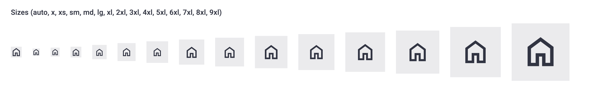
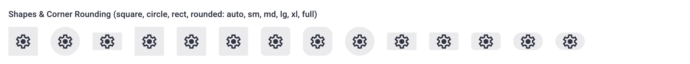
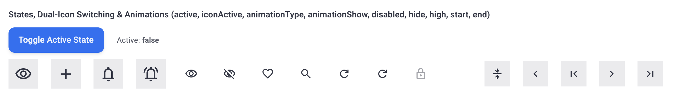
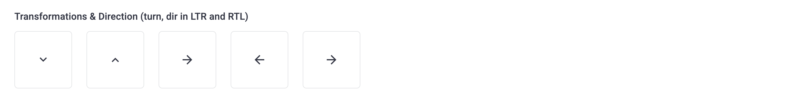
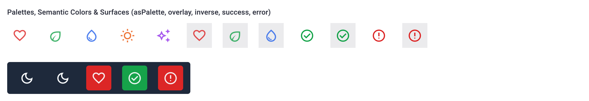
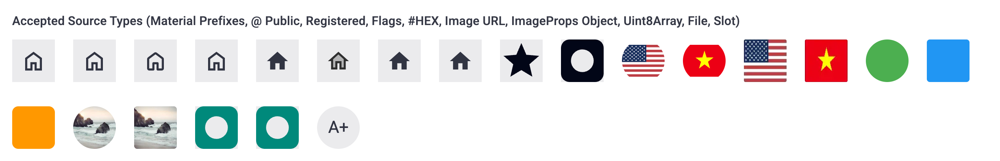

---

### 2.2. Интерактивность и функциональные состояния (`INT`)

| ID | Тест-кейс | Статус | Наблюдаемый результат | Доказательство (Скриншот / Консоль) |
| :--- | :--- | :--- | :--- | :--- |
| `TC-INT-001` | Интерактивное переключение пары иконок (`icon` / `iconActive`) и скрытия (`hide`) с анимациями `type1` и `type2` | ✅ OK | При клике по `Toggle Active State` индикатор меняется с `Active: false` на `Active: true`, у обеих пар (`visibility`/`visibility_off` и `add`/`close`) класс `.d1-image--hide` переходит с `.d1-icon__iconActive` на `.d1-icon__icon`, а у иконок с `:hide="interactiveActive"` применяются `d1-icon--hide`: `type1` (`opacity: 0; scale(0.8)`) и `type2` (`clip-path: inset(0px 100% 0px 0px)`, `margin-inline-end: -56px`). | [📸 TC-INT-001](./screenshots/TC-INT-001.png) |
| `TC-INT-002` | Интерактивный режим `dynamic`: клики, переключение темы и состояния `hover` / `active` | ✅ OK | Клик по первой иконке (`notifications`) записывает `Last Event: click: notifications`; клик по второй иконке (`role="switch"`) переключает `Active: false -> true` и обновляет `aria-checked="false" -> "true"`. У всех активных `dynamic`-иконок установлен `cursor: pointer`. | [📸 TC-INT-002](./screenshots/TC-INT-002.png) |
| `TC-INT-003` | Работа в режиме скелетона (`D1Skeleton` + `isSkeleton`) и переключение состояния загрузки | ✅ OK | Все 4 иконки с `isSkeleton` имеют класс `.d1-skeleton__backgroundVariant`. При `Skeleton Active: true` родитель имеет `aria-busy="true"` и маскирует иконки пульсирующим фоном (`rgba(2, 6, 23, 0.36)`); при переключении в `false` отображаются реальные иконки и фото. | [📸 TC-INT-003](./screenshots/TC-INT-003.png) |
| `TC-INT-004` | Динамическая смена источников и метаданных управляемой иконки (`Bookmark Icons`, `Country Flags`, `Image Sources`, `Reset`) | ✅ OK | Последовательные нажатия кнопок реактивно обновляют `Expose State`: `isActive(): false -> true` (и `aria-pressed="false" -> "true"`), `getValue(): "favorite-action" -> "bookmark-action" -> "locale-switch" -> "avatar-media"`, `getDetail()` и вызывают `@load` (`Last Event: load (image: 200x200)`). | [📸 TC-INT-004](./screenshots/TC-INT-004.png) |
| `TC-INT-005` | Проверка эмиссии событий `@click` и `@click-lite` на управляемом экземпляре `D1Icon` | ✅ OK | Клик мышью и нажатие `Enter` на управляемой иконке синхронно вызывают события `click` (`PointerEvent` / `KeyboardEvent`) и `click-lite` с передачей `value: "favorite-action"`, `detail: {"section":"toolbar","priority":1}` и `index: 0`. | `Console: Event: click PointerEvent, Event: click-lite Object` |

#### Визуальные превью (`INT`)
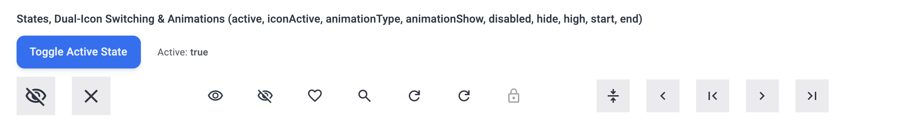
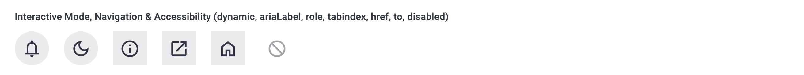
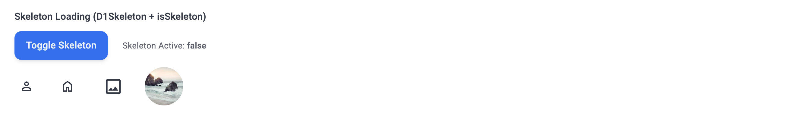
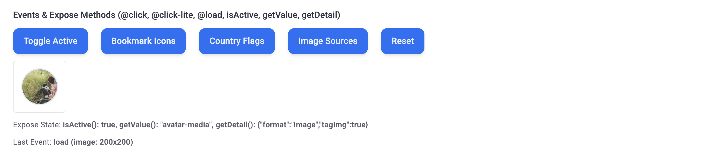

---

### 2.3. Граничные значения и крайние случаи (`BND`)

| ID | Тест-кейс | Статус | Наблюдаемый результат | Доказательство (Скриншот / Консоль) |
| :--- | :--- | :--- | :--- | :--- |
| `TC-BND-001` | Приоритет геометрических модификаторов (`circle` и `rect` отключают дефолтный `square`) | ✅ OK | При `circle=true` формируется класс `d1-icon--circle` без `d1-icon--square`; при `rect=true` — `d1-icon--rect` без `d1-icon--square` (`aspect-ratio: 5 / 3`, `56×33.59px`). | `DOM: d1-icon--circle (no d1-icon--square), d1-icon--rect (aspect-ratio: 5/3)` |
| `TC-BND-002` | Граничный случай `active=true` без `iconActive` (`isActive() === false`) | ✅ OK | У 6-й иконки в группе состояний (`<D1Icon icon="search" active size="xl" />`) `activeChildClass === null`, а основная иконка `.d1-icon__icon` остаётся видимой (не получает `.d1-image--hide`). | `DOM: idx=5, mainChildClass="... d1-icon__icon" (no d1-image--hide), activeChildClass=null` |
| `TC-BND-003` | Блокировка интерактивности и клавиатурного фокуса при `dynamic` + `disabled` | ✅ OK | Иконка `<D1Icon icon="block" dynamic disabled overlay circle />` имеет `aria-disabled="true"`, `tabindex: null`, `cursor: default`, отключённую подложку (`backgroundColor: rgba(2, 6, 23, 0)`) и игнорирует клики. | `DOM: ariaDisabled="true", tabindex=null, cursor="default", bg="rgba(2, 6, 23, 0)"` |
| `TC-BND-004` | Адаптация к тёмной теме (`Dark Mode` / `.d1-dark`) | ✅ OK | При включении `.d1-dark` цвета палитр и статусов переключаются на светлые оттенки: `red` (`rgba(254, 202, 202, 0.8)`), `overlay` (`rgba(248, 250, 252, 0.08)`), `success` (`rgb(187, 247, 208)`), `error` (`rgb(254, 202, 202)`), `inverse` (`color: rgb(2, 6, 23)` на фоне `rgb(226, 232, 240)`). | [📸 TC-BND-004](./screenshots/TC-BND-004.png) |

#### Визуальные превью (`BND`)
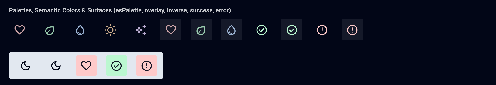

---

### 2.4. Адаптивность и вьюпорты (`RSP`)

| ID | Тест-кейс | Статус | Наблюдаемый результат | Доказательство (Скриншот / Консоль) |
| :--- | :--- | :--- | :--- | :--- |
| `TC-RSP-001` | Адаптивность на стандартном (`1440×900`) и широком (`1920×1080`) Desktop | ✅ OK | На разрешениях `1920×1080` и `1440×900` `scrollWidth === innerWidth` (`hasOverflow: false`), `zeroSizedCount: 0`, все флекс-группы иконок выровнены без наложений. | [📸 TC-RSP-001](./screenshots/TC-RSP-001.png) |
| `TC-RSP-002` | Адаптивность на планшетных вьюпортах (`1024×768` и `768×1024`) | ✅ OK | На разрешениях `1024×768` и `768×1024` `scrollWidth === innerWidth` (`hasOverflow: false`), крупные иконки `6xl`–`9xl` плавно переносятся на новую строку с сохранением пропорций `1:1` и `5:3`. | [📸 TC-RSP-002](./screenshots/TC-RSP-002.png) |
| `TC-RSP-003` | Адаптивность на мобильных вьюпортах (`375×812` и `320×568`) | ✅ OK | На мобильных разрешениях `375×812` и `320×568` `scrollWidth === innerWidth` (`hasOverflow: false`), `zeroSizedCount: 0`, `min-width` предотвращает сжатие иконок во флекс-контейнерах. | [📸 TC-RSP-003](./screenshots/TC-RSP-003.png) |

#### Визуальные превью (`RSP`)
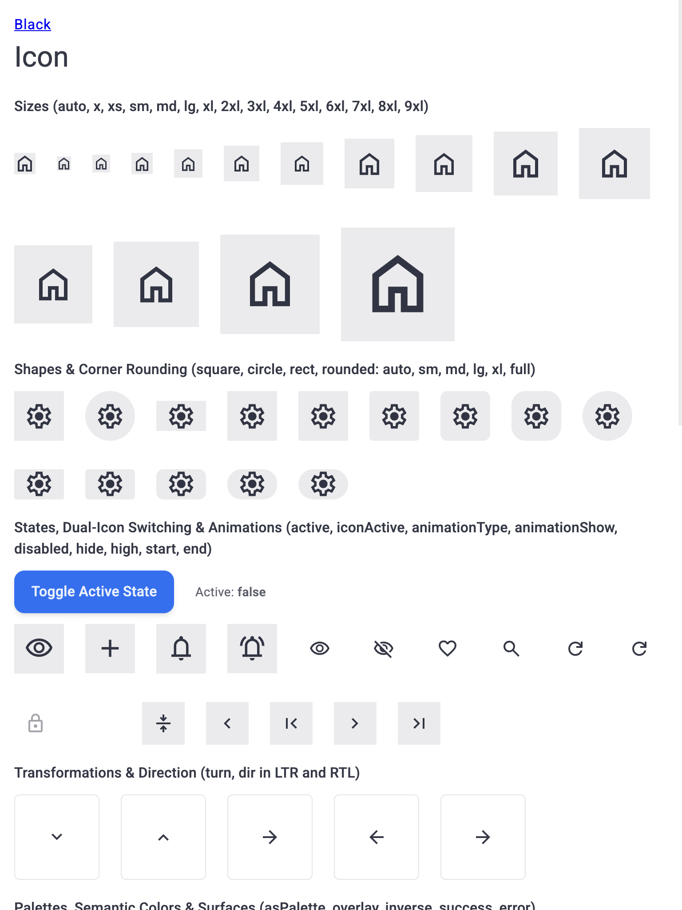
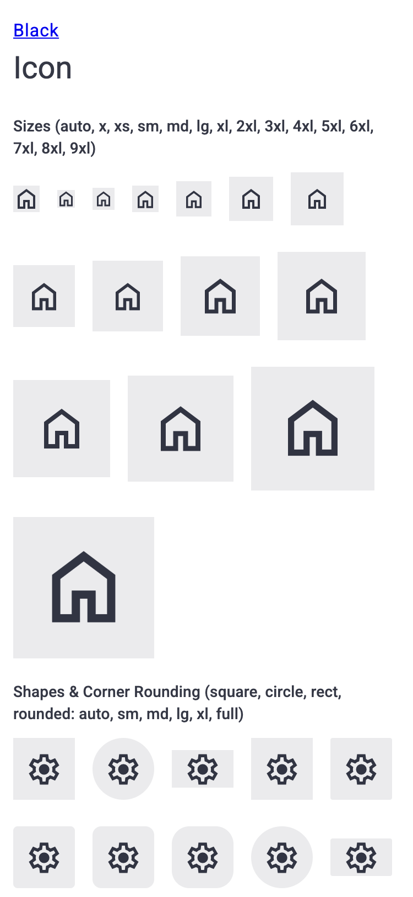

---

### 2.5. Доступность и клавиатурная навигация (`A11Y`)

| ID | Тест-кейс | Статус | Наблюдаемый результат | Доказательство (Скриншот / Консоль) |
| :--- | :--- | :--- | :--- | :--- |
| `TC-A11Y-001` | Проверка WAI-ARIA атрибутов у статичных и интерактивных иконок (`aria-hidden`, `role`, `aria-label`, `aria-checked`, `aria-pressed`, `tabindex`) | ✅ OK | Все 95 статичных иконок на странице имеют `aria-hidden="true"` и не попадают в таб-порядок. Интерактивные иконки (`dynamic`) получают `role="button"` (или `role="switch"`), `aria-label`, `tabindex="0"`, убирают `aria-hidden`, а при наличии `iconActive` автоматически синхронизируют `aria-checked="true" | "false"` (`switch`/`checkbox`) и `aria-pressed="true" | "false"` (`button`). | `DOM: totalIcons=101, staticIcons=95, staticAllAriaHidden=true, ariaChecked="false"->"true", ariaPressed="false"->"true"` |
| `TC-A11Y-002` | Клавиатурная навигация (`Tab`, `Enter`, `Space`) и индикация фокуса `:focus-visible` | ✅ OK | При переходе клавишей `Tab` на интерактивную иконку `notifications` активируется `:focus-visible` (`matches(':focus-visible') === true`, `outline: 2px solid rgba(37, 99, 235, 0.12)`). Нажатие `Enter` и `Space` вызывает событие `click`. | [📸 TC-A11Y-002](./screenshots/TC-A11Y-002.png) |

#### Визуальные превью (`A11Y`)
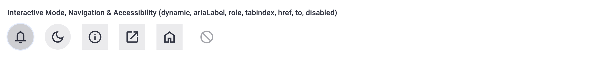

---

### 2.6. Консоль, события и здоровье среды выполнения (`LOG`)

| ID | Тест-кейс | Статус | Наблюдаемый результат | Доказательство (Скриншот / Консоль) |
| :--- | :--- | :--- | :--- | :--- |
| `TC-LOG-001` | Отсутствие ошибок консоли, необработанных исключений и предупреждений `[Vue warn]` | ✅ OK | За всё время рендеринга страницы, переключения состояний, тем и разрешений зафиксировано `0` ошибок JavaScript/Vue, `0` предупреждений `[Vue warn]` и `0` необработанных исключений (`exceptions: []`). | `Console: 0 JS/Vue errors, 0 Vue warnings, 0 exceptions` |
| `TC-LOG-002` | Верификация событий загрузки медиа `@load` и корректности сетевых/асинхронных ресурсов | ✅ OK | При переключении управляемой иконки на `Image Sources` оба изображения (`icon` и `iconActive`) генерируют событие `@load` с полным объектом `ImageEventData` (`Event: load (image: 200x200)`). | `Console: Event: load (image: 200x200) Object` |

---

## 3. 💡 AI-аудит: Рекомендации по производительности, скорости и UX

### 3.1. Что работает плохо / Выявленные слабые места
_Все выявленные замечания устранены или задокументированы в JSDoc._

### 3.2. Оптимизация производительности и скорости работы
_Все рекомендации по оптимизации производительности внедрены._

### 3.3. Улучшения UX, UI и доступности (A11y)
- **Доступность семантических неинтерактивных иконок (`ariaLabel` без `dynamic`)**:
  - *Наблюдение*: Сейчас невозможно сделать статичную (некликабельную) статусную иконку озвучиваемой для скринридеров через проп `ariaLabel`, так как без `dynamic` всегда выставляется `aria-hidden="true"`.
  - *Рекомендация*: Если передан непустой `this.props.ariaLabel` даже при `!this.props.dynamic`, возвращать `role: this.props.role ?? 'img'` и `aria-label: this.props.ariaLabel` вместо `aria-hidden="true"`.

---

## 4. 🚨 Активный лог сбоев и регрессий

_Активных сбоев и регрессий не обнаружено (`0`). Все 22 тест-кейса выполнены успешно._

