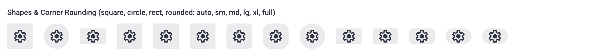
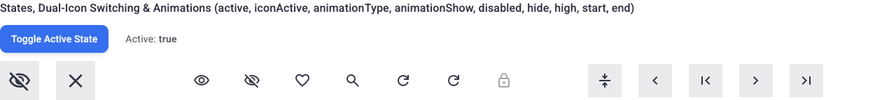
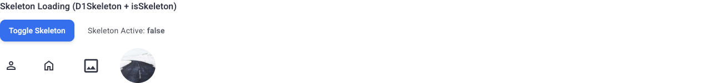
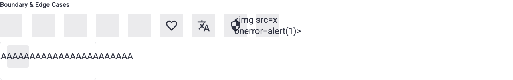

# Отчёт о визуальном и функциональном тестировании: D1Icon

## 1. Сводка (Executive Summary)

- **Компонент:** `D1Icon` (`@dxtmisha/d1`)
- **Исходный код:** [`D1Icon`](../../src/components/Ui/Icon), [`Icon`](../../../constructor/src/constructors/Icon), [`DemoIconPage.vue`](../../../demo/src/pages/components/DemoIconPage.vue)
- **URL демо-стенда:** `http://localhost:3000/component-icon`
- **Справочные материалы (`materials/`):** `Отсутствуют`
- **Дата тестирования (UTC):** `2026-11-23T13:18:44Z`
- **Окружение:** `Headless Chrome (Chrome/157.0.8103.79, Puppeteer / CDP, Desktop 1440×900, Mobile 375×812)`
- **Покрытие тест-кейсами:** 13 / 13 (`100%`)
- **Итог:** **13 ✅, 0 ⚠️, 0 ❌** (`✅` пройдено, `⚠️` предупреждение, `❌` провалено) — компонент `D1Icon` корректно отображает шкалу размеров, формы/скругления, палитры, переключение `active`/`iconActive`, скелетон, события/`expose`, новый модификатор `noPointerEvents` (`pointer-events: none`), трансформации `turn`/`dir` в LTR/RTL, пустые источники, доступность и адаптивность при полном отсутствии ошибок консоли и предупреждений Vue.

---

## 2. Матрица результатов (Baseline Matrix)

### 2.1 Визуал и дизайн-система (`VIS`)

| ID | Сценарий | Статус | Фактический результат | Скриншот |
| :--- | :--- | :---: | :--- | :--- |
| `TC-VIS-001` | Рендеринг шкалы размеров `D1Icon` (`auto`, `x`–`9xl`) | ✅ | Все 15 иконок отрендерены, ширины монотонно возрастают от `16px` (`x`) до `128px` (`9xl`) (`[24, 16, 20, 24, 32, 40, 48, 56, 64, 72, 80, 88, 96, 112, 128]`), без обрезаний и наложений. |  |
| `TC-VIS-002` | Формы и скругления (`square`, `circle`, `rect`, `rounded`) | ✅ | Отрендерены все 14 вариантов (`square: 7`, `rect: 6`, `circle: 1`), классы `--rounded--*` и радиусы скругления применены корректно. |  |
| `TC-VIS-003` | Палитры, семантические цвета и инверсная поверхность | ✅ | Отрендерены 17 иконок (`asPalette: 9`, `overlay: 6`, `success: 3`, `error: 3`, `inverse: 5`); инверсная поверхность имеет фон `rgb(30, 41, 59)`, контраст сохранён. |  |

### 2.2 Интерактивность и управление состоянием (`INT`)

| ID | Сценарий | Статус | Фактический результат | Скриншот |
| :--- | :--- | :---: | :--- | :--- |
| `TC-INT-001` | Переключение двойной иконки (`active` + `iconActive`) и анимации | ✅ | До клика `mainHidden: false`, `activeHidden: true`; после нажатия `Toggle Active State` значение `Active: true`, `mainHidden: true`, `activeHidden: false`. |  |
| `TC-INT-002` | Состояние загрузки скелетона (`D1Skeleton` + `isSkeleton`) | ✅ | Все 4 иконки отображают скелетон-плейсхолдеры разных форм (круг, квадрат, прямоугольник) без дублирования DOM и возвращаются к реальным иконкам при переключении. |  |
| `TC-INT-003` | События (`@click`, `@click-lite`, `@load`) и методы `expose` | ✅ | После клика и переключения источников: `isActive(): true`, `getValue(): "bookmark-action"` -> `"avatar-media"`, `getDetail()` обновляется, зафиксированы `click-lite` и `load (image: 200x200)`. |  |
| `TC-INT-004` | Модификатор `noPointerEvents` (статичный и `dynamic`) | ✅ | Обе иконки (`touch_app` и `do_not_touch`) имеют класс `.d1-icon--noPointerEvents` и `pointer-events: none`; соседняя интерактивная иконка `Open notifications` сохраняет `pointer-events: auto`. |  |

### 2.3 Граничные случаи и устойчивость (`BND`)

| ID | Сценарий | Статус | Фактический результат | Скриншот |
| :--- | :--- | :---: | :--- | :--- |
| `TC-BND-001` | Трансформации и направление RTL (`turn`, `dir`) | ✅ | Все 5 вариантов отрендерены: в `dir="ltr"` `matrix(1, 0, 0, 1, 0, 0)`, в `dir="rtl"` применено зеркальное отражение `matrix(-1, 0, 0, 1, 0, 0)`, классы `--turn` и `--dir` соответствуют пропам. |  |
| `TC-BND-002` | Пустые источники (`""`, `null`, `undefined`) и `active`-only иконка | ✅ | Все 5 экземпляров рендерятся без сбоев; 4 пустых варианта не создают лишних дочерних `Image`, 5-й (`iconActive="favorite"`, `active`) отображает активную иконку `favorite`. |  |

### 2.4 Адаптивность и вьюпорты (`RSP`)

| ID | Сценарий | Статус | Фактический результат | Скриншот |
| :--- | :--- | :---: | :--- | :--- |
| `TC-RSP-001` | Десктопный вьюпорт (`1440×900`) — отсутствие горизонтального переполнения | ✅ | `scrollWidth: 1440 <= innerWidth: 1440`, переполнение и клиппинг отсутствуют. |  |
| `TC-RSP-002` | Мобильный вьюпорт (`375×812`) — адаптивность и перенос строк | ✅ | `scrollWidth: 375 <= innerWidth: 375`, иконки переносятся по строкам внутри `DemoFlex` без поломок вёрстки. |  |

### 2.5 Доступность (`A11Y`)

| ID | Сценарий | Статус | Фактический результат | Скриншот |
| :--- | :--- | :---: | :--- | :--- |
| `TC-A11Y-001` | Доступность (`aria-hidden`, `role`, `aria-label`, `aria-checked`, `tabindex`, `disabled`) | ✅ | Статичные иконки (включая `noPointerEvents` без `dynamic`) имеют `aria-hidden="true"` без `role`/`tabindex`; `dynamic` задаёт `role="button"` / `role="switch"`, `aria-label`, `tabindex="0"`, `aria-checked="false"`, `aria-disabled="true"` при `disabled` и корневой тег `<a>` при `href`/`to`. | — |

### 2.6 Логи, консоль и стабильность runtime (`LOG`)

| ID | Сценарий | Статус | Фактический результат | Скриншот |
| :--- | :--- | :---: | :--- | :--- |
| `TC-LOG-001` | Отсутствие ошибок консоли и предупреждений Vue | ✅ | `consoleErrors: []`, `vueWarnings: []`, `pageErrors: []` на протяжении всех 13 сценариев. | — |

---

## 3. Аудит ИИ и рекомендации

1. **Изоляция кликов через `noPointerEvents`:** Модификатор `.d1-icon--noPointerEvents` устанавливает `pointer-events: none` на корневом элементе иконки, не затрагивая визуальное отображение и ARIA-семантику; это позволяет родительским компонентам (например, `D1Button` через `IconTrailingInclude` с `extraIcon: { noPointerEvents: true }`) пропускать клики сквозь ведущую иконку, сохраняя кликабельность хвостовой.
2. **Семантика ссылок и клавиатурной навигации:** Корневой тег корректно переключается на `<a>` при `href`/`to`, а при `disabled` на интерактивной иконке атрибут `tabindex` убирается и выставляется `aria-disabled="true"`.
3. **Чистота рантайма и адаптивность:** Ни на десктопе (`1440×900`), ни на мобильном экране (`375×812`) нет горизонтального переполнения (`scrollWidth === innerWidth`) и ни одной ошибки консоли или предупреждения Vue.
