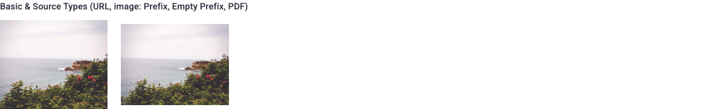
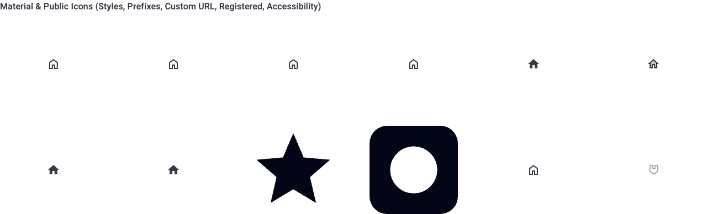
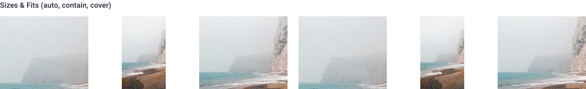
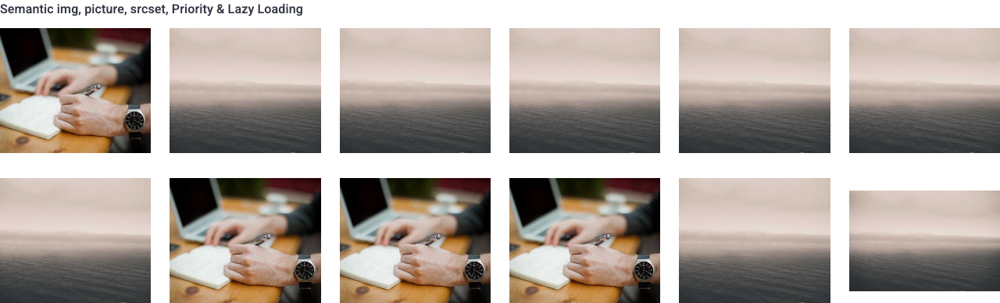
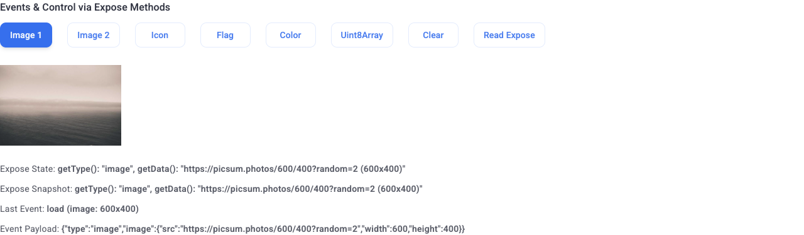
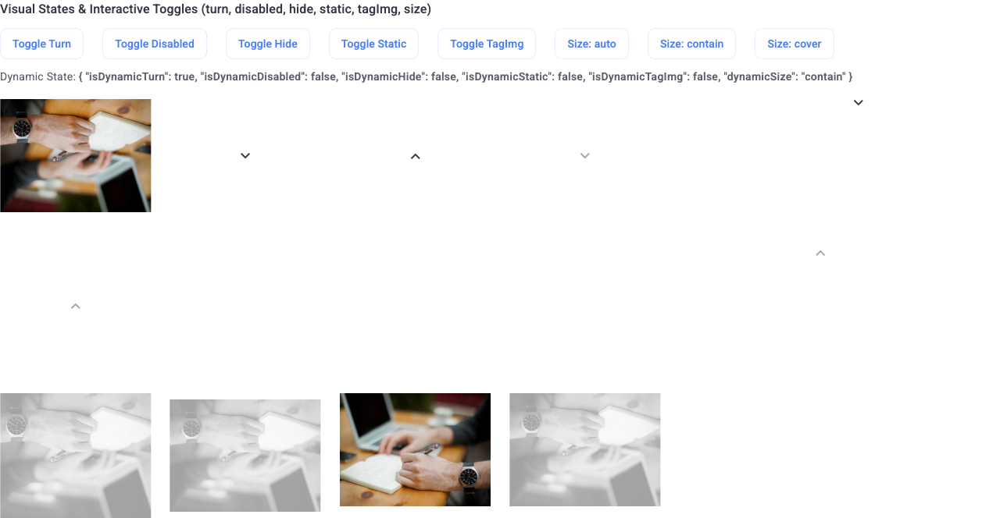
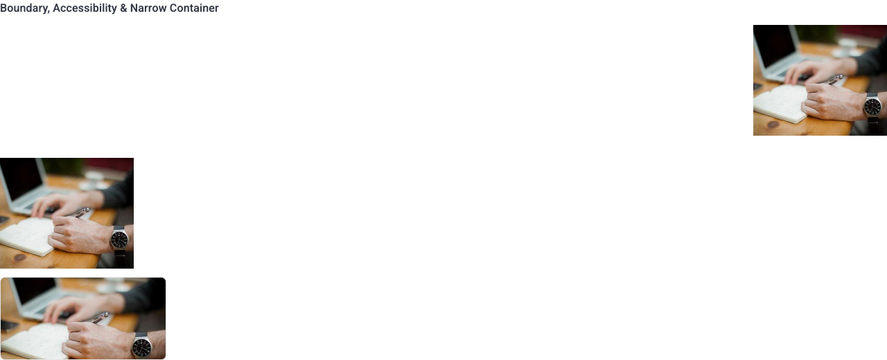
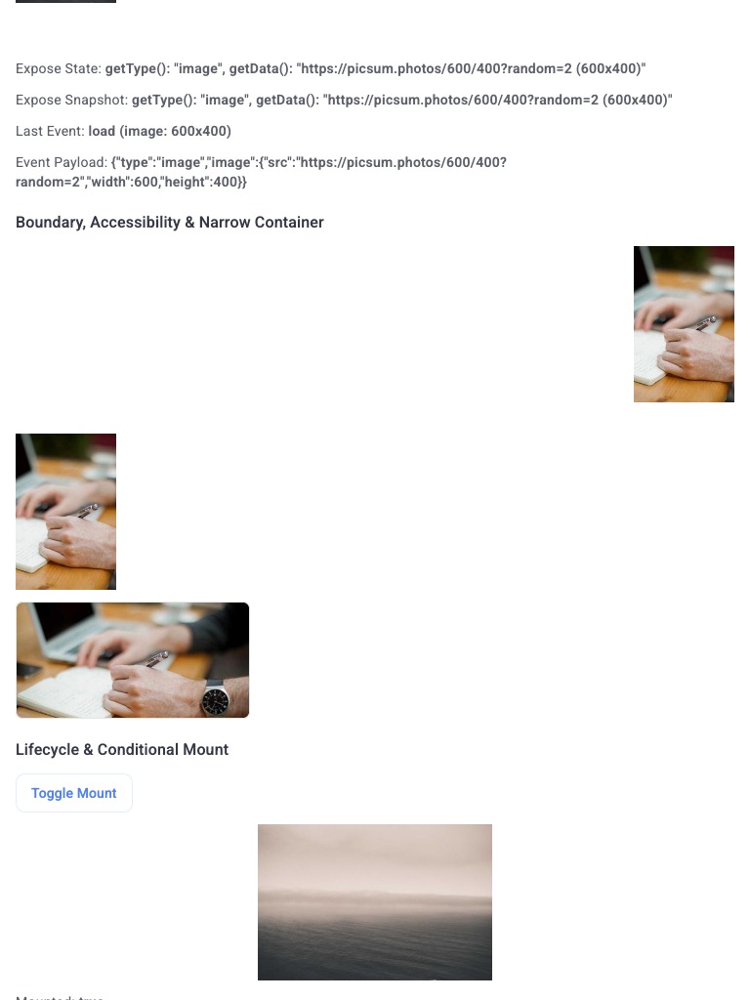
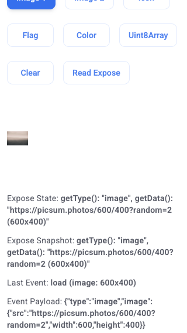

# Отчёт о визуальном и функциональном тестировании: D1Image

## 1. Сводка тестирования

- **Компонент:** `D1Image` (`@dxtmisha/d1`)
- **Исходный код:** [`D1Image`](../../src/components/Ui/Image) ([`Image`](../../../constructor/src/constructors/Image), [`DemoImagePage.vue`](../../../demo/src/pages/components/DemoImagePage.vue))
- **Демо / целевой URL:** `http://localhost:3000/component-image`
- **Материалы:** `Нет`
- **Дата тестирования (UTC):** `2026-11-25T06:23:56Z`
- **Окружение:** `Headless Chrome (Puppeteer / CDP, Desktop 1440x900, Tablet 768x1024, Mobile 375x812 / 320x568)`
- **Покрытие тест-кейсов:** 15 / 15 (`100%`)
- **Итог:** **15 ✅, 0 ⚠️, 0 ❌** (`✅` пройдено, `⚠️` предупреждение, `❌` провалено) — `D1Image` успешно проходит SSR (`200`) и все 15 проверок для разных типов источников (URL, `data:` PDF, бинарные файлы, иконки, флаги, HEX), `<picture>`/`srcset`, `expose`-методов, `adaptive`-групп, `v-if`-очистки и узкого контейнера (`238 === 238`); после замены внешнего PDF URL на встроенный `data:` URI сетевые ошибки полностью устранены (`networkErrors: []`).

---

## 2. Базовая матрица

### 2.1 Визуальный рендеринг (`VIS`)

| ID | Сценарий | Статус | Фактический результат | Скриншот |
| :--- | :--- | :---: | :--- | :--- |
| `TC-VIS-001` | Рендеринг базовых источников (URL, `image:`, PDF, Binary `Uint8Array`/`ArrayBuffer`/`File`) | ✅ | Фоновые изображения, `<object>` для PDF (переведён на встроенный `data:` URI) и бинарные источники (`Uint8Array`, `ArrayBuffer`, `File`) отрисованы корректно без сетевых ошибок (`networkErrors: []`). |  |
| `TC-VIS-002` | Рендеринг иконок Material, публичных иконок, флагов и HEX-цветов | ✅ | Шрифтовые классы иконок, масочные `@public`-иконки, сжатые флаги и цветовые блоки `#HEX` отображаются с корректными стилями. |  |
| `TC-VIS-003` | Режимы размера (`size`), позиционирование (`x`, `y`, `coordinator`) и визуальные состояния (`turn`, `disabled`, `hide`, `static`) | ✅ | Модификаторы размеров, позиционирования и состояний (`turn`, `disabled`, `hide`, `static`) применяются в соответствии с токенами D1 без перекрытий. |  |
| `TC-VIS-004` | Семантические теги `` (`tagImg`), `<picture>` и `srcset` | ✅ | Теги ``, `<picture>` и `<source>` с медиа-запросами, `srcset`, `decoding`, `fetchpriority` и `loading="lazy"` сформированы и загружены корректно. |  |

### 2.2 Интерактивность и управление состоянием (`INT`)

| ID | Сценарий | Статус | Фактический результат | Скриншот |
| :--- | :--- | :---: | :--- | :--- |
| `TC-INT-001` | Реактивное переключение источников, проверка `expose` и события `@load` | ✅ | После переключения источников `getType(): "image"`, `getData(): "https://picsum.photos/600/400?random=2 (600x400)"`, `Last Event: load (image: 600x400)` и JSON payload обновляются синхронно. |  |
| `TC-INT-002` | Адаптивное масштабирование групп изображений (`adaptive`, `adaptiveGroup`, `adaptiveAlways`) | ✅ | Группы `adaptive` и `adaptiveGroup` вычисляют согласованные размеры изображений без `NaN` и нулевых значений. | — |
| `TC-INT-003` | Интерактивные переключатели состояний (`turn`, `disabled`, `hide`, `static`, `tagImg`, `size`) | ✅ | Кнопки управления динамически переключают классы `.d1-image--turn`, `--disabled`, `--hide`, `--static`, `--size--*` и тег ``/`` на `[data-testid="demo-image-dynamic"]`. |  |
| `TC-INT-004` | Условное монтирование и очистка observers (`v-if`) | ✅ | Размонтирование `[data-testid="demo-image-lifecycle"]` с `lazy` и `adaptive` и последующее повторное монтирование проходят чисто (`beforeLen: 54`, `remountedLen: 54`, `consoleErrors: []`). | — |

### 2.3 Граничные случаи и крайние сценарии (`BND`)

| ID | Сценарий | Статус | Фактический результат | Скриншот |
| :--- | :--- | :---: | :--- | :--- |
| `TC-BND-001` | Пустые, пробельные и nullish источники (без `value`, `""`, `"   "`, `null`, `undefined`, `"image:   "`) | ✅ | Все пустые, пробельные и nullish варианты не вызывают ошибок рендера и не порождают битых изображений. | — |
| `TC-BND-002` | Нулевые координаты (`x: 0, y: 0`) и `coordinator: null` | ✅ | Нулевые координаты `x: 0`, `y: 0` не теряются при проверке falsy-значений и корректно применяются к позиционированию. | — |
| `TC-BND-003` | Unicode/эмодзи, XSS-строка в `alt` и узкий контейнер (`max-width: 240px`) | ✅ | XSS-строка в `alt` не создаёт инъекций (`badImgs: 0`); контейнер `.demo-image-page__narrow` не выходит за границы (`scrollWidth: 238 === clientWidth: 238`, `overflowsBox: false`, `overflowChildren: []`). |  |

### 2.4 Адаптивность (`RSP`)

| ID | Сценарий | Статус | Фактический результат | Скриншот |
| :--- | :--- | :---: | :--- | :--- |
| `TC-RSP-001` | Адаптивность на планшете (`768×1024`) | ✅ | На десктопе (`1440/1440`) и планшете (`768/768`) горизонтальное переполнение отсутствует (`overflowX: false`, `offenders: []`), `<picture>` корректно адаптируется. |  |
| `TC-RSP-002` | Адаптивность на мобильном устройстве (`375×812` и `320×568`) | ✅ | На `375×812` (`375/375`) и `320×568` (`320/320`) горизонтальный скролл отсутствует (`overflowX: false`, `offenders: []`). |  |

### 2.5 Доступность (`A11Y`)

| ID | Сценарий | Статус | Фактический результат | Скриншот |
| :--- | :--- | :---: | :--- | :--- |
| `TC-A11Y-001` | Проверка WAI-ARIA атрибутов (`role`, `aria-label`, `aria-hidden`, `translate`) | ✅ | Элементы с `alt` получают `role="img"` и `aria-label` (или `alt` на ``), декоративные элементы — `aria-hidden="true"`, на элементах присутствует `translate="no"`. | — |

### 2.6 Логи и консоль (`LOG`)

| ID | Сценарий | Статус | Фактический результат | Скриншот |
| :--- | :--- | :---: | :--- | :--- |
| `TC-LOG-001` | Отсутствие ошибок в консоли и предупреждений Vue | ✅ | SSR-ответ `status: 200` (`hasComponent: true`), после устранения внешнего ORB-блокированного PDF-запроса зафиксированы `consoleErrors: []`, `vueWarnings: []`, `pageErrors: []`, `networkErrors: []`, `dialogs: []`. | — |

---

## 3. AI-аудит и рекомендации

1. **Устранение внешней сетевой блокировки ORB в демо-стенде:** В первичном прогоне внешний PDF-источник (`https://ontheline.trincoll.edu/.../sample-local-pdf.pdf`) блокировался политикой браузера (`net::ERR_ABORTED`, `net::ERR_BLOCKED_BY_ORB`); после замены на встроенный `data:` URI повторный прогон подтвердил полную чистоту сети (`networkErrors: []`). Рекомендуется и далее использовать локальные/inline-ресурсы в автотестах и демо для детерминизма.
2. **Адаптивность и защита от переполнения на всех вьюпортах:** На всех проверенных разрешениях (`1440`, `768`, `375`, `320`) и в узком контейнере `.demo-image-page__narrow` (`scrollWidth: 238 === clientWidth: 238`, `overflowsBox: false`) зафиксировано `overflowX: false` и `offenders: []`.
3. **Ленивая архитектура и безопасность атрибутов:** Создание подсистем (`ImageImg`, `ImageBackground`, `ImageText`, `ImageLazy`, `ImageAdaptiveItem`) по требованию обеспечивает лёгкий SSR-рендер (`status: 200`) и корректную очистку наблюдателей при `v-if`, а передача потенциально небезопасной строки в `alt` не приводит к инъекциям (`badImgs: 0`) при нулевом уровне ошибок (`consoleErrors: []`, `vueWarnings: []`, `pageErrors: []`).
