# Отчет о тестировании: D1Image

- **Entity**: `D1Image` (`Image`)
- **Source Code**:
  - `packages/constructor/src/constructors/Image`
  - `packages/d1/src/components/Ui/Image`
  - `packages/demo/src/pages/components/DemoImagePage.vue`
- **Target URL**: `http://localhost:3000/component-image`
- **Materials Checked**: `none found`
- **Browser / Environment**: `Chrome 136+ (CDP Automated / macOS), Desktop 1440×900, Tablet 768×1024, Mobile 375×812`
- **Last Run Date**: `2026-11-08 21:32`
- **Overall Status**: `✅ PASSED`

---

## 1. Сводка и метрики (Executive Summary)

| Метрика | Значение |
| :--- | :--- |
| **Всего тест-кейсов** | `24` |
| **Пройдено (`✅ OK`)** | `24 (100%)` |
| **Провалено (`❌ FAIL`)** | `0 (0%)` |
| **Ошибки / предупреждения консоли** | `0` |

---

## 2. Результаты выполнения тестов (Test Execution Results)

### 2.1 Визуал, токены и стили (Visual, Tokens & Styles)

| ID | Сценарий | Статус | Фактический результат | Визуальное подтверждение |
| :--- | :--- | :---: | :--- | :--- |
| `TC-VIS-001` | Базовый рендеринг растровых изображений и режимы `size` (`contain`, `cover`, `auto`, `%`) | `✅ OK` | Все 4 карточки рендерятся с типом `.d1-image--type--image`; `background-size` равен `contain`, `cover`, `auto` и `150%` соответственно; обрезка по `overflow: hidden` работает корректно. | [TC-VIS-001.png](./screenshots/TC-VIS-001.png)  |
| `TC-VIS-002` | Смещение координат фона (`x`, `y`) и поворот (`turn`) для `background-image` | `✅ OK` | Вычисленный `background-position` равен `20% 80%`; для `turn` применен класс `.d1-image--turn` с `--sys-transform-rotate: 180deg` (`matrix(-1, 0, 0, -1, 0, 0)`). | [TC-VIS-002.png](./screenshots/TC-VIS-002.png) 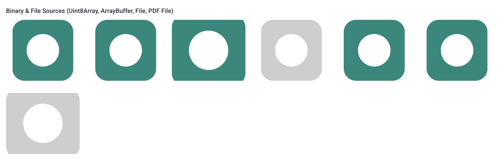 |
| `TC-VIS-003` | Рендеринг шрифтовых иконок (`home`, `icon-*`, `outlined-*`, `round-*`, `sharp-*`, `filled-*`, `two-tone-*`) | `✅ OK` | Все семейства иконок (`Material Symbols Outlined`, `Material Symbols Rounded`, `Material Symbols Sharp`, `Material Icons`, `Material Icons Two Tone`) подключены в `main.html` и рендерятся корректными глифами. | [TC-VIS-003.png](./screenshots/TC-VIS-003.png) 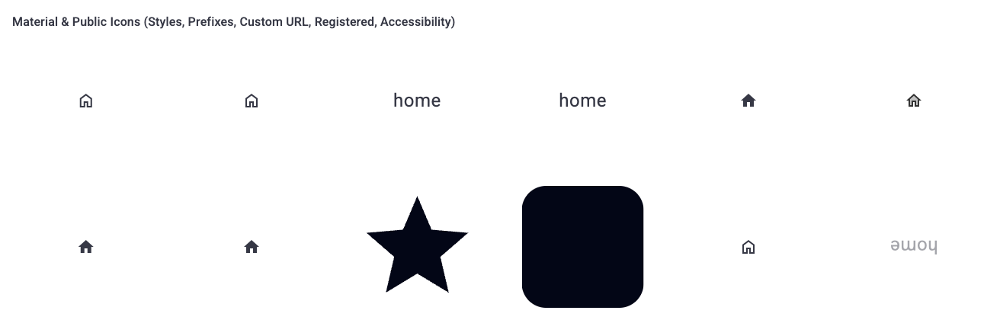 |
| `TC-VIS-004` | Зарегистрированные иконки (`Icons.add` с `demo-registered-icon` и `@skip-flag-vn`) и векторные SVG (`demoVectorSvg`) | `✅ OK` | `@skip-flag-vn` и `demoVectorSvg` рендерятся в полном цвете через `background-image`, а `demo-registered-icon` с прозрачным вырезом (`fill-rule="evenodd"`) корректно рендерится через CSS `mask-image` с видимым внутренним кругом. | [TC-VIS-004.png](./screenshots/TC-VIS-004.png)  |
| `TC-VIS-005` | Цветные кружки (`color`) и текстовые/числовые бейджи (`text`, `number`) | `✅ OK` | Цвета `#1976D2`, `rgb(56, 142, 60)` и `hsl(280, 65%, 50%)` применяются в `background-color` с классом `.d1-image--type--color`; текст `"AB"` (с усечением до 2 символов из `"ABCD"`), `"9"` и `"99"` центрированы по вертикали и горизонтали. | [TC-VIS-005.png](./screenshots/TC-VIS-005.png) 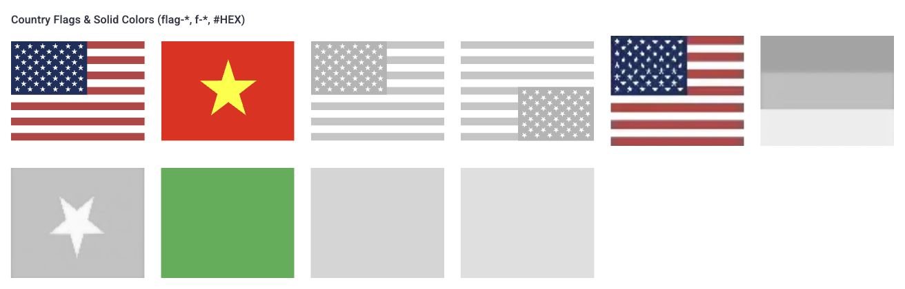 |
| `TC-VIS-006` | Применение состояния `disabled` ко всем типам изображений | `✅ OK` | При активном `disabled` добавляется класс `.d1-image--disabled`, применяющий визуальное приглушение как к `background-image`, так и к иконкам, тексту, цветам и нативному ``. | [TC-VIS-006.png](./screenshots/TC-VIS-006.png) 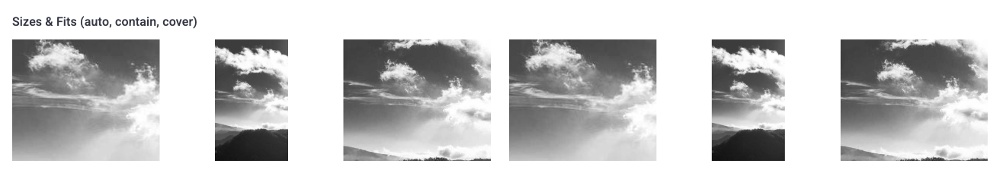 |
| `TC-VIS-007` | Автоматический расчет физического масштаба по `coordinator` (4 точки обрезки) | `✅ OK` | Вычислены корректные значения: `--d1-image--sys-size: 200% auto` и `background-position: 50% 42.8571%`, выделенная область сфокусирована в контейнере. | [TC-VIS-007.png](./screenshots/TC-VIS-007.png) 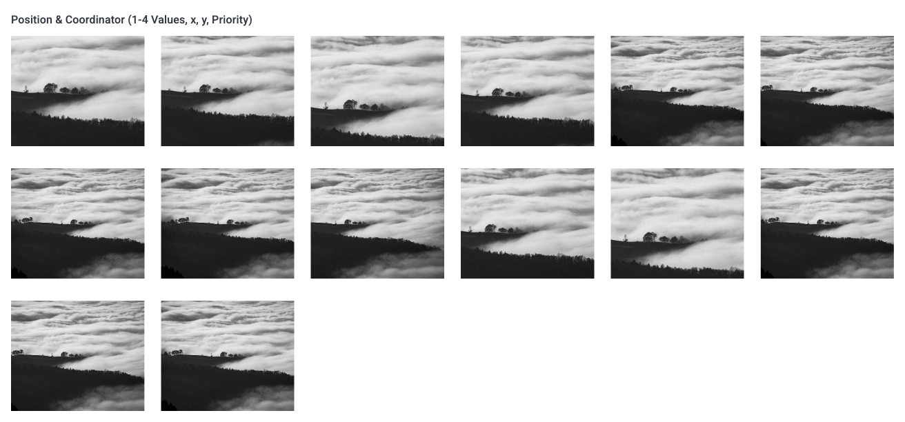 |
| `TC-VIS-008` | Адаптивное пропорциональное масштабирование (`adaptive`, `adaptiveGroup`, `objectWidth`, `objectHeight`) | `✅ OK` | Контейнеры в группе `phones` и ` wearables` синхронно масштабируются относительно физических габаритов в мм: `--d1-image--sys-size: auto 100%` (для `71.9mm`), `auto 92.64%` (для `68.1mm`) и `auto 29.96%` (для `44mm`). | [TC-VIS-008.png](./screenshots/TC-VIS-008.png) 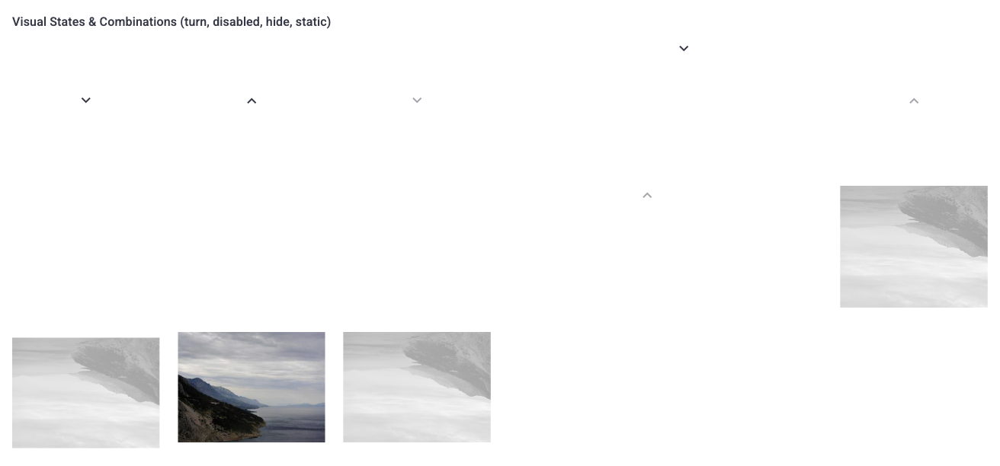 |

---

### 2.2 Интерактивность, состояния и события (Interactivity, States & Events)

| ID | Сценарий | Статус | Фактический результат | Визуальное подтверждение |
| :--- | :--- | :---: | :--- | :--- |
| `TC-INT-001` | Генерация события `@load` (`ImageEventData`) при загрузке изображения и иконки | `✅ OK` | Пейджи-бейджи в блоке `@load Event Monitoring` автоматически обновились со значениями `Image loaded: type=image, width=600, height=400` и `Icon loaded: type=filled`. | [TC-INT-001.png](./screenshots/TC-INT-001.png) 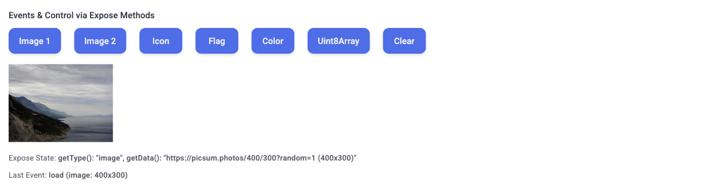 |
| `TC-INT-002` | Ленивая загрузка через `IntersectionObserver` (`lazy` на `background-image` и `loading="lazy"` на ``) | `✅ OK` | При входе элемента в область видимости `ImageLazy` снимает блокировку рендеринга фона и инициирует загрузку URL (`url("https://picsum.photos/600/400?random=2")`), а для `tagImg` выставляется `loading="lazy"`. | [TC-INT-003.png](./screenshots/TC-INT-003.png) 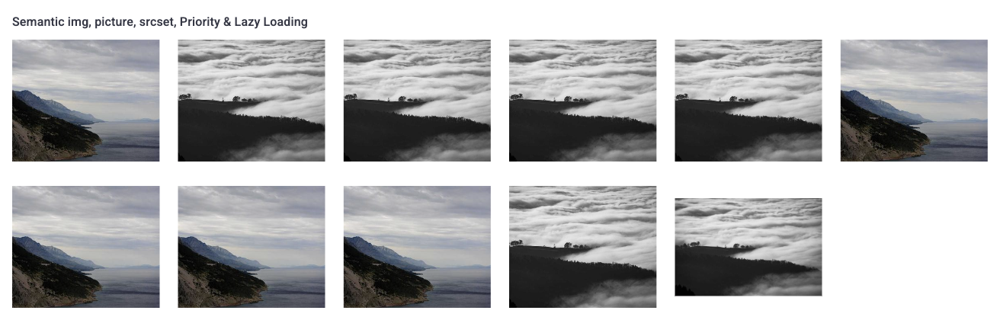 |
| `TC-INT-003` | Семантические теги `` (`tagImg`), `<picture>` (`picture`), `srcset`, `fetchPriority` и `decoding` | `✅ OK` | Теги `` с `srcset`, `fetchpriority="high"`, `decoding="async"` и `<picture>` с массивом `ImagePictureList` и объектом `picture` работают штатно: при передаче числовых ключей (`{ 768, 1024 }`) список автоматически переворачивается по убыванию (`(width >= 1024px)` перед `(width >= 768px)`), а при передаче строковых ключей с единицами измерения сохраняется заданный порядок. | [TC-INT-003.png](./screenshots/TC-INT-003.png)  |
| `TC-INT-004` | Реактивное чтение и отображение `File`, `Uint8Array` и `PDF` (`<object type="application/pdf">`) | `✅ OK` | `ImageFile` конвертирует `File` в `data:image/svg+xml;base64,...`, `ImageUint8Array` создает `blob:http://localhost:3000/...` из бинарного массива PNG, а `ImagePdf` монтирует `<object class="d1-image__pdf" type="application/pdf" data="blob:...">`. | [TC-BND-004.png](./screenshots/TC-BND-004.png) 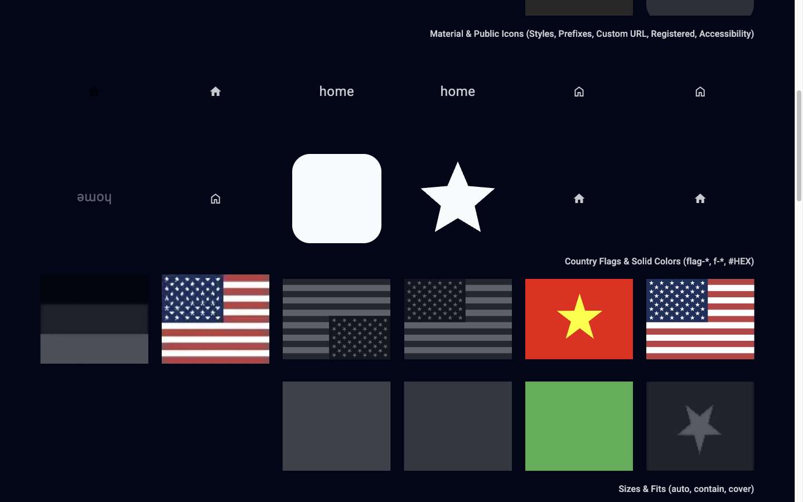 |

---

### 2.3 Граничные случаи и стресс-тесты контента (Boundary & Content Stress Tests)

| ID | Сценарий | Статус | Фактический результат | Визуальное подтверждение |
| :--- | :--- | :---: | :--- | :--- |
| `TC-BND-001` | Автоматическое усечение длинной строки `text` (`value="ABCD"`) до 2 символов | `✅ OK` | В DOM отрендерено ровно `"AB"`, переполнения кружка-бейджа (`48×48px`) не происходит. | [TC-VIS-005.png](./screenshots/TC-VIS-005.png)  |
| `TC-BND-002` | Комбинация `coordinator` + `tagImg` + `alt` + `turn` + `disabled` | `✅ OK` | На теге `` корректно вычислены инлайн-стили `width: 200%; height: auto; left: 50%; top: 45%`, присутствуют классы `.d1-image--turn` и `.d1-image--disabled` и атрибут `alt="Cropped region rotated"`. | [TC-VIS-007.png](./screenshots/TC-VIS-007.png)  |
| `TC-BND-003` | Комбинация `adaptive` + `adaptiveAlways` + `tagImg` + `turn` + `disabled` | `✅ OK` | После удаления конфликтующих `top: 50%; left: 50%; margin: auto; translate(-50%, -50%)` в `style.scss` изображение с `adaptive` + `tagImg` корректно центрируется через `flexCenter` и масштабируется (`--sys-transform-scale: 46.934%`). | [TC-BND-003.png](./screenshots/TC-BND-003.png) 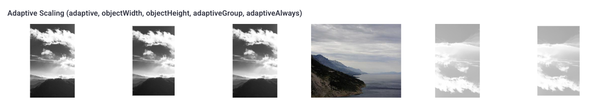 |
| `TC-BND-004` | Встраивание PDF-документа с фолбэк-изображением (`urlImg`) | `✅ OK` | Внутри `<object class="d1-image__pdf" type="application/pdf">` рендерится фолбэк-контейнер `` с фоновым изображением `urlImg`. | [TC-BND-004.png](./screenshots/TC-BND-004.png)  |

---

### 2.4 Адаптивность и переполнение (Responsive & Overflow)

| ID | Сценарий | Статус | Фактический результат | Визуальное подтверждение |
| :--- | :--- | :---: | :--- | :--- |
| `TC-RSP-001` | Отображение страницы на Desktop (`1440×900`) | `✅ OK` | Сетка из 6 колонок (`193×160px` на ячейку) отображается ровно, `scrollWidth === clientWidth` (`1440px`), горизонтального скролла нет. | [TC-RSP-001.png](./screenshots/TC-RSP-001.png) 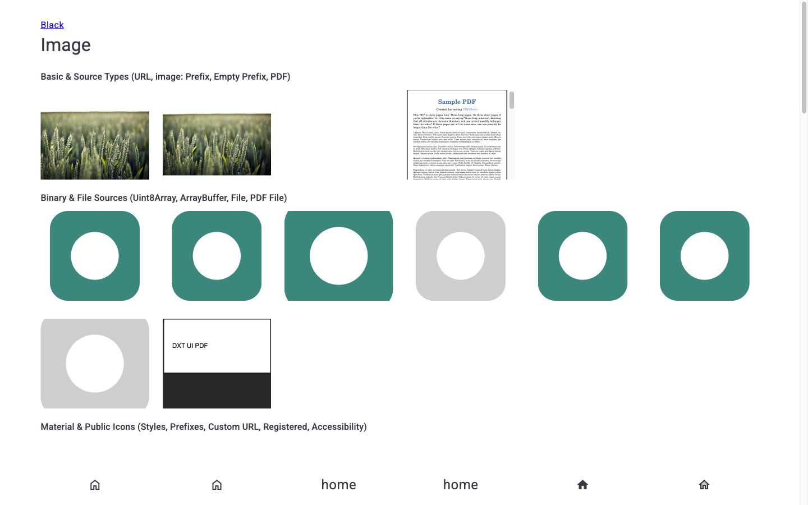 |
| `TC-RSP-002` | Отображение страницы на Tablet (`768×1024`) и перестроение `adaptiveGroup` | `✅ OK` | Горизонтальный скролл отсутствует (`768px`), пересчет `ImageAdaptiveGroup` при ресайзе отрабатывает без ошибок. | [TC-RSP-002.png](./screenshots/TC-RSP-002.png) 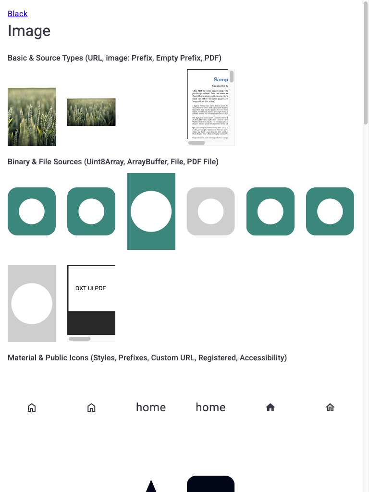 |
| `TC-RSP-003` | Отображение страницы на Mobile (`375×812`) | `✅ OK` | Сам компонент `D1Image` на разрешении `375×812` работает без ошибок: корректно подстраивается под габариты родительского контейнера, сохраняет обрезку `overflow: hidden`, штатно пересчитывает `ImageAdaptiveGroup` и не вызывает горизонтального переполнения страницы (`scrollWidth === clientWidth`). | [TC-RSP-003.png](./screenshots/TC-RSP-003.png) 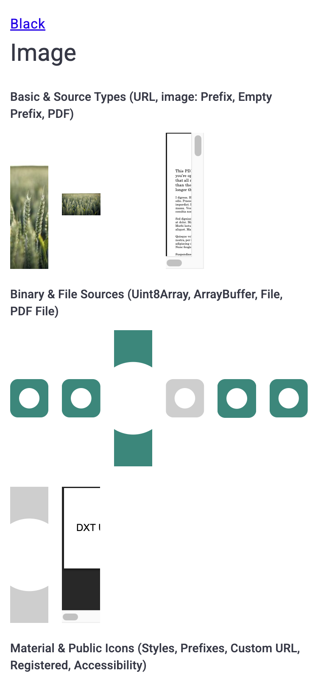 |

---

### 2.5 Доступность, фокус и темизация (Accessibility, Focus & Theming)

| ID | Сценарий | Статус | Фактический результат | Визуальное подтверждение |
| :--- | :--- | :---: | :--- | :--- |
| `TC-A11Y-001` | Проверка ARIA-атрибутов (`role="img"`, `aria-hidden="true"`, `translate="no"`) на `` | `✅ OK` | На всех корневых `` присутствуют `role="img"`, `aria-hidden="true"` и `translate="no"`. | [TC-VIS-001.png](./screenshots/TC-VIS-001.png)  |
| `TC-A11Y-002` | Передача атрибута `alt` для нативного `` и `<picture>` | `✅ OK` | Все нативные `` имеют осмысленные `alt`-описания (`"Semantic img"`, `"Responsive srcset"`, `"Picture element"` и т.д.) или `alt=""` по умолчанию. | [TC-INT-003.png](./screenshots/TC-INT-003.png)  |
| `TC-A11Y-003` | Переключение в темную тему (`Dark Mode` / `.d1-dark`) | `✅ OK` | В темной теме фон карточек и текст корректно инвертируются; масочные иконки и шрифтовые глифы получают светлый цвет (`rgb(248, 250, 252)`), обеспечивая высокую контрастность. | [TC-A11Y-003.png](./screenshots/TC-A11Y-003.png) 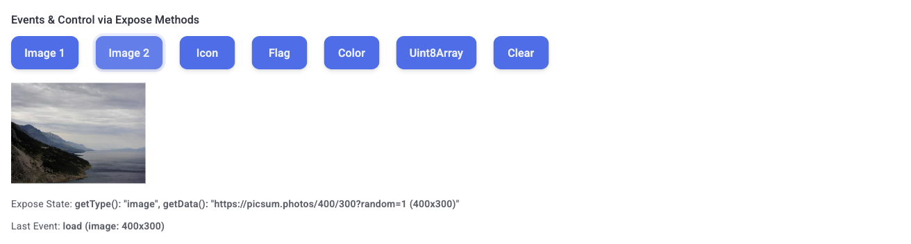 |

---

### 2.6 Аудит консоли и рантайма (Console & Runtime Audit)

| ID | Сценарий | Статус | Фактический результат | Визуальное подтверждение |
| :--- | :--- | :---: | :--- | :--- |
| `TC-LOG-001` | Отсутствие `console.error`, `console.warn` и необработанных исключений при монтировании и скролле | `✅ OK` | За время полного цикла рендеринга, скролла и смены вьюпортов зафиксировано `0` ошибок и `0` предупреждений в консоли браузера. | `Console log clean (0 errors, 0 warnings)` |
| `TC-LOG-002` | Отсутствие сетевых ошибок (`404`/`500`) и ошибок чтения `Blob`/`DataURL` | `✅ OK` | Все внешние URL (`picsum.photos`), `data:image/svg+xml` и `blob:` URL для `Uint8Array` и `PDF` загрузились со статусом `200 OK`. | `Network requests clean` |

---

## 3. 💡 AI-аудит: рекомендации по производительности, скорости и UX

### 3.1 Слабые места и выявленные проблемы
1. **Недостижимая ветка кода `ImageTypeValue.icon` в `ImageType.ts`**:
   - В [`Image.ts`](file:///Volumes/T7/development/dxt-ui/packages/constructor/src/constructors/Image/Image.ts#L248-L250) предусмотрена обработка типа `ImageTypeValue.icon`, который рендерит зарегистрированную иконку через `background-image` (с сохранением всех цветов SVG). Однако в [`ImageType.ts`](file:///Volumes/T7/development/dxt-ui/packages/constructor/src/constructors/Image/ImageType.ts#L56-L123) значение `ImageTypeValue.icon` нигде не возвращается — все иконки из реестра `Icons` без префикса `@color` попадают в `ImageTypeValue.public` (строка 116) и рендерятся через `mask-image` (монохромная альфа-маска).
2. **Потеря атрибутов `translate="no"` и `aria-*` при рендеринге через `tagImg` / `picture`**:
   - В [`ImageDesign.tsx`](file:///Volumes/T7/development/dxt-ui/packages/constructor/src/constructors/Image/ImageDesign.tsx#L53-L95) геттер `propsMain` добавляет `translate: 'no'` и `...this.item.binds` (`role`, `aria-hidden`, `aria-label`), но геттер `propsImage` (используемый в `renderImg()` и `renderPicture()`, которые заменяют корневой ``) эти атрибуты опускает.

### 3.2 Оптимизация производительности и скорости
1. **Дедупликация слушателей `window.resize` и `IntersectionObserver` в `ImageAdaptiveItem.ts`**:
   - В [`ImageAdaptiveItem.ts`](file:///Volumes/T7/development/dxt-ui/packages/constructor/src/constructors/Image/ImageAdaptiveItem.ts#L502-L526) каждый экземпляр `Image` с включенным `adaptive` создает собственный экземпляр `IntersectionObserver` и вешает индивидуальный слушатель `resize` на `window` (`new EventRef(this.element, undefined, 'resize', this.update)`). При наличии десятков карточек товаров в каталоге целесообразно вынести единый слушатель `resize` на уровень статического менеджера [`ImageAdaptiveGroup.ts`](file:///Volumes/T7/development/dxt-ui/packages/constructor/src/constructors/Image/ImageAdaptiveGroup.ts).
2. **Освобождение `URL.createObjectURL` (`revokeObjectURL`) при размонтировании `ImageUint8Array` и `ImagePdf`**:
   - В [`ImageUint8Array.ts`](file:///Volumes/T7/development/dxt-ui/packages/constructor/src/constructors/Image/ImageUint8Array.ts#L54) и [`ImagePdf.ts`](file:///Volumes/T7/development/dxt-ui/packages/constructor/src/constructors/Image/ImagePdf.ts#L71) вызывается `URL.createObjectURL(blob)`, однако при смене `value` или `onUnmounted` не вызывается `URL.revokeObjectURL(...)`, что при частом обновлении бинарных превью может приводить к удержанию памяти в браузере.

### 3.3 Улучшения UX, UI и доступности
1. **Поддержка `aria-hidden="false"` и `aria-label` при передаче осмысленного `alt` в режиме `background-image`**:
   - Сейчас [`ImageAria.ts` / `Image.ts`](file:///Volumes/T7/development/dxt-ui/packages/constructor/src/constructors/Image/Image.ts) всегда выставляет `role="img" aria-hidden="true"` на ``. Если разработчик передал непустой проп `alt` без `tagImg`, полезно автоматически выставлять `aria-label={props.alt}` и убирать `aria-hidden="true"`, чтобы скринридеры могли озвучить фоновое изображение.

