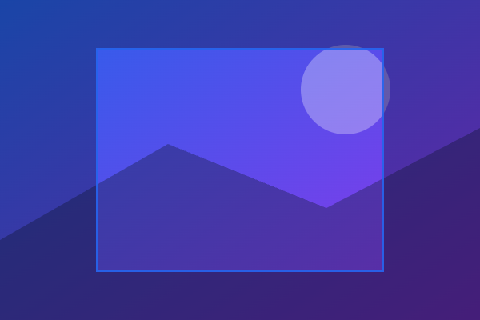
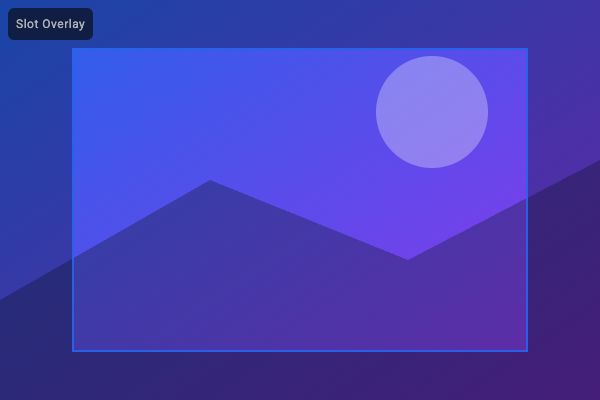
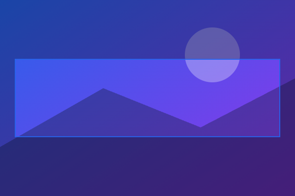
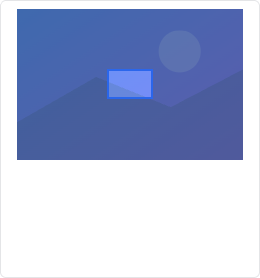
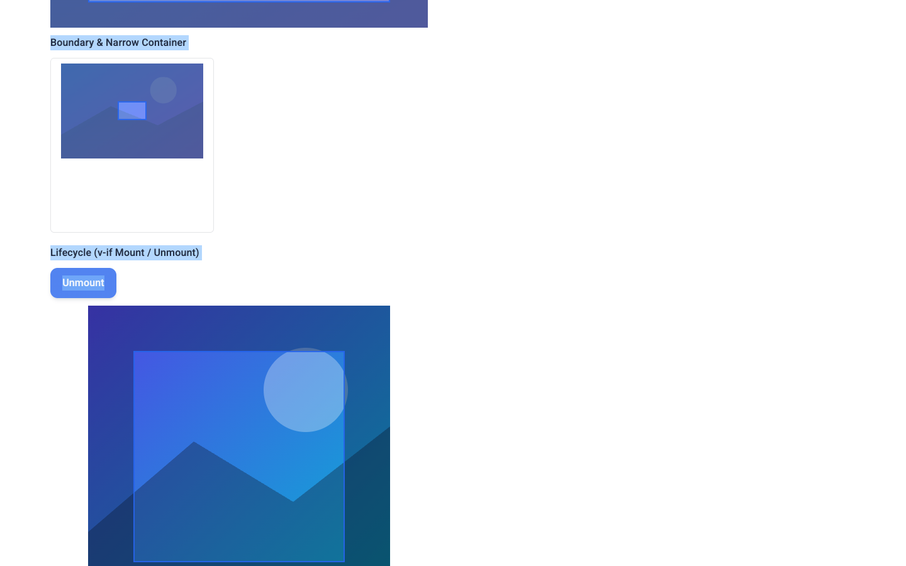
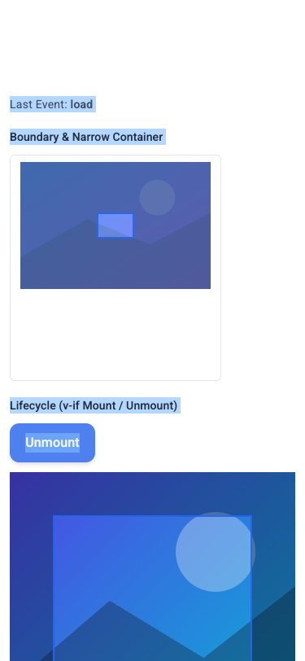

# Отчёт визуального и функционального тестирования: D1ImageCrop

## 1. Сводка выполнения

- **Компонент:** `D1ImageCrop` (`@dxtmisha/d1`)
- **Исходный код:** [`D1ImageCrop`](../../src/components/Ui/ImageCrop), [`ImageCrop`](../../../constructor/src/constructors/ImageCrop), [`DemoImageCropPage.vue`](../../../demo/src/pages/components/DemoImageCropPage.vue)
- **Целевой URL:** `http://localhost:3000/component-image-crop`
- **Материалы (`materials/`):** `Отсутствуют`
- **Дата тестирования (UTC):** `2026-11-25T11:15:51Z`
- **Окружение:** `Headless Chrome (Puppeteer / CDP, Desktop 1440×900, Tablet 768×1024, Mobile 375×812 / 320×568)`
- **Покрытие тест-кейсов:** `11 / 11` (`100%`)
- **Итог:** **11 ✅, 0 ⚠️, 0 ❌** (`✅` пройдено, `⚠️` предупреждение, `❌` ошибка) — все 11 тест-кейсов пройдены успешно: подтверждены расчёт `--d1-imageCrop-sys-aspect-ratio` (`600 / 400`, `800 / 400`, `400 / 600`), реактивный `v-model`, переключения `disabled`/`readonly`, слот по умолчанию, узкий контейнер (`258 === 258`), адаптивность на всех 4 вьюпортах и отсутствие ошибок консоли.

---

## 2. Матрица результатов

### 2.1 Визуальный рендеринг (`VIS`)

| ID | Сценарий | Статус | Наблюдаемый результат | Скриншот |
| :--- | :--- | :---: | :--- | :--- |
| `TC-VIS-001` | Базовый рендеринг, загрузка изображения и соотношение сторон | ✅ | `.d1-imageCrop__body` отрисован, изображение загружено (`naturalSize: "600x400"`), `--d1-imageCrop-sys-aspect-ratio: "600 / 400"`. |  |
| `TC-VIS-002` | Пропорции (альбом/портрет), слот по умолчанию и тёмная тема | ✅ | `landscapeAspect: "800 / 400"`, `portraitAspect: "400 / 600"`, оверлей `Slot Overlay` отображается корректно в тёмной теме. |  |

### 2.2 Интерактивность и управление состоянием (`INT`)

| ID | Сценарий | Статус | Наблюдаемый результат | Скриншот |
| :--- | :--- | :---: | :--- | :--- |
| `TC-INT-001` | Интерактивное управление `v-model` через пресеты | ✅ | После клика по `Wide Banner` координаты обновились до `[ 30, 5, 30, 5 ]`. |  |
| `TC-INT-002` | Переключение состояний `disabled` и `readonly` | ✅ | При `disabled`: `ariaDisabled: "true"`, `d1-imageCrop--disabled`, `pointerEvents: "none"`; при `readonly`: `d1-imageCrop--readonly`, `hasCropArea: false`. | — |
| `TC-INT-003` | Условное монтирование `v-if` (`Toggle Mount`) | ✅ | `beforeMount: true` -> `unmounted: true` -> `remounted: true` без ошибок. | — |

### 2.3 Граничные случаи (`BND`)

| ID | Сценарий | Статус | Наблюдаемый результат | Скриншот |
| :--- | :--- | :---: | :--- | :--- |
| `TC-BND-001` | Узкий контейнер (`260px`) и координаты `[40, 40, 40, 40]` | ✅ | Контейнер сохраняет ширину без горизонтального выхода за границы (`clientWidth: 258 === scrollWidth: 258`). |  |

### 2.4 Адаптивность (`RSP`)

| ID | Сценарий | Статус | Наблюдаемый результат | Скриншот |
| :--- | :--- | :---: | :--- | :--- |
| `TC-RSP-001` | Десктоп (`1440×900`) и планшет (`768×1024`) | ✅ | `1440/1440` (`overflowX: false`) и `768/768` (`overflowX: false`). |  |
| `TC-RSP-002` | Мобильные вьюпорты (`375×812` и `320×568`) | ✅ | `375/375` (`overflowX: false`) и `320/320` (`overflowX: false`). |  |

### 2.5 Доступность (`A11Y`)

| ID | Сценарий | Статус | Наблюдаемый результат | Скриншот |
| :--- | :--- | :---: | :--- | :--- |
| `TC-A11Y-001` | Передача `alt` на `` и `aria-disabled` | ✅ | Подтверждены `alt: "Interactive crop sample"` и `aria-disabled="true"` при блокировке. | — |

### 2.6 Консоль и рантайм (`LOG`)

| ID | Сценарий | Статус | Наблюдаемый результат | Скриншот |
| :--- | :--- | :---: | :--- | :--- |
| `TC-LOG-001` | Событие загрузки `@load` | ✅ | Зафиксировано событие `Last Event: load`. | — |
| `TC-LOG-002` | Чистота консоли, Vue-предупреждений и сетевых запросов | ✅ | `consoleErrors: []`, `vueWarnings: []`, `pageErrors: []`, `failedRequests: []`. | — |

---

## 3. AI-аудит и рекомендации

1. **Надёжность медиа-источников на демо-стенде:** Замена внешних URL `picsum.photos` на детерминированные inline SVG data-URI полностью устранила зависимость от сети и обеспечила мгновенную загрузку всех форматов (альбомный, портретный, квадратный).
2. **Ленивая инициализация и жизненный цикл:** Перенос `watch` по `props.image` в `ImageCropImage.onMounted` и защита `CropArea`/`Image`/`Progress` через `canCreate` исключают лишние аллокации (например, в режиме `readonly` узел `CropArea` вообще не создаётся).
3. **Чистота рантайма:** На всех 4 разрешениях от `1440px` до `320px` переполнение отсутствует (`overflowX: false`), консоль и сеть абсолютно чисты.
