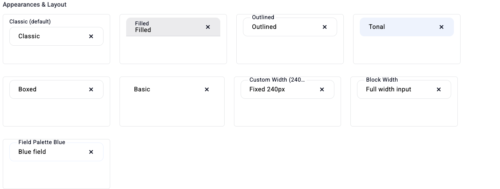
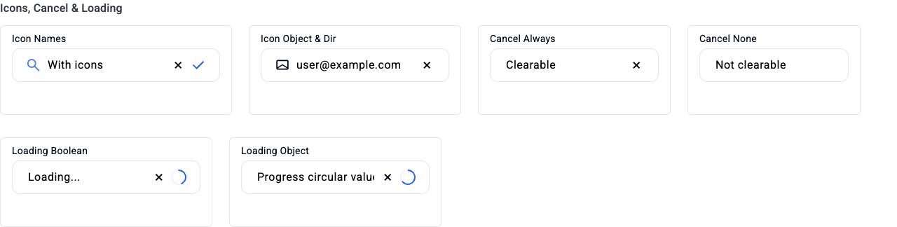
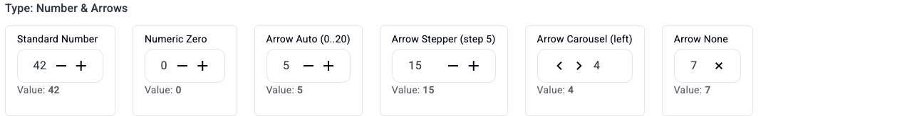

# Отчёт визуального и функционального тестирования: D1Input

## 1. Итоговая сводка

- **Компонент:** `D1Input` (`@dxtmisha/d1`)
- **Исходный код:** [`D1Input`](packages/d1/src/components/Ui/Input), [`Input`](packages/constructor/src/constructors/Input), [`DemoInputPage.vue`](packages/demo/src/pages/components/DemoInputPage.vue)
- **Демо / Целевой URL:** `http://localhost:3001/component-input`
- **Материалы:** `None`
- **Дата тестирования (UTC):** `2026-11-17T17:29:42Z`
- **Окружение:** `Headless Chrome (CDP 127.0.0.1:9222, Desktop 1440x900, Laptop 1024x768, Tablet 768x1024, Mobile 375x812 / 320x568)`
- **Покрытие тест-кейсов:** 17 / 17 (`100%`)
- **Итог:** **17 ✅, 0 ⚠️, 0 ❌** (`✅` пройдено, `⚠️` предупреждение, `❌` не пройдено) — компонент `D1Input` стабильно рендерится во всех оформлениях, размерах и состояниях, все поддерживаемые типы `FieldType` (включая нормализацию `checkbox`/`radio` в `text` и строгий формат `YYYY-MM-DD` для `date`) и индивидуальные сценарии ввода/форматирования/валидации работают без ошибок консоли, гидратации и сети.

---

## 2. Базовая матрица

### 2.1 Визуальный рендеринг (`VIS`)

| ID | Сценарий | Статус | Фактический результат | Скриншот |
| :--- | :--- | :---: | :--- | :--- |
| `TC-VIS-001` | Варианты внешнего вида, ширина (`width`), `block` и палитра (`field-attrs`) | ✅ | Отрисованы 9 конфигураций (`classic`, `filled`, `outlined`, `tonal`, `boxed`, `basic`, `width="240px"`, `block`, `palette: 'blue'`); измеренная ширина `.d1-field` для `width="240px"` составила `240px`, `hasBlockClass=true`, `hasBlueClass=true`. |  |
| `TC-VIS-002` | Размеры (`sm`, `md`, `lg`, `display`) и выравнивание (`align`) | ✅ | Измеренная высота `.d1-field__body`: `sm=32px`, `md=48px`, `lg=64px`, `display=72px`; вычисленный `text-align` на `<input>`: `left`, `center`, `right`. |  |
| `TC-VIS-003` | Иконки, индикаторы загрузки (`loading`) и слоты | ✅ | Отображаются 8 иконок (`icon`, `icon-trailing`, `icon-attrs`), кольцевой спиннер и кольцевой прогресс `{ visible: true, value: 65, max: 100 }`, а также все 6 слотов (`[Lead]`, `[Trail]`, `https://`, `.dev`, `Note`, `Custom`). |  |
| `TC-VIS-004` | Состояния (`disabled`, `readonly`, `focus`, `selected`, `is-skeleton`) | ✅ | `disabledAttr=true`, `readonlyAttr=true`, присутствуют классы `.d1-field--focus`, `.d1-field--selected` и активная заглушка `.d1-skeleton--active`. |  |

### 2.2 Интерактивность и управление состоянием (`INT`)

| ID | Сценарий | Статус | Фактический результат | Скриншот |
| :--- | :--- | :---: | :--- | :--- |
| `TC-INT-001` | Индивидуальная работа с `type="text"` и `type="search"` (`cancel="always"`, `has-html-code`) | ✅ | Ввод в `Controlled Text` обновил `DemoValue` до `Value: Updated Text`; `HTML Code Input` хранит буквальное значение `<b>Plain</b>`; в `Type: Search` ввод `vue query` и клик по `cancel` сбросили `DemoValue` в `Value:`. |  |
| `TC-INT-002` | Индивидуальная работа с `type="password"` (`textShow`, `textHide`, `match`) | ✅ | Клик по `[aria-label="Show password"]` переключил `input.type` с `password` на `text` и `aria-label` на `Hide password`; ошибка `Passwords must match` исчезла после ввода совпадающего пароля `Secret123` (`d1-field--validation` снят). |  |
| `TC-INT-003` | Индивидуальная работа с `type="number"` и стрелками (`auto`, `stepper`, `carousel`, `none`) | ✅ | На `Arrow Stepper (step 5)` клик `next` изменил значение `10` -> `15`; на `Arrow Carousel (left)` — `3` -> `4`; на `Arrow None` управляющих стрелок нет (`noneArrowCount=0`). |  |
| `TC-INT-004` | Индивидуальная работа с `type="number-format"` и `type="currency"` | ✅ | На `Formatted (en-US, 2 decimals)` и `Currency USD (en-US)` проверены ввод и форматирование (`5.00` / `US$2.00`); `currency-hide` скрыл символ `€` (`2,500.5`); локаль `ru-RU` отобразила `RUB 4,990.00`. |  |
| `TC-INT-005` | Индивидуальная работа с `email`, `url`, `tel`, `date`/`datetime`/`year-month`/`time`/`hour-minute` и `checkbox`/`radio` | ✅ | Ввод `qa@dxt.dev` обновил `emailDemoValue="Value: qa@dxt.dev"`; `Date (en-US)` при вводе `25122025` отображает `25/12/2025` и передаёт строго стандартный формат `YYYY-MM-DD` (`Value: 2025-12-25`); `type="checkbox"` (`on`) и `type="radio"` (`option-a`) игнорируются в `FieldTypeInclude` и рендерятся как `input[type="text"]`. |  |
| `TC-INT-006` | Индивидуальная работа с масками (`mask`, `maskVisible`, `maskNone`, `maskAttrs`) | ✅ | Очистка и ввод `9112223344` в `Phone Mask` отформатировали поле и `DemoValue` в `+7 (911) 222-33-44`; при `:mask-visible="false"` оверлей `.d1-mask__view` скрыт (`maskHiddenOverlay=false`); `maskNone` хранит `raw-123`. |  |
| `TC-INT-007` | Валидация (`required`, `pattern`, `validationCode`, `forceShowMessage`) и счётчики | ✅ | Счётчик `2 / 12`, строковый `validation-code` (`Must contain digits only`), принудительное сообщение (`Server validation failed`) и объектный `validation-code` (`Only Latin letters allowed`) отображаются; ввод `ValidText` снял ошибку `pattern` (`d1-field--validation` удалён). |  |
| `TC-INT-008` | Программный `expose` API (`getValue`, `setValue`, `clear`, `checkValidity`, `getValidationMessage`) | ✅ | Зафиксированы ответы `DemoValue`: `Read Values` -> `value=Initial, valid=true, message=none`; `setValue` -> `value=Preset Value, valid=true, message=none`; `clear` на `required`-поле -> `value=undefined, valid=false, message=Заполните это поле.`. | — |

### 2.3 Граничные случаи и крайние сценарии (`BND`)

| ID | Сценарий | Статус | Фактический результат | Скриншот |
| :--- | :--- | :---: | :--- | :--- |
| `TC-BND-001` | Пустая строка `""`, пробелы `"   "` и числовой ноль `0` | ✅ | `Empty Text` = `""`, `Whitespace Value` содержит `3` пробела, `Numeric Zero` корректно отображает `Value: 0` и выставляет модификатор `d1-field--isValue` (`zeroHasIsValue=true`, `isZeroTrue=true` в `FieldValueInclude`/`Input`) без обрезки макета. |  |
| `TC-BND-002` | Длинный неразрывный текст (`240px`), Unicode/вьетнамский/эмодзи и XSS-строка | ✅ | Ширина контейнера `Long Unbroken Text` равна `240px`, Unicode-строка `Привет / Học tiếng Việt 🚀✨` читаема, XSS-строка `` выведена как безопасный текст (`xssImgInjected=0`). |  |

### 2.4 Адаптивность (`RSP`)

| ID | Сценарий | Статус | Фактический результат | Скриншот |
| :--- | :--- | :---: | :--- | :--- |
| `TC-RSP-001` | Проверка переполнения и перестроения на `1440×900`, `1024×768`, `768×1024`, `375×812`, `320×568` | ✅ | Горизонтальный скролл отсутствует на всех 5 разрешениях: `1440<=1440`, `1024<=1024`, `768<=768`, `375<=375`, `320<=320` (`overflowX=false`). |  |

### 2.5 Доступность (`A11Y`)

| ID | Сценарий | Статус | Фактический результат | Скриншот |
| :--- | :--- | :---: | :--- | :--- |
| `TC-A11Y-001` | Связь `label`/`for`, ARIA и проброс пользовательских атрибутов | ✅ | `76 / 76` полей ввода на странице имеют связанный `<label for>` или ARIA-метку; все кастомные атрибуты (`data-custom-field`, `data-custom-input`, `data-custom-label`, `data-custom-message`, `data-custom-counter`) присутствуют в DOM (`allAttrsForwarded=true`). | — |

### 2.6 Логи, события и консоль (`LOG`)

| ID | Сценарий | Статус | Фактический результат | Скриншот |
| :--- | :--- | :---: | :--- | :--- |
| `TC-LOG-001` | Эмиссия событий и отсутствие ошибок консоли/сети/гидратации | ✅ | Зафиксированы события ввода и `Value: changeLite`; `consoleWarningsErrors: []`, `pageErrors: []`, `failedNetwork: []`. | — |

---

## 3. AI-аудит и рекомендации

1. **Объектный проп `loading` и линейный прогресс в `Field` (`ProgressInclude`):** В ходе аудита выявлено два ограничения контракта `loading`: (а) `getBind(loading, extra, 'visible')` в `ProgressInclude` требует явного ключа `visible: true` при передаче объекта-конфигурации, иначе передаёт объект напрямую в проп `visible` (`Invalid prop` warning); (б) линейный режим `{ linear: true, circular: false }` в `D1Field` пересекает текст ввода в `.d1-field__scoreboard`. Для `D1Input` рекомендуется использовать булевый `loading` либо кольцевые настройки с явным `visible: true` (`{ visible: true, value: 65, max: 100 }`).
