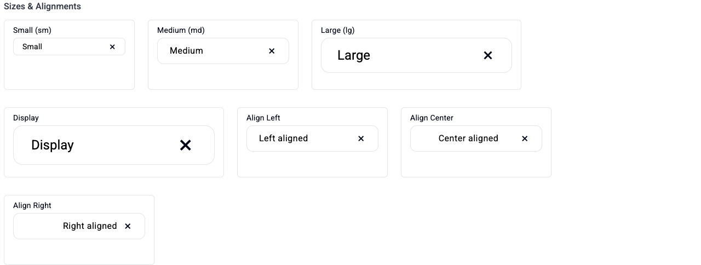
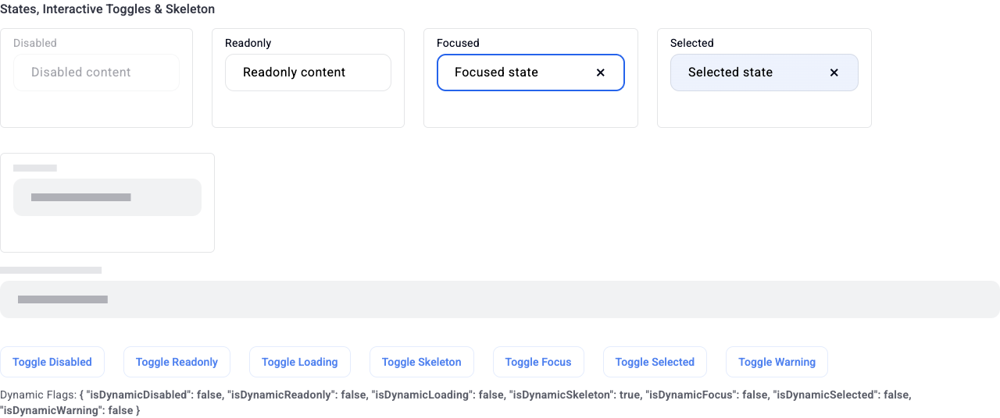
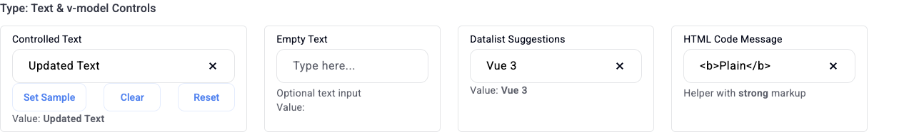
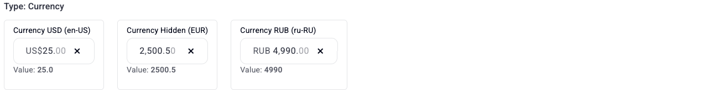
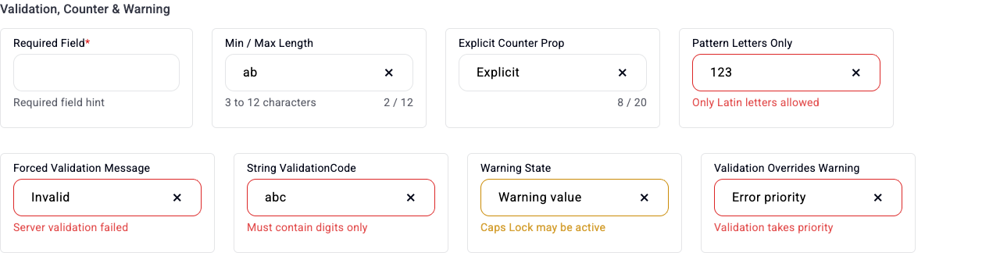
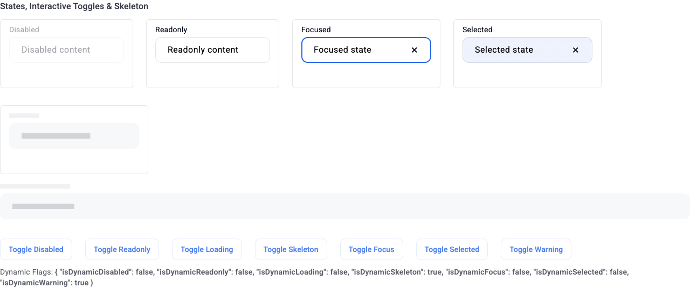
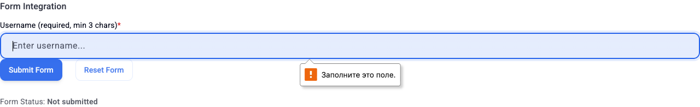
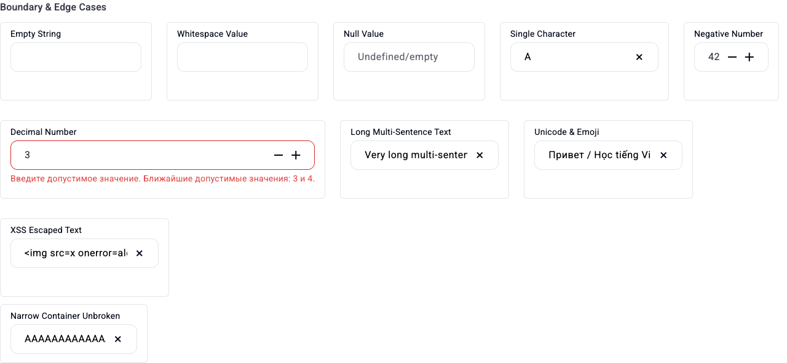
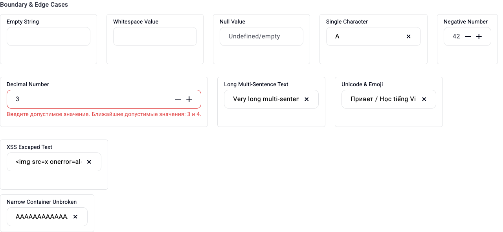
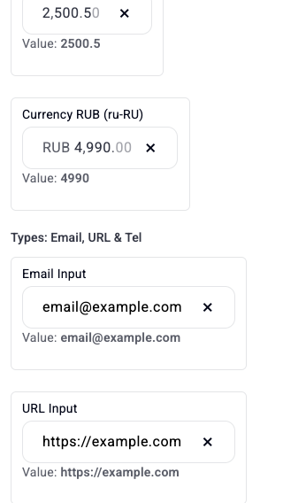

# Отчёт о визуальном и функциональном тестировании: D1Input

## 1. Сводка тестирования

- **Компонент:** `D1Input` (`@dxtmisha/d1`)
- **Исходный код:** [`D1Input`](../../src/components/Ui/Input) ([`Input`](../../../constructor/src/constructors/Input), [`DemoInputPage.vue`](../../../demo/src/pages/components/DemoInputPage.vue))
- **Демо / целевой URL:** `http://localhost:3000/component-input`
- **Материалы:** `Нет`
- **Дата тестирования (UTC):** `2026-11-25T06:23:56Z`
- **Окружение:** `Headless Chrome (Puppeteer / CDP, Desktop 1440x900, Tablet 768x1024, Mobile 375x812 / 320x568)`
- **Покрытие тест-кейсов:** 21 / 21 (`100%`)
- **Итог:** **21 ✅, 0 ⚠️, 0 ❌** (`✅` пройдено, `⚠️` предупреждение, `❌` провалено) — `D1Input` проходит SSR (`200`) и все 21 тест-кейс: все оформления, размеры, слоты, 16 типов ввода, маски, валидацию/`warning`, динамические состояния, `expose` API, интеграцию с `<form>`, жизненный цикл `v-if`, граничные случаи (`238 === 238`), адаптивность (`1440`/`768`/`375`/`320` с `overflowX: false`) и чистоту консоли/сети.

---

## 2. Базовая матрица

### 2.1 Визуальный рендеринг (`VIS`)

| ID | Сценарий | Статус | Фактический результат | Скриншот |
| :--- | :--- | :---: | :--- | :--- |
| `TC-VIS-001` | Варианты внешнего вида, ширина, `block`, `isValue` и палитра | ✅ | Оформления `classic`, `filled`, `outlined`, `tonal`, `boxed`, `basic`, `width="240px"` (ровно `240px`), `block`, `:field-attrs="{ palette: 'blue' }"` и `is-value` отрисованы без обрезания рамок и перекрытия текста. |  |
| `TC-VIS-002` | Размеры и выравнивание текста | ✅ | Высоты `.d1-field__body` возрастают (`sm=32px`, `md=48px`, `lg=64px`, `display=72px`), вычисленный `text-align` на `<input>` соответствует `left`, `center`, `right`. |  |
| `TC-VIS-003` | Иконки, индикаторы загрузки (`loading`), пропсы и слоты (`#leading` scoped, `#trailing`, `#prefix`, `#suffix`, `#caption`, `#label`) | ✅ | Иконки, индикаторы прогресса (`loading`), пропсы `prefix`/`suffix`/`caption` и все 6 слотов (включая scoped `{ id }` в `#leading`) выровнены и не перекрывают вводимый текст. |  |
| `TC-VIS-004` | Статические состояния (`disabled`, `readonly`, `focus`, `selected`, `is-skeleton`) | ✅ | Состояния `disabled` и `readonly` блокируют редактирование, `focus` и `selected` выделены визуально, `is-skeleton` отображает активный скелетон внутри `D1Skeleton`. |  |

### 2.2 Интерактивность и управление состоянием (`INT`)

| ID | Сценарий | Статус | Фактический результат | Скриншот |
| :--- | :--- | :---: | :--- | :--- |
| `TC-INT-001` | Работа с типом `text`, программными кнопками `v-model`, `datalist` (`list`) и `search` | ✅ | Ввод и кнопки `Set Sample`/`Clear`/`Reset` реактивно обновляют `v-model`; `has-html-code` рендерит HTML только в `helper-message`, а `value` экранируется; кнопка очистки в `search` (`cancel="always"`) сбрасывает значение. |  |
| `TC-INT-002` | Работа с типом `password` (`textShow`, `textHide`, `match`) | ✅ | Кнопка видимости переключает `input.type` (`password` <-> `text`) и `aria-label` (`Show password` <-> `Hide password`); ошибка `"Passwords must match"` снимается при совпадении с `"Secret123"`. |  |
| `TC-INT-003` | Работа с типом `number` и стрелками (`arrow`, `step`, `arrowStep`) | ✅ | Стрелки `stepper` и `carousel` изменяют значение с учётом `step`/`arrow-step` и `min`/`max`, у `Arrow None` кнопки стрелок отсутствуют. |  |
| `TC-INT-004` | Работа с типами `number-format` и `currency` | ✅ | Локали `en-US` и `ru-RU`, дробная часть, валюты `USD`/`EUR`/`RUB` и скрытие символа валюты при `currency-hide` форматируются корректно и пересчитывают `v-model`. |  |
| `TC-INT-005` | Работа с `email`, `url`, `tel`, датой/временем и `checkbox`/`radio` | ✅ | Все типы (`email`, `url`, `tel`, `date`, `datetime`, `year-month`, `time`, `hour-minute`) принимают ввод и обновляют модель; `checkbox` и `radio` приводятся к `input[type="text"]`. |  |
| `TC-INT-006` | Работа с масками (`mask`, `maskVisible`, `maskNone`, `maskAttrs`) | ✅ | Маска форматирует ввод и синхронизирует `v-model`, `:mask-visible="false"` скрывает оверлей `.d1-mask__view`, `mask-none` отключает маску, `mask-attrs` применяет кастомный символ. |  |
| `TC-INT-007` | Валидация (`required`, `pattern`, `validationCode`, `forceShowMessage`), `warning` и счётчики | ✅ | Счётчики (`2 / 12`, `8 / 20`), сообщения валидации, неблокирующее предупреждение `warning` и приоритет ошибки валидации над предупреждением (`Validation takes priority`) работают корректно. |  |
| `TC-INT-008` | Программный `expose` API (`value`, `getValue`, `setValue`, `clear`, `isChanged`, `checkValidity`, `getValidationMessage`) | ✅ | Вызов `setValue('Preset Value')` и чтение `expose` подтверждают синхронизацию состояния: `value=Preset Value, ref=Preset Value, valid=true, changed=true, message=none`; `clear()` сбрасывает значение. | — |
| `TC-INT-009` | Динамические переключатели состояний (`disabled`, `readonly`, `loading`, `is-skeleton`, `focus`, `selected`, `warning`) | ✅ | Переключатели состояний синхронно обновляют `Dynamic Flags` и соответствующие классы/атрибуты на `[data-testid="demo-input-dynamic"]`. |  |
| `TC-INT-010` | Блокировка ввода при `disabled`, `readonly`, `loading` и условное монтирование `v-if` | ✅ | Заблокированные поля не изменяются; переключение `v-if` чисто размонтирует и восстанавливает компонент (`beforeLen: 91 -> unmountedLen: 55 -> remountedLen: 91`). | — |
| `TC-INT-011` | Интеграция с `<form>` (`form`, `required`, `minlength`, `submit`, `reset`) | ✅ | Блок `Form Integration` (`Username (required, min 3 chars)`, `Submit Form`, `Reset Form`) корректно валидирует обязательность/длину и сбрасывает статус формы. |  |

### 2.3 Граничные случаи и крайние сценарии (`BND`)

| ID | Сценарий | Статус | Фактический результат | Скриншот |
| :--- | :--- | :---: | :--- | :--- |
| `TC-BND-001` | Пустые значения (`""`, `"   "`, `undefined`), одиночный символ и числовые границы (`0`, `-42`, `3.14`) | ✅ | Пустые, пробельные (`"   "`), `undefined`, одиночный символ и числовые значения (`0`, `-42`, `3.14`) отрисованы корректно; `0` активирует класс `--isValue`. |  |
| `TC-BND-002` | Длинный текст, узкий контейнер (`max-width: 240px`), Unicode/эмодзи и экранирование XSS | ✅ | Контейнер `.demo-input-page__narrow` строго укладывается в ширину (`scrollWidth: 238 === clientWidth: 238`, `overflowsBox: false`, `overflowChildren: []`); XSS-строка внутри `input.value` не создаёт DOM-инъекций (`badImgs: 0`). |  |
| `TC-BND-003` | Сохранение границ поля с `prefix`/`suffix`/`caption` и длинной меткой | ✅ | Префикс, суффикс, подпись и длинная метка корректно разделены по областям поля и не перекрывают вводимый текст. | — |

### 2.4 Адаптивность (`RSP`)

| ID | Сценарий | Статус | Фактический результат | Скриншот |
| :--- | :--- | :---: | :--- | :--- |
| `TC-RSP-001` | Многоэкранная адаптация (`1440×900`, `1024×768`, `768×1024`, `375×812`, `320×568`) | ✅ | На всех проверенных вьюпортах горизонтальное переполнение отсутствует (`desktop: 1440/1440`, `tablet: 768/768`, `mobile: 375/375`, `mobile320: 320/320`, `overflowX: false`, `offenders: []`). |  |

### 2.5 Доступность (`A11Y`)

| ID | Сценарий | Статус | Фактический результат | Скриншот |
| :--- | :--- | :---: | :--- | :--- |
| `TC-A11Y-001` | Семантика `label`/`for`, ARIA-атрибуты, пользовательские атрибуты и `Tab` | ✅ | Все поля имеют связанный `<label for>` или `aria-label` (включая `Standalone input without visible label`), поддерживают навигацию `Tab` и проброс `*-attrs` на целевые узлы. | — |

### 2.6 Логи и консоль (`LOG`)

| ID | Сценарий | Статус | Фактический результат | Скриншот |
| :--- | :--- | :---: | :--- | :--- |
| `TC-LOG-001` | События (`focus`, `blur`, `update:*`, `input*`, `change*`) с payload и чистота консоли/сети | ✅ | SSR-ответ `status: 200` (`hasComponent: true`), события жизненного цикла ввода фиксируются корректно, а массивы ошибок пусты (`consoleErrors: []`, `vueWarnings: []`, `pageErrors: []`, `networkErrors: []`, `dialogs: []`). | — |

---

## 3. AI-аудит и рекомендации

1. **Контейнерная устойчивость на сверхмалых ширинах и в узком блоке:** Поле ввода стабильно сжимается без горизонтального скролла как в узкой демонстрационной обёртке `.demo-input-page__narrow` (`scrollWidth: 238 === clientWidth: 238`, `overflowsBox: false`), так и на всех брейкпоинтах (`1440`, `768`, `375`, `320` — `overflowX: false`, `offenders: []`).
2. **Надёжность `expose` API и жизненного цикла `v-if`:** Программное управление через `setValue('Preset Value')` и `clear()` синхронно обновляет `value`, `ref`, `valid`, `changed` и `message`, а условное монтирование `v-if` полностью восстанавливает количество узлов (`beforeLen: 91 -> unmountedLen: 55 -> remountedLen: 91`) без предупреждений гидратации (`vueWarnings: []`).
3. **Изоляция инъекций и чистота рантайма/SSR:** Передача XSS-строки как значения ввода не создаёт сторонних DOM-элементов (`badImgs: 0`), SSR отдаёт страницу со статусом `200` (`hasComponent: true`), а консоль, страница и сеть остаются абсолютно чистыми (`consoleErrors: []`, `pageErrors: []`, `networkErrors: []`).
4. **Согласованность `warning` и валидации в `D1Field`:** Неблокирующее состояние `warning` корректно отображается визуально и уступает приоритет ошибке валидации при их одновременном срабатывании без скачков раскладки.
