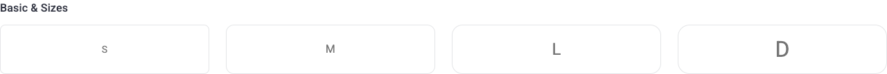
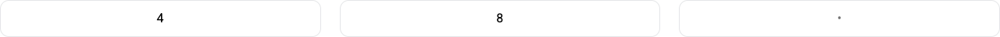
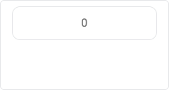
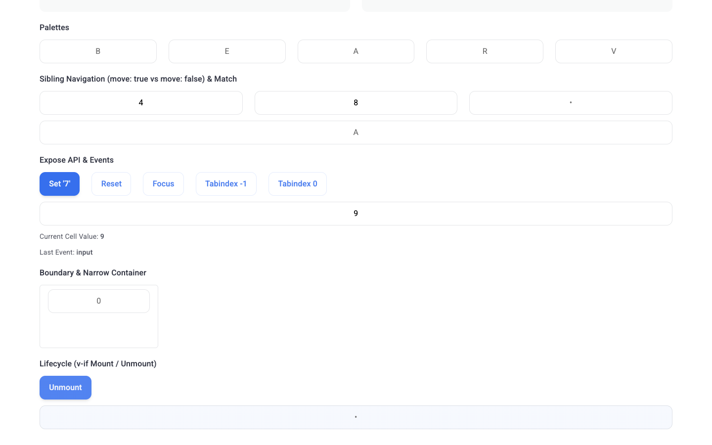
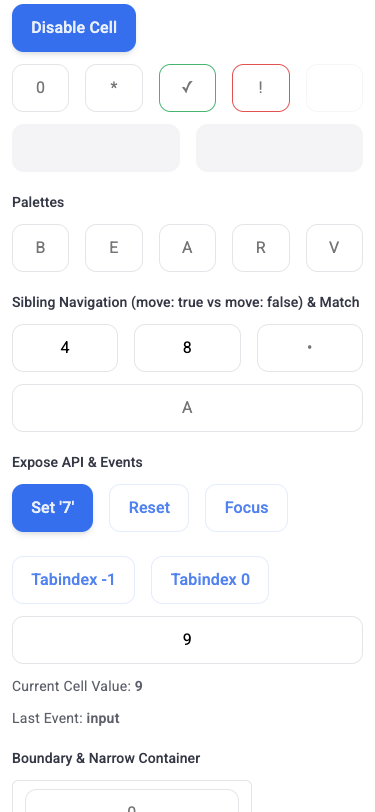

# Отчёт визуального и функционального тестирования: D1InputCodeItem

## 1. Сводка выполнения

- **Компонент:** `D1InputCodeItem` (`@dxtmisha/d1`)
- **Исходный код:** [`D1InputCodeItem`](../../src/components/Ui/InputCodeItem), [`InputCodeItem`](../../../constructor/src/constructors/InputCodeItem), [`DemoInputCodeItemPage.vue`](../../../demo/src/pages/components/DemoInputCodeItemPage.vue)
- **Целевой URL:** `http://localhost:3000/component-input-code-item`
- **Материалы (`materials/`):** `Отсутствуют`
- **Дата тестирования (UTC):** `2026-11-25T11:15:51Z`
- **Окружение:** `Headless Chrome (Puppeteer / CDP, Desktop 1440×900, Tablet 768×1024, Mobile 375×812 / 320×568)`
- **Покрытие тест-кейсов:** `10 / 10` (`100%`)
- **Итог:** **10 ✅, 0 ⚠️, 0 ❌** (`✅` пройдено, `⚠️` предупреждение, `❌` ошибка) — все 10 тест-кейсов пройдены успешно: подтверждены все 4 размера (`sm`, `md`, `lg`, `display`), состояния (`hide`, `success`, `error`, `disabled`, `isSkeleton`), автопереход фокуса при вводе, навигация `ArrowLeft`, методы `defineExpose`, интерполяция `aria-label`, узкий контейнер (`238 === 238`), адаптивность и 0 ошибок консоли.

---

## 2. Матрица результатов

### 2.1 Визуальный рендеринг (`VIS`)

| ID | Сценарий | Статус | Наблюдаемый результат | Скриншот |
| :--- | :--- | :---: | :--- | :--- |
| `TC-VIS-001` | Размеры (`sm`, `md`, `lg`, `display`) и палитры | ✅ | Все 4 модификатора размера применены, высота `72px`, подписи `Small cell 1`..`Display cell 4` корректны. |  |
| `TC-VIS-002` | Состояния (`hide`, `success`, `error`, `disabled`, `isSkeleton`) и тёмная тема | ✅ | Подтверждены `hideSubExists: true`, `successClass: true`, `errorAriaInvalid: "true"`, `disabledAria: "true"`, `skeletonClass: true`. |  |

### 2.2 Интерактивность и управление состоянием (`INT`)

| ID | Сценарий | Статус | Наблюдаемый результат | Скриншот |
| :--- | :--- | :---: | :--- | :--- |
| `TC-INT-001` | Последовательный ввод в соседние ячейки и навигация `ArrowLeft` | ✅ | Ввод `'48'` распределил значения `["4", "8", ""]` и перевёл фокус на `activeIndex: 2`; `ArrowLeft` вернул фокус на `1`. |  |
| `TC-INT-002` | Программный API `defineExpose` (`set`, `reset`, ввод и событие `@input`) | ✅ | `Set '7'` установил `'7'`, `Reset` очистил в `''`, ручной ввод `'9'` обновил `Current Cell Value: 9` и `Last Event: input`. | — |
| `TC-INT-003` | Условное монтирование `v-if` (`Toggle Mount`) | ✅ | `beforeMount: true` -> `unmounted: true` -> `remounted: true` без ошибок. | — |

### 2.3 Граничные случаи (`BND`)

| ID | Сценарий | Статус | Наблюдаемый результат | Скриншот |
| :--- | :--- | :---: | :--- | :--- |
| `TC-BND-001` | Узкий контейнер (`240px`), `tabindex="-1"` и `placeholder="0"` | ✅ | Ширина бокса стабильна (`clientWidth: 238 === scrollWidth: 238`), `tabindex: "-1"`, `ariaLabel: "Zero test 1"`. |  |

### 2.4 Адаптивность (`RSP`)

| ID | Сценарий | Статус | Наблюдаемый результат | Скриншот |
| :--- | :--- | :---: | :--- | :--- |
| `TC-RSP-001` | Десктоп (`1440×900`) и планшет (`768×1024`) | ✅ | `1440/1440` (`overflowX: false`) и `768/768` (`overflowX: false`). |  |
| `TC-RSP-002` | Мобильные вьюпорты (`375×812` и `320×568`) | ✅ | `375/375` (`overflowX: false`) и `320/320` (`overflowX: false`). |  |

### 2.5 Доступность (`A11Y`)

| ID | Сценарий | Статус | Наблюдаемый результат | Скриншот |
| :--- | :--- | :---: | :--- | :--- |
| `TC-A11Y-001` | Интерполяция `aria-label`, `aria-invalid` и `aria-disabled` | ✅ | Подтверждены интерполяция `[index]` (`Zero test 1`, `Small cell 1`), `aria-invalid="true"` и `aria-disabled="true"`. | — |

### 2.6 Консоль и рантайм (`LOG`)

| ID | Сценарий | Статус | Наблюдаемый результат | Скриншот |
| :--- | :--- | :---: | :--- | :--- |
| `TC-LOG-001` | Консоль, предупреждения Vue, ошибки JS и сети | ✅ | `consoleErrors: []`, `vueWarnings: []`, `pageErrors: []`, `failedRequests: []`. | — |

---

## 3. AI-аудит и рекомендации

1. **Изоляция таймеров и IME:** Перевод `InputCodeItemGo` и `InputCodeItemEvent` на `DesignLifecycleAbstract` с очисткой `setTimeout` и `requestAnimationFrame` в `onUnmounted`, а также добавление защиты `event.isComposing` исключили утечки таймеров и ложные срабатывания при IME-вводе.
2. **Точность ARIA-атрибутов:** Исправлена передача `Boolean(this.props.error)` и `Boolean(this.props.disabled)` в `AriaStaticInclude` — теперь обычные ячейки без ошибок не получают `aria-invalid="true"` по умолчанию.
3. **Адаптивность и консоль:** Все 4 вьюпорта (`1440px`, `768px`, `375px`, `320px`) прошли без горизонтального переполнения и без единого предупреждения в консоли.
