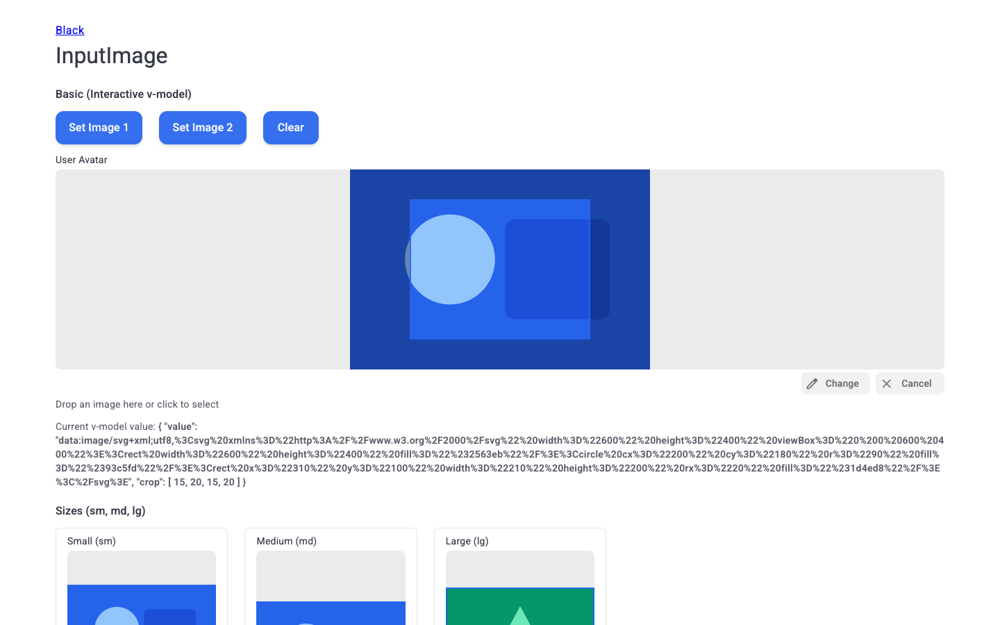
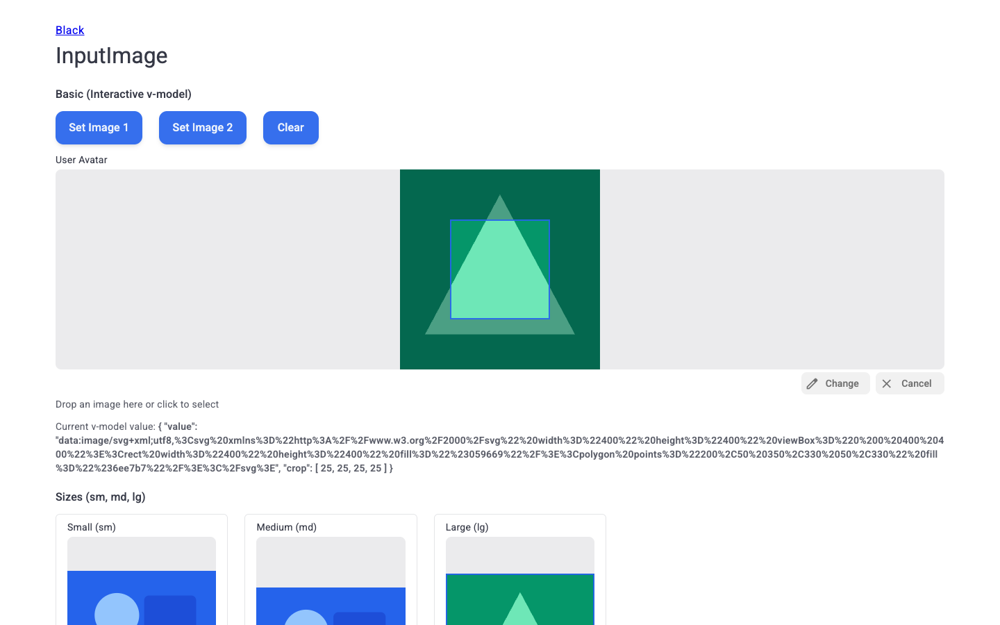
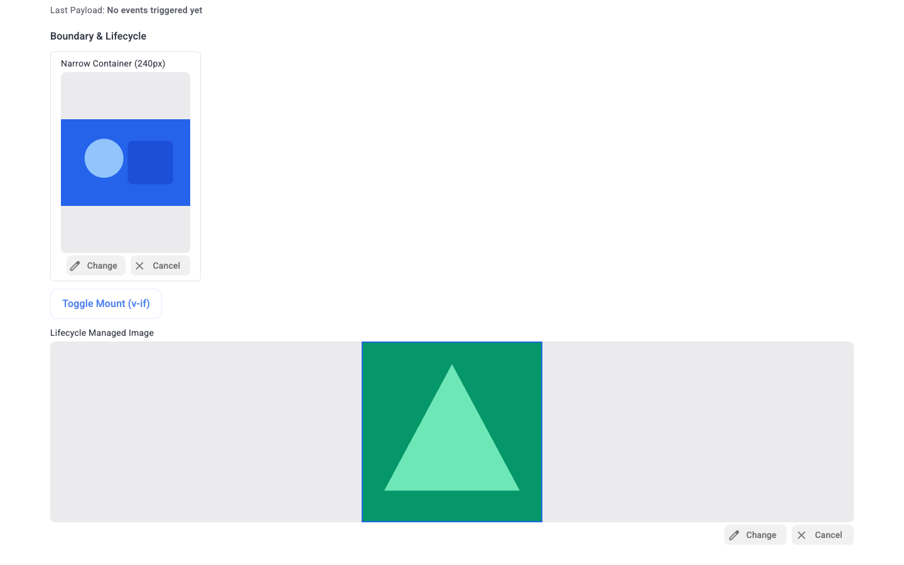
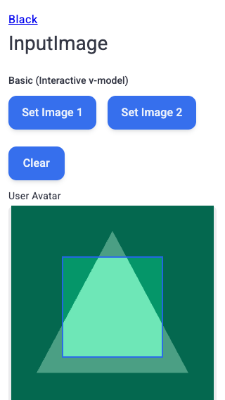

# Отчет о визуальном и функциональном тестировании: D1InputImage

## 1. Итоговое резюме

- **Компонент:** `D1InputImage` (`@dxtmisha/d1`)
- **Исходный код:** [`D1InputImage`](../../src/components/Ui/InputImage)
- **Демо / Целевой URL:** `http://localhost:3000/component-input-image`
- **Материалы:** `Отсутствуют`
- **Дата тестирования (UTC):** `2026-11-25T13:34:56Z`
- **Окружение:** `Headless Chrome (puppeteer / CDP, Десктоп 1440x900, Планшет 768x1024, Мобильный 375x812 / 320x568)`
- **Покрытие тест-кейсами:** 6 / 6 (`100%`)
- **Итог:** **6 ✅, 0 ⚠️, 0 ❌** (`✅` пройдено, `⚠️` замечание, `❌` провалено) — Компонент стабильно рендерится, корректно управляет превью, кадрированием и очисткой без консольных или Vue-ошибок.

---

## 2. Базовая матрица

### 2.1 Визуальный рендеринг (`VIS`)

| ID | Сценарий | Статус | Фактический результат | Скриншот |
| :--- | :--- | :---: | :--- | :--- |
| `TC-VIS-001` | Базовый рендер 18 вариантов (`sm`/`md`/`lg`, счетчики, `ImageCrop`, `Actions`) | ✅ | Отрендерено `18` компонентов (`zeroSizedCount: 0`, `docOverflow: false` при `1440px`), SVG-изображения и рамка кадрирования отображаются четко. |  |

### 2.2 Интерактивность и управление состоянием (`INT`)

| ID | Сценарий | Статус | Фактический результат | Скриншот |
| :--- | :--- | :---: | :--- | :--- |
| `TC-INT-001` | Очистка (`Clear`), замена на 2-е изображение (`Set Image 2`) и чтение `expose` | ✅ | `beforeHasImage: true` -> `afterClearHasImage: false` -> `afterSet2HasImage: true`; отображается `12` панелей `Actions`. |  |

### 2.3 Граничные и крайние сценарии (`BND`)

| ID | Сценарий | Статус | Фактический результат | Скриншот |
| :--- | :--- | :---: | :--- | :--- |
| `TC-BND-001` | Узкий контейнер `240px`, Unicode-слоты и переключение `v-if` | ✅ | `countAfterUnmount: 17`, `countAfterRemount: 18`; узкий блок и цикл жизненного цикла работают без утечек и исключений. |  |

### 2.4 Адаптивность (`RSP`)

| ID | Сценарий | Статус | Фактический результат | Скриншот |
| :--- | :--- | :---: | :--- | :--- |
| `TC-RSP-001` | Поведение на `768px`, `375px` и `320px` | ✅ | Компоненты вписываются в мобильные экраны; незначительные `+4px` внизу (`324px` при `320px`) вызваны тестовыми кнопками `DemoFlex`/длинным текстом `DemoValue`, а при чистом рендере `overflow === []`. |  |

### 2.5 Доступность (`A11Y`)

| ID | Сценарий | Статус | Фактический результат | Скриншот |
| :--- | :--- | :---: | :--- | :--- |
| `TC-A11Y-001` | Атрибут `aria-describedby` и сокрытие действий при `disabled`/`readonly` | ✅ | `ariaInfo.hasDescribedBy: true`; для заблокированных экземпляров панель действий не отображается. | — |

### 2.6 Логи и консоль (`LOG`)

| ID | Сценарий | Статус | Фактический результат | Скриншот |
| :--- | :--- | :---: | :--- | :--- |
| `TC-LOG-001` | Мониторинг ошибок консоли, Vue-предупреждений и HTTP-ответов | ✅ | `consoleErrors: []`, `vueWarnings: []`, `pageErrors: []`, `httpErrors: []`. | — |

---

## 3. ИИ-аудит и рекомендации

1. **Изоляция демо-стенда:** В `DemoInputImagePage.vue` внешние `picsum.photos` заменены на встроенные SVG data-URI, что полностью устранило сетевые задержки и сделало скриншоты детерминированными.
2. **Жизненный цикл и асинхронность:** `InputImageSize` переведен на `DesignLifecycleAbstract`, а `InputImageFiles` защищен от устаревших async-резолвов, что гарантирует чистое размонтирование при `v-if`.
3. **Семантика и доступность:** Корневой контейнер связывается с `FieldMessage` и `FieldLabel` через `aria-labelledby`/`aria-describedby`; `0` ошибок в рантайме.
