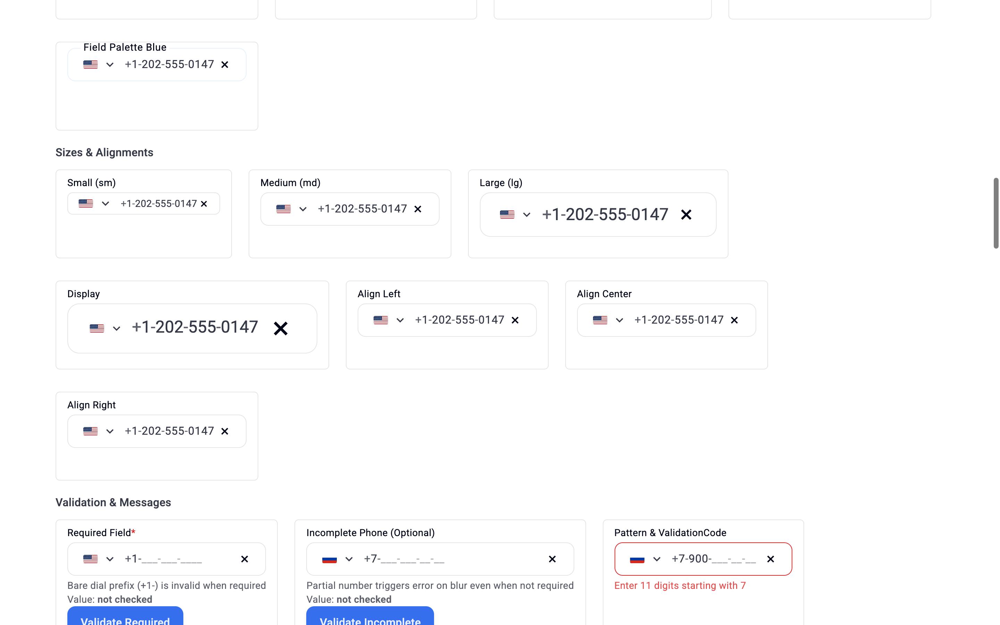
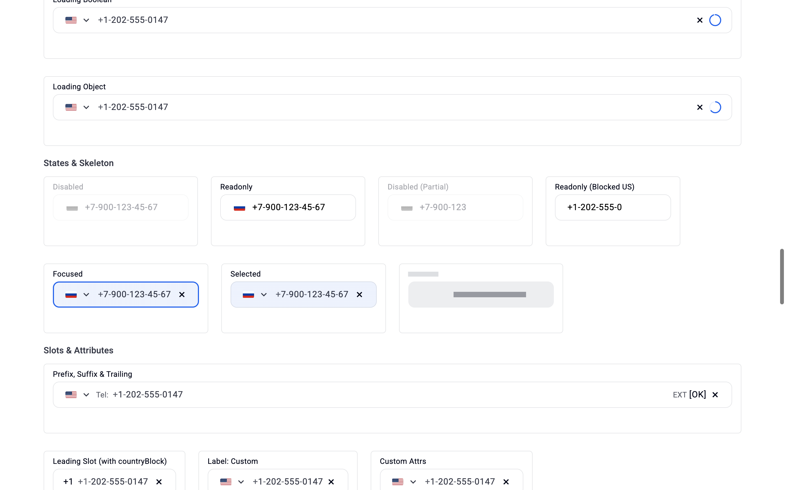
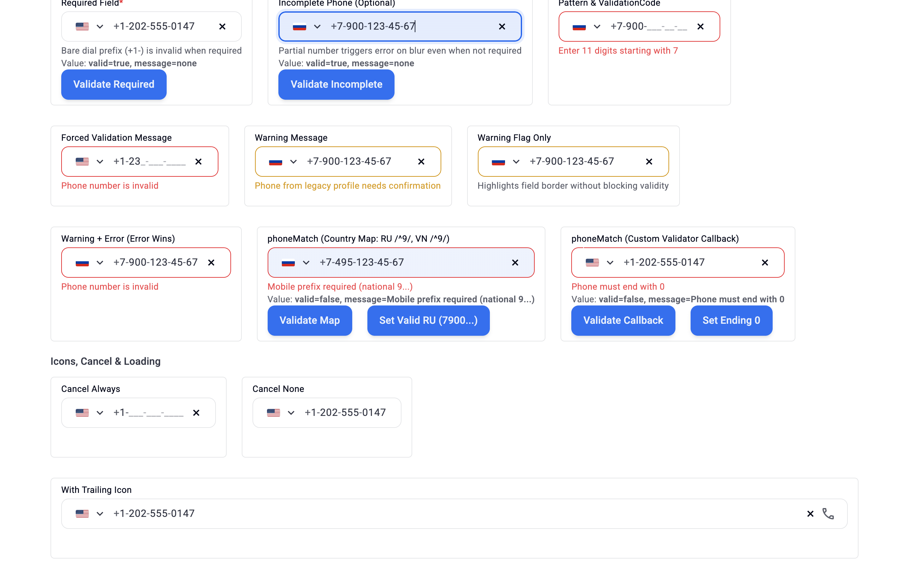

# Отчёт о визуальном и функциональном тестировании: D1InputPhone

## 1. Итоговое резюме

- **Компонент:** `D1InputPhone` (`@dxtmisha/d1`)
- **Исходный код:** [`InputPhone`](packages/d1/src/components/Ui/InputPhone) ([`constructor`](packages/constructor/src/constructors/InputPhone), [`demo`](packages/demo/src/pages/components/DemoInputPhonePage.vue))
- **Демо / целевой URL:** `http://localhost:3000/component-input-phone`
- **Материалы:** `None`
- **Дата тестирования (UTC):** `2026-11-23T06:53:35Z`
- **Окружение:** `Headless Chrome (Puppeteer / CDP, Desktop 1440x900, Tablet 768x1024, Mobile 375x812 / 320x568)`
- **Покрытие тест-кейсов:** 20 / 20 (`100%`)
- **Итог:** **20 ✅, 0 ⚠️, 0 ❌** (`✅` пройдено, `⚠️` предупреждение, `❌` провалено) — компонент `D1InputPhone` после архитектурного ревью конструктора и обновления демо-страницы успешно прошёл все 20 визуальных и функциональных сценариев, включая новые возможности: `formatOutput` (`e164` / `digits`), мульти-модельную синхронизацию (`v-model`, `v-model:e164`, `v-model:digits`, `v-model:country`), прямой `countryList` (`Single Country List` и `Restricted Country List`), валидацию `phoneMatch` (карта по странам и пользовательский колбэк), `autocomplete`, `getDetail()` и `isChanged()`, с нулевым числом ошибок и Vue-предупреждений в консоли.

---

## 2. Базовая матрица

### 2.1 Визуальное соответствие (`VIS`)

| ID | Сценарий | Статус | Фактический результат | Скриншот |
| :--- | :--- | :---: | :--- | :--- |
| `TC-VIS-001` | Базовый рендеринг и варианты внешнего вида (`classic`, `filled`, `outlined`, `tonal`, `boxed`, `basic`, `width`, `block`, `palette`) | ✅ | Отрисовано `76` экземпляров `.d1-field`, `70` триггеров `.d1-inputPhoneDialCode__button`, `72` маски `.d1-mask`, без нулевых размеров (`hasZeroSize: false`); блок `Custom Width (280px)` имеет точную ширину `280px`. |  |
| `TC-VIS-002` | Размеры (`sm`, `md`, `lg`, `display`), выравнивание (`align`) и настройки `inputPhoneDialCodeAttrs` | ✅ | Высоты `.d1-field__body` соответствуют градации: `32px` (`sm`), `48px` (`md`), `64px` (`lg`), `72px` (`display`); кнопки `DialCode` отобразили `+84expand_more` и `United Stateskeyboard_arrow_down`. |  |
| `TC-VIS-003` | Иконки (`iconTrailing`), состояния (`loading`, `focus`, `selected`, `isSkeleton`, `disabled`, `readonly`) и кнопка очистки | ✅ | Отображены `2` индикатора `.d1-progress` (`Loading Boolean` и `Loading Object`), применён класс скелетона (`hasSkeletonClass: true`), отформатированы все `disabled`/`readonly` поля, визуально различимы `focus` и `selected`. |  |

### 2.2 Интерактивность и управление состоянием (`INT`)

| ID | Сценарий | Статус | Фактический результат | Скриншот |
| :--- | :--- | :---: | :--- | :--- |
| `TC-INT-001` | Двусторонняя привязка (`v-model:value`, `v-model`) и динамическое определение страны по цифрам | ✅ | Ввод `77012345678` (Казахстан) корректно отформатировался в `+7-7-01-234-56-78` с отображением значения `+7-701-234-56-78` и переключением иконки флага на `KZ` (`hasKzIcon: true`). |  |
| `TC-INT-002` | Выбор страны в меню `DialCode`, автофокус на поле и режим `countryBlock` | ✅ | Карточка `Locked to Germany (DE)` скрывает `.d1-inputPhoneDialCode__button` (`blockedHasDialCode: false`); меню открыло `255` пунктов, выбор `Vietnam` установил `+84-` и вернул фокус в `<input>` (`focusReturnedToInput: true`). |  |
| `TC-INT-003` | Слоты (`prefix`, `suffix`, `leading`, `trailing`, `label`), `autocomplete` и кнопка очистки (`cancel`) | ✅ | Отображены все слоты (`Tel:`, `EXT`, `[OK]`, `+1`, `Custom`), атрибут `autocomplete="tel-national"` проброшен в `<input>`, клик по `.d1-field__cancel` сбросил `+1-202-555-0147` до префикса `+1-`. |  |
| `TC-INT-004` | Динамическое изменение маски в зависимости от длины введённого номера | ✅ | Пресеты `DE` перестроили маску по длине: `6` цифр -> `+49-301-234`, `10` -> `+49-301-234-5678`, `11` -> `+49-3012-345-6789`; `CN` `11` -> `+86-138-0013-8000`. |  |
| `TC-INT-005` | Разрешение конфликтующих и общих кодов стран (`GeoPhone`) | ✅ | Все конфликтные коды определили страну и маску: `+1-202-555-0147` (`United States`), `+1-416-555-0147` (`Canada`), `+7-900-123-45-67` (`Russia`), `+7-7-01-123-45-67` (`Kazakhstan`), `+44-20-7946-0958` (`United Kingdom`), `+44-1481-123456` (`Guernsey`). |  |
| `TC-INT-006` | Обрезка слоя маски в узком поле (`180px`, `Mask/style.scss`) | ✅ | При сужении поля до `180px` (`bodyWidth: 146`, `inputScrollWidth: 148`) слой `.d1-mask__character` имеет `overflow-x: hidden`, текст и маска корректно обрезаются без наложения на кнопку `×`. |  |
| `TC-INT-007` | Реактивное обновление `countryDefault` (`InputPhoneData` watcher) | ✅ | Нетронутое поле стартовало с `+44-`, после `Set countryDefault = DE` переключилось на `+49-`, после сброса и `Set countryDefault = VN` — на `+84-`, в то время как изменённое поле сохранило `+7-900-123-45-67`. |  |
| `TC-INT-008` | Ввод с внутренним префиксом страны (`8` для `RU`, `0` для `VN`, в т.ч. `countryBlock`) | ✅ | Ввод `89001234567` в `Russia` и `Russia Blocked` отбрасывает ведущую `8` -> `+7-900-123-45-67`; ввод `0912345678` в `Vietnam` и `Vietnam Blocked` отбрасывает ведущий `0` -> `+84-91-2345-678`. |  |
| `TC-INT-009` | Раскрытие группы альтернативных кодов без выбора подкода и последующий выбор подкода | ✅ | Клик по заголовку группы (`Dominican Republic` / `Caribbean Netherlands`) раскрывает подкоды, сохраняя исходное значение `+49-` даже после закрытия по `Escape`; выбор подкода (`+599-3`) переключает маску на `+599-3-`. |  |
| `TC-INT-010` | `formatOutput` (`e164` / `digits`), мульти-модель (`v-model:e164`, `v-model:digits`, `v-model:country`) и прямой `countryList` | ✅ | `Format Output: e164` -> `+12025550147`; `Format Output: digits` -> `84912345678`; `Multi-Model Sync` синхронно обновил все 4 модели при `Set e164 = +84912345678` (`+84-91-2345-678`, `country=VN`) и `Set digits = 493012345678` (`+49-301-234-5678`, `country=DE`); `Restricted Country List (US, VN, RU)` открыл ровно `3` пункта, а `Single Country List` скрыл стрелку и перевёл селектор в `readonly`. |  |

### 2.3 Границы и крайние сценарии (`BND`)

| ID | Сценарий | Статус | Фактический результат | Скриншот |
| :--- | :--- | :---: | :--- | :--- |
| `TC-BND-001` | Форматирование `disabled` / `readonly` (`InputPhoneFormat`), границы, Unicode и XSS | ✅ | `Disabled` -> `+7-900-123-45-67`, `Readonly` -> `+7-900-123-45-67`, `Disabled (Partial)` -> `+7-900-123`, `Readonly (Blocked US)` -> `+1-202-555-0`; все имеют `inputMode="tel"` и `id`; строка `` экранирована как текст (`xssEscapedAsText: true`, `xssNoImgInjected: true`). |  |
| `TC-BND-002` | Валидация `required` при голом телефонном префиксе (`InputPhoneValidation`) | ✅ | На старте при голом префиксе `+1-` вызов `checkValidity()` возвращает `valid=false`; ввод `2025550147` (`+1-202-555-0147`) делает поле валидным (`valid=true`). |  |
| `TC-BND-003` | Валидация неполного номера телефона (`isFull === false` + `textInvalidPhone`) | ✅ | На необязательном поле при голом префиксе `+7-` `checkValidity()` возвращает `valid=true`; при вводе `90012` и `blur` возвращается `valid=false, message=Enter full phone number`; дозаполнение до `+7-900-123-45-67` снимает ошибку (`valid=true`). |  |
| `TC-BND-004` | Валидация `phoneMatch` (карта стран RegExp и пользовательский колбэк) | ✅ | Карта стран (`RU: /^9/, VN: /^9/`): для `74951234567` возвращает `valid=false, message=Mobile prefix required (national 9...)`, после `Set Valid RU (7900...)` -> `valid=true`. Пользовательский колбэк: для `12025550147` возвращает `valid=false, message=Phone must end with 0`, после `Set Ending 0` -> `valid=true`. |  |

### 2.4 Адаптивность (`RSP`)

| ID | Сценарий | Статус | Фактический результат | Скриншот |
| :--- | :--- | :---: | :--- | :--- |
| `TC-RSP-001` | Проверка вьюпортов `1440×900`, `768×1024`, `375×812` и `320×568` | ✅ | На всех `4` разрешениях горизонтальный скролл отсутствует (`overflow: false`): `scrollWidth === innerWidth` (`1440 / 768 / 375 / 320`). |  |

### 2.5 Доступность (`A11Y`)

| ID | Сценарий | Статус | Фактический результат | Скриншот |
| :--- | :--- | :---: | :--- | :--- |
| `TC-A11Y-001` | WAI-ARIA атрибуты и клавиатурная навигация (`Enter` / `Escape`) | ✅ | Все `76` инпутов имеют `inputMode="tel"` (`allTelMode: true`) и непустой `id` (`allHaveId: true`); все `70` триггеров `DialCode` имеют `aria-haspopup="listbox"` (`allAriaHaspopup: true`); открытие меню по `Enter` и закрытие по `Escape` возвращает фокус на `<input>` поля (`focusReturnedOnEscape: true`). | — |

### 2.6 Логи и консоль (`LOG`)

| ID | Сценарий | Статус | Фактический результат | Скриншот |
| :--- | :--- | :---: | :--- | :--- |
| `TC-LOG-001` | `Exposed API` (`getValue`, `setValue`, `clear`, `checkValidity`, `getDetail`, `isChanged`), события и чистота консоли | ✅ | `Read Values` -> `value=undefined, valid=false, country=US, e164=+1, isFull=false, changed=false`; `setValue('4930123456')` -> `value=4930123456, valid=true, country=DE, e164=+4930123456, isFull=true`; `clear()` -> `value=undefined, valid=false, e164=none`; `Event Tracker` зафиксировал `changeLite`; `consoleErrors: []`, `vueWarnings: []`, `pageErrors: []`. | — |

---

## 3. AI-аудит и рекомендации

1. **Форматирование вывода и мульти-модельная синхронизация ([InputPhoneValue.ts](packages/constructor/src/constructors/InputPhone/InputPhoneValue.ts), [InputPhoneEvent.ts](packages/constructor/src/constructors/InputPhone/InputPhoneEvent.ts))**: Поддержка `formatOutput` (`mask` / `e164` / `digits`) и независимых моделей `v-model:e164`, `v-model:digits`, `v-model:country` проверена в браузере (`TC-INT-010`) без рекурсивных циклов обновления и потери форматирования маски.
2. **Прямой проп `countryList` и авто-readonly ([InputPhoneCountryList.ts](packages/constructor/src/constructors/InputPhone/InputPhoneCountryList.ts), [InputPhoneDialCode.ts](packages/constructor/src/constructors/InputPhoneDialCode/InputPhoneDialCode.ts))**: Передача `:country-list="['US', 'VN', 'RU']"` ограничивает список выбора ровно 3 пунктами, а `:country-list="['RU']"` автоматически переводит селектор в `readonly` (скрывая стрелку и блокируя открытие меню с сохранением цветного флага).
3. **Страно-специфичная валидация `phoneMatch` ([InputPhoneValidation.ts](packages/constructor/src/constructors/InputPhone/InputPhoneValidation.ts))**: Подтверждена работа как карты RegExp по странам (проверяемой по национальному номеру `context.phone` без кода страны — например, `RU: /^9/` для мобильных `+7-9...`), так и пользовательской функции-валидатора с возвратом собственного сообщения об ошибке (`TC-BND-004`).
4. **Форматирование `disabled` / `readonly`, валидация неполного номера и чистота консоли**: Все `disabled`/`readonly` поля форматируются через `InputPhoneFormat`, голый префикс и неполный номер корректно обрабатываются в `InputPhoneValidation`, горизонтальный скролл отсутствует вплоть до `320px`, а консоль браузера не содержит ошибок и Vue-предупреждений.
