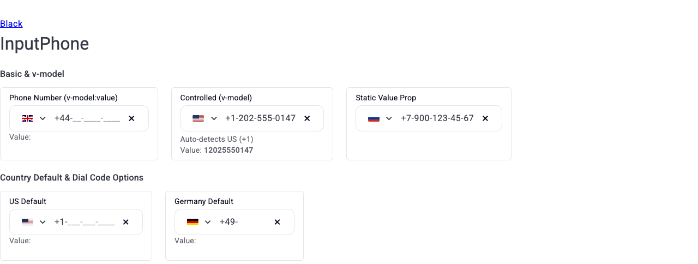
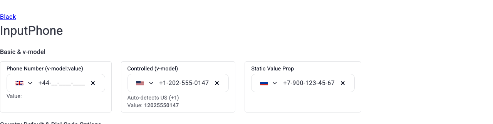
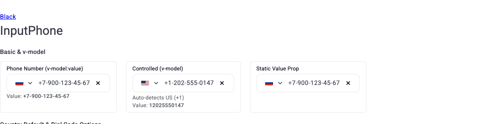
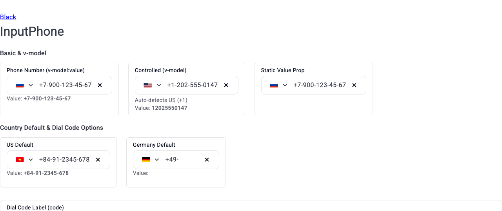

# Отчёт о визуальном и функциональном тестировании: D1InputPhone

## 1. Итоговое резюме

- **Компонент:** `D1InputPhone` (`@dxtmisha/d1`)
- **Исходный код:** [`InputPhone`](packages/d1/src/components/Ui/InputPhone) ([`constructor`](packages/constructor/src/constructors/InputPhone), [`demo`](packages/demo/src/pages/components/DemoInputPhonePage.vue))
- **Демо / целевой URL:** `http://localhost:3000/component-input-phone`
- **Материалы:** `None`
- **Дата тестирования (UTC):** `2026-11-20T06:46:40Z`
- **Окружение:** `Headless Chrome (Puppeteer / CDP, Desktop 1440x900, Tablet 768x1024, Mobile 375x812 / 320x568)`
- **Покрытие тест-кейсов:** 18 / 18 (`100%`)
- **Итог:** **18 ✅, 0 ⚠️, 0 ❌** (`✅` пройдено, `⚠️` предупреждение, `❌` провалено) — после полной пересборки пакетов (`media`, `functional-basic`, `functional`, `constructor`, `d1`, `demo`, `wiki`, `test`) компонент `D1InputPhone` успешно прошёл все 18 визуальных и функциональных сценариев, включая `phoneWithinSkip` для `KZ` (`+7-7-81-234-56-78`) и `GG` (`+44-1481-012345`), промежуточные маски `DE` (`+49-301-2345`), консистентный `getValue() === undefined` на старте пустого поля и синхронный `setValue()` (`TC-LOG-001`), а также отклонение пустого значения без цифр (`+`) при `required` (`TC-BND-002`) с нулевым числом ошибок и Vue-предупреждений в консоли.

---

## 2. Базовая матрица

### 2.1 Визуальное соответствие (`VIS`)

| ID | Сценарий | Статус | Фактический результат | Скриншот |
| :--- | :--- | :---: | :--- | :--- |
| `TC-VIS-001` | Базовый рендеринг и варианты внешнего вида (`classic`, `filled`, `outlined`, `tonal`, `boxed`, `basic`, `width`, `block`, `palette`) | ✅ | Отрисовано `70` экземпляров `.d1-field`, `64` триггера `.d1-inputPhoneDialCode__button`, `66` масок `.d1-mask`, без нулевых размеров (`hasZeroSize: false`); блок `Custom Width (280px)` имеет точную ширину `280px`. |  |
| `TC-VIS-002` | Размеры (`sm`, `md`, `lg`, `display`), выравнивание (`align`) и настройки `inputPhoneDialCodeAttrs` | ✅ | Высоты `.d1-field__body` соответствуют градации: `32px` (`sm`), `48px` (`md`), `64px` (`lg`), `72px` (`display`); кнопки `DialCode` отобразили `+84expand_more` и `United Stateskeyboard_arrow_down`. |  |
| `TC-VIS-003` | Иконки (`iconTrailing`), состояния (`loading`, `focus`, `selected`, `isSkeleton`, `disabled`, `readonly`) и кнопка очистки | ✅ | Отображены `2` индикатора `.d1-progress` (`Loading Boolean` и `Loading Object`), применён класс скелетона (`hasSkeletonClass: true`), отформатированы все `disabled`/`readonly` поля, визуально различимы `focus` и `selected`. |  |

### 2.2 Интерактивность и управление состоянием (`INT`)

| ID | Сценарий | Статус | Фактический результат | Скриншот |
| :--- | :--- | :---: | :--- | :--- |
| `TC-INT-001` | Двусторонняя привязка (`v-model:value`, `v-model`) и динамическое определение страны по цифрам | ✅ | Ввод `77812345678` (Казахстан с цифрой `8` после `+7-7`) успешно отформатировался в `+7-7-81-234-56-78` с флагом `ui-sys-flags--KZ` (`phoneWithinSkip`); ввод `79001234567` переключился на `RU` (`+7-900-123-45-67`). |  |
| `TC-INT-002` | Выбор страны в меню `DialCode`, автофокус на поле и режим `countryBlock` | ✅ | Карточка `Locked to Germany (DE)` скрывает `.d1-inputPhoneDialCode__button` (`blockedHasDialCode: false`); меню открыло `247` пунктов, выбор `Vietnam` установил `+84-` и вернул фокус в `<input>` (`focusReturnedToInput: true`), ввод `912345678` обновил значение до `+84-91-2345-678`. |  |
| `TC-INT-003` | Слоты (`prefix`, `suffix`, `leading`, `trailing`, `label`) и кнопка очистки (`cancel`) | ✅ | Отображены все слоты (`Tel:`, `EXT`, `[OK]`, `+1`, `Custom`); клик по кнопке `.d1-field__cancel` сбросил `+1-202-555-0147` до префикса `+1-`. |  |
| `TC-INT-004` | Динамическое изменение маски в зависимости от длины введённого номера | ✅ | Пресеты и ввод для `DE` перестроили маску по длине: `6` цифр -> `+49-301-234`, `7` (новая промежуточная маска `geo.json`) -> `+49-301-2345`, `10` -> `+49-301-234-5678`, `11` -> `+49-3012-345-6789`, `Backspace` -> `+49-301-234-5678`, `CN` `11` -> `+86-138-0013-8000`. |  |
| `TC-INT-005` | Разрешение конфликтующих и общих кодов стран (`GeoPhone`) | ✅ | Все проверенные конфликтные коды определили страну и маску: `+1-202-555-0147` (`United States`), `+1-416-555-0147` (`Canada`), `+7-900-123-45-67` (`Russia`), `+7-7-01-123-45-67` (`Kazakhstan`), `+44-20-7946-0958` (`United Kingdom`), `+44-1481-123456` и `+44-1481-012345` (с лидирующим `0`, `Guernsey`). |  |
| `TC-INT-006` | Обрезка слоя маски в узком поле (`180px`, `Mask/style.scss`) | ✅ | При сужении поля до `180px` с длинным номером `4930123456789` (`clientWidth: 46`, `scrollWidth: 148`) текст и маска корректно обрезаются по границе ввода и не накладываются на кнопку очистки `×`. |  |
| `TC-INT-007` | Реактивное обновление `countryDefault` (`InputPhoneData` watcher) | ✅ | На старте нетронутое поле имело страну по умолчанию `GB` (`+44-`), а изменённое — `RU` (`+7-900-123-45-67`). После нажатия `Set countryDefault = DE` нетронутое поле переключилось на `+49-` (`+49-___-___`), а изменённое сохранило `+7-900-123-45-67`. После сброса и нажатия `Set countryDefault = VN` нетронутое поле переключилось на `+84-` (`+84-__-____-___`), не затрагивая изменённое. |  |
| `TC-INT-008` | Ввод с внутренним префиксом страны (`8` для `RU`, `0` для `VN`, в т.ч. `countryBlock`) | ✅ | При вводе `89001234567` в `Russia (Trunk Prefix 8)` и `Russia Blocked (Trunk Prefix 8)` ведущая `8` отбрасывается (`~` в `+7-~**-***-**-**`), формируя `+7-900-123-45-67`; при вводе `0912345678` в `Vietnam (Trunk Prefix 0)` и `Vietnam Blocked (Trunk Prefix 0)` ведущий `0` отбрасывается (`=` в `+84-=*-****-***`), формируя `+84-91-2345-678`. |  |
| `TC-INT-009` | Раскрытие группы альтернативных кодов без выбора подкода (`Dominican Republic`) | ✅ | Клик по заголовку группы `Dominican Republic` раскрыл подкоды (`+1-809`, `+1-829`, `+1-849`), сохранив флаг `ui-sys-flags--VN` и значение `+84-`; после закрытия меню без выбора подкода флаг, метка `+84` и префикс `+84-` полностью сохранились, а последующий выбор `+1-829` переключил флаг на `DO` и значение на `+1-829-` (`consoleErrors: []`, `vueWarnings: []`). |  |

### 2.3 Границы и крайние сценарии (`BND`)

| ID | Сценарий | Статус | Фактический результат | Скриншот |
| :--- | :--- | :---: | :--- | :--- |
| `TC-BND-001` | Форматирование `disabled` / `readonly` (`InputPhoneFormat`), границы, Unicode и XSS | ✅ | Поля без `Mask` (`hasMaskLayer: false`) отображают отформатированное значение: `Disabled` -> `+7-900-123-45-67`, `Readonly` -> `+7-900-123-45-67`, `Disabled (Partial)` -> `+7-900-123`, `Readonly (Blocked US)` -> `+1-202-555-0`; все имеют `inputMode="tel"` и непустой `id`; строка `` экранирована как текст (`xssEscapedAsText: true`, `xssNoImgInjected: true`). |  |
| `TC-BND-002` | Валидация `required` при голом телефонном префиксе (`InputPhoneValidation`) | ✅ | На старте при голом префиксе `+1-` вызов `checkValidity()` возвращает `valid=false`; ввод `12025550147` (`+1-202-555-0147`) делает поле валидным (`valid=true`); полное стирание цифр до `+` также активирует `.d1-field--validation`, `aria-invalid="true"` и сообщение `Phone number is required` (`valid=false`). |  |
| `TC-BND-003` | Валидация неполного номера телефона (`isFull === false` + `textInvalidPhone`) | ✅ | На необязательном поле при голом префиксе `+7-` `checkValidity()` возвращает `valid=true, message=none`; при вводе `90012` (`+7-900-12`) и `blur` активируются `.d1-field--validation`, `aria-invalid="true"` и сообщение `Enter full phone number` (`valid=false`); дозаполнение до `+7-900-123-45-67` снимает ошибку (`valid=true`). |  |

### 2.4 Адаптивность (`RSP`)

| ID | Сценарий | Статус | Фактический результат | Скриншот |
| :--- | :--- | :---: | :--- | :--- |
| `TC-RSP-001` | Проверка вьюпортов `1440×900`, `768×1024`, `375×812` и `320×568` | ✅ | На всех `4` разрешениях горизонтальный скролл отсутствует (`overflow: false`): `scrollWidth === innerWidth` (`1440 / 768 / 375 / 320`). |  |

### 2.5 Доступность (`A11Y`)

| ID | Сценарий | Статус | Фактический результат | Скриншот |
| :--- | :--- | :---: | :--- | :--- |
| `TC-A11Y-001` | WAI-ARIA атрибуты и клавиатурная навигация (`Enter` / `Escape`) | ✅ | Все `70` инпутов имеют `inputMode="tel"` (`allTelMode: true`) и непустой `id` (`allHaveId: true`); все `64` триггера `DialCode` имеют `aria-haspopup="listbox"` (`allAriaHaspopup: true`); открытие меню по `Enter` и закрытие по `Escape` возвращает фокус на `<input>` поля (`focusReturnedOnEscape: true`). | — |

### 2.6 Логи и консоль (`LOG`)

| ID | Сценарий | Статус | Фактический результат | Скриншот |
| :--- | :--- | :---: | :--- | :--- |
| `TC-LOG-001` | `Exposed API`, события (`input`, `inputLite`, `change`, `changeLite`) и чистота консоли | ✅ | `Read Values` (пустой `required` со страной `US`) -> `value=undefined, valid=false, message=none`; `setValue('4930123456')` -> `value=4930123456, valid=true, message=none`; `clear()` -> `value=undefined, valid=false, message=none`; `Event Tracker` зафиксировал `changeLite`; `consoleErrors: []`, `vueWarnings: []`, `pageErrors: []`. | — |

---

## 3. AI-аудит и рекомендации

1. **Форматирование `disabled` и `readonly` значений ([InputPhoneFormat.ts](packages/constructor/src/constructors/InputPhone/InputPhoneFormat.ts), [GeoPhone.ts](packages/functional-basic/src/classes/GeoPhone.ts))**: Поддержка частичного форматирования (`isPartial = true` в `GeoPhone.getByPhoneFull` / `GeoPhone.toMask`) корректно работает без инициализации `Mask` как для полных номеров (`+7-900-123-45-67`), так и для частичных (`+7-900-123`) и `countryBlock: true` (`+1-202-555-0`).
2. **Устранение смещения `within` в [GeoPhone.ts](packages/functional-basic/src/classes/GeoPhone.ts) и [geo.json](packages/media/src/media/geo.json)**: Свойство `phoneWithinSkip: true` добавлено в `geo.json` для `KZ`, `AX`, `BQ`, `GG`, `IM`, `JE`, а `GeoPhone` учитывает `withinSkip` при генерации `mask` и `maskFull`. В браузере подтверждено, что ввод цифр `8` после `+7-7` (`+7-7-81-234-56-78`, Казахстан) и `0` после `+44-1481-` (`+44-1481-012345`, Гернси) больше не блокируется, а `geo.json` дополнен промежуточными масками для `DE`, `AT`, `FI`, `IT`, `LU`, `SE`, `IE`.
3. **Согласованность `getValue()` на старте пустого поля и синхронного `setValue()` ([InputPhoneData.ts](packages/constructor/src/constructors/InputPhone/InputPhoneData.ts))**: При маунте пустого поля `this.value().setFull(false)` гарантирует, что `getValue()` возвращает `undefined`, а не голый префикс `'1'`/`'7'`. Наблюдатель в `InputPhoneData.onMounted` переведён на `{ flush: 'sync' }`, благодаря чему синхронное обращение к `getValue()` сразу после `setValue('4930123456')` немедленно возвращает актуальное значение и статус `valid=true` (`TC-LOG-001`).
4. **Валидация `required` при пустом префиксе или удалении всех цифр до `+` ([InputPhoneValidation.ts](packages/constructor/src/constructors/InputPhone/InputPhoneValidation.ts))**: `checkByInput` проверяет `!cleanValue || this.isBareDefaultPrefix(cleanValue)` и нормализует оба случая в `''`, поэтому даже при стирании всего номера до одиночного `+` обязательное поле корректно остаётся невалидным (`TC-BND-002`).
5. **Игнорирование клика по заголовку группы в `DialCode` и автоскролл ([InputPhoneDialCode.ts](packages/constructor/src/constructors/InputPhoneDialCode/InputPhoneDialCode.ts), [ListFocus.ts](packages/constructor/src/constructors/List/ListFocus.ts))**: Клик по группе `Dominican Republic` раскрывает подкоды (`+1-809`, `+1-829`, `+1-849`) без сброса флага и кода `VN` (`+84`), а выбор `+1-829` переключает флаг на `DO` и маску на `+1-829-` (`TC-INT-009`).
