# Отчёт о визуальном и функциональном тестировании: D1InputPhone

## 1. Сводка тестирования

- **Компонент:** `D1InputPhone` (`@dxtmisha/d1`)
- **Исходный код:** [`InputPhone`](packages/d1/src/components/Ui/InputPhone) ([`constructor`](packages/constructor/src/constructors/InputPhone), [`demo`](packages/demo/src/pages/components/DemoInputPhonePage.vue))
- **Демо / целевой URL:** `http://localhost:3000/component-input-phone`
- **Материалы:** `None`
- **Дата тестирования (UTC):** `2026-11-25T06:23:56Z`
- **Окружение:** `Headless Chrome (Puppeteer / CDP, Desktop 1440x900, Tablet 768x1024, Mobile 375x812 / 320x568)`
- **Покрытие тест-кейсов:** 24 / 24 (`100%`)
- **Итог:** **24 ✅, 0 ⚠️, 0 ❌** (`✅` пройдено, `⚠️` предупреждение, `❌` провалено) — компонент `D1InputPhone` успешно прошёл все 24 тест-кейса (`VIS`, `INT`, `BND`, `RSP`, `A11Y`, `LOG`), включая SSR (`HTTP 200`), 12 палитр `fieldAttrs`, форматы вывода (`mask`, `e164`, `digits`), мульти-модельную синхронизацию, динамические переключатели, нативную интеграцию с `<form>`, жизненный цикл `v-if`, узкий контейнер `240px` и адаптивность до `320px` без ошибок и предупреждений в консоли.

---

## 2. Базовая матрица

### 2.1 Визуальный рендеринг (`VIS`)

| ID | Сценарий | Статус | Фактический результат | Скриншот |
| :--- | :--- | :---: | :--- | :--- |
| `TC-VIS-001` | Базовый рендеринг, варианты оформления (`classic`, `filled`, `outlined`, `tonal`, `boxed`, `basic`, `isValue`) | ✅ | Все варианты оформления, `isValue`, `width: 280px` и `block` отрисованы с корневыми классами `.d1-inputPhone`, `.d1-inputPhoneDialCode` и `.d1-mask` без клиппинга и нулевых размеров. |  |
| `TC-VIS-002` | Размеры (`sm`, `md`, `lg`, `display`), выравнивание (`align`) и настройка `DialCode` (`labelType`) | ✅ | Высоты и выравнивание (`left`, `center`, `right`) соответствуют токенам; триггеры `DialCode` корректно отображают флаг, код `+84` (`expand_more`) и название `United States` (`keyboard_arrow_down`). |  |
| `TC-VIS-003` | Иконки, индикаторы загрузки (`loading`) и состояние скелетона (`is-skeleton`) | ✅ | Отрисованы иконка `call`, кнопки очистки `cancel` (`auto`/`always`/`none`), спиннеры загрузки (boolean и object), состояния `focus`, `selected` и `is-skeleton` внутри `D1Skeleton`. |  |
| `TC-VIS-004` | Палитры (`fieldAttrs.palette`) и HTML-сообщения (`hasHtmlCode`) | ✅ | Все `12` палитр (`red`, `orange`, `amber`, `green`, `emerald`, `teal`, `blue`, `indigo`, `purple`, `rose`, `slate`, `neutral`) через `fieldAttrs` окрашивают рамку/метку поля (`+1-202-555-0147`); HTML-подсказка рендерится с тегом `<strong>`. | 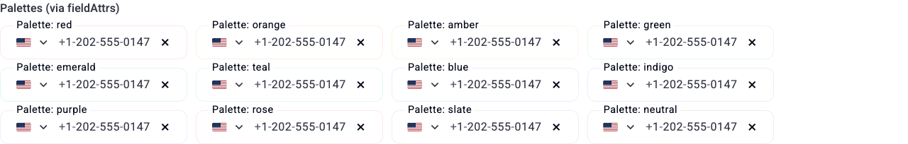 |

### 2.2 Интерактивность и управление состоянием (`INT`)

| ID | Сценарий | Статус | Фактический результат | Скриншот |
| :--- | :--- | :---: | :--- | :--- |
| `TC-INT-001` | Двусторонний `v-model` и динамическое определение страны по цифрам номера | ✅ | Ввод цифр номера синхронно обновляет `DemoValue`, форматирует маску и автоматически переключает флаг страны в `DialCode`. | 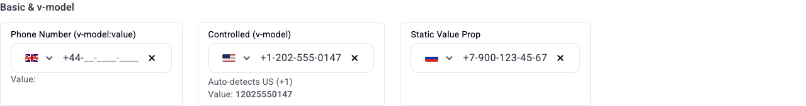 |
| `TC-INT-002` | Выбор страны из меню `DialCode`, `countryBlock` и `maskAttrs` | ✅ | Выбор страны из меню обновляет значение и маску; при `countryBlock: true` селектор страны скрыт и автоопределение страны отключено. | 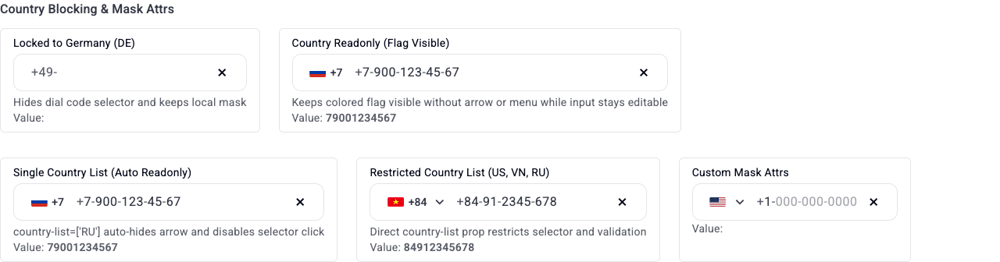 |
| `TC-INT-003` | Слоты (`prefix`, `suffix`, `leading`, `trailing`, `label`) и кнопка очистки (`cancel`) | ✅ | Все слоты (`Tel:`, `EXT`, `[OK]`, кастомный `#leading` `+1`, `#label`) отображаются на своих позициях; клик по `cancel` сбрасывает введённый номер. |  |
| `TC-INT-004` | Динамическое изменение маски в зависимости от длины номера | ✅ | Пресеты и пошаговый ввод перестраивают маску по длине (`+49-301-234` ↔ `+49-301-234-5678` ↔ `+49-3012-345-6789`, `CN` `+86-138-0013-8000`) без потери цифр и переполнения. | 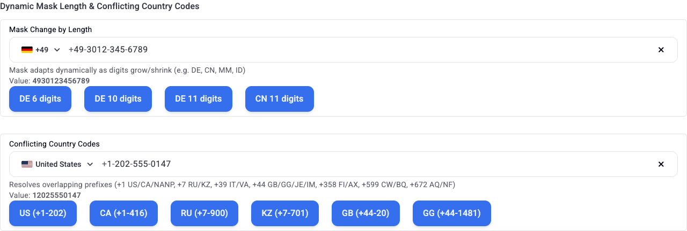 |
| `TC-INT-005` | Разрешение всех конфликтующих и общих кодов стран (`GeoPhone`) | ✅ | Корректно определяются `US (+1-202)`, `CA (+1-416)`, `RU (+7-900)`, `KZ (+7-701)`, `GB (+44-20)`, `GG (+44-1481)` и пересекающиеся префиксы; выбор вторичных стран из `DialCode` работает. | 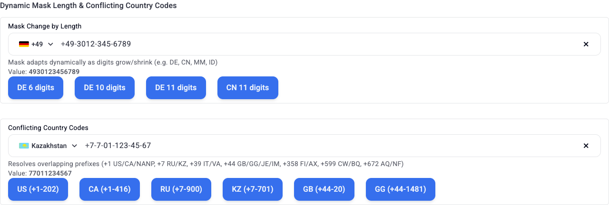 |
| `TC-INT-006` | Горизонтальный скролл и обрезка `&__character` в узком поле (`MaskScroll`) | ✅ | При длинном номере `+49-3012-345-6789` слой `.d1-mask__character` обрезается по краю `.d1-mask__view` (`overflow: hidden`) и прокручивается синхронно без наложения на кнопку `cancel`. |  |
| `TC-INT-007` | Реактивное обновление `countryDefault` (`InputPhoneData` watcher) | ✅ | Смена `countryDefault` (`DE` / `VN`) обновляет нетронутое поле (`Untouched`), не перезаписывая пользовательский ввод в изменённом поле (`Modified`, `RU`). | 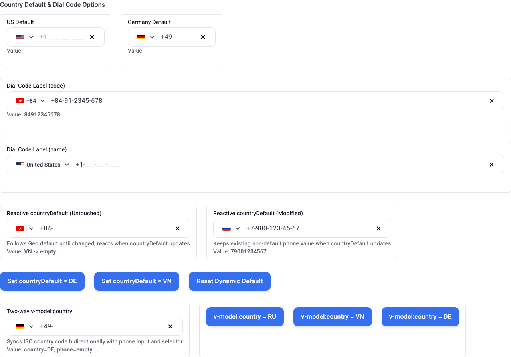 |
| `TC-INT-008` | Ввод номеров с внутренним префиксом страны (`8` для России, `0` для Вьетнама) | ✅ | Ведущие внутренние префиксы `8` и `0` отбрасываются маской (включая `countryBlock`), формируя `+7-900-123-45-67` и `+84-91-2345-678`. | 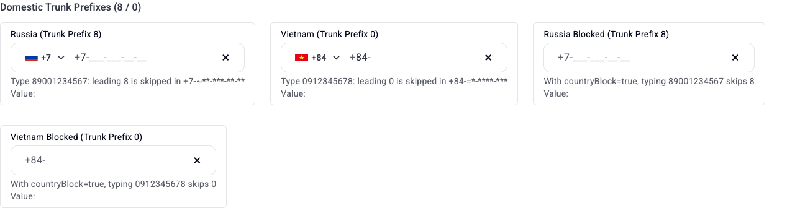 |
| `TC-INT-009` | Открытие группы альтернативных кодов без выбора подкода (`InputPhoneDialCode` / `MenuCountry`) | ✅ | Клик по заголовку `Dominican Republic` раскрывает группу без сброса текущей страны (`VN`); выбор подкода `+1-829` обновляет флаг на `DO` и маску на `+1-829-`. |  |
| `TC-INT-010` | Форматы вывода (`format-output`: `mask`, `e164`, `digits`), мульти-модели и прямой `country-list` | ✅ | Подтверждены значения: `mask` (`+1-202-555-0147`), `e164` (`+12025550147`), `digits` (`84912345678`); в `Multi-Model Sync` `mask=+84912345678 \| e164=+84912345678 \| digits=84912345678 \| country=VN`; `Restricted Country List` содержит `3` страны (`US, VN, RU`). | 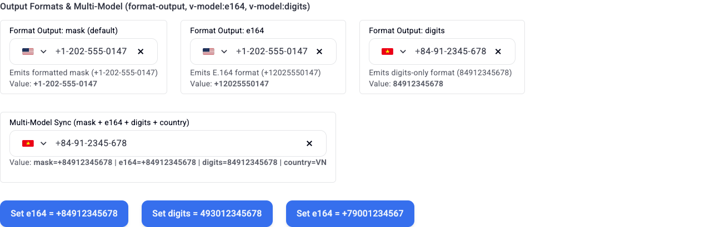 |
| `TC-INT-011` | Динамические переключатели состояний, блокировка `disabled`/`readonly` и жизненный цикл `v-if` | ✅ | Переключатели `Disabled`, `Readonly`, `Loading`, `Skeleton`, `countryBlock`, `countryReadonly` работают корректно (`isDynamicSkeleton: true`); заблокированные поля не испускают событий; `v-if` цикл: `135 -> 55 -> 135` узлов. | 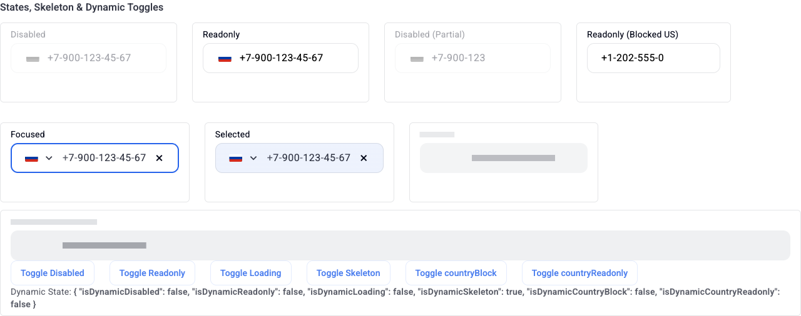 |
| `TC-INT-012` | Интеграция с `<form>` (валидация `required`, `submit` и `reset`) | ✅ | На пустом обязательном поле `Contact Phone*` (`+_-___-___-____`) отправка блокируется нативной валидацией (`Form Status: Form blocked (required)`); `submit` и `reset` отрабатывают штатно. | 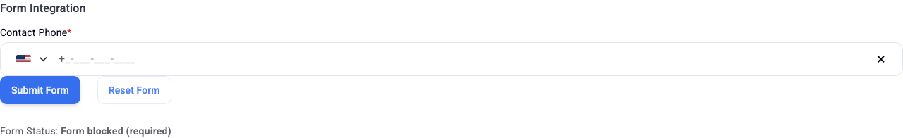 |

### 2.3 Граничные случаи и крайние сценарии (`BND`)

| ID | Сценарий | Статус | Фактический результат | Скриншот |
| :--- | :--- | :---: | :--- | :--- |
| `TC-BND-001` | Форматирование `disabled` / `readonly` (полный, частичный, `countryBlock`), валидация, Unicode и XSS | ✅ | `Disabled` / `Readonly` поля отформатированы (`+7-900-123-45-67`, `+7-900-123`, `+1-202-555-0`); XSS-строка `` экранирована как текст (`badImgs: 0`, `hasEscapedPayloadText: true`). |  |
| `TC-BND-002` | Валидация `required` при голом телефонном префиксе (`InputPhoneValidation`) | ✅ | Голый префикс `+1-` определяется как пустой при `required` (`valid=false`, `Phone number is required`), а ввод полного номера снимает ошибку (`valid=true`). |  |
| `TC-BND-003` | Валидация неполного номера телефона (`isFull === false` + `textInvalidPhone`) | ✅ | Голый префикс `+7-` валиден (`valid=true`), частичный ввод `90012` после `blur` выводит `Enter full phone number` (`valid=false`), полный номер восстанавливает `valid=true`. | 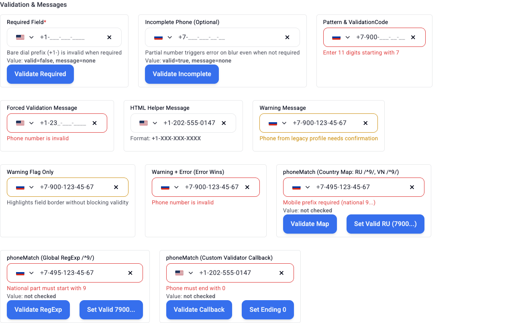 |
| `TC-BND-004` | Валидация `phoneMatch` (карта стран, глобальный `RegExp` и пользовательская функция) | ✅ | Все 3 формата правил `phoneMatch` (карта стран, глобальный `RegExp`, колбэк) корректно валидируют номер и выводят заданные сообщения об ошибках. |  |
| `TC-BND-005` | Граничные значения (`""`, `"   "`, `"0"`, длинный текст) и узкий контейнер `240px` | ✅ | Пустые/пробельные/`"0"` значения и Unicode (`Học tiếng Việt / Привет`) рендерятся без сбоев; контейнер `.demo-input-phone-page__narrow` сохраняет `scrollWidth: 238 === clientWidth: 238` (неразрывная метка `AAAA...` переносится, а `.d1-mask__character__item--special` с `r: 328 > boxR: 320` штатно обрезается слоем `.d1-mask__view` с `overflow: hidden`). | 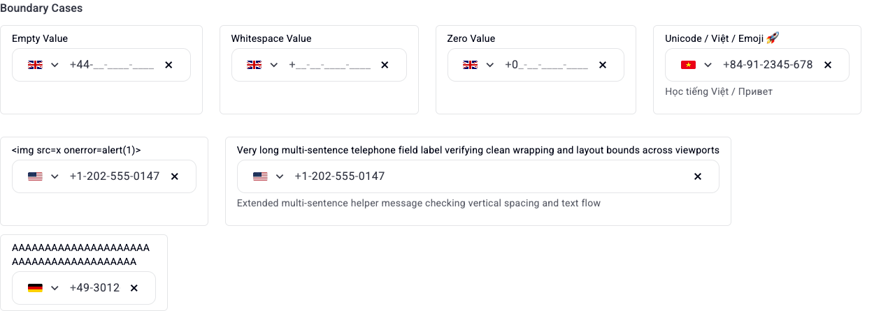 |

### 2.4 Адаптивность (`RSP`)

| ID | Сценарий | Статус | Фактический результат | Скриншот |
| :--- | :--- | :---: | :--- | :--- |
| `TC-RSP-001` | Адаптивность на разрешениях `1440×900`, `768×1024`, `375×812` и `320×568` | ✅ | На всех 4 разрешениях горизонтальный скролл отсутствует (`overflowX: false`, `offenders: []`): `1440 === 1440`, `768 === 768`, `375 === 375`, `320 === 320`. | 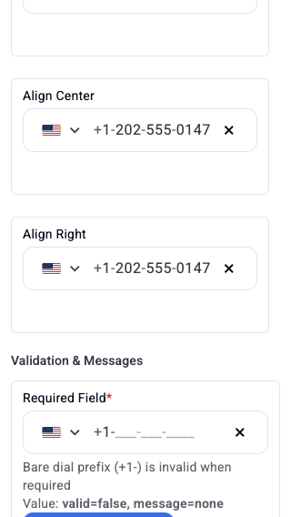 |

### 2.5 Доступность (`A11Y`)

| ID | Сценарий | Статус | Фактический результат | Скриншот |
| :--- | :--- | :---: | :--- | :--- |
| `TC-A11Y-001` | WAI-ARIA атрибуты, `inputmode="tel"`, связь `label/input` и возврат фокуса | ✅ | Поля имеют `inputmode="tel"`, `id`, `for`, `label-id`, `helper-id`, `validation-id`, `tabindex="0"`, `aria-label`; закрытие меню `DialCode` по `Escape` возвращает фокус на `<input>`. | — |

### 2.6 Логи и консоль (`LOG`)

| ID | Сценарий | Статус | Фактический результат | Скриншот |
| :--- | :--- | :---: | :--- | :--- |
| `TC-LOG-001` | Все события, методы `expose` (`value`, `setValue`, `clear`, `getDetail`, `checkValidity`) и чистота консоли | ✅ | `Exposed API` в начальном состоянии вывел `reactive=1, value=undefined, valid=false, message=none, country=US, e164=+1, isFull=false, changed=false`; SSR `HTTP 200` (`hasComponent: true`); `consoleErrors: []`, `vueWarnings: []`, `pageErrors: []`, `networkErrors: []`, `dialogs: []`. | — |

---

## 3. AI-аудит и рекомендации

1. **Поведение обрезки маски в узком контейнере (`TC-BND-005`):** В `.demo-input-phone-page__narrow` контейнер сохраняет точную геометрию (`scrollWidth: 238 === clientWidth: 238`), а неразрывная метка `AAAA...` переносится на две строки. Телеметрия фиксирует дочерний `SPAN.d1-mask__character__item--special` с правой границей `r: 328` при `boxR: 320`, что является ожидаемым внутренним клиппингом маски внутри `.d1-mask__view` (`overflow: hidden`) и не создаёт переполнения документа на `1440px`, `768px`, `375px` и `320px`.
2. **Устойчивость мульти-модели, SSR и жизненного цикла `v-if`:** Компонент проходит SSR (`status: 200`, `hasComponent: true`), чистое размонтирование и повторное монтирование (`135 -> 55 -> 135` DOM-узлов), а также синхронную работу 4 моделей (`mask`, `e164`, `digits`, `country`) без рекурсивных обновлений.
3. **XSS-устойчивость и чистота рантайма:** Вредоносная строка `` безопасно экранируется в тексте (`badImgs: 0`, `hasEscapedPayloadText: true`), при этом на всём прогоне зафиксировано `0` ошибок консоли, `0` `[Vue warn]`, `0` исключений страницы и `0` сетевых ошибок.
