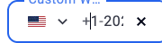
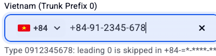
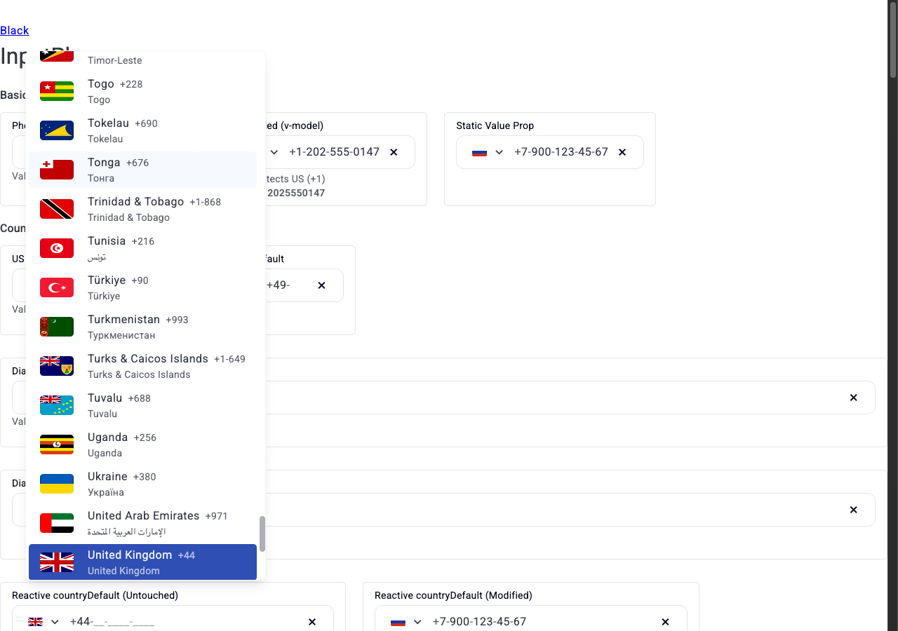

# Отчёт о визуальном и функциональном тестировании: D1InputPhone

## 1. Итоговое резюме

- **Компонент:** `D1InputPhone` (`@dxtmisha/d1`)
- **Исходный код:** [`InputPhone`](packages/d1/src/components/Ui/InputPhone) ([`constructor`](packages/constructor/src/constructors/InputPhone), [`demo`](packages/demo/src/pages/components/DemoInputPhonePage.vue))
- **Демо / целевой URL:** `http://localhost:3000/component-input-phone`
- **Материалы:** `None`
- **Дата тестирования (UTC):** `2026-11-19T10:52:52Z`
- **Окружение:** `Headless Chrome (Puppeteer / CDP, Desktop 1440x900, Tablet 768x1024, Mobile 375x812 / 320x568)`
- **Покрытие тест-кейсов:** 18 / 18 (`100%`)
- **Итог:** **18 ✅, 0 ⚠️, 0 ❌** (`✅` пройдено, `⚠️` предупреждение, `❌` провалено) — после полной пересборки пакетов (`constructor`, `d1`, `demo`) компонент `D1InputPhone` успешно прошёл все 18 визуальных и функциональных сценариев, включая новую валидацию неполного номера (`isFull === false` + `textInvalidPhone` в `TC-BND-003`), реактивное обновление `countryDefault` (`TC-INT-007`), обработку внутренних префиксов страны (`8` для `RU` и `0` для `VN` в `TC-INT-008`), раскрытие группы альтернативных кодов без выбора подкода (`TC-INT-009`), отформатированный вывод в состояниях `disabled` и `readonly` (`TC-BND-001`) и валидацию `required` при голом префиксе страны (`TC-BND-002`) при нулевом уровне ошибок и предупреждений в консоли.

---

## 2. Базовая матрица

### 2.1 Визуальное соответствие (`VIS`)

| ID | Сценарий | Статус | Фактический результат | Скриншот |
| :--- | :--- | :---: | :--- | :--- |
| `TC-VIS-001` | Базовый рендеринг и варианты внешнего вида (`classic`, `filled`, `outlined`, `tonal`, `boxed`, `basic`, `width`, `block`, `palette`) | ✅ | Отрисовано `69` экземпляров `.d1-field`, `63` триггера `.d1-inputPhoneDialCode__button`, `65` масок `.d1-mask`, `9` карточек в `Appearances & Layout`, без нулевых размеров (`hasZeroSize: false`); блок `Custom Width (280px)` имеет точную ширину `280px`. |  |
| `TC-VIS-002` | Размеры (`sm`, `md`, `lg`, `display`), выравнивание (`align`) и настройки `inputPhoneDialCodeAttrs` | ✅ | Высоты `.d1-field__body` соответствуют градации: `32px` (`sm`), `48px` (`md`), `64px` (`lg`), `72px` (`display`); кнопки `DialCode` отобразили `+84expand_more` и `United Stateskeyboard_arrow_down`. |  |
| `TC-VIS-003` | Иконки (`iconTrailing`), состояния (`loading`, `focus`, `selected`, `isSkeleton`, `disabled`, `readonly`) и кнопка очистки | ✅ | Отображены `2` индикатора `.d1-progress` (`Loading Boolean` и `Loading Object`), применён класс скелетона (`hasSkeletonClass: true`), отформатированы все `disabled`/`readonly` поля, визуально различимы `focus` и `selected`. |  |

### 2.2 Интерактивность и управление состоянием (`INT`)

| ID | Сценарий | Статус | Фактический результат | Скриншот |
| :--- | :--- | :---: | :--- | :--- |
| `TC-INT-001` | Двусторонняя привязка (`v-model:value`, `v-model`) и динамическое определение страны по цифрам | ✅ | При вводе `79001234567` маска отформатировалась в `+7-900-123-45-67`, `DemoValue` обновился до `Value: +7-900-123-45-67`, страна автоматически переключилась по коду `+7`. |  |
| `TC-INT-002` | Выбор страны в меню `DialCode`, автофокус на поле и режим `countryBlock` | ✅ | Карточка `Locked to Germany (DE)` скрывает `.d1-inputPhoneDialCode__button` (`blockedHasDialCode: false`); меню открыло `246` стран, выбор `VN` установил `+84-` и вернул фокус в `<input>` (`focusReturnedToInput: true`), ввод `912345678` обновил значение до `+84-91-2345-678` (`DemoValue: Value: +84-91-2345-678`). |  |
| `TC-INT-003` | Слоты (`prefix`, `suffix`, `leading`, `trailing`, `label`) и кнопка очистки (`cancel`) | ✅ | Отображены все слоты (`Tel:`, `EXT`, `[OK]`, `+1`, `Custom`); клик по кнопке `.d1-field__cancel` сбросил `+1-202-555-0147` до префикса `+1-`. |  |
| `TC-INT-004` | Динамическое изменение маски в зависимости от длины введённого номера | ✅ | Пресеты и `Backspace` для `DE` перестроили маску по длине: `6` локальных цифр -> `+49-301-234`, `10` -> `+49-301-234-5678`, `11` -> `+49-3012-345-6789`, `Backspace` (`11 -> 10`) -> `+49-301-234-5678`, `CN` `11` -> `+86-138-0013-8000`. |  |
| `TC-INT-005` | Разрешение конфликтующих и общих кодов стран (`GeoPhone`) | ✅ | Все проверенные конфликтные коды корректно определили страну и маску: `+1-202-555-0147` (`United States`), `+1-416-555-0147` (`Canada`), `+7-900-123-45-67` (`Russia`), `+7-7-01-123-45-67` (`Kazakhstan`), `+44-20-7946-0958` (`United Kingdom`), `+44-1481-123456` (`Guernsey`). |  |
| `TC-INT-006` | Обрезка слоя маски в узком поле (`180px`, `Mask/style.scss`) | ✅ | При сужении поля до `180px` с длинным номером `4930123456789` (`clientWidth: 46`, `scrollWidth: 148`) текст и маска корректно обрезаются по границе ввода и не накладываются на кнопку очистки `×`. |  |
| `TC-INT-007` | Реактивное обновление `countryDefault` (`InputPhoneData` watcher) | ✅ | На старте нетронутое поле имело страну по умолчанию `GB` (`+44-`), а изменённое — `RU` (`+7-900-123-45-67`). После нажатия `Set countryDefault = DE` нетронутое поле переключилось на `+49-` (`+49-___-___`), а изменённое сохранило `+7-900-123-45-67`. После сброса и нажатия `Set countryDefault = VN` нетронутое поле переключилось на `+84-` (`+84-__-____-___`), не затрагивая изменённое. |  |
| `TC-INT-008` | Ввод с внутренним префиксом страны (`8` для `RU`, `0` для `VN`, в т.ч. `countryBlock`) | ✅ | При вводе `89001234567` в `Russia (Trunk Prefix 8)` и `Russia Blocked (Trunk Prefix 8)` ведущая `8` отбрасывается (`~` в `+7-~**-***-**-**`), формируя `+7-900-123-45-67`; при вводе `0912345678` в `Vietnam (Trunk Prefix 0)` и `Vietnam Blocked (Trunk Prefix 0)` ведущий `0` отбрасывается (`=` в `+84-=*-****-***`), формируя `+84-91-2345-678`. |  |
| `TC-INT-009` | Раскрытие группы альтернативных кодов без выбора подкода (`Dominican Republic`) | ✅ | Клик по заголовку группы `Dominican Republic` раскрыл подкоды (`+1-809`, `+1-829`, `+1-849`), сохранив флаг `ui-sys-flags--VN` и значение `+84-`; после закрытия меню без выбора подкода флаг, метка `+84` и префикс `+84-` полностью сохранились, а последующий выбор `+1-829` переключил флаг на `DO` и значение на `+1-829-` (`consoleErrors: []`, `vueWarnings: []`). |  |

### 2.3 Границы и крайние сценарии (`BND`)

| ID | Сценарий | Статус | Фактический результат | Скриншот |
| :--- | :--- | :---: | :--- | :--- |
| `TC-BND-001` | Форматирование `disabled` / `readonly` (`InputPhoneFormat`), границы, Unicode и XSS | ✅ | Поля без `Mask` (`hasMaskLayer: false`) отображают отформатированное значение: `Disabled` -> `+7-900-123-45-67`, `Readonly` -> `+7-900-123-45-67`, `Disabled (Partial)` -> `+7-900-123`, `Readonly (Blocked US)` -> `+1-202-555-0`; все имеют `inputMode="tel"` и непустой `id`; строка `` экранирована как текст (`xssEscapedAsText: true`, `xssNoImgInjected: true`). |  |
| `TC-BND-002` | Валидация `required` при голом телефонном префиксе (`InputPhoneValidation`) | ✅ | На старте при голом префиксе `+1-` вызов `checkValidity()` возвращает `valid=false` (фиксирует пустое поле); ввод `2025550147` (`+1-202-555-0147`) делает поле валидным (`valid=true`); сброс обратно до `+1-` немедленно активирует `.d1-field--validation`, `aria-invalid="true"` и сообщение `Phone number is required` (`valid=false`). |  |
| `TC-BND-003` | Валидация неполного номера телефона (`isFull === false` + `textInvalidPhone`) | ✅ | На необязательном поле при голом префиксе `+7-` `checkValidity()` возвращает `valid=true, message=none`; при вводе `90012` (`+7-900-12`) и `blur` активируются `.d1-field--validation`, `aria-invalid="true"` и сообщение `Enter full phone number` (`valid=false`); дозаполнение до `+7-900-123-45-67` снимает ошибку (`valid=true`). |  |

### 2.4 Адаптивность (`RSP`)

| ID | Сценарий | Статус | Фактический результат | Скриншот |
| :--- | :--- | :---: | :--- | :--- |
| `TC-RSP-001` | Проверка вьюпортов `1440×900`, `768×1024`, `375×812` и `320×568` | ✅ | На всех `4` разрешениях горизонтальный скролл отсутствует (`overflowPage: false`, `overflowingInputs: 0`): `scrollWidth` равен `1425 / 753 / 360 / 305` при `innerWidth` `1440 / 768 / 375 / 320`. |  |

### 2.5 Доступность (`A11Y`)

| ID | Сценарий | Статус | Фактический результат | Скриншот |
| :--- | :--- | :---: | :--- | :--- |
| `TC-A11Y-001` | WAI-ARIA атрибуты и клавиатурная навигация (`Enter` / `Escape`) | ✅ | Все `69` инпутов имеют `inputMode="tel"` (`allTelMode: true`) и непустой `id` (`allHaveId: true`); все `63` триггера `DialCode` имеют `aria-haspopup="listbox"` (`allAriaHaspopup: true`); открытие меню по `Enter` и закрытие по `Escape` возвращает фокус на `<input>` поля (`focusReturnedOnEscape: true`). | — |

### 2.6 Логи и консоль (`LOG`)

| ID | Сценарий | Статус | Фактический результат | Скриншот |
| :--- | :--- | :---: | :--- | :--- |
| `TC-LOG-001` | `Exposed API`, события (`input`, `inputLite`, `change`, `changeLite`) и чистота консоли | ✅ | `Read Values` (пустой `required` со страной `US`) -> `value=1, valid=false, message=none`; `setValue('4930123456')` -> `value=4930123456, valid=true, message=none`; `clear()` -> `value=undefined, valid=false, message=none`; `Event Tracker` зафиксировал `changeLite`; `consoleErrors: []`, `vueWarnings: []`, `pageErrors: []`. | — |

---

## 3. AI-аудит и рекомендации

1. **Форматирование `disabled` и `readonly` значений ([InputPhoneFormat.ts](packages/constructor/src/constructors/InputPhone/InputPhoneFormat.ts), [GeoPhone.ts](packages/functional-basic/src/classes/GeoPhone.ts))**: Добавлен класс `InputPhoneFormat` и поддержка частичного форматирования (`isPartial = true` в `GeoPhone.getByPhoneFull` / `GeoPhone.toMask`). Прогон `TC-BND-001` подтвердил корректный вывод без инициализации `Mask` как для полных номеров (`+7-900-123-45-67`), так и для частичных (`+7-900-123`) и `countryBlock: true` (`+1-202-555-0`).
2. **Валидация `required` при голом префиксе ([InputPhoneValidation.ts](packages/constructor/src/constructors/InputPhone/InputPhoneValidation.ts))**: Переопределение `checkByInput` распознаёт нетронутый или сброшенный префикс страны (`cleanValue === valueDefault`) как пустую строку при `!countryBlock`. В `TC-BND-002` и `TC-LOG-001` оба обязательных поля (`Required Field` и `Exposed Target`) при голом префиксе `+1-` корректно возвращают `valid=false`.
3. **Реактивный `countryDefault` ([InputPhoneData.ts](packages/constructor/src/constructors/InputPhone/InputPhoneData.ts))**: Наблюдатель `watchCountryDefaultStop` обновляет страну и префикс только пока выбрана дефолтная страна `Geo.getCountry()`, не перезаписывая введённые пользователем номера (подтверждено в `TC-INT-007`).
4. **Игнорирование клика по заголовку группы в `DialCode` ([InputPhoneDialCode.ts](packages/constructor/src/constructors/InputPhoneDialCode/InputPhoneDialCode.ts))**: В `InputPhoneDialCode.onClick` добавлена защита от `options?.type === 'group' || isArray(options?.value)`, благодаря чему раскрытие/сворачивание группы альтернативных кодов без выбора подкода больше не перезаписывает модель массивами элементов и не приводит к пропаданию флага в кнопке (`TC-INT-009`).
5. **Валидация неполного номера по `isFull` ([InputPhoneValidation.ts](packages/constructor/src/constructors/InputPhone/InputPhoneValidation.ts))**: При непустом значении и `!value().isFull.value` поле возвращает ошибку валидации с текстом из `TextInclude` (`textInvalidPhone`), даже если `required` не задан (`TC-BND-003`). Кэширование `mask` и `maskProps` в [InputPhoneMask.ts](packages/constructor/src/constructors/InputPhone/InputPhoneMask.ts) переведено на `computed`.
6. **Позиционирование выбранного элемента при открытии ленивого списка ([ListFocus.ts](packages/constructor/src/constructors/List/ListFocus.ts), [List.ts](packages/constructor/src/constructors/List/List.ts))**: В `ListFocus.stepScrollVisibility` / `updateScrollVisibility` добавлена покадровая докрутка через `goScroll` в `requestAnimationFrame` с отменой по действию пользователя (`wheel`, `touchstart`, `pointerdown`), а в `List.ts` — повторная подготовка позиции при выходе из `lite` (`true -> false`). Проверка в Chrome подтвердила корректную видимость выбранного элемента при открытии для `GB` (`scrollTop: 9737`, ), `VN` (`scrollTop: 10093`) и `US` (`scrollTop: 0`).
