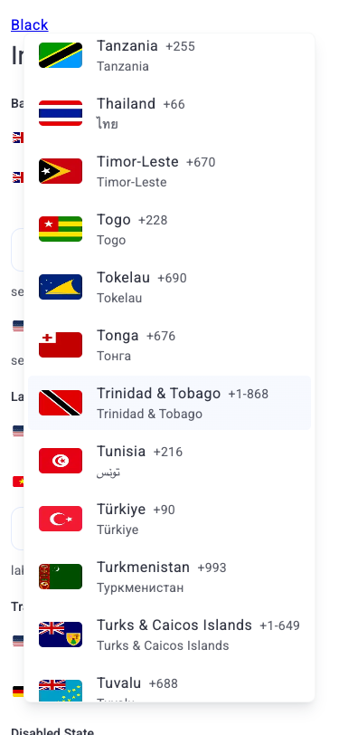

# Отчёт о визуальном и функциональном тестировании: D1InputPhoneDialCode

## 1. Итоговое резюме

- **Компонент:** `D1InputPhoneDialCode` (`@dxtmisha/d1`)
- **Исходный код:** [`InputPhoneDialCode`](packages/d1/src/components/Ui/InputPhoneDialCode) ([`constructor`](packages/constructor/src/constructors/InputPhoneDialCode), [`demo`](packages/demo/src/pages/components/DemoInputPhoneDialCodePage.vue))
- **Демо / целевой URL:** `http://localhost:3000/component-input-phone-dial-code`
- **Материалы:** `None`
- **Дата тестирования (UTC):** `2026-11-18T07:49:52Z`
- **Окружение:** `Headless Chrome (Puppeteer / CDP, Desktop 1440x900, Tablet 768x1024, Mobile 375x812 / 320x568)`
- **Покрытие тест-кейсов:** 9 / 9 (`100%`)
- **Итог:** **9 ✅, 0 ⚠️, 0 ❌** (`✅` пройдено, `⚠️` предупреждение, `❌` провалено) — компонент `D1InputPhoneDialCode` корректно отображает флаг страны, настраиваемые метки (`none`, `code`, `name`) и стрелку (`icon-arrow-down`), поддерживает двустороннюю привязку (`v-model:model-selected` и `:value` + `@update:selected`), фильтрацию и поиск через `menu-country-attrs`, состояние `disabled`, `disableFocusReturn: true`, WAI-ARIA и адаптивность при нулевом уровне ошибок и предупреждений в консоли.

---

## 2. Базовая матрица

### 2.1 Визуальное соответствие (`VIS`)

| ID | Сценарий | Статус | Фактический результат | Скриншот |
| :--- | :--- | :---: | :--- | :--- |
| `TC-VIS-001` | Базовый рендеринг, автоопределение страны и режимы отображения метки (`label-type`) | ✅ | На странице отрисован `21` триггер; кнопки в группе `Label Display Types` имеют высоту `32px`, ширину `56.06px` (`none`), `114.44px` (`code`: `+1`), `145.45px` (`name`: `United States`), флаг и стрелку без клиппинга. |  |
| `TC-VIS-002` | Настройка иконки-стрелки (`icon-arrow-down`) и стилей кнопки (`button-attrs`) | ✅ | Отображены иконки `keyboard_arrow_down`, `expand_more`, `arrow_drop_down`; модификаторы `button-attrs` применили классы `d1-button--outline` и `d1-button--size--md`. |  |
| `TC-VIS-003` | Открытие меню выбора страны и отображение телефонных кодов | ✅ | Всплывающее меню `.d1-window__body` (`335.16×756px`) открылось с `246` странами, флагами и телефонными кодами; кнопка переключила `aria-expanded="true"` и `.d1-icon--turn`. |  |

### 2.2 Интерактивность и управление состоянием (`INT`)

| ID | Сценарий | Статус | Фактический результат | Скриншот |
| :--- | :--- | :---: | :--- | :--- |
| `TC-INT-001` | Двусторонняя привязка (`v-model:model-selected`, `:value` + `@update:selected`) и переключение `label-type` | ✅ | Кнопки `Select US` / `Select FR` и выбор `VN` в меню синхронно обновили кнопку (`+1` → `+33` → `+84`) и `DemoValue` (`VN`); переключение `label-type` изменило текст на `""` / `"Vietnam"` / `"+84"`. |  |
| `TC-INT-002` | Фильтрация списка, поиск и локализация через `menu-country-attrs` | ✅ | Список ограничен `6` странами (`France`, `Germany`, `Japan`, `United Kingdom`, `United States`, `Vietnam`); поиск `"Viet"` отфильтровал до `Vietnam +84`; смена `language="ru"` локализовала метку на `"Вьетнам"`. |  |

### 2.3 Границы и крайние сценарии (`BND`)

| ID | Сценарий | Статус | Фактический результат | Скриншот |
| :--- | :--- | :---: | :--- | :--- |
| `TC-BND-001` | Состояние `disabled`, пустой поиск и сброс модели (`undefined`) | ✅ | Кнопки `disabled` имеют атрибут `disabled`, не содержат `.d1-button__trailing` и не открывают меню (`disabledOpened: false`); `Clear` вернул страну по умолчанию (`+44`); поиск `"zzzzzz"` отобразил `"Nothing found"`. |  |

### 2.4 Адаптивность (`RSP`)

| ID | Сценарий | Статус | Фактический результат | Скриншот |
| :--- | :--- | :---: | :--- | :--- |
| `TC-RSP-001` | Адаптивность на разрешениях `1440×900`, `768×1024`, `375×812` и `320×568` | ✅ | На всех 4 разрешениях горизонтальное переполнение отсутствует (`overflow: false`, `scrollWidth === innerWidth`); на `375×812` открытое меню (`323.16×740px`, `left: 26`, `right: 349.16`) полностью помещается во вьюпорт. |  |

### 2.5 Доступность (`A11Y`)

| ID | Сценарий | Статус | Фактический результат | Скриншот |
| :--- | :--- | :---: | :--- | :--- |
| `TC-A11Y-001` | WAI-ARIA атрибуты, клавиатурное управление и `disableFocusReturn` | ✅ | Подтверждены `aria-haspopup="listbox"`, переключение `aria-expanded` (`"false"` → `"true"` по `Enter` → `"false"` при выборе) и `activeElementIsTrigger: false` после закрытия (`disableFocusReturn: true`). | — |

### 2.6 Логи и консоль (`LOG`)

| ID | Сценарий | Статус | Фактический результат | Скриншот |
| :--- | :--- | :---: | :--- | :--- |
| `TC-LOG-001` | События (`click`, `clickLite`, `updateValue`, `window`) и чистота консоли | ✅ | Зафиксированы события `updateValue`, `click`, `clickLite` и `window` (`open=false`), `selectedEvents: VN`; `consoleErrors`: `[]`, `vueWarnings`: `[]`, `pageErrors`: `[]`. | — |

---

## 3. AI-аудит и рекомендации

1. **Автоимпорт `D1InputPhoneDialCode` в Vite-плагине ([design.ts](file:///Users/tung/Documents/GitHub/dxt-ui/packages/d1/src/library/design.ts))**: Исправлена генерация регулярного выражения в [LibraryList.ts](file:///Users/tung/Documents/GitHub/dxt-ui/packages/scripts/src/classes/Library/LibraryList.ts#L152) (`.replace(/-/g, '-?')`), благодаря чему для многословных компонентов формируется паттерн `input-?phone-?dial-?code`. Повторная проверка в браузере подтвердила, что `<D1InputPhoneDialCode>` автоматически резолвится без ручного импорта на [DemoInputPhoneDialCodePage.vue](file:///Users/tung/Documents/GitHub/dxt-ui/packages/demo/src/pages/components/DemoInputPhoneDialCodePage.vue) и при нулевом числе `vueWarnings`.
2. **Рендер кнопки в состоянии `disabled` и SSR**: Благодаря передаче `() => true` в `renderControl` (`InputPhoneDialCodeDesign.tsx`) кнопка-триггер стабильно рендерится как при `disabled: true`, так и на SSR до монтирования `MenuCountry`, без мигания и предупреждений гидратации.
3. **Поведение `icon-arrow-down` со значением по умолчанию**: В `D1InputPhoneDialCode` проп `iconArrowDown` имеет значение по умолчанию `'keyboard_arrow_down'`, поэтому передача `undefined` оставляет стрелку по умолчанию; для полного скрытия стрелки необходимо передавать пустую строку `""`.
