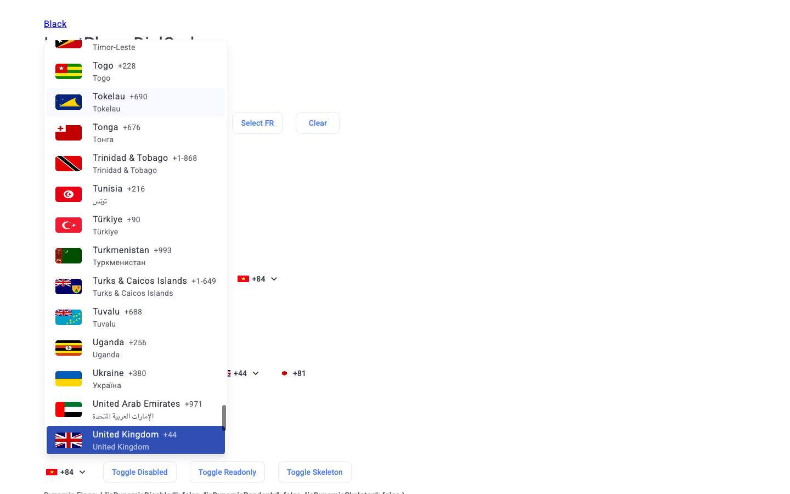
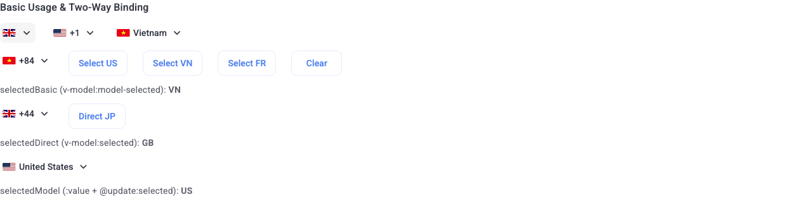
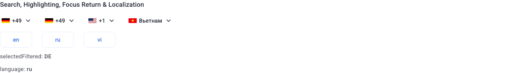
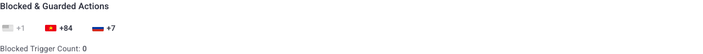

# Отчёт о визуальном и функциональном тестировании: D1InputPhoneDialCode

## 1. Сводка тестирования

- **Компонент:** `D1InputPhoneDialCode` (`@dxtmisha/d1`)
- **Исходный код:** [`InputPhoneDialCode`](packages/d1/src/components/Ui/InputPhoneDialCode) ([`constructor`](packages/constructor/src/constructors/InputPhoneDialCode), [`demo`](packages/demo/src/pages/components/DemoInputPhoneDialCodePage.vue))
- **Демо / целевой URL:** `http://localhost:3000/component-input-phone-dial-code`
- **Материалы:** `None`
- **Дата тестирования (UTC):** `2026-11-25T06:23:56Z`
- **Окружение:** `Headless Chrome (Puppeteer / CDP, Desktop 1440x900, Tablet 768x1024, Mobile 375x812 / 320x568)`
- **Покрытие тест-кейсов:** 11 / 11 (`100%`)
- **Итог:** **11 ✅, 0 ⚠️, 0 ❌** (`✅` пройдено, `⚠️` предупреждение, `❌` провалено) — компонент `D1InputPhoneDialCode` прошёл все 11 тест-кейсов (`VIS`, `INT`, `BND`, `RSP`, `A11Y`, `LOG`), подтвердив корректность SSR (`HTTP 200`), двусторонней привязки (`v-model:model-selected`, `v-model:selected`, `:value` + `@update:selected`), поиска и фильтрации, альтернативных кодов, узкого контейнера `240px`, жизненного цикла `v-if` и адаптивности до `320px` без ошибок в консоли.

---

## 2. Базовая матрица

### 2.1 Визуальный рендеринг (`VIS`)

| ID | Сценарий | Статус | Фактический результат | Скриншот |
| :--- | :--- | :---: | :--- | :--- |
| `TC-VIS-001` | Базовый рендеринг, автоопределение страны и режимы отображения метки (`label-type`) | ✅ | Триггеры `.d1-inputPhoneDialCode__button` и `.d1-button` корректно отображают флаг страны, стрелку и метки для режимов `none` (`""`), `code` (`+1`) и `name` (`United States`) без клиппинга. |  |
| `TC-VIS-002` | Настройка иконки-стрелки (`icon-arrow-down`) и стилей кнопки (`button-attrs`) | ✅ | Отображены все варианты стрелки (`keyboard_arrow_down`, `expand_more`, `arrow_drop_down`, `undefined`, `null` без стрелки) и модификации `button-attrs` (палитры, размеры `sm`/`md`/`lg`, `roundedFull`). |  |
| `TC-VIS-003` | Открытие меню выбора страны и отображение телефонных кодов | ✅ | Всплывающее меню `MenuCountry` открылось (`menuOpen: true`) со списком стран, флагами и телефонными кодами без клиппинга; кнопка-триггер переключила `aria-expanded="true"` и поворот стрелки. |  |

### 2.2 Интерактивность и управление состоянием (`INT`)

| ID | Сценарий | Статус | Фактический результат | Скриншот |
| :--- | :--- | :---: | :--- | :--- |
| `TC-INT-001` | Двусторонняя привязка (`v-model:model-selected`, `v-model:selected`, `:value` + `@update:selected`) и переключение `label-type` | ✅ | Синхронизация подтверждена для всех 3 биндингов: `Basic (v-model:model-selected): VN`, `Direct (v-model:selected): GB`, `Model (:value + @update:selected): US`; переключение `label-type` немедленно меняет формат метки. |  |
| `TC-INT-002` | Прямой поиск, фильтрация списка, `highlightLengthStart` и локализация (`language`) | ✅ | Ограниченный список `country-list` (`7` стран) фильтруется запросом `"Viet"` до `Vietnam`, порог подсветки `highlightLengthStart="3"` соблюдается, `:show-search="false"` скрывает поиск, смена `language` (`ru`, `vi`) переводит названия. |  |
| `TC-INT-003` | Альтернативные коды (`DO`, `VA`), авто-блокировка `country-list`, динамические состояния и `v-if` | ✅ | Выбор подкода `DO` обновляет флаг и код, `['RU']` и `[]` блокируются без стрелки, `['DO']` открывается, динамические переключатели (`disabled`/`readonly`/`isSkeleton`) и цикл `v-if` (`76 -> 55 -> 76` узлов) работают без ошибок. |  |

### 2.3 Граничные случаи и крайние сценарии (`BND`)

| ID | Сценарий | Статус | Фактический результат | Скриншот |
| :--- | :--- | :---: | :--- | :--- |
| `TC-BND-001` | Блокировка `disabled` / `readonly` / `['RU']`, пустой поиск и сброс модели (`undefined`) | ✅ | Заблокированные триггеры не открывают меню (`Blocked Trigger Count: 0`); `Clear` сбрасывает к стране по умолчанию через `Geo.getCountry()`; поиск `"zzzzzz"` выводит пустое состояние. |  |
| `TC-BND-002` | Граничные значения (`""`, `"   "`, `"ZZ"`) и длинное название в узком контейнере `240px` | ✅ | Пустые/пробельные/`"ZZ"` значения обрабатываются без падений (`badImgs: 0`); триггер `Bosnia & Herzegovina` (`BA`, `label-type="name"`) полностью помещается внутри `.demo-input-phone-dial-code-page__narrow` (`scrollWidth: 238 === clientWidth: 238`, `overflowsBox: false`). |  |

### 2.4 Адаптивность (`RSP`)

| ID | Сценарий | Статус | Фактический результат | Скриншот |
| :--- | :--- | :---: | :--- | :--- |
| `TC-RSP-001` | Адаптивность на разрешениях `1440×900`, `768×1024`, `375×812` и `320×568` | ✅ | На всех 4 разрешениях горизонтальное переполнение отсутствует (`overflowX: false`, `offenders: []`): `1440 === 1440`, `768 === 768`, `375 === 375`, `320 === 320`; открытое меню на мобильном экране помещается во вьюпорте. |  |

### 2.5 Доступность (`A11Y`)

| ID | Сценарий | Статус | Фактический результат | Скриншот |
| :--- | :--- | :---: | :--- | :--- |
| `TC-A11Y-001` | WAI-ARIA атрибуты, клавиатурное управление и `disableFocusReturn` | ✅ | На триггерах присутствуют `aria-haspopup="listbox"`, `aria-expanded` и `aria-label`; открытие по `Enter` и закрытие по `Escape` корректно управляются флагом `disableFocusReturn`. | — |

### 2.6 Логи и консоль (`LOG`)

| ID | Сценарий | Статус | Фактический результат | Скриншот |
| :--- | :--- | :---: | :--- | :--- |
| `TC-LOG-001` | События (`click`, `clickLite`, `update:selected`, `update:modelSelected`, `updateValue`, `window`) и чистота консоли | ✅ | Все события триггера и окна обрабатываются корректно; SSR `HTTP 200` (`hasComponent: true`); `consoleErrors: []`, `vueWarnings: []`, `pageErrors: []`, `networkErrors: []`, `dialogs: []`. | — |

---

## 3. AI-аудит и рекомендации

1. **Безупречная адаптивность и компактность в узком контейнере (`TC-BND-002`, `TC-RSP-001`):** Даже с длинным названием страны `Bosnia & Herzegovina` в режиме `label-type="name"` узкий контейнер `.demo-input-phone-dial-code-page__narrow` сохраняет `scrollWidth: 238 === clientWidth: 238` (`overflowsBox: false`), а на всех 4 вьюпортах (`1440`, `768`, `375`, `320`) не зафиксировано ни одного выходящего элемента (`offenders: []`).
2. **Устойчивость при граничных входных данных и `v-if` жизненном цикле:** Передача пустых и невалидных кодов (`""`, `"   "`, `"ZZ"`) не вызывает исключений и утечек, а условное монтирование/размонтирование чисто восстанавливает исходный DOM (`76 -> 55 -> 76` узлов) при SSR `HTTP 200`.
3. **Чистота рантайма и контракты событий:** На протяжении всего тестового прогона не зафиксировано ни одного `console.error`, `[Vue warn]`, `pageerror` или сетевой ошибки (`[]`), при этом поддержка всех трёх паттернов `v-model` (`v-model:model-selected`, `v-model:selected`, `:value` + `@update:selected`) работает согласованно.
