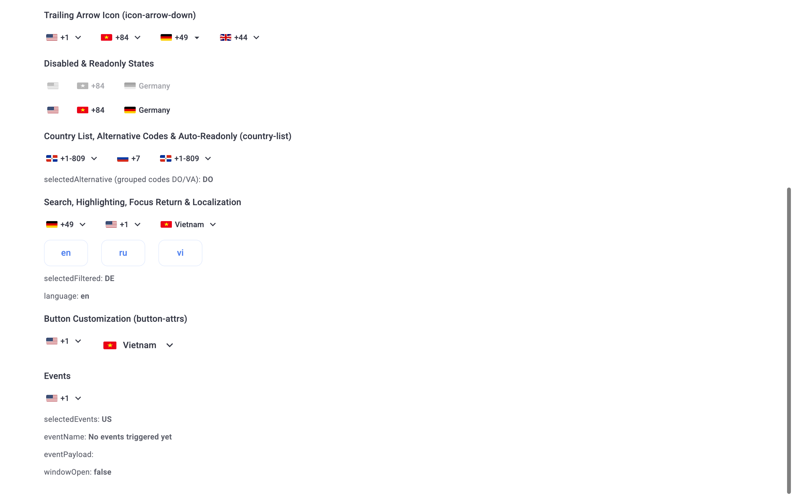
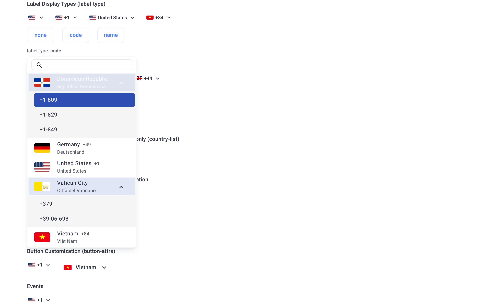

# Отчёт о визуальном и функциональном тестировании: D1InputPhoneDialCode

## 1. Итоговое резюме

- **Компонент:** `D1InputPhoneDialCode` (`@dxtmisha/d1`)
- **Исходный код:** [`InputPhoneDialCode`](packages/d1/src/components/Ui/InputPhoneDialCode) ([`constructor`](packages/constructor/src/constructors/InputPhoneDialCode), [`demo`](packages/demo/src/pages/components/DemoInputPhoneDialCodePage.vue))
- **Демо / целевой URL:** `http://localhost:3000/component-input-phone-dial-code`
- **Материалы:** `None`
- **Дата тестирования (UTC):** `2026-11-23T00:25:48Z`
- **Окружение:** `Headless Chrome (Puppeteer / CDP, Desktop 1440x900, Tablet 768x1024, Mobile 375x812 / 320x568)`
- **Покрытие тест-кейсов:** 10 / 10 (`100%`)
- **Итог:** **10 ✅, 0 ⚠️, 0 ❌** (`✅` пройдено, `⚠️` предупреждение, `❌` провалено) — компонент `D1InputPhoneDialCode` корректно отображает флаг страны, настраиваемые метки (`none`, `code`, `name`) и стрелку (`icon-arrow-down`), поддерживает двустороннюю привязку (`v-model:model-selected` и `:value` + `@update:selected`), прямые пропсы `country-list`, `show-search`, `filter-mode`, `highlight-length-start` и `disable-focus-return`, группировку альтернативных телефонных кодов (`DO`, `VA`), состояния `disabled` / `readonly` и авто-блокировку единственной однокодовой страны (`['RU']`), WAI-ARIA и адаптивность при нулевом уровне ошибок и предупреждений в консоли.

---

## 2. Базовая матрица

### 2.1 Визуальное соответствие (`VIS`)

| ID | Сценарий | Статус | Фактический результат | Скриншот |
| :--- | :--- | :---: | :--- | :--- |
| `TC-VIS-001` | Базовый рендеринг, автоопределение страны и режимы отображения метки (`label-type`) | ✅ | На странице отрисовано `28` триггеров; кнопки в группе `Label Display Types` имеют высоту `32px`, ширину `56.06px` (`none`: `""`), `75.97px` (`code`: `+1`), `145.45px` (`name`: `United States`), флаг и стрелку без клиппинга. |  |
| `TC-VIS-002` | Настройка иконки-стрелки (`icon-arrow-down`) и стилей кнопки (`button-attrs`) | ✅ | Отображены 4 варианта стрелки (`keyboard_arrow_down`, `expand_more`, `arrow_drop_down`, default при `undefined`); модификаторы `button-attrs` применили классы `d1-button--outline` и `d1-button--size--md`. |  |
| `TC-VIS-003` | Открытие меню выбора страны и отображение телефонных кодов | ✅ | Всплывающее меню `.d1-window__body` (`335.16×756px`) открылось с `255` элементами списка (страны + группы), полем поиска, флагами и телефонными кодами; кнопка переключила `aria-expanded="true"` и `.d1-icon--turn`. |  |

### 2.2 Интерактивность и управление состоянием (`INT`)

| ID | Сценарий | Статус | Фактический результат | Скриншот |
| :--- | :--- | :---: | :--- | :--- |
| `TC-INT-001` | Двусторонняя привязка (`v-model:model-selected`, `:value` + `@update:selected`) и переключение `label-type` | ✅ | Кнопки `Select US` / `Select FR` / `Select VN` синхронно обновили кнопку (`+84` → `+1` → `+33` → `+84`); переключение `label-type` изменило метку на `""` / `"Vietnam"` / `"+84"`. |  |
| `TC-INT-002` | Прямой поиск, фильтрация списка и локализация (`show-search`, `filter-mode`, `highlight-length-start`, `language`) | ✅ | Список из `country-list` (`8` узлов включая группу `DO`) отфильтрован поиском `"Viet"` до `1` элемента (`Vietnam +84 Việt Nam`) с обновлением `selectedFiltered: VN`; триггер с `:show-search="false"` открылся без поля поиска (`3` пункта); смена `language="ru"` локализовала метку на `"Вьетнам"`. |  |
| `TC-INT-003` | Группировка альтернативных телефонных кодов (`DO`, `VA`) и поведение `country-list` для одной страны | ✅ | Единственная однокодовая страна `['RU']` отобразила `+7` в режиме `readonly` без стрелки и не открыла меню (`ruOpened: false`); единственная многокодовая `['DO']` осталась интерактивной со стрелкой (`doOnlyOpened: true`); в группе `DO`/`VA` (`2` группы) клик по заголовку `Vatican City` сохранил `selectedAlternative: DO`, а выбор подкода `+1-829` обновил кнопку до `+1-829` и модель до `DO-1-829`. |  |

### 2.3 Границы и крайние сценарии (`BND`)

| ID | Сценарий | Статус | Фактический результат | Скриншот |
| :--- | :--- | :---: | :--- | :--- |
| `TC-BND-001` | Состояния `disabled` / `readonly`, пустой поиск и сброс модели (`undefined`) | ✅ | Кнопки `disabled` (`3` шт.) и `readonly` (`3` шт.) не содержат `.d1-button__trailing` и не открывают меню (`disabledOpened: false`, `readonlyOpened: false`); `Clear` вернул страну по умолчанию (`+44`); поиск `"zzzzzz"` отобразил `"Nothing found"`. |  |

### 2.4 Адаптивность (`RSP`)

| ID | Сценарий | Статус | Фактический результат | Скриншот |
| :--- | :--- | :---: | :--- | :--- |
| `TC-RSP-001` | Адаптивность на разрешениях `1440×900`, `768×1024`, `375×812` и `320×568` | ✅ | На всех 4 разрешениях горизонтальное переполнение отсутствует (`overflow: false`, `scrollWidth === innerWidth`); на `375×812` открытое меню (`323.16×740px`, `left: 26`, `right: 349.16`, `fitsViewport: true`) полностью помещается во вьюпорт. |  |

### 2.5 Доступность (`A11Y`)

| ID | Сценарий | Статус | Фактический результат | Скриншот |
| :--- | :--- | :---: | :--- | :--- |
| `TC-A11Y-001` | WAI-ARIA атрибуты, клавиатурное управление и `disableFocusReturn` | ✅ | Подтверждены `aria-haspopup="listbox"`, переключение `aria-expanded` (`"false"` → `"true"` по `Enter` → `"false"` по `Escape`); по умолчанию `disableFocusReturn: true` не возвращает фокус (`activeElementIsTriggerWhenDisabled: false`), а при `:disable-focus-return="false"` фокус возвращается на триггер (`activeElementIsTriggerWhenEnabled: true`). | — |

### 2.6 Логи и консоль (`LOG`)

| ID | Сценарий | Статус | Фактический результат | Скриншот |
| :--- | :--- | :---: | :--- | :--- |
| `TC-LOG-001` | События (`click`, `clickLite`, `updateValue`, `window`) и чистота консоли | ✅ | Зафиксированы обновления `selectedEvents: VN`, `eventName: window`, `eventPayload: open=false`, `windowOpen: false`; `consoleErrors`: `[]`, `vueWarnings`: `[]`, `pageErrors`: `[]`. | — |

---

## 3. AI-аудит и рекомендации

1. **Авто-блокировка и альтернативные префиксы (`InputPhoneDialCodeStatus` + `InputPhoneDialCodeEvent`)**: Автоматическое переключение в режим `readonly` для `country-list="['RU']"` (с сокрытием стрелки и блокировкой меню) корректно отличает однокодовые страны от многокодовых (`country-list="['DO']"`), а клики по заголовкам групп альтернативных кодов (`DO`, `VA`) не перезаписывают выбранное значение модели.
2. **Конфигурируемый `disableFocusReturn` и ленивая инициализация `event`**: Перенос значения `disableFocusReturn: true` в `defaultsInputPhoneDialCode` и `this.props.disableFocusReturn ?? true` в `bindsMenu` сохранил поведение по умолчанию для родительского `D1InputPhone`, при этом восстановив работу явного `:disable-focus-return="false"`. Инъекция `() => this.i('event')` в `InputPhoneDialCodeEvent` исключила раннее выделение `EventClickInclude` при SSR и первичном рендере.
3. **Поведение `icon-arrow-down` со значением по умолчанию**: В `D1InputPhoneDialCode` проп `iconArrowDown` имеет значение по умолчанию `'keyboard_arrow_down'`, поэтому передача `undefined` оставляет стрелку по умолчанию; для полного скрытия стрелки необходимо передавать пустую строку `""`.
