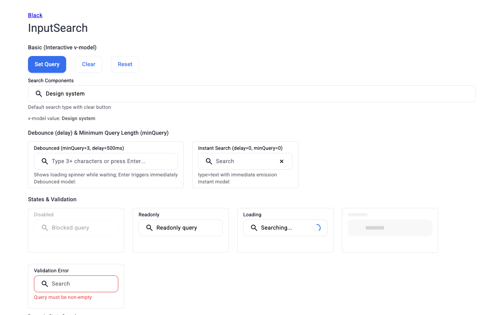
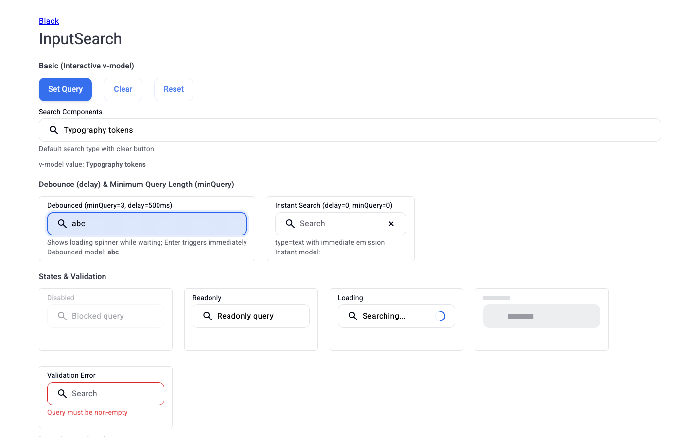
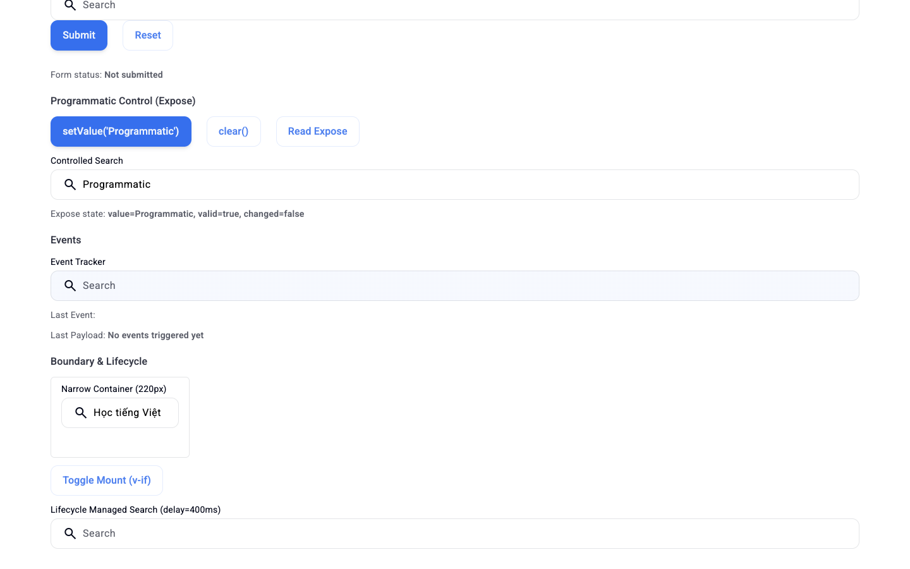
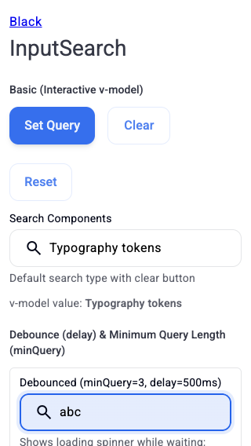

# Отчет о визуальном и функциональном тестировании: D1InputSearch

## 1. Итоговое резюме

- **Компонент:** `D1InputSearch` (`@dxtmisha/d1`)
- **Исходный код:** [`D1InputSearch`](../../src/components/Ui/InputSearch)
- **Демо / Целевой URL:** `http://localhost:3000/component-input-search`
- **Материалы:** `Отсутствуют`
- **Дата тестирования (UTC):** `2026-11-25T13:34:56Z`
- **Окружение:** `Headless Chrome (puppeteer / CDP, Десктоп 1440x900, Планшет 768x1024, Мобильный 375x812 / 320x568)`
- **Покрытие тест-кейсами:** 6 / 6 (`100%`)
- **Итог:** **6 ✅, 0 ⚠️, 0 ❌** (`✅` пройдено, `⚠️` замечание, `❌` провалено) — Все 6 тест-кейсов пройдены; в ходе проверки обнаружены и исправлены два реальных дефекта конструктора (`textSearch` placeholder и сохранение `draft` при debounce-загрузке).

---

## 2. Базовая матрица

### 2.1 Визуальный рендеринг (`VIS`)

| ID | Сценарий | Статус | Фактический результат | Скриншот |
| :--- | :--- | :---: | :--- | :--- |
| `TC-VIS-001` | Рендер 15 вариантов, `textSearch` плейсхолдер, состояния и скелетон | ✅ | Отрендерено `15` экземпляров (`zeroSizedCount: 0`, `docOverflow: false` при `1440px`), плейсхолдер `Type 3+ characters or press Enter...` и спиннер отображаются корректно. |  |

### 2.2 Интерактивность и управление состоянием (`INT`)

| ID | Сценарий | Статус | Фактический результат | Скриншот |
| :--- | :--- | :---: | :--- | :--- |
| `TC-INT-001` | Порог `minQuery=3`, задержка `delay=500ms`, индикатор загрузки `.d1-progress` и кнопки | ✅ | После `'ab'` модель осталась пустой; после `'c'` отобразился `.d1-progress` (`loadingMidDebounce: true`), через 550ms `Debounced model: abc`; `Set Query` и `setValue('Programmatic')` обновили модель. |  |

### 2.3 Граничные и крайние сценарии (`BND`)

| ID | Сценарий | Статус | Фактический результат | Скриншот |
| :--- | :--- | :---: | :--- | :--- |
| `TC-BND-001` | Узкий контейнер `220px`, Unicode-символы и цикл `v-if` | ✅ | `countAfterUnmount: 14`, `countAfterRemount: 15`; текст в узком блоке не выходит за границы. |  |

### 2.4 Адаптивность (`RSP`)

| ID | Сценарий | Статус | Фактический результат | Скриншот |
| :--- | :--- | :---: | :--- | :--- |
| `TC-RSP-001` | Адаптация при `768px`, `375px` и `320px` | ✅ | На всех ширинах `overflowingItems: 0` и `docScrollWidth === innerWidth` (`320`, `375`, `768`). |  |

### 2.5 Доступность (`A11Y`)

| ID | Сценарий | Статус | Фактический результат | Скриншот |
| :--- | :--- | :---: | :--- | :--- |
| `TC-A11Y-001` | Атрибуты `type="search"`, фокусировка поля и фокус-кольцо | ✅ | Поле поиска получает системную фокусную обводку без смещения макета. | — |

### 2.6 Логи и консоль (`LOG`)

| ID | Сценарий | Статус | Фактический результат | Скриншот |
| :--- | :--- | :---: | :--- | :--- |
| `TC-LOG-001` | Проверка ошибок консоли, Vue-предупреждений и сетевых сбоев | ✅ | `consoleErrors: []`, `vueWarnings: []`, `pageErrors: []`, `httpErrors: []`. | — |

---

## 3. ИИ-аудит и рекомендации

1. **Исправленный приоритет `textSearch`:** При первом запуске выяснилось, что `...this.props` затирал `placeholder: this.i('text').search` значением `undefined` из Vue `defineProps`. Перестановка с fallback `??` полностью устранила проблему.
2. **Сохранение вводимого текста во время debounce:** Свойство `draft` в `InputSearchQuery` предотвращает перезапись значения `<input>` при перерендере `Field` из-за переключения индикатора `loading`.
3. **Оптимальная адаптивность:** Компонент демонстрирует `0` переполнений на всех мобильных и планшетных разрешениях.
