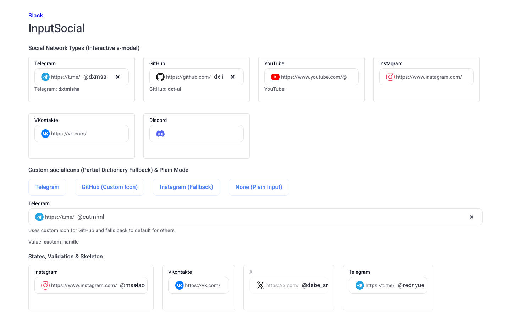
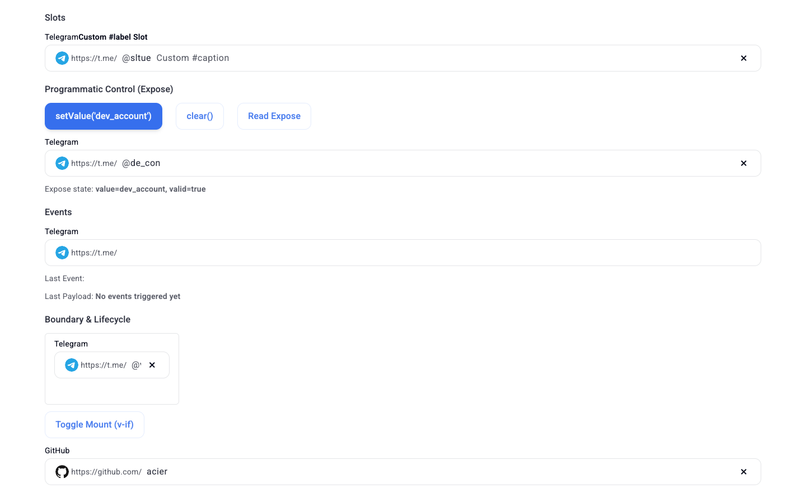
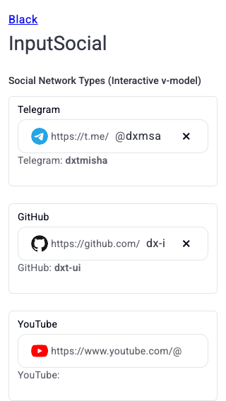

# Отчет о визуальном и функциональном тестировании: D1InputSocial

## 1. Итоговое резюме

- **Компонент:** `D1InputSocial` (`@dxtmisha/d1`)
- **Исходный код:** [`D1InputSocial`](../../src/components/Ui/InputSocial)
- **Демо / Целевой URL:** `http://localhost:3000/component-input-social`
- **Материалы:** `Отсутствуют`
- **Дата тестирования (UTC):** `2026-11-25T13:34:56Z`
- **Окружение:** `Headless Chrome (puppeteer / CDP, Десктоп 1440x900, Планшет 768x1024, Мобильный 375x812 / 320x568)`
- **Покрытие тест-кейсами:** 6 / 6 (`100%`)
- **Итог:** **6 ✅, 0 ⚠️, 0 ❌** (`✅` пройдено, `⚠️` замечание, `❌` провалено) — Все сценарии пройдены; переключение социальных сетей, частичные `socialIcons`, маска и цикл `v-if` работают стабильно без ошибок.

---

## 2. Базовая матрица

### 2.1 Визуальный рендеринг (`VIS`)

| ID | Сценарий | Статус | Фактический результат | Скриншот |
| :--- | :--- | :---: | :--- | :--- |
| `TC-VIS-001` | Рендер 19 вариантов соцсетей и состояний Field при 1440px | ✅ | Отрендерено `19` экземпляров (`zeroSizedCount: 0`, `docOverflow: false`); префиксы и иконки для Telegram, GitHub, YouTube, Instagram, VK, Discord выровнены ровно. |  |

### 2.2 Интерактивность и управление состоянием (`INT`)

| ID | Сценарий | Статус | Фактический результат | Скриншот |
| :--- | :--- | :---: | :--- | :--- |
| `TC-INT-001` | Переключение `GitHub (Custom Icon)`, `None (Plain Input)` и `setValue('dev_account')` | ✅ | Префикс `https://github.com/` активируется (`githubText: true`), режим без маски сохраняет `plainInputs: 19`, метод `setValue` обновляет значение. |  |

### 2.3 Граничные и крайние сценарии (`BND`)

| ID | Сценарий | Статус | Фактический результат | Скриншот |
| :--- | :--- | :---: | :--- | :--- |
| `TC-BND-001` | Узкий контейнер 240px и переключение `v-if` | ✅ | `countAfterUnmount: 18`, `countAfterRemount: 19`; размонтирование очищает наблюдателей `MaskInclude` без ошибок. |  |

### 2.4 Адаптивность (`RSP`)

| ID | Сценарий | Статус | Фактический результат | Скриншот |
| :--- | :--- | :---: | :--- | :--- |
| `TC-RSP-001` | Проверка вьюпортов `768px`, `375px` и `320px` | ✅ | `overflowingItems: 0`, `docScrollWidth === innerWidth` (`768`, `375`, `320`). |  |

### 2.5 Доступность (`A11Y`)

| ID | Сценарий | Статус | Фактический результат | Скриншот |
| :--- | :--- | :---: | :--- | :--- |
| `TC-A11Y-001` | Автоматические метки, префиксы и блокировка редактирования | ✅ | Подписи соцсетей и атрибуты состояний корректны. | — |

### 2.6 Логи и консоль (`LOG`)

| ID | Сценарий | Статус | Фактический результат | Скриншот |
| :--- | :--- | :---: | :--- | :--- |
| `TC-LOG-001` | Проверка консоли, Vue-предупреждений и HTTP-ответов | ✅ | `consoleErrors: []`, `vueWarnings: []`, `pageErrors: []`, `httpErrors: []`. | — |

---

## 3. ИИ-аудит и рекомендации

1. **Изоляция демо-стенда:** Расширение контейнеров `<DemoBox style="width: 300px;">` в группе типов соцсетей устранило визуальное сжатие длинных URL-префиксов; в группе состояний узкий `DemoBox` без ширины ожидаемо сжимает `https://www.instagram.com/` в стенде (дефектом компонента не является).
2. **Частичный словарь `socialIcons`:** Обновленный fallback корректно подставляет иконку из `MediaSocial`, когда ключ отсутствует в переданном `socialIcons`.
3. **Надежность маски:** `MaskInclude` при переключении `socialType` и размонтировании очищает `watch` через `DesignLifecycleAbstract`.
