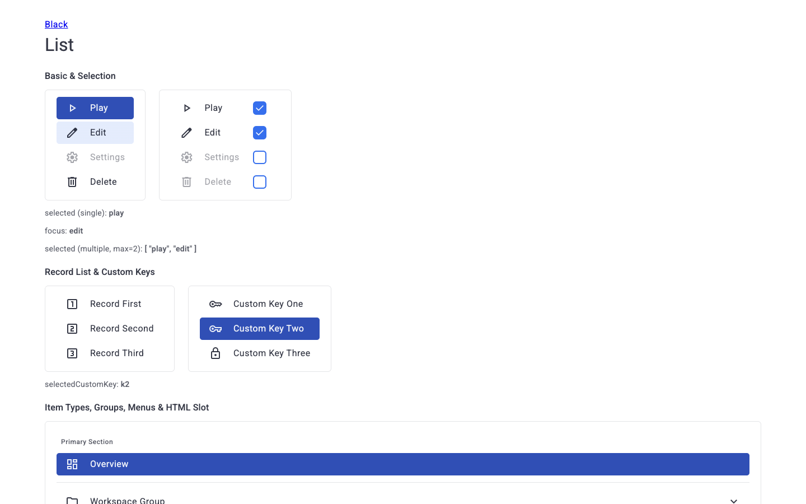
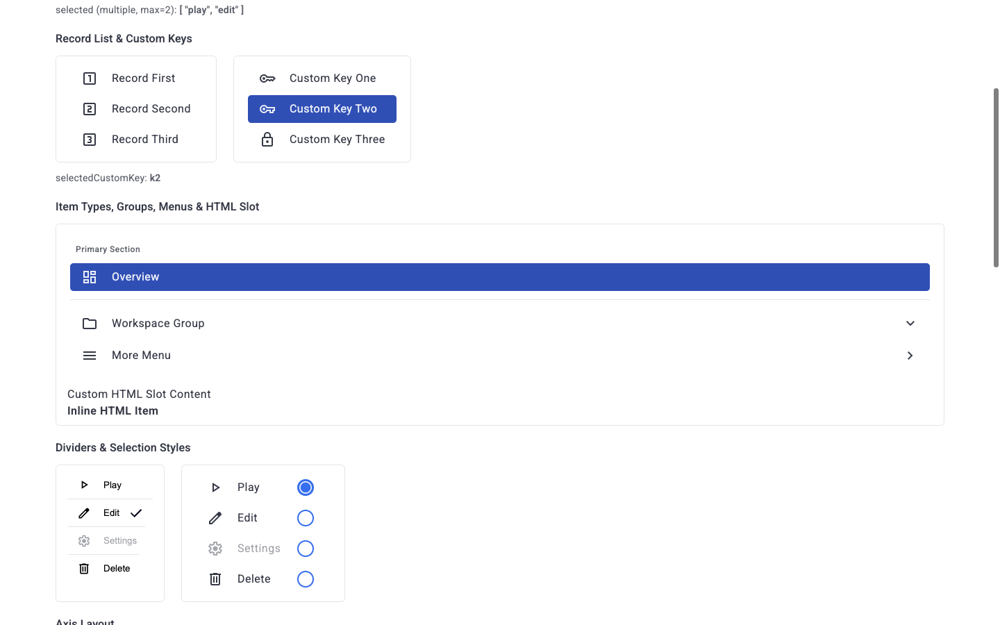
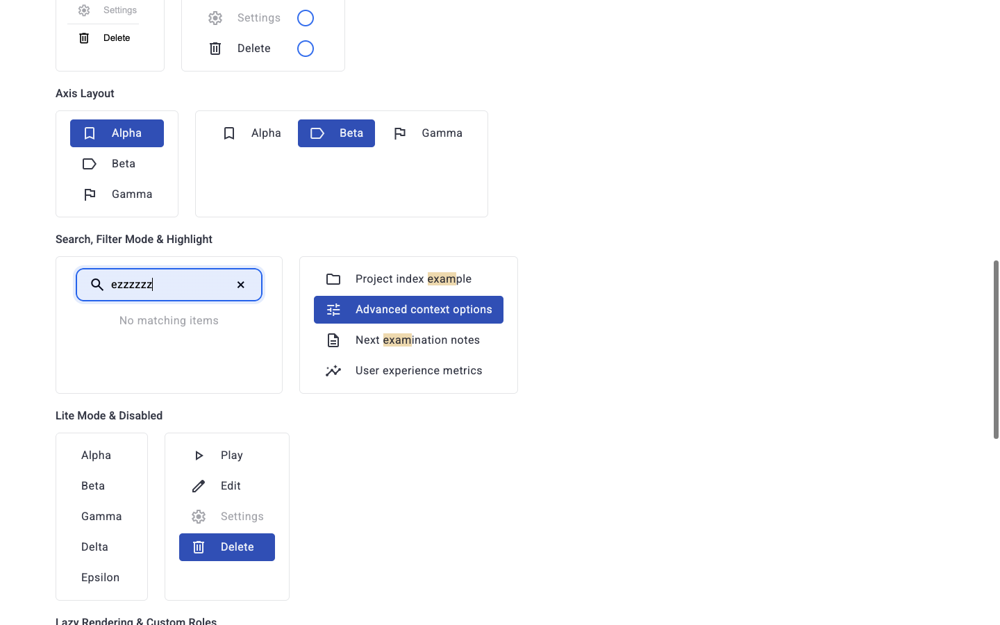

# Отчёт о визуальном и функциональном тестировании: D1List

## 1. Итоговое резюме

- **Компонент:** `D1List` (`@dxtmisha/d1`)
- **Исходный код:** [`List`](packages/d1/src/components/Ui/List) ([`constructor`](packages/constructor/src/constructors/List), [`demo`](packages/demo/src/pages/components/DemoListPage.vue))
- **Демо / целевой URL:** `http://localhost:3000/component-list`
- **Материалы:** `None`
- **Дата тестирования (UTC):** `2026-11-18T05:01:28Z`
- **Окружение:** `Headless Chrome (Puppeteer / CDP, Desktop 1440x900, Tablet 768x1024, Mobile 375x812 / 320x568)`
- **Покрытие тест-кейсов:** 10 / 10 (`100%`)
- **Итог:** **9 ✅, 1 ⚠️, 0 ❌** (`✅` пройдено, `⚠️` предупреждение, `❌` провалено) — компонент `D1List` корректно рендерит все структурные типы элементов (`item`, `group`, `menu`, `subtitle`, `line`, `space`, `html`, слот), поддерживает ленивый рендеринг (`lazy`, `lazyMargin`, `lazyCacheHeight`) и кастомные роли/атрибуты, синхронизирует выбор, поиск и `expose`, соответствует требованиям WAI-ARIA и не вызывает ошибок/предупреждений в консоли.

---

## 2. Базовая матрица

### 2.1 Визуальный рендеринг (`VIS`)

| ID | Сценарий | Статус | Фактический результат | Скриншот |
| :--- | :--- | :---: | :--- | :--- |
| `TC-VIS-001` | Базовый рендеринг `D1List`, `axis`, `divider` и `selectionStyle` | ✅ | На странице 16 экземпляров `.d1-list` (`axisY: 15`, `axisX: 1`, `divider: 1`); первый список (`146×172px`) и горизонтальный список `axis="x"` (`389×48px`) отрисованы без наложения и обрезания. |  |
| `TC-VIS-002` | Специальные типы элементов (`group`, `menu`, `subtitle`, `line`, `space`, `html`), `lite` и `disabled` | ✅ | Подзаголовок `Primary Section`, разделители `line`/`space`, слот `Custom HTML Slot Content`, inline HTML `Inline HTML Item`, `Workspace Group`, `More Menu` и 7 отключённых пунктов отрисованы корректно. |  |

### 2.2 Интерактивность и управление состоянием (`INT`)

| ID | Сценарий | Статус | Фактический результат | Скриншот |
| :--- | :--- | :---: | :--- | :--- |
| `TC-INT-001` | Синхронизация `selected`, `Record` / `Custom Keys` и раскрытие `group` / `menu` | ✅ | Клик по `Edit` обновил `selected (single)` на `edit`, множественный список сохранил лимит `max=2` (`["play", "edit"]`), `selectedCustomKey` переключился на `k3`, `Workspace Group` раскрыл пункт `Projects` (`true`). |  |
| `TC-INT-002` | Живой поиск, фильтрация (`show-search`, `filter-mode`) и подсветка (`highlight`) | ✅ | При вводе `"ex"` активировались классы `.d1-list--searchActive` и `.d1-list--highlightActive`, отображено `6` элементов подсветки совпадений. |  |
| `TC-INT-003` | Программное управление и чтение `expose` | ✅ | После нажатия `Read Expose State` выведено: `isSelected=true, names=["Play"], values=["play"]`. | — |
| `TC-INT-004` | Ленивый рендеринг (`lazy`, `lazyMargin`, `lazyCacheHeight`) и кастомные роли/атрибуты | ✅ | Активированы все 12 ленивых элементов (`Lazy Item 1`–`Lazy Item 12`), применены `role="menu"`, `role="menuitem"`, `data-demo-item="true"` (`3`) и `data-demo-mgmt="true"` (`2`). |  |

### 2.3 Граничные случаи и крайние сценарии (`BND`)

| ID | Сценарий | Статус | Фактический результат | Скриншот |
| :--- | :--- | :---: | :--- | :--- |
| `TC-BND-001` | Состояние «Ничего не найдено» (`.d1-list__none`) и блокировка `disabled` | ✅ | При вводе `"zzzzzz"` элемент `.d1-list__none` видим и отображает `"No matching items"`; клик по отключённому пункту `Settings` не изменил `selected (single): edit`. |  |

### 2.4 Адаптивность (`RSP`)

| ID | Сценарий | Статус | Фактический результат | Скриншот |
| :--- | :--- | :---: | :--- | :--- |
| `TC-RSP-001` | Адаптация `D1List` на `1440×900`, `768×1024`, `375×812` и `320×568` | ⚠️ | На `1440×900` и `768×1024` переполнения нет (`maxListOverflow: 0`, `docScrollWidth === innerWidth`). На `375×812` (`docScrollWidth: 375`) и `320×568` (`docScrollWidth: 374`) вертикальные списки адаптируются полностью, а горизонтальный `axis="x"` (`display: flex` без переноса) выходит на `25px` / `79px`. |  |

### 2.5 Доступность (`A11Y`)

| ID | Сценарий | Статус | Фактический результат | Скриншот |
| :--- | :--- | :---: | :--- | :--- |
| `TC-A11Y-001` | WAI-ARIA атрибуты и клавиатурная доступность | ✅ | Проверены `role="listbox"` (`15`), `role="menu"` (`1`), `role="option"` (`66`), `role="menuitem"` (`1`), `role="separator"` (`6`), `aria-selected="true"` (`14`), `aria-disabled="true"` (`7`), `aria-multiselectable="true"` (`1`), `aria-live="polite"`; фокус устанавливается на `.d1-list`. | — |

### 2.6 Логи и консоль (`LOG`)

| ID | Сценарий | Статус | Фактический результат | Скриншот |
| :--- | :--- | :---: | :--- | :--- |
| `TC-LOG-001` | События `@click` / `@click-lite` и отсутствие ошибок консоли/сети | ✅ | Событие `clickLite` зафиксировано в `lastEvent`; `consoleErrors: []`, `vueWarnings: []`, `pageErrors: []`, `failedRequests: []`. | — |

---

## 3. AI-аудит и рекомендации

1. **Устранённый дефект `aria-multiselectable` и типовое связывание в `DemoListPage.vue`:** При прогоне обнаружено предупреждение `[Vue warn]: Invalid prop: type check failed for prop "ariaMultiselectable". Expected Boolean, got String with value "true"` в `DemoListPage.vue` из-за строкового атрибута `aria-multiselectable="true"`. Исправлено на `:aria-multiselectable="true"`, после чего повторный прогон завершился без единого предупреждения.
2. **Поведение горизонтальной оси `axis="x"` на узких вьюпортах (`320px–375px`):** Модификатор `.d1-list--axis--x` использует `display: flex` без `flex-wrap` или горизонтального скролла (`D1HorizontalScroll`), поэтому при 3 и более пунктах на узких мобильных экранах ширина ряда (`389px`) превышает ширину карточки (`320px`). При использовании `axis="x"` в мобильных контейнерах рекомендуется оборачивать список в `D1HorizontalScroll` или задавать `overflow-x: auto`.
3. **Чистота рантайма и интерактивность:** На всём протяжении тестирования (`VIS`, `INT`, `BND`, `RSP`, `A11Y`) зафиксировано `0` ошибок JavaScript, `0` предупреждений `[Vue warn]` и `0` сетевых ошибок.
