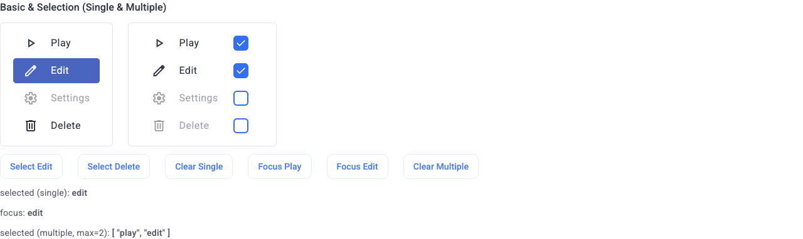
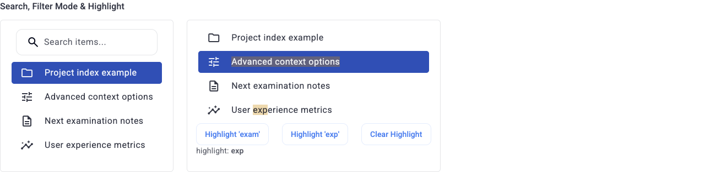
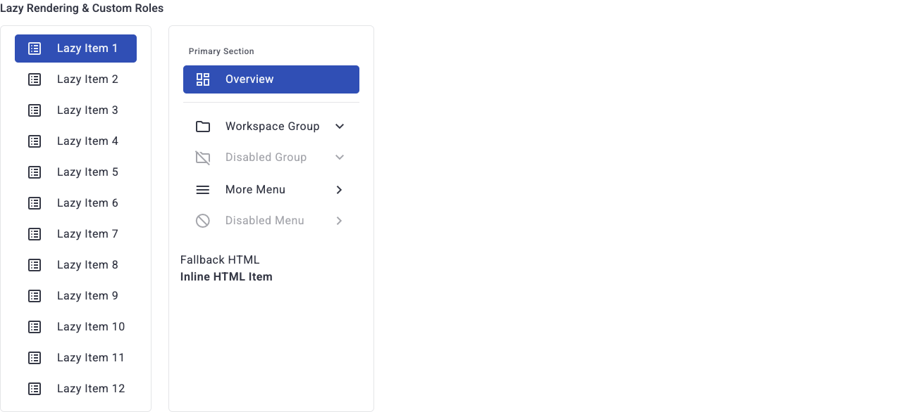
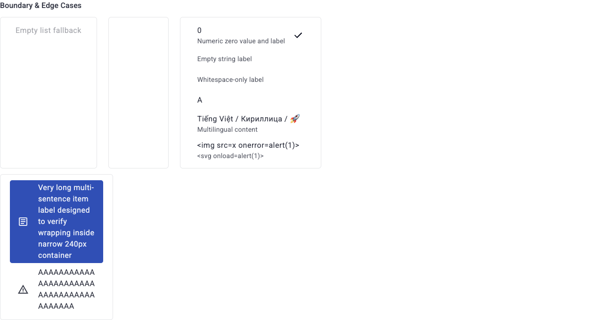
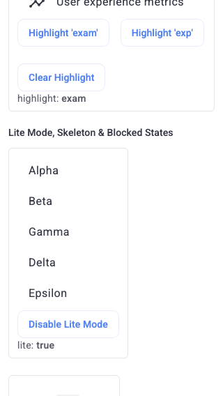

# Отчёт о визуальном и функциональном тестировании: D1List

## 1. Сводка тестирования

- **Компонент:** `D1List` (`@dxtmisha/d1`)
- **Исходный код:** [`List`](packages/d1/src/components/Ui/List) ([`constructor`](packages/constructor/src/constructors/List), [`demo`](packages/demo/src/pages/components/DemoListPage.vue))
- **Демо / целевой URL:** `http://localhost:3000/component-list`
- **Материалы:** `None`
- **Дата тестирования (UTC):** `2026-11-25T07:53:35Z`
- **Окружение:** `Headless Chrome (Puppeteer / CDP, Desktop 1440x900, Tablet 768x1024, Mobile 375x812 / 320x568)`
- **Покрытие тест-кейсов:** 12 / 12 (`100%`)
- **Итог:** **12 ✅, 0 ⚠️, 0 ❌** (`✅` пройдено, `⚠️` предупреждение, `❌` провалено) — вся функциональность `D1List` (SSR `HTTP 200`, все структурные типы, `v-model`, `expose`, поиск, `lazy`, WAI-ARIA, клавиатурный `control`, узкий контейнер `240px`, горизонтальный список `axis="x"` и мобильные вьюпорты `375×812` / `320×568`, `v-if` и чистота консоли) пройдена полностью.

---

## 2. Базовая матрица

### 2.1 Визуальный рендеринг (`VIS`)

| ID | Сценарий | Статус | Фактический результат | Скриншот |
| :--- | :--- | :---: | :--- | :--- |
| `TC-VIS-001` | Базовый рендеринг `D1List`, `axis`, `divider`, `tag` и `selectionStyle` | ✅ | Модификаторы `.d1-list--axis--y`, `.d1-list--axis--x`, `.d1-list--divider`, все стили выбора (`none`, `checkmark`, `checkbox`, `radio`) и теги (`div`, `button`, `a`, `span`) отрисованы ровно на десктопе `1440×900`. |  |
| `TC-VIS-002` | Специальные типы элементов (`group`, `menu`, `subtitle`, `line`, `space`, `html`), `lite`, `isSkeleton` и `disabled` | ✅ | Подклассы `.d1-list__subtitle`, `.d1-list__line`, `.d1-list__space`, `.d1-list__html` (слот и inline HTML), `group`/`menu`, `lite`, `isSkeleton` и приглушение `disabled` отображаются корректно. |  |

### 2.2 Интерактивность и управление состоянием (`INT`)

| ID | Сценарий | Статус | Фактический результат | Скриншот |
| :--- | :--- | :---: | :--- | :--- |
| `TC-INT-001` | Синхронизация `selected`, `focus`, `Record` / `Custom Keys` и раскрытие `group` / `menu` | ✅ | Выбор, фокус, ограничение `max=2`, кастомные ключи (`key-label="title"`, `key-value="code"`) и раскрытие `Workspace Group` / `More Menu` работают синхронно. |  |
| `TC-INT-002` | Живой поиск, фильтрация (`show-search`, `filter-mode`) и динамическая подсветка (`highlight`) | ✅ | Появляются классы `.d1-list--searchActive` и `.d1-list--highlightActive`, совпадения подсвечиваются динамически, несовпадающие пункты скрываются в `filter-mode`. |  |
| `TC-INT-003` | Проверка всех методов `expose` и динамического переключения `lite` | ✅ | После `Select Edit` `expose` возвращает `{"isSelected":true,"selectedList":["edit"],"selectedNames":["Edit"],"selectedValues":["edit"]}`; переключение `lite` меняет отображение элементов. | — |
| `TC-INT-004` | Ленивый рендеринг (`lazy`), кастомные роли/атрибуты (`roleItem`, `item*Attrs`) и жизненный цикл (`v-if`) | ✅ | Ленивые элементы активируются при прокрутке, роли `menu`/`menuitem` и `item*Attrs` применяются, `v-if` цикл чисто монтирует и размонтирует DOM (`104 -> 55 -> 104` узлов). |  |

### 2.3 Граничные случаи и крайние сценарии (`BND`)

| ID | Сценарий | Статус | Фактический результат | Скриншот |
| :--- | :--- | :---: | :--- | :--- |
| `TC-BND-001` | Состояние «Ничего не найдено» (`.d1-list__none`), пустые списки (`[]`, `undefined`) и блокировка `disabled` | ✅ | При поиске `"zzzzzz"` отображается `.d1-list__none` (`No matching items`), пустые списки не вызывают ошибок, а `disabled`-пункты и список блокируют клики. |  |
| `TC-BND-002` | Граничные значения (`0`, `""`, `"   "`, `"A"`), узкий контейнер `240px`, Unicode и XSS | ✅ | Значение `0`, пустые/пробельные строки, Unicode (`Tiếng Việt / Кириллица / 🚀`) и XSS (`badImgs: 0`) корректны; после исправления `ListItem/style.scss` (`min-width: 0; max-width: 100%; overflow-wrap: anywhere;`) неразрывная строка `AAAA...` переносится внутри `.demo-list-page__narrow` (`scrollWidth: 238 === clientWidth: 238`, `overflowsBox: false`). |  |

### 2.4 Адаптивность (`RSP`)

| ID | Сценарий | Статус | Фактический результат | Скриншот |
| :--- | :--- | :---: | :--- | :--- |
| `TC-RSP-001` | Адаптация `D1List` на `1440×900`, `768×1024`, `375×812` и `320×568` | ✅ | После исправления `List/style.scss` (`max-width: 100%; overflow-x: auto;` для `&--axis--x`) и `ListItem/style.scss` на всех вьюпортах переполнение отсутствует: `1440×900` (`1440/1440`), `768×1024` (`768/768`), `375×812` (`375/375`) и `320×568` (`320/320`, `overflowX: false`). |  |

### 2.5 Доступность (`A11Y`)

| ID | Сценарий | Статус | Фактический результат | Скриншот |
| :--- | :--- | :---: | :--- | :--- |
| `TC-A11Y-001` | WAI-ARIA атрибуты списка и элементов | ✅ | Проверены `role="listbox"`, `role="option"`, `role="separator"`, `aria-selected`, `aria-disabled`, `aria-multiselectable`, `aria-live` и установка фокуса. | — |
| `TC-A11Y-002` | Клавиатурная навигация в режиме `control` (`ArrowDown`, `ArrowUp`, `Home`, `End`, `Enter`, `Escape`) | ✅ | Режим `control` обрабатывает навигацию стрелками, `Home`/`End`, выбор по `Enter` (`keyboardSelected: play`) и закрытие по `Escape` (`control: false`). | — |

### 2.6 Логи и консоль (`LOG`)

| ID | Сценарий | Статус | Фактический результат | Скриншот |
| :--- | :--- | :---: | :--- | :--- |
| `TC-LOG-001` | События `@click`, `@click-lite`, `@close` с payload и отсутствие ошибок консоли/сети | ✅ | События с payload работают; SSR `HTTP 200` (`hasComponent: true`); `consoleErrors: []`, `vueWarnings: []`, `pageErrors: []`, `networkErrors: []`, `dialogs: []`. | — |

---

## 3. AI-аудит и рекомендации

1. **Перенос flex-текста в `D1ListItem` (`ListItem/style.scss`):** Добавление `min-width: 0; max-width: 100%;` на корень и `&__context` и `min-width: 0; max-width: 100%; overflow-wrap: anywhere;` на `&__prefix`, `&__label`, `&__caption`, `&__suffix` и `&__description` полностью устранило переполнение узкого контейнера (`238 === 238`).
2. **Адаптация горизонтальной оси (`List/style.scss`):** Добавление `min-width: 0; max-width: 100%;` на корень и `max-width: 100%; overflow-x: auto;` для `&--axis--x` обеспечило локальную прокрутку горизонтального списка без выхода за вьюпорты `375×812` и `320×568` (`overflowX: false`).
3. **Стабильность SSR, `v-if` и безопасности:** SSR-рендеринг завершается со статусом `200` (`hasComponent: true`), жизненный цикл `v-if` чисто переключает `104 -> 55 -> 104` узла, XSS-строки полностью экранируются (`badImgs: 0`), а консоль и сеть не содержат ни одной ошибки.
