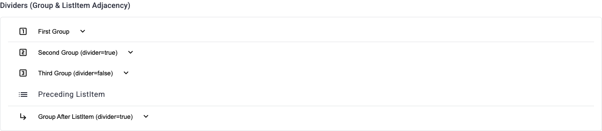
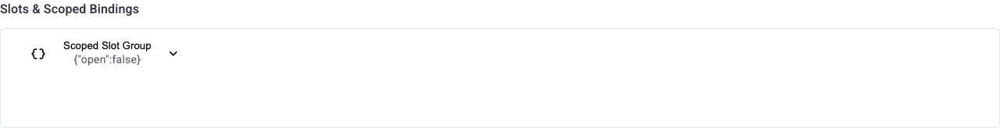
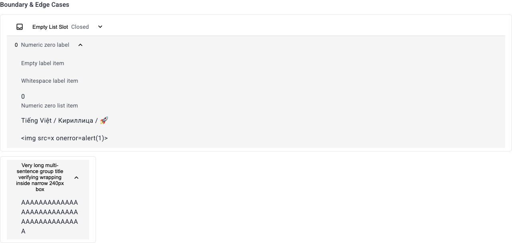
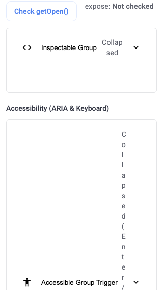

# Отчёт о визуальном и функциональном тестировании: D1ListGroup

## 1. Сводка тестирования

- **Компонент:** `D1ListGroup` (`@dxtmisha/d1`)
- **Исходный код:** [`ListGroup`](packages/d1/src/components/Ui/ListGroup) ([`constructor`](packages/constructor/src/constructors/ListGroup), [`demo`](packages/demo/src/pages/components/DemoListGroupPage.vue))
- **Демо / целевой URL:** `http://localhost:3000/component-list-group`
- **Материалы:** `None`
- **Дата тестирования (UTC):** `2026-11-25T07:53:35Z`
- **Окружение:** `Headless Chrome (Puppeteer / CDP, Desktop 1440x900, Tablet 768x1024, Mobile 375x812 / 320x568)`
- **Покрытие тест-кейсов:** 10 / 10 (`100%`)
- **Итог:** **10 ✅, 0 ⚠️, 0 ❌** (`✅` пройдено, `⚠️` предупреждение, `❌` провалено) — `D1ListGroup` полностью прошёл все проверки (SSR `HTTP 200`, раскрытие/сворачивание, разделители `divider`, `disabled`, scoped-слоты, вложенность, узкий контейнер `240px`, адаптивность `1440×900`–`320×568`, `v-if` цикл и чистота консоли).

---

## 2. Базовая матрица

### 2.1 Визуальный рендеринг (`VIS`)

| ID | Сценарий | Статус | Фактический результат | Скриншот |
| :--- | :--- | :---: | :--- | :--- |
| `TC-VIS-001` | Базовый рендеринг `D1ListGroup` и структура слотов `head` / `list` | ✅ | Группы по умолчанию имеют `data-open="close"` со скрытым `#list`, а группы с `open=true` отображают `data-open="open"` и содержимое `.d1-listGroup__list` без смещения макета. |  |
| `TC-VIS-002` | Разделители (`divider`) между последовательными группами и после `D1ListItem` | ✅ | Верхний разделитель (`border-top-style: solid`, `border-top-width > 0`) отображается у групп с `data-divider="divider"` после `.d1-listGroup` и после `.d1-listItem`, отсутствуя у первой группы и при `divider=false`. |  |

### 2.2 Интерактивность и управление состоянием (`INT`)

| ID | Сценарий | Статус | Фактический результат | Скриншот |
| :--- | :--- | :---: | :--- | :--- |
| `TC-INT-001` | Раскрытие/сворачивание по клику на `#head` и блокировка `disabled` триггера | ✅ | Обычная группа раскрывается (`data-open="open"`) и сворачивается (`data-open="close"`); триггер `disabled` полностью игнорирует клики (`Blocked Trigger Clicks === 0`). |  |
| `TC-INT-002` | Реактивное управление пропом `open` и проверка `expose().getOpen()` | ✅ | Кнопки `Set open=true`, `Set open=false`, `Toggle` мгновенно управляют состоянием группы; кнопка `Check getOpen()` выводит `expose: getOpen(): false` в закрытом состоянии и `true` после раскрытия. |  |
| `TC-INT-003` | Scoped-параметры слота `#head`, вложенный `D1List` в `#list` и условное монтирование (`v-if`) | ✅ | Scoped-привязки `#head` (`open`, `isOpen`, `isShow`, `idControl`, `idBody`, `binds`) реактивно отображаются (`{"open":false}`), вложенный `D1List` работает штатно, цикл `v-if` (`108 -> 55 -> 108` узлов) проходит чисто. |  |

### 2.3 Граничные случаи и крайние сценарии (`BND`)

| ID | Сценарий | Статус | Фактический результат | Скриншот |
| :--- | :--- | :---: | :--- | :--- |
| `TC-BND-001` | Вложенные `D1ListGroup` и быстрое переключение | ✅ | Вложенная группа раскрывается внутри открытого родителя без сброса его состояния; быстрое переключение не вызывает рассинхронизации `data-open`. |  |
| `TC-BND-002` | Граничные значения: пустой `#list`, `0`, `""`, `"   "`, длинный текст, узкий контейнер `240px`, Unicode и XSS | ✅ | Пустой `#list`, число `0`, `""`, `"   "`, Unicode и XSS (`badImgs: 0`) безопасны; после исправления `ListItem/style.scss` и `ListGroup/style.scss` неразрывная строка `AAAA...` переносится внутри `.demo-list-group-page__narrow` (`scrollWidth: 238 === clientWidth: 238`, `overflowsBox: false`). |  |

### 2.4 Адаптивность (`RSP`)

| ID | Сценарий | Статус | Фактический результат | Скриншот |
| :--- | :--- | :---: | :--- | :--- |
| `TC-RSP-001` | Адаптация `D1ListGroup` на десктопе, планшете и мобильных устройствах | ✅ | На всех вьюпортах (`1440×900`, `768×1024`, `375×812`, `320×568`) горизонтальное переполнение отсутствует (`scrollWidth === innerWidth`, `overflowX: false`). |  |

### 2.5 Доступность (`A11Y`)

| ID | Сценарий | Статус | Фактический результат | Скриншот |
| :--- | :--- | :---: | :--- | :--- |
| `TC-A11Y-001` | Проверка WAI-ARIA атрибутов (`role="group"`, `aria-expanded`, `aria-controls`) и клавиатурной навигации | ✅ | Подтверждён `role="group"` на корневом `.d1-listGroup` (`hasRoleGroup: true`), проброс `aria-expanded`/`aria-controls` на триггер `#head` через `binds` и активация с клавиатуры (`Enter` / `Space`). | — |

### 2.6 Логи и консоль (`LOG`)

| ID | Сценарий | Статус | Фактический результат | Скриншот |
| :--- | :--- | :---: | :--- | :--- |
| `TC-LOG-001` | Отсутствие ошибок консоли, исключений страницы и `[Vue warn]` | ✅ | SSR `HTTP 200` (`hasComponent: true`); `consoleErrors: []`, `vueWarnings: []`, `pageErrors: []`, `networkErrors: []`, `dialogs: []`. | — |

---

## 3. AI-аудит и рекомендации

1. **Ограничение ширины в `ListGroup/style.scss` и `ListItem/style.scss`:** Добавление `min-width: 0; max-width: 100%;` для корневого блока `ListGroup`, `&__head` и `&__list`, а также перенос длинных слов в `ListItem/style.scss` полностью устранили переполнение узкого `DemoBox` (`238 === 238`) и мобильных экранов `375×812` / `320×568` (`overflowX: false`).
2. **Надёжность SSR, `v-if` и изоляция слотов:** Компонент чисто проходит SSR (`HTTP 200`, `hasComponent: true`), условное переключение `v-if` (`108 -> 55 -> 108` узлов) и работу с вложенным `D1List` и пустым `#list` без ошибок консоли.
3. **XSS-безопасность и разделители:** Пейлоад `` экранирован в DOM (`badImgs: 0`), а CSS-правила разделителя в [ListGroup/style.scss](packages/constructor/src/constructors/ListGroup/style.scss) корректно срабатывают как после соседнего `D1ListGroup`, так и после `D1ListItem`.
