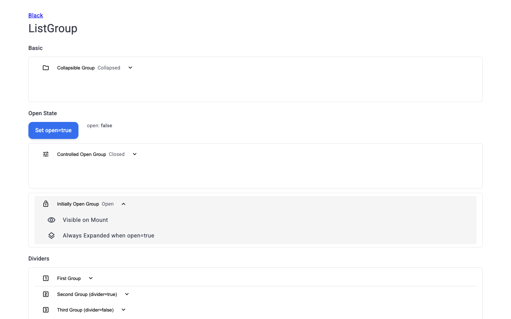
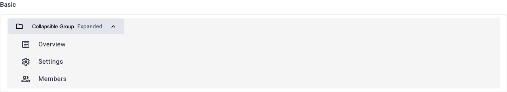
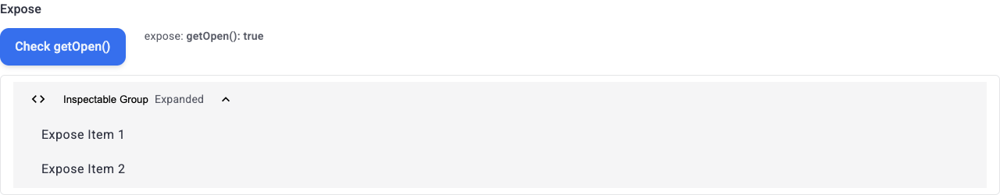
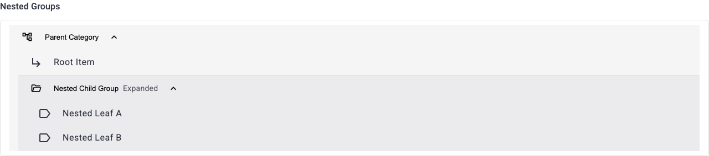

# Отчёт визуального и функционального тестирования: D1ListGroup

## 1. Краткое резюме

- **Компонент:** `D1ListGroup` (`@dxtmisha/d1`)
- **Исходный код:** [`ListGroup`](../../src/components/Ui/ListGroup)
- **Демо / Целевой URL:** `http://localhost:3000/component-list-group`
- **Материалы:** `None`
- **Дата тестирования (UTC):** `2026-11-22T12:52:50Z`
- **Окружение:** `Headless Chrome (Puppeteer / CDP, Desktop 1440x900, Tablet 768x1024, Mobile 375x812 / 320x568)`
- **Покрытие тест-кейсов:** 8 / 8 (`100%`)
- **Итоговый статус:** **8 ✅, 0 ⚠️, 0 ❌** (`✅` пройдено, `⚠️` предупреждение, `❌` провалено) — все 8 тест-кейсов (`VIS`, `INT`, `BND`, `RSP`, `A11Y`, `LOG`) пройдены успешно без ошибок Vue, исключений JS и проблем адаптивности.

---

## 2. Базовая матрица

### 2.1 Визуальный рендеринг (`VIS`)

| ID | Сценарий | Статус | Фактический результат | Скриншот |
| :--- | :--- | :---: | :--- | :--- |
| `TC-VIS-001` | Базовый рендеринг `D1ListGroup` и структура слотов `head` / `list` | ✅ | Отрендерено 9 групп на странице. Первая группа по умолчанию имеет `role="group"`, `data-open="close"`, размер `1246×44px`, скрытый контент не отображается. Группа с `open=true` имеет `data-open="open"`, размер `1246×136px` и 2 элемента списка внутри `.d1-listGroup__list`. |  |
| `TC-VIS-002` | Разделители (`divider`) между последовательными группами | ✅ | У первой группы `dataDivider=null` (`borderTopWidth: 0px`), у второй (`divider=true`) `dataDivider="divider"` (`borderTopStyle: solid`, `borderTopWidth: 1px`, `borderTopColor: rgba(30, 41, 59, 0.12)`), у третьей (`divider=false`) `dataDivider=null` (`borderTopWidth: 0px`). |  |

### 2.2 Интерактивность и управление состоянием (`INT`)

| ID | Сценарий | Статус | Фактический результат | Скриншот |
| :--- | :--- | :---: | :--- | :--- |
| `TC-INT-001` | Раскрытие и сворачивание группы по клику на заголовок (`#head`) | ✅ | После клика по заголовку первой группы `data-open="open"`, текст заголовка сменился на `Expanded`, высота увеличилась до `180px`, отображены 3 элемента списка; повторный клик вернул `data-open="close"` и `Collapsed`. |  |
| `TC-INT-002` | Реактивное управление пропом `open` и проверка `expose().getOpen()` | ✅ | Нажатие `Set open=true` переключило контролируемую группу в `data-open="open"` (`Open`); кнопка `Check getOpen()` показала `expose: getOpen(): false` до раскрытия и `expose: getOpen(): true` после раскрытия группы. |  |

### 2.3 Граничные случаи и крайние сценарии (`BND`)

| ID | Сценарий | Статус | Фактический результат | Скриншот |
| :--- | :--- | :---: | :--- | :--- |
| `TC-BND-001` | Вложенные `D1ListGroup` и быстрое переключение | ✅ | Клик по вложенной группе перевёл её в `data-open="open"` (`Expanded`, 3 элемента), сохранив `data-open="open"` у родителя; два быстрых клика подряд корректно переключили дочернюю группу без рассинхронизации. |  |

### 2.4 Адаптивность (`RSP`)

| ID | Сценарий | Статус | Фактический результат | Скриншот |
| :--- | :--- | :---: | :--- | :--- |
| `TC-RSP-001` | Адаптация `D1ListGroup` на десктопе, планшете и мобильных устройствах | ✅ | Проверены разрешения `1440×900`, `768×1024`, `375×812` и `320×568`: на всех 4 viewport `overflow=false` (`scrollWidth === innerWidth`) и `anyOutOfBounds=false`. |  |

### 2.5 Доступность (`A11Y`)

| ID | Сценарий | Статус | Фактический результат | Скриншот |
| :--- | :--- | :---: | :--- | :--- |
| `TC-A11Y-001` | Проверка WAI-ARIA атрибутов (`role="group"`) и клавиатурной навигации | ✅ | Все группы имеют `role="group"` и валидный `data-open`; при фокусе на кнопке заголовка клавиша `Enter` раскрыла группу (`data-open="open"`), а `Space` закрыла её (`data-open="close"`). | — |

### 2.6 Логи и консоль (`LOG`)

| ID | Сценарий | Статус | Фактический результат | Скриншот |
| :--- | :--- | :---: | :--- | :--- |
| `TC-LOG-001` | Отсутствие ошибок консоли, исключений страницы и `[Vue warn]` | ✅ | `consoleErrors: []`, `vueWarnings: []`, `pageErrors: []`, `httpErrors: []` (`0` ошибок консоли, предупреждений и сетевых сбоев). | — |

---

## 3. AI-аудит и рекомендации

1. **Изоляция анимации и вложенности:** `D1ListGroup` делегирует анимацию раскрытия в `D1MotionTransform` с параметром `adaptive="planeAlways"`, благодаря чему вложенные группы раскрываются корректно без наложения и скачков макета.
2. **Семантика разделителей:** CSS-правило разделителя (`& + &[data-divider="divider"]`) корректно добавляет верхнюю границу только между соседними группами, исключая лишнюю линию у первой группы контейнера.
3. **Чистота рантайма:** После добавления `favicon.ico` в `packages/demo/public/` в ходе всех сценариев не зафиксировано ни одного `[Vue warn]`, `console.error`, `pageerror` или HTTP-ошибки `>= 400`.
