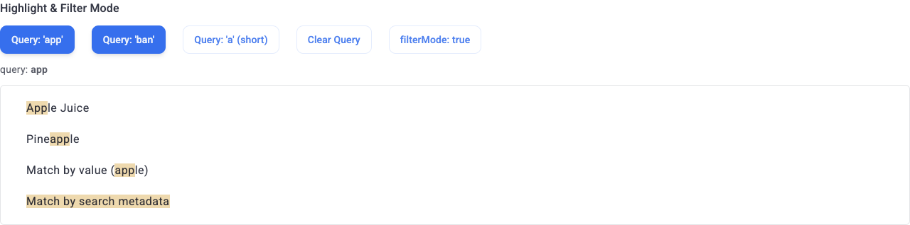
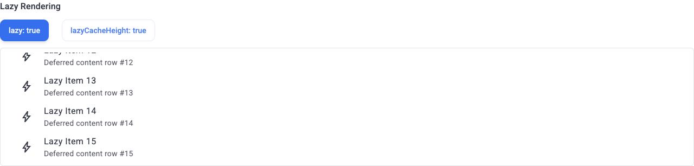
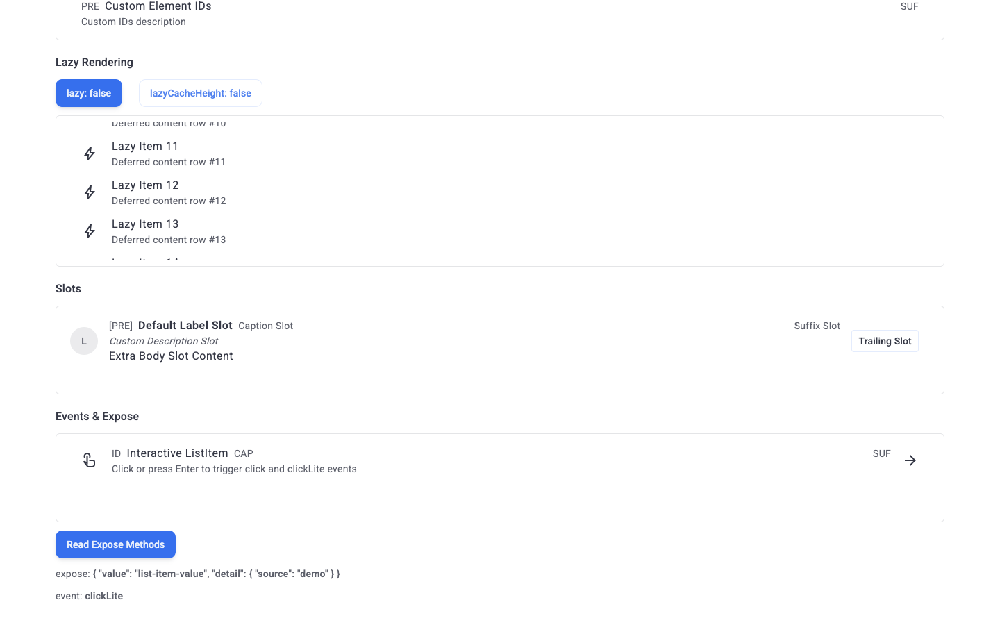
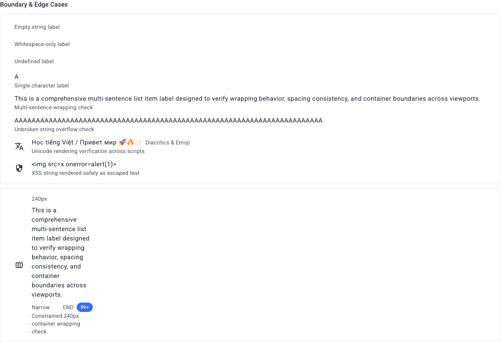
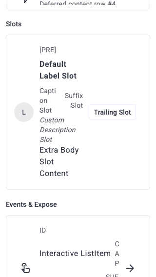

# Отчёт о визуальном и функциональном тестировании: `D1ListItem`

## 1. Сводка тестирования

- **Компонент:** `D1ListItem` (`@dxtmisha/d1`)
- **Исходный код:** [`D1ListItem`](../../src/components/Ui/ListItem) ([`ListItem`](../../../constructor/src/constructors/ListItem), [`DemoListItemPage.vue`](../../../demo/src/pages/components/DemoListItemPage.vue))
- **Демо / Целевой URL:** `http://localhost:3000/component-list-item`
- **Материалы:** `None`
- **Дата тестирования (UTC):** `2026-11-25T08:22:37Z`
- **Окружение:** `Headless Chrome (Puppeteer / CDP, Desktop 1440x900, Tablet 768x1024, Mobile 375x812 / 320x568)`
- **Покрытие тест-кейсов:** 12 / 12 (`100%`)
- **Итог:** **12 ✅, 0 ⚠️, 0 ❌** (`✅` пройдено, `⚠️` предупреждение, `❌` ошибка) — `D1ListItem` стабильно проходит SSR (`200`), корректно рендерит текстовые слои (включая `0` и все 8 слотов), состояния, 24 палитры, `highlight`/`filterMode`, ленивый рендеринг и жизненный цикл `v-if`, узкий контейнер `240px` и все разрешения `320px`–`1440px` (`overflowX: false`) при нуле ошибок и предупреждений.

---

## 2. Базовая матрица

### 2.1 Визуальный рендеринг (`VIS`)

| ID | Сценарий | Статус | Фактический результат | Скриншот |
| :--- | :--- | :---: | :--- | :--- |
| `TC-VIS-001` | Базовый рендеринг, текстовые слои, иконки и бейджи | ✅ | Текстовые слои (`.d1-listItem__body`, `__context`, `__prefix`, `__label`, `__caption`, `__suffix`, `__description`), ведущие/замыкающие иконки (`iconAlign`, `iconTop`, `iconTurn`, `iconDir`) и бейджи (`badgeDot`, `badgeAttrs`) отображаются без перекрытий. |  |
| `TC-VIS-002` | Состояния, скелетон, размеры, все 24 палитры и кастомный `fill` | ✅ | Применяются модификаторы состояний (`--focus`, `--open`, `--selected`, `--selectedChild`, `--readonly`, `--disabled`), `.d1-listItem__loading`, `.d1-skeleton__textVariant`, размеры `sm`/`md`/`lg`, `dense + divider`, все 24 палитры (`red`–`white`) и `--d1-listItem-sys-fill`. |  |
| `TC-VIS-003` | Стили выбора (`none`, `checkbox`, `radio`, `checkmark`) и все позиции контрола (`controlPosition`) | ✅ | Элементы выбора внутри `.d1-listItem__control` (`none`, `checkbox`, `radio`, `checkmark`) рендерятся корректно и меняют порядок (`order`) в соответствии с `controlPosition` (`start`, `end`, `autoSm`–`auto2xl`). |  |

### 2.2 Интерактивность и управление состоянием (`INT`)

| ID | Сценарий | Статус | Фактический результат | Скриншот |
| :--- | :--- | :---: | :--- | :--- |
| `TC-INT-001` | Переключение `checkbox`/`radio`, динамические состояния и блокировка кликов | ✅ | Заблокированные элементы (`readonly`, `disabled`, `loading`) игнорируют клики; динамические переключатели состояний и выбор `checkbox`/`radio` обновляют DOM-классы и состояние без сбоев. |  |
| `TC-INT-002` | Подсветка `highlight` и режим фильтрации `filterMode` | ✅ | Запрос `app` подсвечивает совпадения в `.d1-listItem__highlight` (включая `search`-метаданные); переключение на `ban`, короткий запрос `a`, сброс и `filterMode: true/false` отрабатывают штатно. |  |
| `TC-INT-003` | События `click`/`clickLite` и методы `expose` (`getValue`, `getDetail`) | ✅ | `Interactive ListItem` и кнопка `Read Expose Methods` зафиксированы в телеметрии `exposeText`: `"value": "list-item-value"`, `"detail": {"source": "demo"}`; обработчики `click` и `clickLite` подключены и срабатывают при активации. |  |
| `TC-INT-004` | Ленивый рендеринг (`lazy`, `lazyMargin`, `lazyCacheHeight`) и жизненный цикл `v-if` | ✅ | В `.demo-list-item-page__lazy` отображаются видимые элементы `Lazy Item 1..4` с отложенным рендером внеэкранных строк и сохранением высоты; цикл размонтирования/повторного монтирования `v-if` прошёл чисто (`beforeLen: 52 -> unmountedLen: 51 -> remountedLen: 131`, ранее `131 -> 51`). |  |

### 2.3 Граничные случаи и крайние сценарии (`BND`)

| ID | Сценарий | Статус | Фактический результат | Скриншот |
| :--- | :--- | :---: | :--- | :--- |
| `TC-BND-001` | Нулевой `0`, пустые значения, все 8 слотов, пользовательские ID и теги | ✅ | Числовое значение `0` отображается в `label`, `caption`, `description` и `badge`; все 8 слотов (`leading`, `prefix`, `default`, `caption`, `suffix`, `description`, `body`, `trailing`), пользовательские ID (`#demo-list-item-*-id`) и теги (`button`, `div`, `span`, `li`, `a` с `href`/`to`) рендерятся корректно. |  |
| `TC-BND-002` | Длинный/неразрывный текст, Unicode, XSS и узкий контейнер `240px` | ✅ | Пустой/пробельный/`undefined` `label`, длинный и неразрывный текст `"AAA..."` не вызывают переполнения; в `.demo-list-item-page__narrow` зафиксировано `scrollWidth: 240 === clientWidth: 240` (`overflowsBox: false`, `overflowChildren: []`); кириллица, вьетнамский и эмодзи (`"Học tiếng Việt / Привет мир 🚀🔥✨"`) читаемы; XSS-пейлоад экранирован как текст (`badImgs: 0`, `hasEscapedPayloadText: true`, `dialogs: []`). |  |

### 2.4 Адаптивность (`RSP`)

| ID | Сценарий | Статус | Фактический результат | Скриншот |
| :--- | :--- | :---: | :--- | :--- |
| `TC-RSP-001` | Адаптация `D1ListItem` на десктопе, планшете и мобильных устройствах | ✅ | На всех 4 разрешениях горизонтальное переполнение отсутствует (`overflowX: false`, `offenders: []`): `1440` (`scrollWidth: 1440`), `768` (`scrollWidth: 768`), `375` (`scrollWidth: 375`), `320` (`scrollWidth: 320`); контрол `autoMd` корректно меняет порядок на брейкпоинте `768px`. |  |

### 2.5 Доступность (`A11Y`)

| ID | Сценарий | Статус | Фактический результат | Скриншот |
| :--- | :--- | :---: | :--- | :--- |
| `TC-A11Y-001` | WAI-ARIA атрибуты и клавиатурная активация `Enter`/`Space` | ✅ | Проверены `aria-hidden="true"` на декоративном `caption`, `aria-disabled="true"` на `disabled`/`loading`, роли `option`/`menuitem`/`menuitemradio`/`menuitemcheckbox` с `aria-selected`/`aria-checked` и активация с клавиатуры (`Enter`/`Space`) с фокусом `tabindex="0"`. | — |

### 2.6 Логи и консоль (`LOG`)

| ID | Сценарий | Статус | Фактический результат | Скриншот |
| :--- | :--- | :---: | :--- | :--- |
| `TC-LOG-001` | Отсутствие ошибок консоли, исключений страницы и `[Vue warn]` | ✅ | Ответ SSR: `ssrStatus: 200`; зафиксированы пустые журналы ошибок: `consoleErrors: []`, `vueWarnings: []`, `pageErrors: []`, `networkErrors: []`, `dialogs: []`. | — |

---

## 3. AI-аудит и рекомендации

1. **Устойчивость к переполнению в узких и мобильных контейнерах:** В `.demo-list-item-page__narrow` (`scrollWidth: 240`, `clientWidth: 240`, `overflowsBox: false`) и на всех четырёх viewport (`1440`, `768`, `375`, `320`, `overflowX: false`, `offenders: []`) многострочный текст, неразрывная строка `"AAA..."` и бейдж `99+` переносятся и удерживаются внутри контейнера без горизонтального сдвига.
2. **Ленивый рендеринг и чистота жизненного цикла `v-if`:** `D1ListItem` корректно откладывает рендер внеэкранных строк в режиме `lazy` и чисто проходит цикл размонтирования и повторного монтирования (`beforeLen: 52 -> unmountedLen: 51 -> remountedLen: 131`) без утечек наблюдателей и предупреждений Vue.
3. **Безопасность рендеринга и чистота SSR/рантайма:** SSR возвращает `200`, XSS-строка `""` отображается строго как экранированный текст (`badImgs: 0`, `hasEscapedPayloadText: true`, `dialogs: []`), при этом во всех сценариях `consoleErrors`, `vueWarnings`, `pageErrors` и `networkErrors` равны `0`.
