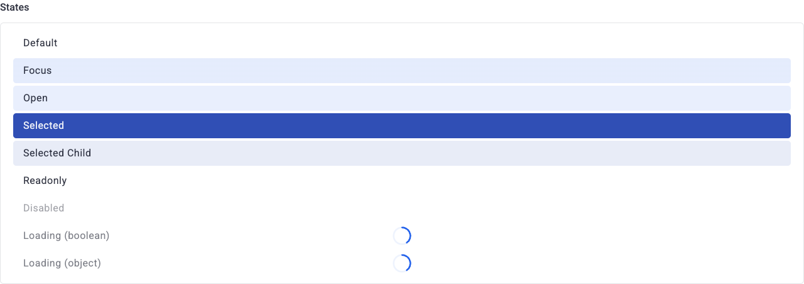
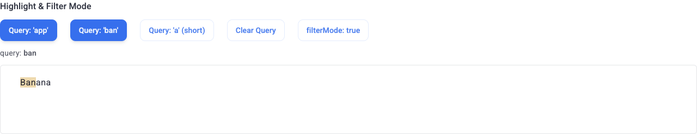

# Отчёт о визуальном и функциональном тестировании: `D1ListItem`

## 1. Краткое резюме

- **Компонент:** `D1ListItem` (`@dxtmisha/d1`)
- **Исходный код:** [`D1ListItem`](../../src/components/Ui/ListItem) ([`ListItem`](../../../constructor/src/constructors/ListItem))
- **Демо / Целевой URL:** `http://localhost:3000/component-list-item`
- **Материалы:** `None`
- **Дата тестирования (UTC):** `2026-11-22T15:24:42Z`
- **Окружение:** `Headless Chrome (Puppeteer / CDP, Desktop 1440x900, Tablet 768x1024, Mobile 375x812 / 320x568)`
- **Покрытие тест-кейсов:** 10 / 10 (`100%`)
- **Сводка:** **10 ✅, 0 ⚠️, 0 ❌** (`✅` пройдено, `⚠️` предупреждение, `❌` ошибка) — `D1ListItem` корректно рендерит все текстовые слои (включая нулевые `0`), состояния (`focus`, `open`, `selected`, `selectedChild`, `readonly`, `disabled`, `loading`, `isSkeleton`), иконки, бейджи, стили выбора (`checkbox`, `radio`, `checkmark`), подсветку и фильтрацию (включая метаданные `search`), ленивый рендеринг (`lazy`, `lazyMargin`, `lazyCacheHeight`), все 8 слотов, пользовательские ID, ссылки `<a>` для `to`/`href`, адаптивность (`0` переполнений на `320px`–`1440px`) и WAI-ARIA атрибуты при `0` ошибках и предупреждениях консоли.

---

## 2. Базовая матрица

### 2.1 Визуальный рендеринг (`VIS`)

| ID | Сценарий | Статус | Фактический результат | Скриншот |
| :--- | :--- | :---: | :--- | :--- |
| `TC-VIS-001` | Базовый рендеринг, текстовые слои, иконки и бейджи | ✅ | Отрендерено `84` элемента `.d1-listItem` (`bodyCount: 68`, `contextCount: 68`, `prefixCount: 5`, `captionCount: 6`, `suffixCount: 5`, `descCount: 8`, `iconCount: 35`, `trailingCount: 8`, `badgeCount: 6`); строка `Full Text Composition` имеет размер `1238×52px` без перекрытий. |  |
| `TC-VIS-002` | Состояния (`focus`, `open`, `selected`, `disabled`, `loading`, `skeleton`), размеры, палитры и `fill` | ✅ | Активны все модификаторы состояний, `loadingCount: 2`, `skeletonCount: 7` (`.d1-skeleton__textVariant`); высоты размеров: `sm: 32px`, `md: 40px`, `lg: 48px`; разделитель `dense + divider`: `solid 1px`; `--d1-listItem-sys-fill: #ff0000`. |  |
| `TC-VIS-003` | Стили выбора (`checkbox`, `radio`, `checkmark`) и позиции контрола (`controlPosition`) | ✅ | Отрендерено `7` контролов `.d1-listItem__control`; для `controlPosition="start"` `order: 4` (слева), для `controlPosition="end"` `order: 28` (справа). |  |

### 2.2 Интерактивность и управление состоянием (`INT`)

| ID | Сценарий | Статус | Фактический результат | Скриншот |
| :--- | :--- | :---: | :--- | :--- |
| `TC-INT-001` | Переключение `checkbox`/`radio`, подсветка `highlight` и фильтрация `filterMode` | ✅ | Клики переключили `Selection Checkbox` (`true -> false`) и `Selection Radio Beta` (`false -> true`); при `query="app"` отображаются 4 элемента (`Apple Juice`, `Pineapple`, `Match by value (apple)`, `Match by search metadata` с полной подсветкой метки через `search`), при переключении на `ban` остался 1 элемент `Banana` с выделением `"Ban"`. |  |
| `TC-INT-002` | События `click` / `clickLite` и методы `expose` (`getValue`, `getDetail`) | ✅ | Клик по `Interactive ListItem` зафиксировал `event: clickLite`; кнопка `Read Expose Methods` вывела `value: "list-item-value"` и `detail: { "source": "demo" }`. | — |
| `TC-INT-003` | Ленивый рендеринг (`lazy`, `lazyMargin`, `lazyCacheHeight`) при прокрутке и переключении | ✅ | Из `16` элементов вначале видимы `4` (`hiddenCount: 12`, последний без `.d1-listItem__label`); после прокрутки вниз нижние строки (`Lazy Item 12..15`) стали видимыми, а ушедший вверх первый элемент сохранил `containIntrinsicHeight: 52px`; отключение `lazyCacheHeight` очистило inline-высоту (`""`), а `lazy: false` отрендерил все `16` элементов без `--lazy`. |  |

### 2.3 Границы и крайние случаи (`BND`)

| ID | Сценарий | Статус | Фактический результат | Скриншот |
| :--- | :--- | :---: | :--- | :--- |
| `TC-BND-001` | Нулевые значения (`0`), проекция всех 8 слотов, пользовательские ID, кастомные теги и ссылки | ✅ | Число `0` отображается в `label`, `caption`, `description`, `badge`; все 8 слотов (`leading`, `prefix`, `default`, `caption`, `suffix`, `description`, `body`, `trailing`) визуально подтверждены; проверены пользовательские ID (`#demo-list-item-label-id`, `#demo-list-item-prefix-id`, `#demo-list-item-suffix-id`, `#demo-list-item-description-id`); тег `<button>` и 3 ссылки `<a>` (`href` и `to`) отрендерены корректно. |  |

### 2.4 Адаптивность (`RSP`)

| ID | Сценарий | Статус | Фактический результат | Скриншот |
| :--- | :--- | :---: | :--- | :--- |
| `TC-RSP-001` | Адаптация `D1ListItem` на десктопе, планшете и мобильных устройствах | ✅ | На всех проверенных разрешениях (`1440×900`, `768×1024`, `375×812`, `320×568`) `docOverflow: false` и `overflowCount: 0`; `autoMdOrder` переключается с `"4"` (`>=768px`) на `"28"` (`<768px`). |  |

### 2.5 Доступность (`A11Y`)

| ID | Сценарий | Статус | Фактический результат | Скриншот |
| :--- | :--- | :---: | :--- | :--- |
| `TC-A11Y-001` | WAI-ARIA атрибуты и клавиатурная активация `Enter` | ✅ | `caption-decorative` имеет `aria-hidden="true"`; `disabled` и `loading` имеют `aria-disabled="true"`; `role="option"` -> `aria-selected="true"`, `role="menuitemradio"` -> `aria-checked="true"`, `role="menuitemcheckbox"` -> `aria-checked="false"`; нажатие `Enter` вызвало `event: clickLite`. | — |

### 2.6 Логи и консоль (`LOG`)

| ID | Сценарий | Статус | Фактический результат | Скриншот |
| :--- | :--- | :---: | :--- | :--- |
| `TC-LOG-001` | Отсутствие ошибок консоли, исключений страницы и `[Vue warn]` | ✅ | `consoleErrors: []`, `vueWarnings: []`, `pageErrors: []`, `httpErrors: []`. | — |

---

## 3. AI-аудит и рекомендации

1. **Подсветка и фильтрация по метаданным `search` (`LabelHighlightInclude`):** Обновлённая логика `LabelHighlightInclude.isSearchMatch()` и наследование `search?: string` из `LabelHighlightProps` подтверждены в реальном браузере: строка `Match by search metadata` с `search="apple orchard cider"` сохраняется при `filterMode` и подсвечивает всю метку при запросе `app`.
2. **Ленивый рендеринг (`ListItemLazy` + `ListItemLazyHeight`):** При прокрутке `.demo-list-item-page__lazy` элементы вне зоны видимости откладывают рендеринг дочерних узлов, сохраняя измеренную высоту (`containIntrinsicHeight: 52px`); идемпотентный `onMounted` предотвращает утечки наблюдателей при повторном монтировании.
3. **Адаптивность и чистота рантайма:** На всех проверенных разрешениях (`1440×900`, `768×1024`, `375×812`, `320×568`) переполнения отсутствуют (`overflowCount: 0`, `docOverflow: false`), контрол `autoMd` корректно меняет порядок на брейкпоинте `768px`, а `consoleErrors`, `vueWarnings`, `pageErrors` и `httpErrors` пусты.
