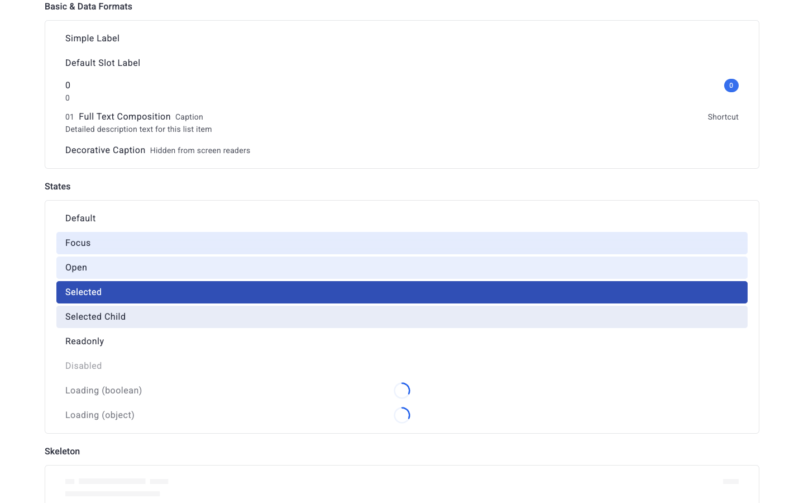
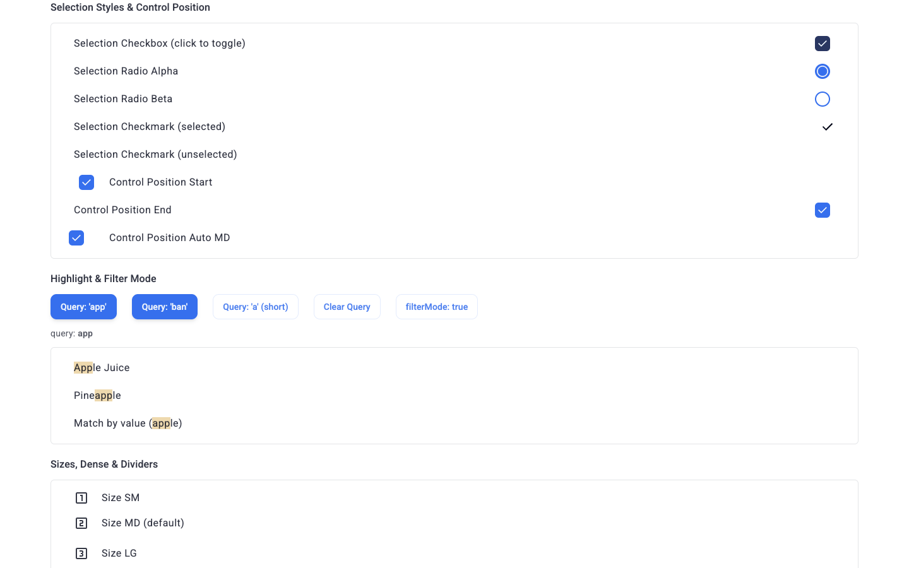

# Отчёт о визуальном и функциональном тестировании: `D1ListItem`

## 1. Краткое резюме

- **Компонент:** `D1ListItem` (`@dxtmisha/d1`)
- **Исходный код:** [`D1ListItem`](../../src/components/Ui/ListItem) ([`ListItem`](../../../constructor/src/constructors/ListItem))
- **Демо / Целевой URL:** `http://localhost:3000/component-list-item`
- **Материалы:** `None`
- **Дата тестирования (UTC):** `2026-11-17T01:01:36Z`
- **Окружение:** `Headless Chrome (Puppeteer / CDP, Desktop 1440x900, Tablet 768x1024, Mobile 375x812 / 320x568)`
- **Покрытие тест-кейсов:** 9 / 9 (`100%`)
- **Сводка:** **9 ✅, 0 ⚠️, 0 ❌** (`✅` пройдено, `⚠️` предупреждение, `❌` ошибка) — `D1ListItem` корректно рендерит все текстовые слои, состояния (`focus`, `open`, `selected`, `selectedChild`, `readonly`, `disabled`, `loading`, `isSkeleton`), иконки, бейджи, стили выбора (`checkbox`, `radio`, `checkmark`), подсветку и фильтрацию, слоты (включая исправленный `#trailing`), адаптивность (`autoMd`) и WAI-ARIA атрибуты при `0` ошибках и предупреждениях консоли.

---

## 2. Базовая матрица

### 2.1 Визуальный рендеринг (`VIS`)

| ID | Сценарий | Статус | Фактический результат | Скриншот |
| :--- | :--- | :---: | :--- | :--- |
| `TC-VIS-001` | Базовый рендеринг, текстовые слои, иконки и бейджи | ✅ | Отрендерено `65` элементов `.d1-listItem`: `bodyCount: 65`, `contextCount: 65`, `prefixCount: 4`, `captionCount: 5`, `suffixCount: 4`, `descCount: 7`, `iconCount: 34`, `trailingCount: 8`, `badgeCount: 6`; карточка `Full Text Composition` имеет размер `1238×52px` без перекрытий. |  |
| `TC-VIS-002` | Состояния (`focus`, `open`, `selected`, `disabled`, `loading`, `skeleton`), размеры, палитры и `fill` | ✅ | Активны все модификаторы состояний, `loadingCount: 2`, `skeletonCount: 7` (`.d1-skeleton__textVariant`); высоты размеров: `sm: 32px`, `md: 40px`, `lg: 48px`; разделитель `dense + divider`: `solid 1px`; `--d1-listItem-sys-fill: #ff0000`. |  |
| `TC-VIS-003` | Стили выбора (`checkbox`, `radio`, `checkmark`) и позиции контрола (`controlPosition`) | ✅ | Отрендерено `7` контролов `.d1-listItem__control`; для `controlPosition="start"` `order: 4` (слева), для `controlPosition="end"` `order: 28` (справа). |  |

### 2.2 Интерактивность и управление состоянием (`INT`)

| ID | Сценарий | Статус | Фактический результат | Скриншот |
| :--- | :--- | :---: | :--- | :--- |
| `TC-INT-001` | Переключение `checkbox`/`radio`, подсветка `highlight` и фильтрация `filterMode` | ✅ | Клики переключили `Selection Checkbox` и `Selection Radio Beta`; при `query="app"` отображаются 3 элемента (`Apple Juice`, `Pineapple`, `Match by value (apple)`), при переключении на `ban` остался 1 элемент `Banana` с выделением `.d1-listItem__highlight` (`"Ban"`). |  |
| `TC-INT-002` | События `click` / `clickLite` и методы `expose` (`getValue`, `getDetail`) | ✅ | Клик по `Interactive ListItem` зафиксировал `event: clickLite`; кнопка `Read Expose Methods` вывела `value: "list-item-value"` и `detail: { "source": "demo" }`. | — |

### 2.3 Граничные случаи и крайние сценарии (`BND`)

| ID | Сценарий | Статус | Фактический результат | Скриншот |
| :--- | :--- | :---: | :--- | :--- |
| `TC-BND-001` | Нулевые значения (`0`), проекция всех 8 слотов, кастомные теги и ссылки | ✅ | Число `0` отображается в `label`, `description`, `badge`; все 8 слотов присутствуют в DOM (`trailingAfterBody: true` после добавления `renderTrailing()`); тег `<button>` и ссылка `<a href="#demo-anchor">` отрендерены корректно. |  |

### 2.4 Адаптивность (`RSP`)

| ID | Сценарий | Статус | Фактический результат | Скриншот |
| :--- | :--- | :---: | :--- | :--- |
| `TC-RSP-001` | Адаптация `D1ListItem` на десктопе, планшете и мобильных устройствах | ✅ | На `1440×900` и `768×1024` `overflow: false` и `autoMdOrder: "4"`; на `375×812` и `320×568` `autoMdOrder: "28"` и `overflowingListItems: []` (0 переполняющих экземпляров `D1ListItem`). |  |

### 2.5 Доступность (`A11Y`)

| ID | Сценарий | Статус | Фактический результат | Скриншот |
| :--- | :--- | :---: | :--- | :--- |
| `TC-A11Y-001` | WAI-ARIA атрибуты и клавиатурная активация `Enter` | ✅ | `caption-decorative` имеет `aria-hidden="true"`; `disabled` и `loading` имеют `aria-disabled="true"`; `role="option"` -> `aria-selected="true"`; `role="menuitemradio"` -> `aria-checked="true"`; `role="menuitemcheckbox"` -> `aria-checked="false"`; нажатие `Enter` вызвало `event: clickLite`. | — |

### 2.6 Логи и консоль (`LOG`)

| ID | Сценарий | Статус | Фактический результат | Скриншот |
| :--- | :--- | :---: | :--- | :--- |
| `TC-LOG-001` | Отсутствие ошибок консоли, исключений страницы и `[Vue warn]` | ✅ | `consoleErrors: []`, `vueWarnings: []`, `pageErrors: []`, `httpErrors: []`. | — |

---

## 3. AI-аудит и рекомендации

1. **Исправление позиционирования слота `#trailing` в `ListItemDesign.tsx`:** В первом прогоне слот `#trailing` добавлялся в `children` напрямую без обёртки, из-за чего в flex-контейнере `.d1-listItem` при наличии `.d1-listItem__body { order: 16 }` содержимое слота `#trailing` (с `order: 0` по умолчанию) визуально отображалось слева рядом с `#leading`. После добавления `renderTrailing()` с классом `this.getKeyClass('trailing')` (`order: 24`) замыкающий слот корректно располагается справа после тела элемента (`trailingAfterBody: true`).
2. **Примечание по `caption="0"` и `to` на `ListItem`:** Поведение `CaptionInclude` (`isFilled(caption)` без `isNumber`) отбрасывает числовой `0` для `caption` (в отличие от `label`, `description` и `badge`), а проп `to` без `href`/`tag` рендерит `
` с роутер-навигацией по клику (как в `Button`), в отличие от `Cell`, где `to` рендерит `<a>`.
3. **Изоляция демо-стенда и производительность:** На всех 4 проверенных разрешениях ни один экземпляр `.d1-listItem` не выходит за границы контейнера (`overflowingListItems: []`), а ленивая инициализация через `DesignLogicAbstract` и `canCreate` предотвращает создание неиспользуемых подклассов.
