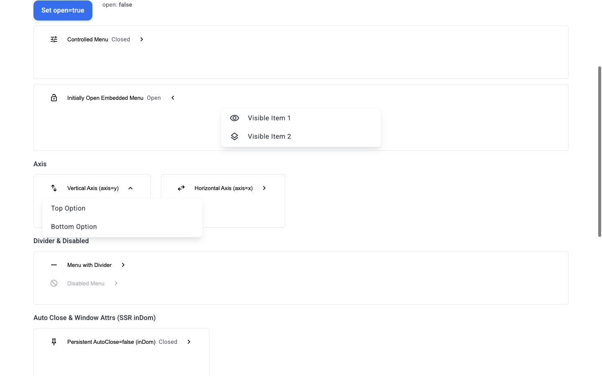
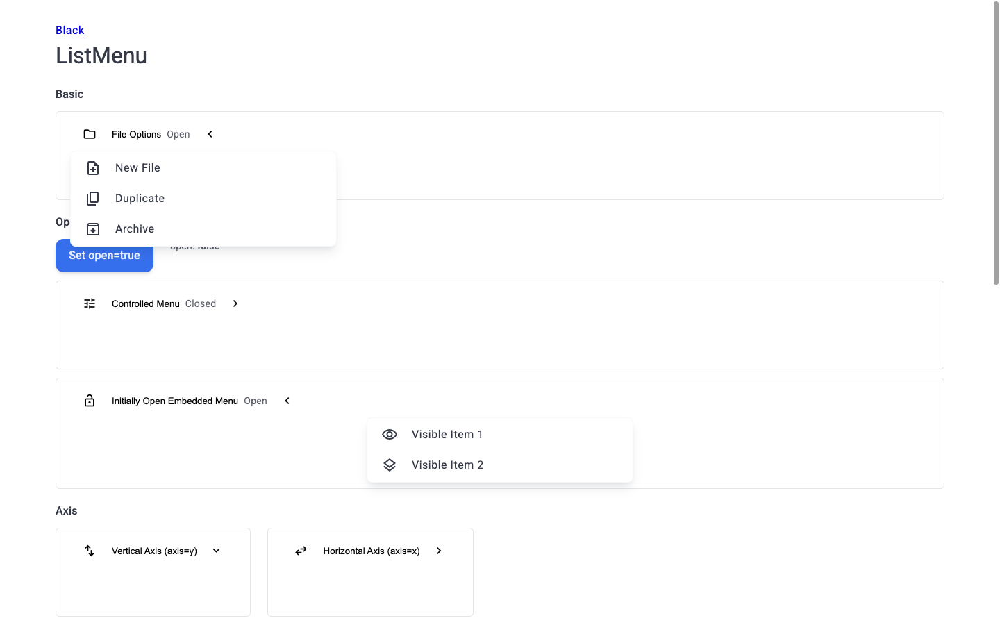

# Отчёт о визуальном и функциональном тестировании: D1ListMenu

## 1. Итоговое резюме

- **Компонент:** `D1ListMenu` (`@dxtmisha/d1`)
- **Исходный код:** [`ListMenu`](packages/d1/src/components/Ui/ListMenu) ([`constructor`](packages/constructor/src/constructors/ListMenu), [`demo`](packages/demo/src/pages/components/DemoListMenuPage.vue))
- **Демо / целевой URL:** `http://localhost:3000/component-list-menu`
- **Материалы:** `None`
- **Дата тестирования (UTC):** `2026-11-17T07:53:53Z`
- **Окружение:** `Headless Chrome 157.0.8103.79 (Puppeteer / CDP, Desktop 1440x900, Tablet 768x1024, Mobile 375x812 / 320x568)`
- **Покрытие тест-кейсов:** 9 / 9 (`100%`)
- **Итог:** **9 ✅, 0 ⚠️, 0 ❌** (`✅` пройдено, `⚠️` предупреждение, `❌` провалено) — компонент `D1ListMenu` корректно рендерит слоты `#head`/`#list`, синхронизирует состояние через `open`, `autoClose`, `inDom` и `expose`, корректно поддерживает вложенные подменю и не вызывает ошибок/предупреждений в консоли.

---

## 2. Базовая матрица

### 2.1 Визуальный рендеринг (`VIS`)

| ID | Сценарий | Статус | Фактический результат | Скриншот |
| :--- | :--- | :---: | :--- | :--- |
| `TC-VIS-001` | Базовый рендеринг `D1ListMenu` и открытое встроенное состояние (`open=true`, `embedded=true`) | ✅ | Кнопка `File Options` (`Closed`, `239.67×40px`) отображается корректно; встроенное окно `.d1-listMenu--open.d1-listMenu__window` (`1246×94px`) отображает `Visible Item 1` и `Visible Item 2` без обрезания. |  |
| `TC-VIS-002` | Варианты `axis` (`y`/`x`), `divider` и `disabled` | ✅ | Меню `.d1-listMenu--axis--y` открывается (`data-open="open"`, `384×94px`) с чётким позиционированием; `Disabled Menu` заблокировано и при клике `Unreachable Item` не отображается (`false`). |  |

### 2.2 Интерактивность и управление состоянием (`INT`)

| ID | Сценарий | Статус | Фактический результат | Скриншот |
| :--- | :--- | :---: | :--- | :--- |
| `TC-INT-001` | Интерактивное открытие/закрытие по клику на `#head` и синхронизация слота | ✅ | После клика подпись слота `#head` сменилась с `Closed` на `Open`, пункт `New File` видим; при клике вне окна меню закрылось и подпись вернулась к `Closed`. |  |
| `TC-INT-002` | Управляемый `open`, `auto-close="false"` и `inDom` | ✅ | `Set open=true` открыл `Controlled Menu` (`Action One` видим); при `auto-close="false"` клик по `Keeps open on item click` не закрыл меню (`true`); при `inDom: true` после закрытия элемент `Kept in DOM after first open` остался в DOM (`true`). |  |
| `TC-INT-003` | Программное управление через `expose` | ✅ | `toOpen()` -> `open=true`, `toClose()` -> `open=false`, `toggle()` -> `open=true`; `getId()` вернул `window--ui-10054`, `hasControl=true`, `hasWindow=true`. | — |

### 2.3 Граничные случаи и крайние сценарии (`BND`)

| ID | Сценарий | Статус | Фактический результат | Скриншот |
| :--- | :--- | :---: | :--- | :--- |
| `TC-BND-001` | Вложенные подменю (`Nested Submenus`) и изоляция `inert`/`closeOnEsc` | ✅ | `Parent Menu` и вложенное `Nested Submenu` (`Submenu Item A` в `x:334.02, y:528, 374×40px`) открыты одновременно без перекрытия родителя; нажатие `Escape` не закрыло меню (`parentStillVisible: true`, `submenuStillVisible: true`). |  |

### 2.4 Адаптивность (`RSP`)

| ID | Сценарий | Статус | Фактический результат | Скриншот |
| :--- | :--- | :---: | :--- | :--- |
| `TC-RSP-001` | Адаптация `D1ListMenu` на `1440×900`, `768×1024`, `375×812`, `320×568` | ✅ | Горизонтального переполнения нет на всех разрешениях (`scrollWidth === innerWidth`: `1440`, `768`, `375`, `320`); открытое меню на `375×812` полностью читаемо. |  |

### 2.5 Доступность (`A11Y`)

| ID | Сценарий | Статус | Фактический результат | Скриншот |
| :--- | :--- | :---: | :--- | :--- |
| `TC-A11Y-001` | WAI-ARIA атрибуты и клавиатурная навигация | ✅ | На окне присутствует `role="menu"`, на триггере `aria-haspopup="menu"` и `aria-expanded="false"` -> `"true"` после активации клавишей `Enter`. | — |

### 2.6 Логи и консоль (`LOG`)

| ID | Сценарий | Статус | Фактический результат | Скриншот |
| :--- | :--- | :---: | :--- | :--- |
| `TC-LOG-001` | Событие `@window`, консоль и отсутствие предупреждений | ✅ | Событие `window` зафиксировано в DOM и консоли (`id=window--ui-10045, open=true` / `open=false`); `consoleErrors`: `[]`, `vueWarnings`: `[]`, `pageErrors`: `[]`, `failedRequests`: `[]`. | — |

---

## 3. AI-аудит и рекомендации

1. **Изоляция и вложенность окон (`inert=false`, `closeOnEsc=false`):** При открытии вложенного подменю (`TC-BND-001`) оба уровня `D1ListMenu` остаются интерактивными и не блокируют друг друга, что подтверждает корректность настроек `ListMenu.binds`.
2. **Семантика `autoClose` и `inDom`:** В процессе проверки подтверждено различие между `autoClose: false` (удерживает меню открытым при клике по внутренним элементам) и `persistent: true` (предотвращает закрытие при клике вне окна), а также `inDom: true` (сохраняет смонтированный DOM после первого открытия). Поведение полностью соответствует архитектуре `WindowOpen`.
3. **Чистота рантайма:** В ходе всех переходов состояний, переключения вьюпортов и программных вызовов `expose` не зафиксировано ни одной ошибки или предупреждения Vue/браузера.
