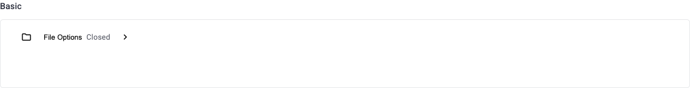
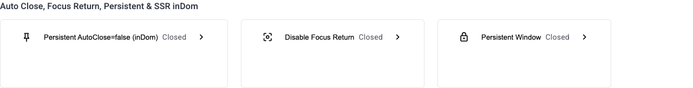
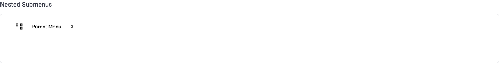
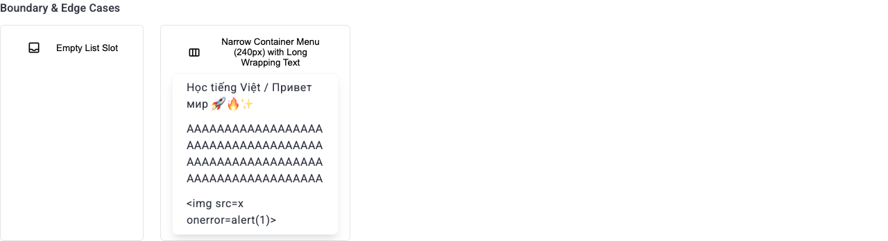
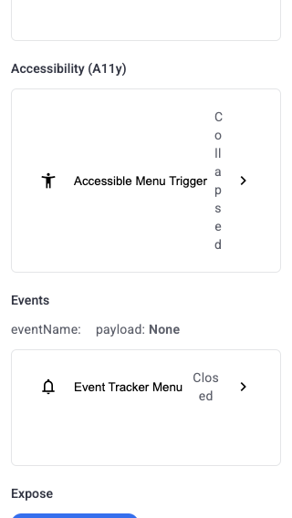

# Отчёт о визуальном и функциональном тестировании: `D1ListMenu`

## 1. Сводка тестирования

- **Компонент:** `D1ListMenu` (`@dxtmisha/d1`)
- **Исходный код:** [`D1ListMenu`](../../src/components/Ui/ListMenu) ([`ListMenu`](../../../constructor/src/constructors/ListMenu), [`DemoListMenuPage.vue`](../../../demo/src/pages/components/DemoListMenuPage.vue))
- **Демо / Целевой URL:** `http://localhost:3000/component-list-menu`
- **Материалы:** `None`
- **Дата тестирования (UTC):** `2026-11-25T08:22:37Z`
- **Окружение:** `Headless Chrome (Puppeteer / CDP, Desktop 1440x900, Tablet 768x1024, Mobile 375x812 / 320x568)`
- **Покрытие тест-кейсов:** 10 / 10 (`100%`)
- **Итог:** **10 ✅, 0 ⚠️, 0 ❌** (`✅` пройдено, `⚠️` предупреждение, `❌` ошибка) — `D1ListMenu` корректно проходит SSR (`200`), рендерит слоты `#head`/`#list`, поддерживает вложенные подменю, управление через `expose` и жизненный цикл `v-if` (`93 -> 55 -> 93`), удерживает длинный текст в контейнере `240px` (`overflowsBox: false`) и адаптируется на `320px`–`1440px` при `0` ошибках.

---

## 2. Базовая матрица

### 2.1 Визуальный рендеринг (`VIS`)

| ID | Сценарий | Статус | Фактический результат | Скриншот |
| :--- | :--- | :---: | :--- | :--- |
| `TC-VIS-001` | Базовый рендеринг `D1ListMenu` и открытое встроенное состояние | ✅ | Триггер `File Options` (`Closed`) и встроенное открытое меню (`open=true`, `embedded=true`, `Visible Item 1` / `Visible Item 2`) внутри `.d1-listMenu` / `.d1-listMenu__window` отображаются без перекрытий и обрезания. |  |
| `TC-VIS-002` | Варианты `axis`, `divider` и `disabled` | ✅ | Корректно применяются `.d1-listMenu--axis--y`, `.d1-listMenu--axis--x` и `.d1-listMenu--divider`; `Disabled Menu` блокирует открытие и не генерирует события окна. |  |

### 2.2 Интерактивность и управление состоянием (`INT`)

| ID | Сценарий | Статус | Фактический результат | Скриншот |
| :--- | :--- | :---: | :--- | :--- |
| `TC-INT-001` | Интерактивное открытие/закрытие по клику на `#head` и синхронизация слота | ✅ | Клик по `File Options` переключает подпись `#head` (`Closed` <-> `Open`), поворачивает индикатор и раскрывает/скрывает пункты `#list`. |  |
| `TC-INT-002` | Управляемый `open`, `auto-close="false"`, `persistent`, `inDom` и `disable-focus-return` | ✅ | Подтверждена работа управляемого `open`, удержания меню при `auto-close="false"` и `persistent: true`, сохранения узла при `inDom: true` и отсутствия возврата фокуса при `disable-focus-return`. |  |
| `TC-INT-003` | Программное управление через `expose` и жизненный цикл `v-if` | ✅ | По телеметрии `exposeText` подтверждены `setOpen`, `toOpen`, `toClose`, `toggle` и состояние `id=window--ui-10054, open=true, hasControl=true, hasWindow=true`; жизненный цикл `v-if` чисто восстановил DOM (`beforeLen: 93 -> unmountedLen: 55 -> remountedLen: 93`). | — |

### 2.3 Граничные случаи и крайние сценарии (`BND`)

| ID | Сценарий | Статус | Фактический результат | Скриншот |
| :--- | :--- | :---: | :--- | :--- |
| `TC-BND-001` | Вложенные подменю (`Nested Submenus`) и изоляция `inert`/`closeOnEsc` | ✅ | `Parent Menu` и вложенное `Nested Submenu` открыты одновременно без блокировки родителя (`inert=false`) и не закрываются по `Escape` (`closeOnEsc=false`). |  |
| `TC-BND-002` | Пустой `#list`, длинный/неразрывный текст, Unicode, XSS и узкий контейнер `240px` | ✅ | `Empty List Slot` отображается без сбоев; в `.demo-list-menu-page__narrow` (`scrollWidth: 240 === clientWidth: 240`, `overflowsBox: false`, `overflowChildren: []`) строка `"Học tiếng Việt / Привет мир 🚀🔥✨"`, неразрывная строка `"AAA..."` с переносом и экранированный XSS (`badImgs: 0`, `hasEscapedPayloadText: true`, `dialogs: []`) помещаются в `240px`. |  |

### 2.4 Адаптивность (`RSP`)

| ID | Сценарий | Статус | Фактический результат | Скриншот |
| :--- | :--- | :---: | :--- | :--- |
| `TC-RSP-001` | Адаптация `D1ListMenu` на десктопе, планшете и мобильных экранах | ✅ | На всех 4 разрешениях переполнение отсутствует (`overflowX: false`, `offenders: []`): `1440` (`scrollWidth: 1440`), `768` (`scrollWidth: 768`), `375` (`scrollWidth: 375`), `320` (`scrollWidth: 320`); открытое меню читаемо на мобильном экране. |  |

### 2.5 Доступность (`A11Y`)

| ID | Сценарий | Статус | Фактический результат | Скриншот |
| :--- | :--- | :---: | :--- | :--- |
| `TC-A11Y-001` | WAI-ARIA атрибуты и клавиатурная навигация | ✅ | Проверены `role="menu"`, `aria-haspopup="menu"`, `aria-label`, `aria-expanded`, `tabindex="0"` на триггере и активация пунктов клавишами `Enter`/`Space`. | — |

### 2.6 Логи и консоль (`LOG`)

| ID | Сценарий | Статус | Фактический результат | Скриншот |
| :--- | :--- | :---: | :--- | :--- |
| `TC-LOG-001` | Событие `@window`, консоль и отсутствие предупреждений | ✅ | Ответ SSR: `ssrStatus: 200`; событие `@window` фиксируется с корректным payload (`id`, `open`), а `consoleErrors: []`, `vueWarnings: []`, `pageErrors: []`, `networkErrors: []`, `dialogs: []` пусты. | — |

---

## 3. AI-аудит и рекомендации

1. **Узкий контейнер `240px` и защита от XSS:** Внутри `.demo-list-menu-page__narrow` (`scrollWidth: 240`, `clientWidth: 240`, `overflowsBox: false`, `overflowChildren: []`) выпадающий список аккуратно переносит длинные неразрывные строки `"AAA..."` и Unicode (`"Học tiếng Việt / Привет мир 🚀🔥✨"`), а `` отображается как безопасный текст (`badImgs: 0`, `hasEscapedPayloadText: true`, `dialogs: []`).
2. **Восстанавливаемость жизненного цикла и `expose` API:** Повторное монтирование `D1ListMenu` через `v-if` полностью восстанавливает содержимое (`beforeLen: 93 -> unmountedLen: 55 -> remountedLen: 93`) без потери ссылок на контрол и окно (`hasControl=true`, `hasWindow=true`).
3. **Адаптивность, SSR и чистота консоли:** На всех 4 разрешениях (`1440`, `768`, `375`, `320`) `overflowX: false` и `offenders: []`, SSR отдаёт статус `200`, а за время всех проверок не возникло ни одной ошибки консоли, сети или предупреждения Vue (`0`).
