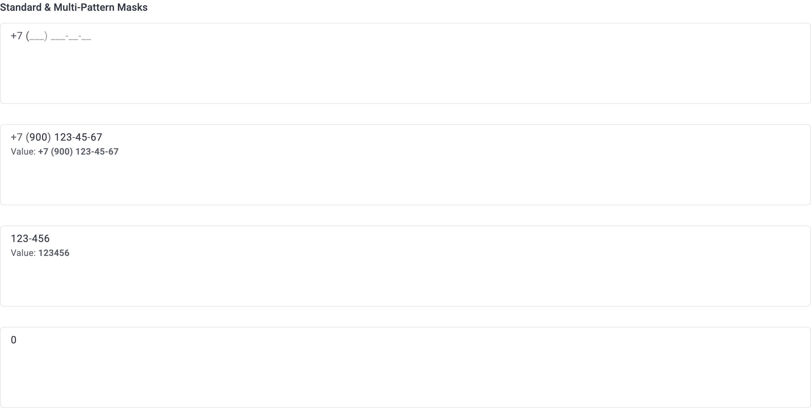
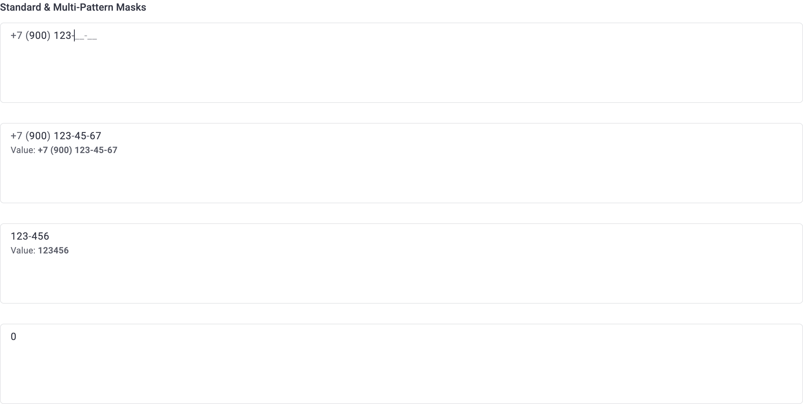
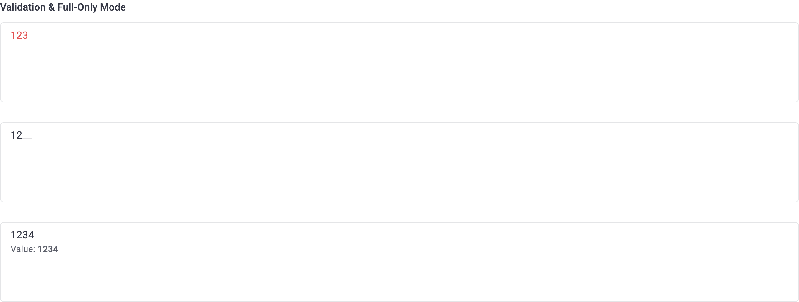
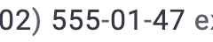

# Отчёт визуального и функционального тестирования: D1Mask

## 1. Резюме

- **Компонент:** `D1Mask` (`@dxtmisha/d1`)
- **Исходный код:** [`Mask`](../../src/components/Ui/Mask) ([`constructor/Mask`](../../../constructor/src/constructors/Mask), [`DemoMaskPage.vue`](../../../demo/src/pages/components/DemoMaskPage.vue))
- **URL демо:** `http://localhost:3000/component-mask`
- **Материалы:** `None`
- **Дата тестирования (UTC):** `2026-11-22T10:47:59Z`
- **Окружение:** `Headless Chrome (puppeteer / CDP, Desktop 1440x900, Tablet 768x1024, Mobile 375x812 / 320x568)`
- **Покрытие тест-кейсов:** 11 / 11 (`100%`)
- **Итог:** **11 ✅, 0 ⚠️, 0 ❌** (`✅` пройдено, `⚠️` предупреждение, `❌` провалено) — все 11 сценариев (рендеринг, ввод, валидация, программный API, обрезка оверлея и синхронизация прокрутки `MaskScroll`, адаптивность, ARIA и консоль) успешно пройдены без ошибок и предупреждений Vue.

---

## 2. Базовая матрица

### 2.1 Визуальный рендеринг (`VIS`)

| ID | Сценарий | Статус | Фактический результат | Скриншот |
| :--- | :--- | :---: | :--- | :--- |
| `TC-VIS-001` | Базовый рендеринг стандартной и мульти-шаблонной масок | ✅ | `count=4`, `rect=inputRect=charRect=127×24px`; пустая маска показывает `14` плейсхолдеров `--placeholder`, заполненная `+7 (900) 123-45-67` и мульти-шаблон `123-456` имеют класс `.d1-mask--value`. |  |
| `TC-VIS-002` | Видимость (`visible`, `visiblePartly`), выравнивание (`align`) и направление (`dir`) | ✅ | `visibleClass=true`; при `visible=false` `hiddenCharOpacity="0"`; при `visiblePartly=true` `partlyCharOpacity="1"` и `partlyPlaceholderOpacity="0"`; `align` задаёт `left`/`center`/`right`; `dir="rtl"` выставляет `.d1-mask--dir--rtl` и `.d1-mask--end`. |  |
| `TC-VIS-003` | Спецсимволы, типы дат/времени и числовые/валютные маски | ✅ | `dateMaskCount=14`, `numMaskCount=7`; числовая маска `123,456` (`--end=true`) и валютная `€123,456.70` (`--end=true`) отображаются с корректными разделителями и выравниванием. |  |

### 2.2 Интерактивность и управление состоянием (`INT`)

| ID | Сценарий | Статус | Фактический результат | Скриншот |
| :--- | :--- | :---: | :--- | :--- |
| `TC-INT-001` | Ввод с клавиатуры, автоподстановка литералов и удаление `Backspace` | ✅ | После ввода `900123`: `value="+7 (900) 123-"`, `hiddenValue="+7 (900) 123-"`; после `Backspace`: `"+7 (900) 12"`. |  |
| `TC-INT-002` | Валидация (`pattern`, `check`) и режим `fullOnly` | ✅ | `errorItemsCount=3` (`.d1-mask__character__item--error`); в `fullOnly` после ввода `12` — `Value:`, после `34` — `Value: 1234`. |  |
| `TC-INT-003` | Программный `expose` API (`getValue`, `getValueBasic`, `setValue`, `clear`) | ✅ | Исходно `["Value: 123-", "Value: 123-"]`, после `Set 987654` — `["Value: 987-654", "Value: 987-654"]`, после `Clear` — `["Value: 000-", "Value: 000-"]`. |  |

### 2.3 Граничные случаи и крайние сценарии (`BND`)

| ID | Сценарий | Статус | Фактический результат | Скриншот |
| :--- | :--- | :---: | :--- | :--- |
| `TC-BND-001` | Числовой `0`, скрытое поле `name`, `rubber`-группы и `groupSave` | ✅ | `zeroValue="0"` (`zeroHasValueClass=true`), `hiddenFilledValue="+7 (900) 123-45-67"`, `rubberValue="12-34"`, `groupSave` (`true`/`false`) отображают `123-456`. |  |
| `TC-BND-002` | Обрезка визуального оверлея и синхронизация горизонтальной прокрутки (`MaskScroll`) | ✅ | В контейнере `120px`: `charWidth=120px`, `charScrollWidth=220px`, `overflow="hidden"`, `whiteSpace="nowrap"`; после прокрутки `input.scrollLeft=40` подтверждено `charScrollLeft=40` (`synced=true`). |  |

### 2.4 Адаптивность (`RSP`)

| ID | Сценарий | Статус | Фактический результат | Скриншот |
| :--- | :--- | :---: | :--- | :--- |
| `TC-RSP-001` | Адаптация `D1Mask` на десктопе, планшете и мобильных устройствах | ✅ | На всех 4 разрешениях (`1440×900`, `768×1024`, `375×812`, `320×568`): `maskCount=45`, `misalignedCount=0`, `docOverflow=false`. |  |

### 2.5 Доступность (`A11Y`)

| ID | Сценарий | Статус | Фактический результат | Скриншот |
| :--- | :--- | :---: | :--- | :--- |
| `TC-A11Y-001` | Семантика, ARIA-атрибуты и навигация с клавиатуры | ✅ | `ariaLabel="Phone mask with value"`, `inputMode="tel"`, `characterAriaHidden="true"`, `characterPointerEvents="none"`, `isFocused=true`. | — |

### 2.6 Логи и консоль (`LOG`)

| ID | Сценарий | Статус | Фактический результат | Скриншот |
| :--- | :--- | :---: | :--- | :--- |
| `TC-LOG-001` | События маски и отсутствие ошибок в консоли | ✅ | `trackerText="Value: blur"`, `consoleErrors=[]`, `vueWarnings=[]`, `pageErrors=[]`, `failedResponses=[]`. | — |

---

## 3. AI-аудит и рекомендации

1. **Обрезка оверлея и горизонтальная синхронизация (`MaskScroll`):** Новые стили `overflow: hidden`, `white-space: nowrap`, `max-width: 100%` на `.d1-mask__character` и `flex-shrink: 0` на `.d1-mask__character__item` совместно с `MaskScroll` полностью исключают выход маски за пределы узких контейнеров (`120px` при `scrollWidth=220px`) и удерживают точное соответствие `scrollLeft` между `<input>` и оверлеем.
2. **Производительность и управление жизненным циклом:** Выделение `MaskControl` и `MaskScroll` с отменой отложенных `requestAnimationFrame` в `onUnmounted` и очисткой `watchStops` в `Mask.onUnmounted` предотвращает утечки памяти и паразитные кадры после размонтирования.
3. **Чистота рантайма и доступность:** На всём прогоне из 11 сценариев и 4 viewport зафиксировано `0` ошибок консоли, `0` предупреждений Vue и `0` неудачных сетевых запросов; декоративный слой маски скрыт через `aria-hidden="true"`, а нативный `<input>` сохраняет проброс `inputAttrs` и фокус.
