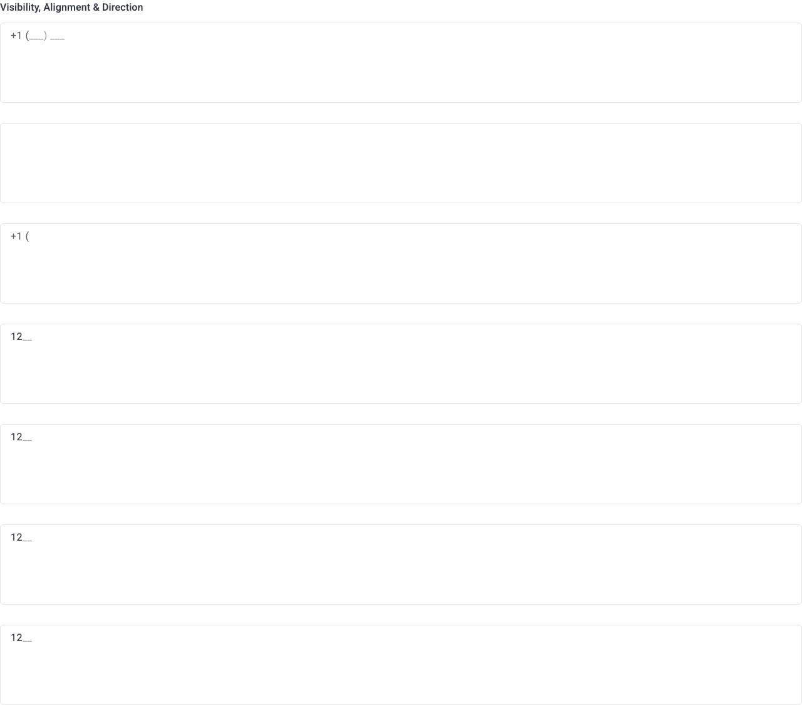
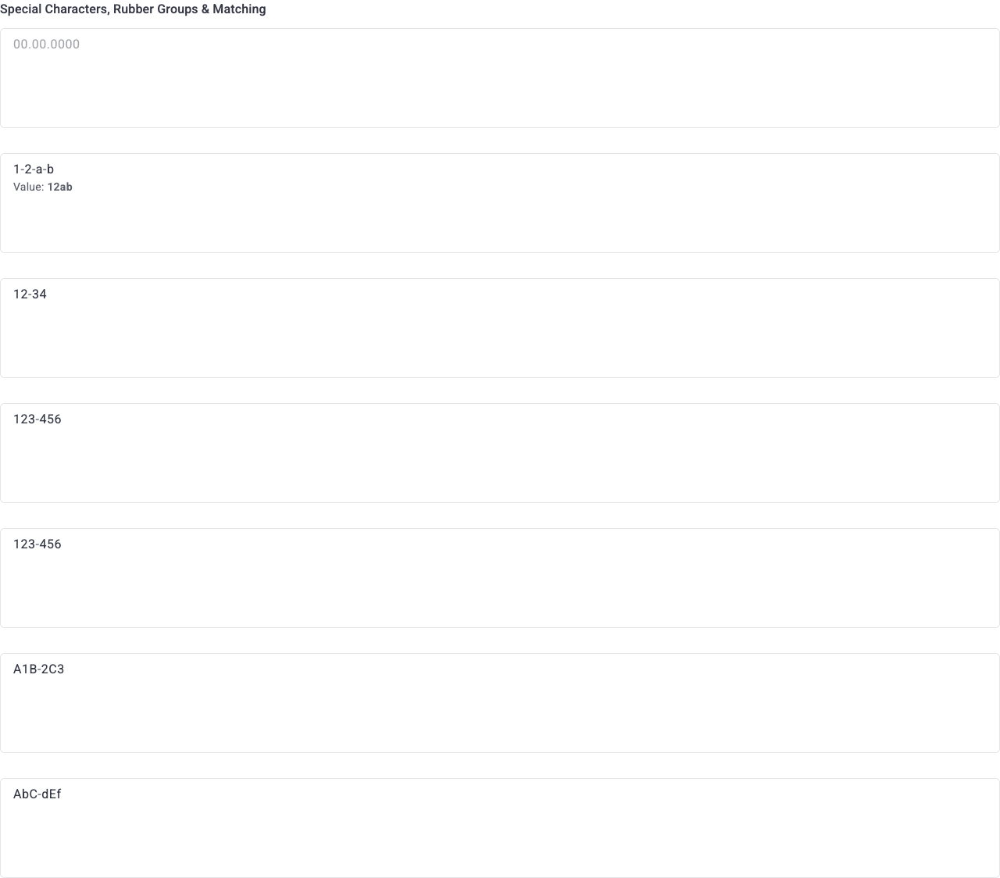

# Отчёт визуального и функционального тестирования: D1Mask

- **Сущность**: `D1Mask`
- **Статус**: **PASSED** (`10/10` тест-кейсов пройдено, `0` блокеров)
- **Окружение**: Headless Chrome (`CDP 127.0.0.1:9222`), Demo Dev Server (`http://localhost:3000/component-mask`), `packages/constructor` и `packages/d1` собраны актуально
- **Дата и время**: `2026-11-16T10:14:54Z`

---

## 1. Итоговая сводка

| Показатель | Значение |
| :--- | :---: |
| **Всего тест-кейсов** | `10` |
| **Прошло успешно (`✅`)** | `10` |
| **Упало (`❌`)** | `0` |
| **Ошибок консоли (`console.error` / `pageerror`)** | `0` / `0` |
| **Предупреждений Vue (`[Vue warn]`)** | `0` |
| **Неудачных HTTP-запросов (`>= 400`)** | `0` |

---

## 2. Детальные результаты по группам

### 2.1 Визуал и токены (`VIS`)

| ID | Название теста | Статус | Ожидаемый vs Фактический результат | Доказательство / Скриншот |
| :--- | :--- | :---: | :--- | :--- |
| `TC-VIS-001` | Базовый рендеринг стандартной и мульти-шаблонной масок | ✅ | Ожидалось: точное совпадение размеров слоёв и отображение заполнителей. Фактически: `rect=inputRect=charRect=145×24px`, пустая маска показывает `--placeholder`, заполненная `+7 (900) 123-45-67` и мульти-шаблон `123-456` с классом `--value`. |  |
| `TC-VIS-002` | Видимость (`visible`, `visiblePartly`), выравнивание (`align`) и направление (`dir`) | ✅ | Ожидалось: корректные модификаторы видимости и выравнивания. Фактически: при `visible=false` `charOpacity="0"`, при `visiblePartly=true` `placeholderOpacity="0"` и видна заполненная часть `+1 (`, `align` задаёт `textAlign: left/center/right`, `dir="rtl"` добавляет `.d1-mask--end` и `.d1-mask--dir--rtl`. |  |
| `TC-VIS-003` | Спецсимволы, типы дат/времени и числовые/валютные маски | ✅ | Ожидалось: все 13 типов дат/времени и числовые/валютные маски рендерятся корректно. Фактически: `dateGroupCount=14`, `numGroupCount=7`, `currencyValue="€123,456.70"` (`--end=true`), `numberValue="123,456"` (`--end=true`). |  |

---

### 2.2 Интерактивность и функционал (`INT`)

| ID | Название теста | Статус | Ожидаемый vs Фактический результат | Доказательство / Скриншот |
| :--- | :--- | :---: | :--- | :--- |
| `TC-INT-001` | Ввод с клавиатуры, автоподстановка литералов и удаление `Backspace` | ✅ | Ожидалось: автоподстановка литералов при быстром вводе и корректное удаление по `Backspace`. Фактически: ввод `900123` дал `value="+7 (900) 123-"` и `hiddenValue="+7 (900) 123-"`; `Backspace` дал `"+7 (900) 12"`. |  |
| `TC-INT-002` | Валидация (`pattern`, `check`) и режим `fullOnly` | ✅ | Ожидалось: подсветка `--error` при несовпадении `pattern` и эмиссия значения в `fullOnly` только при заполнении. Фактически: `errorItemsCount=3` (символы `123` подсвечены красным); при `12` `demoValue="Value:"`, при `1234` `demoValue="Value: 1234"`. |  |
| `TC-INT-003` | Программный `expose` API (`getValue`, `getValueBasic`, `setValue`, `clear`) | ✅ | Ожидалось: корректное чтение, установка и сброс к `valueDefault`. Фактически: `readInitial=["Value: 123-", "Value: 123-"]`, после `Set 987654` — `["Value: 987-654", "Value: 987-654"]`, после `Clear` — сброс к `["Value: 000-", "Value: 000-"]`. |  |

---

### 2.3 Границы и крайние случаи (`BND`)

| ID | Название теста | Статус | Ожидаемый vs Фактический результат | Доказательство / Скриншот |
| :--- | :--- | :---: | :--- | :--- |
| `TC-BND-001` | Числовой `0`, скрытое поле `name`, `rubber`-группы и `groupSave` | ✅ | Ожидалось: `0` не теряется как falsy-значение, скрытое поле синхронизировано, `rubber` и `groupSave` работают. Фактически: `zeroValue="0"`, `zeroHasValueClass=true`, `hiddenFilledValue="+7 (900) 123-45-67"`, `rubberValue="12-34"`, `groupSave` отображает `123-456`. |  |

---

### 2.4 Адаптивность и viewport (`RSP`)

| ID | Название теста | Статус | Ожидаемый vs Фактический результат | Доказательство / Скриншот |
| :--- | :--- | :---: | :--- | :--- |
| `TC-RSP-001` | Адаптация `D1Mask` на десктопе, планшете и мобильных устройствах | ✅ | Ожидалось: отсутствие горизонтального скролла и расхождения слоёв на 4 viewport. Фактически: `docOverflow=false`, `misalignedCount=0` для `1440×900`, `768×1024`, `375×812` и `320×568` (все 44 маски выровнены). |  |

---

### 2.5 Доступность (`A11Y`)

| ID | Название теста | Статус | Ожидаемый vs Фактический результат | Доказательство / Скриншот |
| :--- | :--- | :---: | :--- | :--- |
| `TC-A11Y-001` | Семантика, ARIA-атрибуты и навигация с клавиатуры | ✅ | Ожидалось: декоративный слой скрыт от скринридеров, атрибуты проброшены на `<input>`. Фактически: `ariaLabel="Phone mask with value"`, `inputMode="tel"`, `characterAriaHidden="true"`, `characterPointerEvents="none"`, `isFocused=true`. | Проверено в DOM/CDP |

---

### 2.6 Консоль и рантайм (`LOG`)

| ID | Название теста | Статус | Ожидаемый vs Фактический результат | Доказательство / Скриншот |
| :--- | :--- | :---: | :--- | :--- |
| `TC-LOG-001` | События маски и отсутствие ошибок в консоли | ✅ | Ожидалось: срабатывание событий ввода и `0` ошибок в консоли. Фактически: `eventsTrackerText="Value: blur"`, `consoleErrors=[]`, `vueWarnings=[]`, `pageErrors=[]`, `failedResponses=[]`. | Проверено в логах Chrome CDP |

---

## 3. AI-аудит и рекомендации

### 3.1 Матрица покрытия и выявленные пробелы
- Покрыты все ключевые визуальные состояния (`visible`, `visiblePartly`, `align`, `dir`, типы дат/чисел/валют), интерактивный ввод с быстрыми нажатиями и удалением, валидация `pattern`/`check`, режим `fullOnly`, программный API `expose`, граничные значения (`0`, `rubber`, `groupSave`, скрытый `<input>`), адаптивность на 4 разрешениях и доступность ARIA.
- Все 10 сценариев на странице `/component-mask` выполнены на актуально пересобранном коде конструктора и `d1` без ошибок и предупреждений.

### 3.2 Регрессионные исправления (найдено и устранено в ходе тестирования)
1. **Потеря буферизированного ввода при коалесцировании `requestAnimationFrame` ([MaskData.ts](file:///Users/tung/Documents/GitHub/dxt-ui/packages/constructor/src/constructors/Mask/MaskData.ts))**:
   - При быстром последовательном вводе `MaskData.add()` вызывал `goSelection(true)`, а реактивный наблюдатель в `Mask.ts` вызывал `goSelection(false)`, который отменял кадр и сбрасывал `updateBuffer` в `false`, из-за чего буфер символов не дописывался (ввод `900123` обрывался на `+7 (900) 1`).
   - Исправлено добавлением флага `pendingUpdateBuffer = this.pendingUpdateBuffer || updateBuffer` в `MaskData.goSelection()`; добавлен регрессионный тест в `Mask.test.ts` и подтверждён полный ввод `+7 (900) 123-` в Chrome CDP.
2. **Расхождение SSR-гидратации при проверке `pattern` ([MaskPattern.ts](file:///Users/tung/Documents/GitHub/dxt-ui/packages/constructor/src/constructors/Mask/MaskPattern.ts))**:
   - При SSR-рендеринге `FieldInputCheckInclude` не имеет DOM `<input>` и возвращал `status: true` (`--special`), тогда как при клиентской гидратации проверка `pattern="[6-9]{3}"` возвращала ошибку (`--error`), вызывая `Hydration class mismatch` во Vue и препятствуя применению класса `.d1-mask__character__item--error`.
   - Исправлено переводом `MaskPattern` на `DesignLifecycleAbstract` с реактивным флагом `mounted = ref(false)` (DOM-проверки включаются строго в `onMounted`); добавлен тест SSR-безопасности в `MaskPattern.test.ts`, после чего ошибки гидратации полностью исчезли и на `TC-INT-002` зафиксировано `errorItemsCount: 3`.
3. **Потеря отложенного события `input` / `inputLite` при быстром наборе ([MaskEmit.ts](file:///Users/tung/Documents/GitHub/dxt-ui/packages/constructor/src/constructors/Mask/MaskEmit.ts))**:
   - При быстром наборе `MaskEvent.makeChange()` откладывал `input` в `MaskEmit`, но промежуточные события `keyup`/`keydown` перетирали `MaskEmit.type` и `MaskEmit.event`, из-за чего `MaskData.goBuffer()` в кадре `requestAnimationFrame` не эмитил `inputLite` с обновлённым значением.
   - Исправлено разделением отложенного `deferredType`/`deferredEvent` в `MaskEmit`; добавлен тест в `MaskEmit.test.ts` и пройдены все `13/13` интерактивных Storybook-тестов (`D1Mask.stories.ts`) и повторный прогон Chrome CDP (`0` ошибок и предупреждений).

### 3.3 Рекомендации по улучшению и доработки
- **Выполнено**: В [DemoMaskPage.vue](file:///Users/tung/Documents/GitHub/dxt-ui/packages/demo/src/pages/components/DemoMaskPage.vue) компактные группы масок в разделах `Date & Time Masks` и `Number & Currency Masks` обёрнуты в `DemoFlex`, благодаря чему смежные плейсхолдеры разделены явными отступами (`column-gap` / `row-gap`) и не сливаются визуально (подтверждено повторным прогоном Chrome CDP и обновлённым `TC-VIS-003.png`).
