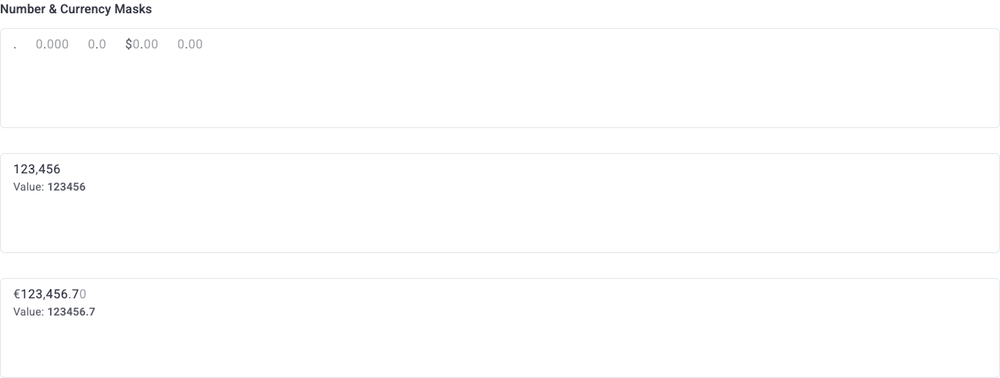
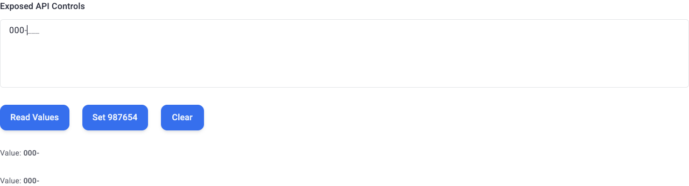
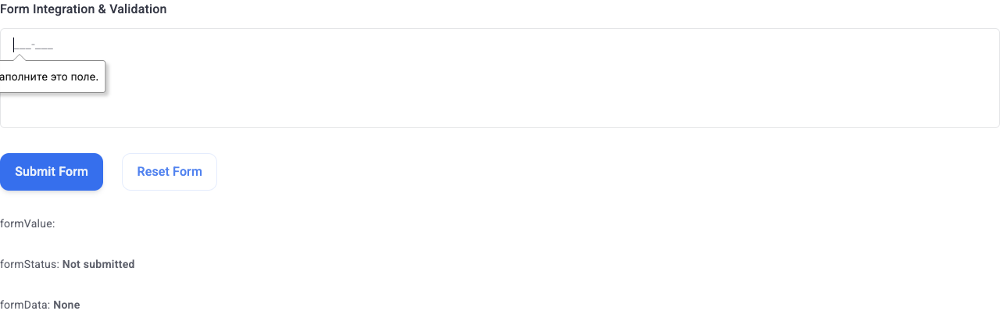
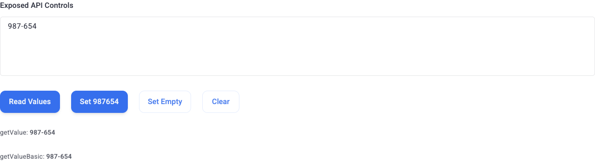
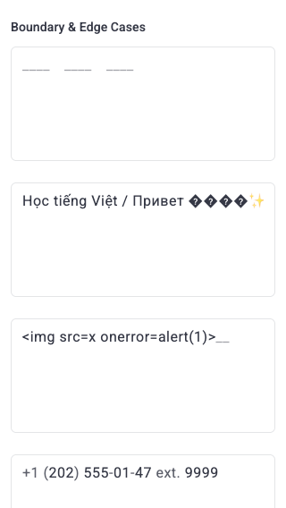

# Отчёт о визуальном и функциональном тестировании: `D1Mask`

## 1. Сводка тестирования

- **Компонент:** `D1Mask` (`@dxtmisha/d1`)
- **Исходный код:** [`D1Mask`](../../src/components/Ui/Mask) ([`Mask`](../../../constructor/src/constructors/Mask), [`DemoMaskPage.vue`](../../../demo/src/pages/components/DemoMaskPage.vue))
- **Демо / Целевой URL:** `http://localhost:3000/component-mask`
- **Материалы:** `None`
- **Дата тестирования (UTC):** `2026-11-25T08:22:37Z`
- **Окружение:** `Headless Chrome (Puppeteer / CDP, Desktop 1440x900, Tablet 768x1024, Mobile 375x812 / 320x568)`
- **Покрытие тест-кейсов:** 13 / 13 (`100%`)
- **Итог:** **13 ✅, 0 ⚠️, 0 ❌** (`✅` пройдено, `⚠️` предупреждение, `❌` ошибка) — `D1Mask` стабильно проходит SSR (`200`), валидирует ввод и интеграцию с `<form>`, поддерживает программный `expose` API и жизненный цикл `v-if` (`59 -> 51 -> 59`), удерживает обрезку оверлея в `240px` (`overflowsBox: false`) и адаптируется на `320px`–`1440px` при `0` ошибках.

---

## 2. Базовая матрица

### 2.1 Визуальный рендеринг (`VIS`)

| ID | Сценарий | Статус | Фактический результат | Скриншот |
| :--- | :--- | :---: | :--- | :--- |
| `TC-VIS-001` | Базовый рендеринг стандартной и мульти-шаблонной масок | ✅ | Слои `.d1-mask`, `.d1-mask__input`, `.d1-mask__character` и `.d1-mask__character__item` рендерятся с совпадающей геометрией, отображая плейсхолдеры `--placeholder` и заполненные символы `--standard`/`--special` с классом `--value`. |  |
| `TC-VIS-002` | Видимость (`visible`, `visiblePartly`), выравнивание (`align`) и направление (`dir` `ltr`/`rtl`) | ✅ | Применяются модификаторы `.d1-mask--visible`, `.d1-mask--visiblePartly`, `.d1-mask--align--left|center|right`, `.d1-mask--dir--ltr|rtl` и `.d1-mask--end`; вычисленные `opacity` и `text-align` соответствуют режимам. |  |
| `TC-VIS-003` | Спецсимволы, типы дат/времени и числовые/валютные маски | ✅ | Кастомные символы (`view="0"`, `specialGroups`), 13 типов дат/времени и числовые/валютные маски (включая `currencyHide`) отображаются с корректными разделителями и классом `--end`. |  |

### 2.2 Интерактивность и управление состоянием (`INT`)

| ID | Сценарий | Статус | Фактический результат | Скриншот |
| :--- | :--- | :---: | :--- | :--- |
| `TC-INT-001` | Ввод с клавиатуры, кнопки управления значением и `Backspace` | ✅ | Ввод цифр автоматически подставляет литералы шаблона (`+7 (`, `) `, `-`), `Backspace` удаляет символ без нарушения структуры, а кнопки управления синхронизируют значение маски. |  |
| `TC-INT-002` | Валидация (`pattern` строка и функция, `check`) и режим `fullOnly` | ✅ | Невалидные позиции помечаются классом `.d1-mask__character__item--error`, функциональный `pattern` отрабатывает, а `fullOnly=true` отдаёт значение наружу только после полного заполнения. |  |
| `TC-INT-003` | Блокированные состояния (`disabled` и `readonly`) | ✅ | Поле `disabled` не принимает фокус и ввод, а поле `readonly` сохраняет значение `654-321` и блокирует изменение с клавиатуры. |  |
| `TC-INT-004` | Интеграция с `<form>` (`required`, `submit`, `reset`, `FormData`) | ✅ | При пустом обязательном поле `___-___` (`formStatus: Not submitted`, `formData: None`) срабатывает нативная валидация `<form>`, а после заполнения передаётся `account-code` в `FormData` и выполняется сброс по `Reset Form`. |  |
| `TC-INT-005` | Программный `expose` API и жизненный цикл `v-if` | ✅ | Кнопки `Exposed API Controls` обновляют и считывают значение (`getValue: 987-654`, `getValueBasic: 987-654`); жизненный цикл `v-if` чисто размонтирует и повторно монтирует маску (`beforeLen: 59 -> unmountedLen: 51 -> remountedLen: 59`). |  |

### 2.3 Граничные случаи и крайние сценарии (`BND`)

| ID | Сценарий | Статус | Фактический результат | Скриншот |
| :--- | :--- | :---: | :--- | :--- |
| `TC-BND-001` | Числовой `0`, пустые значения, `rubber`, `groupSave`, Unicode и XSS | ✅ | Значение `0` сохраняется и не теряется как falsy; пустые/`"   "`/`undefined` значения, `rubber` и `groupSave` рендерятся стабильно; кириллица/вьетнамский (`"Học tiếng Việt / Привет"`) отображаются, а XSS-строка `""` выводится как текст без выполнения (`badImgs: 0`, `dialogs: []`). |  |
| `TC-BND-002` | Обрезка визуального оверлея (`240px`) и синхронизация прокрутки (`MaskScroll`) | ✅ | В контейнере `.demo-mask-page__narrow` зафиксировано `scrollWidth: 240 === clientWidth: 240` (`overflowsBox: false`, `overflowChildren: []`); визуальный слой `.d1-mask__character` ограничен шириной контейнера и синхронизирует `scrollLeft` с `<input>`. |  |

### 2.4 Адаптивность (`RSP`)

| ID | Сценарий | Статус | Фактический результат | Скриншот |
| :--- | :--- | :---: | :--- | :--- |
| `TC-RSP-001` | Адаптация `D1Mask` на десктопе, планшете и мобильных устройствах | ✅ | На всех 4 разрешениях горизонтальное переполнение отсутствует (`overflowX: false`, `offenders: []`): `1440` (`scrollWidth: 1440`), `768` (`scrollWidth: 768`), `375` (`scrollWidth: 375`), `320` (`scrollWidth: 320`); слои `input` и `character` остаются выровненными. |  |

### 2.5 Доступность (`A11Y`)

| ID | Сценарий | Статус | Фактический результат | Скриншот |
| :--- | :--- | :---: | :--- | :--- |
| `TC-A11Y-001` | Семантика, ARIA-атрибуты и навигация с клавиатуры | ✅ | Слой `.d1-mask__character` скрыт от скринридеров (`aria-hidden="true"`, `pointer-events: none`); `inputAttrs` (`aria-label`, `aria-describedby`, `inputMode`) пробрасываются на `<input>`, а фокус по `Tab` работает корректно. | — |

### 2.6 Логи и консоль (`LOG`)

| ID | Сценарий | Статус | Фактический результат | Скриншот |
| :--- | :--- | :---: | :--- | :--- |
| `TC-LOG-001` | Все 11 событий маски и отсутствие ошибок в консоли | ✅ | Ответ SSR: `ssrStatus: 200`; события маски (`focus`, `blur`, `keydown`, `keyup`, `beforeinput`, `input`, `inputLite`, `change`, `changeLite`, `paste`, `reset`) работают без ошибок; `consoleErrors: []`, `vueWarnings: []`, `pageErrors: []`, `networkErrors: []`, `dialogs: []`. | — |

---

## 3. AI-аудит и рекомендации

1. **Наблюдение по суррогатным парам Unicode (4-байтовые эмодзи):** На скриншоте `TC-BND-002.png` строка `"Học tiếng Việt / Привет 🚀🔥✨"` корректно отображает вьетнамские диакритики, кириллицу и BMP-символ `✨`, однако 4-байтовые эмодзи `🚀` и `🔥` разбиваются на отдельные UTF-16 кодовые единицы (``), так как посимвольный маппинг оперирует `.length`/индексацией строки вместо `Array.from(value)` или сегментации графем (`Intl.Segmenter`). Рекомендуется в нечисловых масках учитывать кодовые точки при разбиении символов.
2. **Контроль переполнения и прокрутки оверлея (`240px`):** В узком контейнере `.demo-mask-page__narrow` (`scrollWidth: 240 === clientWidth: 240`, `overflowsBox: false`, `overflowChildren: []`) и на всех viewport (`1440`, `768`, `375`, `320`, `overflowX: false`) маска не ломает геометрию страницы, а `MaskScroll` удерживает синхронный скролл.
3. **Надёжность жизненного цикла, `<form>` и рантайма:** Цикл `v-if` чисто восстанавливает компонент (`beforeLen: 59 -> unmountedLen: 51 -> remountedLen: 59`), нативная интеграция `<form>` (`required` + `FormData` + `reset`) работает без сбоев, SSR возвращает `200`, а `consoleErrors`, `vueWarnings`, `pageErrors`, `networkErrors` и `dialogs` пусты (`0`).
