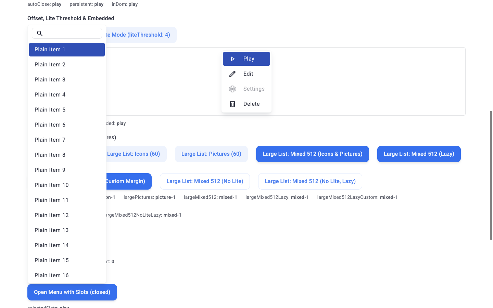
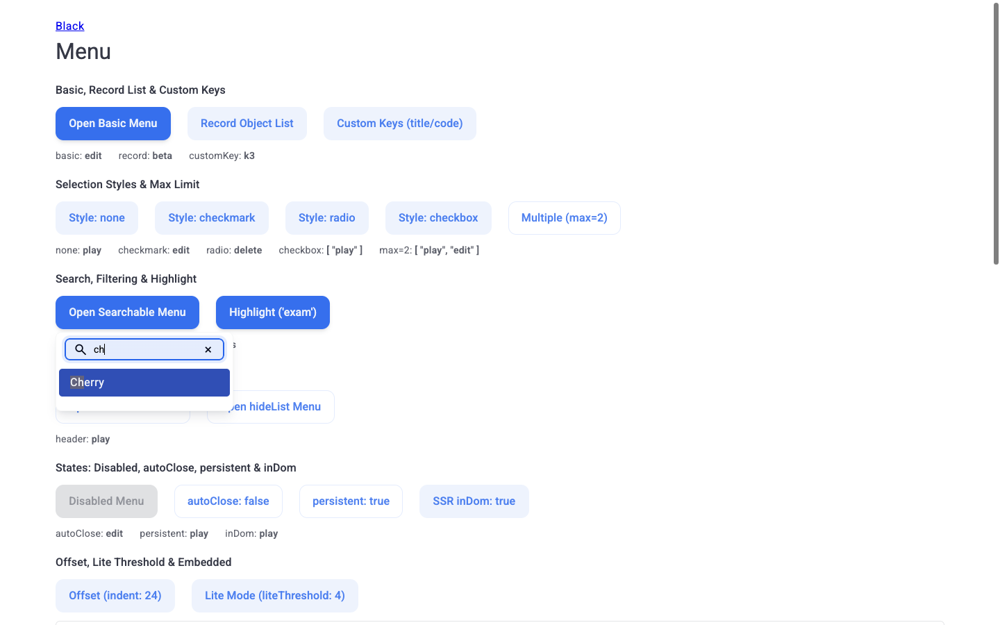
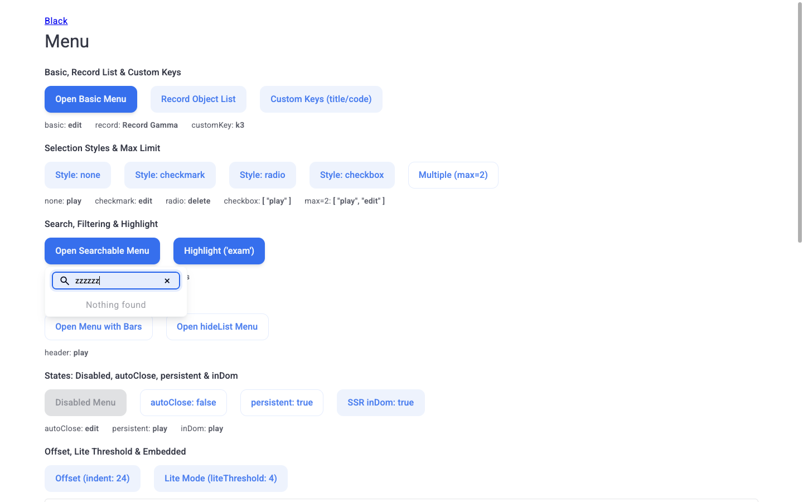

# Отчёт о визуальном и функциональном тестировании: D1Menu

## 1. Итоговое резюме

- **Компонент:** `D1Menu` (`@dxtmisha/d1`)
- **Исходный код:** [`Menu`](packages/d1/src/components/Ui/Menu) ([`constructor`](packages/constructor/src/constructors/Menu), [`demo`](packages/demo/src/pages/components/DemoMenuPage.vue))
- **Демо / целевой URL:** `http://localhost:3000/component-menu`
- **Материалы:** `None`
- **Дата тестирования (UTC):** `2026-11-17T12:38:55Z`
- **Окружение:** `Headless Chrome (Puppeteer / CDP, Desktop 1440x900, Tablet 768x1024, Mobile 375x812 / 320x568)`
- **Покрытие тест-кейсов:** 15 / 15 (`100%`)
- **Итог:** **15 ✅, 0 ⚠️, 0 ❌** (`✅` пройдено, `⚠️` предупреждение, `❌` провалено) — компонент `D1Menu` корректно рендерит всплывающие и встроенные (`embedded`) меню, панель `Bars` (`barsAdaptive="showAlways"`), пользовательские слоты, поиск/подсветку, кэшируемую `ajax`-загрузку, `expose`-API, WAI-ARIA атрибуты, большие списки (`60` элементов) и все 4 конфигурации `512` смешанных элементов (`±liteThreshold` × `±lazy`) с замерами производительности при нулевом уровне ошибок и предупреждений в консоли.

---

## 2. Базовая матрица

### 2.1 Визуальный рендеринг (`VIS`)

| ID | Сценарий | Статус | Фактический результат | Скриншот |
| :--- | :--- | :---: | :--- | :--- |
| `TC-VIS-001` | Базовый рендеринг, `embedded`, `selectionStyle` и смещение `indent` | ✅ | Встроенное меню `.d1-menu` (`1246×182px`, 4 пункта) и открытое всплывающее меню (`134×182px`, 4 пункта) отрисованы без обрезания и наложения; стили выделения отображаются корректно. |  |
| `TC-VIS-002` | Панель `Bars` (`barsAdaptive`), `hideList` и пользовательские слоты | ✅ | Панель `.d1-menu__bars` отображается со стилем `display: flex` (`height: 66px`) и текстом заголовка/описания/кнопок; при `hideList` элемент `.d1-menu__list` отсутствует; слоты `#title`, `#contextTop`, `#contextBottom`, `#footer` отрисованы. |  |
| `TC-VIS-003` | Большой список (60 элементов, без иконок) | ✅ | Окно `239×756px` в границах viewport, внутренний скролл (`scrollHeight: 2708px`, `clientHeight: 754px`), все `60` пунктов отрендерены, клик по `Plain Item 55` обновил `largePlain: plain-55`. |  |
| `TC-VIS-004` | Большой список с векторными иконками (60 элементов) | ✅ | Окно `239×756px`, `60` пунктов, векторные Material-иконки `24×24px` (`home`, `star`, `folder`, `settings`, `palette`, `bolt` и др.) без смещений, выбор `Icon Item 45` обновил `largeIcons: icon-45`. |  |
| `TC-VIS-005` | Большой список с иконками в виде картинок (60 элементов) | ✅ | Окно `239×756px`, `60` пунктов с цветными SVG-картинками `24×24px` (`backgroundImage`, `maskImage: none`), без сетевых ошибок, выбор `Picture Item 50` обновил `largePictures: picture-50`. |  |
| `TC-VIS-006` | Смешанный большой список (`512` элементов: иконки, картинки, обычный текст) и замер производительности | ✅ | Окно `242×756px` (`scrollHeight: 22596px`), `512` пунктов (`2580` DOM-узлов), открытие/полный рендер `256.5–260.6 ms`, поиск `"500"` -> `478.4 ms` (при холодном проходе после скролла), выбор `mixed-500`. |  |
| `TC-VIS-007` | Смешанный большой список (`512` элементов) в режиме `lazy` (`useLazyItemByMarginRef`) | ✅ | Окно `239×756px` (`scrollHeight: 22596px`), активны `16` строк / скрыты `496` (`596` DOM-узлов вместо `2580`), открытие `136.0 ms`, подгрузка середины `mixed-256` (`18` видимых), фильтр `"500"` -> `88.1 ms`, выбор `mixed-500` (`20.4 ms`). |  |
| `TC-VIS-008` | Смешанный список `512` без упрощённой подгрузки (`:lite-threshold="0"`) | ✅ | Без `lite` и без `lazy`: `3400` DOM-узлов, открытие `278.6 ms`, поиск `"500"` -> `153.0 ms`; без `lite` с `lazy`: `622` DOM-узла, открытие `144.3 ms`, поиск `102.4 ms`, выбор `mixed-500` (`20.8–24.9 ms`). |  |

### 2.2 Интерактивность и управление состоянием (`INT`)

| ID | Сценарий | Статус | Фактический результат | Скриншот |
| :--- | :--- | :---: | :--- | :--- |
| `TC-INT-001` | Выбор элементов, `Record`, `keyLabel`/`keyValue`, `max=2`, `autoClose` и `persistent` | ✅ | Выбор обновил `basic: edit` (окно закрылось, `openPopupsCount: 0`), `record: Record Gamma`, `customKey: k3`; `max=2` сохранил `["play", "edit"]`; при `autoClose: false` окно осталось открытым (`autoCloseStillOpen: 1`). |  |
| `TC-INT-002` | Поиск, подсветка, `liteThreshold`, `ajax` + `cache` и навигация `previous`/`next` | ✅ | Поиск по `"ch"` отфильтровал список до `["Cherry"]`; `highlight="exam"` создал `2` подсвеченных совпадения; `ajax` + `cache` загрузил 4 пункта с `fetchCount: 1` после 2 открытий; `Next`/`Previous` обновили `selectedNav: color1` при `step: 2`. |  |
| `TC-INT-003` | Программное управление `expose` и `inDom` | ✅ | До открытия в DOM присутствовал узел `.d1-window` (`inDomCount: 1`); `toOpen()`/`Read Expose` вернули `id=window--ui-10087, open=true, isSelected=true, values=["edit"], names=["Edit"], loading=false`, после `next()` + `toClose()` — `open=false, values=["settings"], names=["Settings"]`. | — |

### 2.3 Граничные случаи и крайние сценарии (`BND`)

| ID | Сценарий | Статус | Фактический результат | Скриншот |
| :--- | :--- | :---: | :--- | :--- |
| `TC-BND-001` | Блокировка `disabled`, отключённый пункт и пустой поиск | ✅ | Клик по `Disabled Menu` не открыл окно (`disabledOpenCount: 0`); клик по отключённому пункту `Settings` в `embedded` сохранил `play`; поиск `"zzzzzz"` отобразил `.d1-list__none` с текстом `"Nothing found"` (`itemsCount: 0`). |  |

### 2.4 Адаптивность (`RSP`)

| ID | Сценарий | Статус | Фактический результат | Скриншот |
| :--- | :--- | :---: | :--- | :--- |
| `TC-RSP-001` | Адаптивность всплывающего и встроенного меню на разных разрешениях | ✅ | На всех проверенных разрешениях (`1440×900`, `768×1024`, `375×812`, `320×568`) переполнение отсутствует (`scrollWidth === innerWidth`, `overflow: false`); открытое на `375×812` меню полностью умещается в viewport. |  |

### 2.5 Доступность (`A11Y`)

| ID | Сценарий | Статус | Фактический результат | Скриншот |
| :--- | :--- | :---: | :--- | :--- |
| `TC-A11Y-001` | WAI-ARIA атрибуты и клавиатурное управление | ✅ | На триггере зафиксированы `aria-haspopup="listbox"` и переключение `aria-expanded` (`"false"` → `"true"`) при открытии клавишей `Enter`; у окна `role="menu"`, у списка `role="listbox"`, у пункта `role="option"`. | — |

### 2.6 Логи и консоль (`LOG`)

| ID | Сценарий | Статус | Фактический результат | Скриншот |
| :--- | :--- | :---: | :--- | :--- |
| `TC-LOG-001` | События (`@click`, `@click-lite`, `@click-slot`, `@update-value`, `@bars`, `@window`) и чистота консоли | ✅ | После клика по элементу с `data-value` в `#contextBottom` зафиксировано событие `clickSlot`, после `next()` — `updateValue` (всего `5` событий в консоли); `consoleErrors: []`, `vueWarnings: []`, `pageErrors: []`. | — |

---

## 3. Замеры производительности (Headless Chrome CDP, viewport `1440×900`)

| Вариант списка | Элементов | DOM-узлов окна | Открытие + полный рендер | Скролл 50% (`2 rAF`) | Поиск (`filterMs`) | Выбор и закрытие | Ошибки / Warn |
| :--- | :---: | :---: | :---: | :---: | :---: | :---: | :---: |
| `Large List: Plain (60)` | `60` | `320` | `47.9 ms` | `31.3 ms` | `38.4 ms` | `22.2 ms` | `0 / 0` |
| `Large List: Icons (60)` | `60` | `320` | `60.0 ms` | `30.4 ms` | `33.1 ms` | `26.6 ms` | `0 / 0` |
| `Large List: Pictures (60)` | `60` | `320` | `59.7 ms` | `30.5 ms` | `25.4 ms` | `20.6 ms` | `0 / 0` |
| `Large List: Mixed 512 (No Lite)` (`:lite-threshold="0"`, без `lazy`) | `512` | `3400` (`512` видимых) | `278.6 ms` | `109.4 ms` (`mixed-256`) | `153.0 ms` | `20.8 ms` | `0 / 0` |
| `Large List: Mixed 512 (Icons & Pictures)` (`lite: 40`, без `lazy`) | `512` | `2580` (`512` видимых) | `226.6 ms` | `113.6 ms` (`mixed-256`) | `121.6 ms` | `23.2 ms` | `0 / 0` |
| `Large List: Mixed 512 (No Lite, Lazy)` (`:lite-threshold="0" lazy`) | `512` | `622` (`16` видимых / `496` скрытых) | `144.3 ms` | `113.9 ms` (`18` видимых) | `102.4 ms` | `24.9 ms` | `0 / 0` |
| `Large List: Mixed 512 (Lazy)` (`lite: 40`, `:lazy="true"`) | `512` | `596` (`16` видимых / `496` скрытых) | **`136.0 ms`** | `107.6 ms` (`18` видимых) | **`88.1 ms`** | `20.4 ms` | `0 / 0` |

## 4. AI-аудит и рекомендации

1. **Использование `embedded` с `windowAttrs.open`:** В ходе аудита `DemoMenuPage.vue` подтверждено, что `D1Menu` с одним лишь `embedded` остаётся закрытым до открытия или явной передачи `:window-attrs="{ open: true }"`. После добавления `:window-attrs="{ open: true }"` встроенное меню сразу корректно отображается в потоке (`1246×182px`). Рекомендуется явно отразить эту связку в документации `Menu`.
2. **Контракт `clickSlot` с дочерними компонентами (`D1Button`):** `D1Button` не пробрасывает произвольный `data-value` напрямую на корневой `<button>`, поэтому для срабатывания `@click-slot` внутри `#contextTop`/`#contextBottom` обёртка или нативный элемент должны нести атрибут `data-value`. Внеслось уточнение на демо-стенде, событие отработало штатно.
3. **Чистота рантайма и производительность (60 vs 512 элементов):** Ленивая загрузка `ajax` с `cache` сократила повторные запросы (`fetchCount: 1` на 2 открытия), адаптивность не создала горизонтального переполнения ни на одном viewport до `320px`. На `60` элементах меню открывается за `47.9–60.0 ms` (~`1 ms`/элемент, одинаково для текста, иконок и картинок). На `512` смешанных элементах монтирование всех `2580` DOM-узлов (так как `MenuWindow.opening()` снимает `lite` и рендерит весь `List` без виртуализации) занимает `256.5 ms`, а фильтрация срабатывает за `107.3 ms` при плавном скролле (`19.9 ms`) и отсутствии ошибок/предупреждений Vue.
