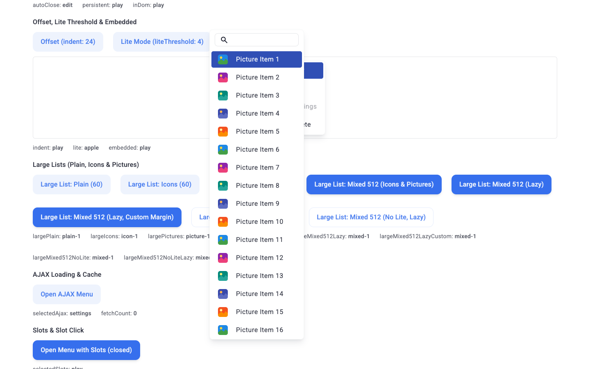
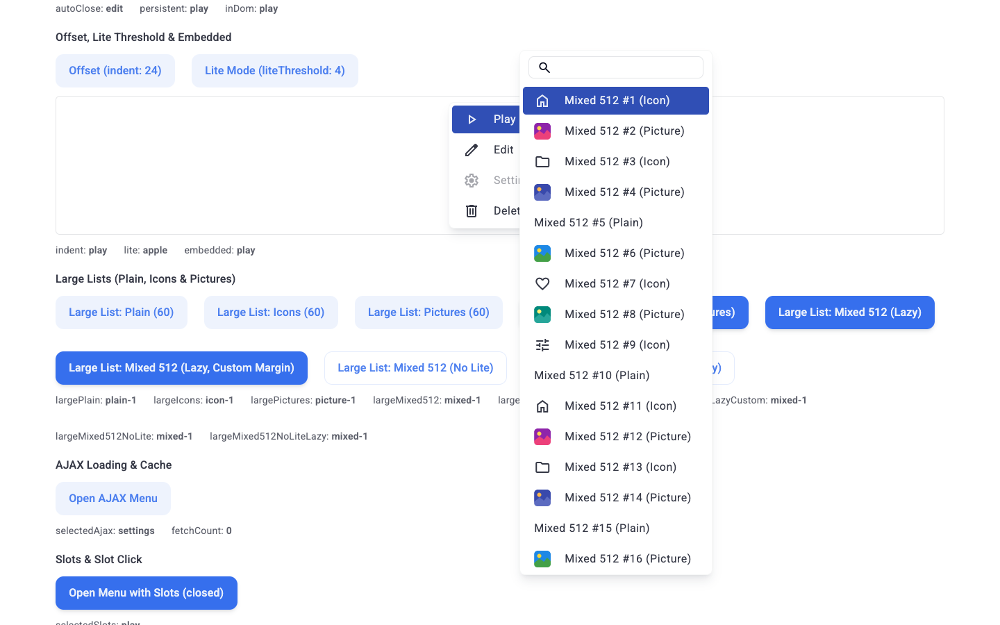
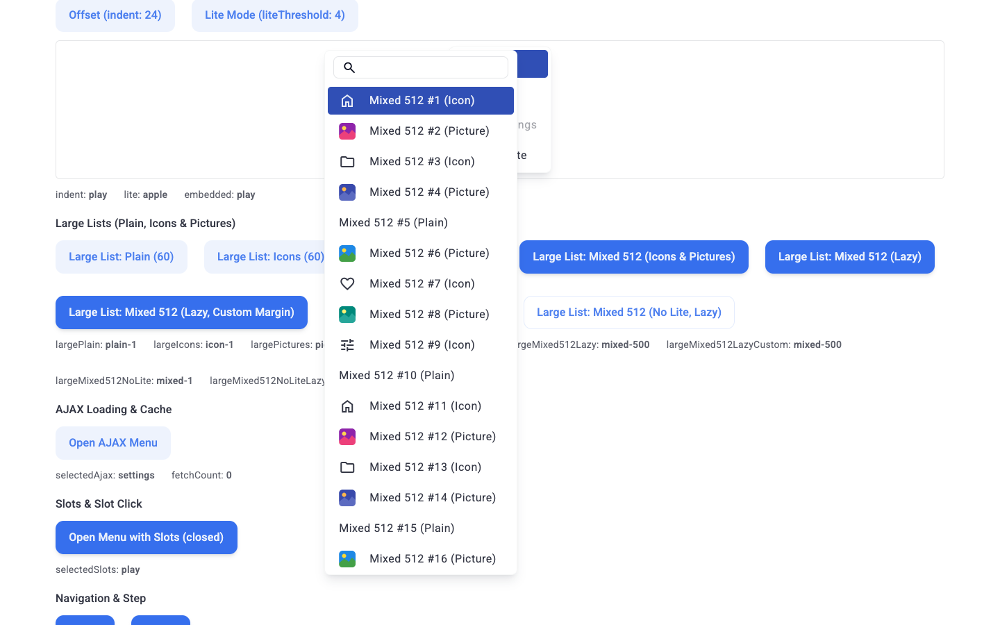
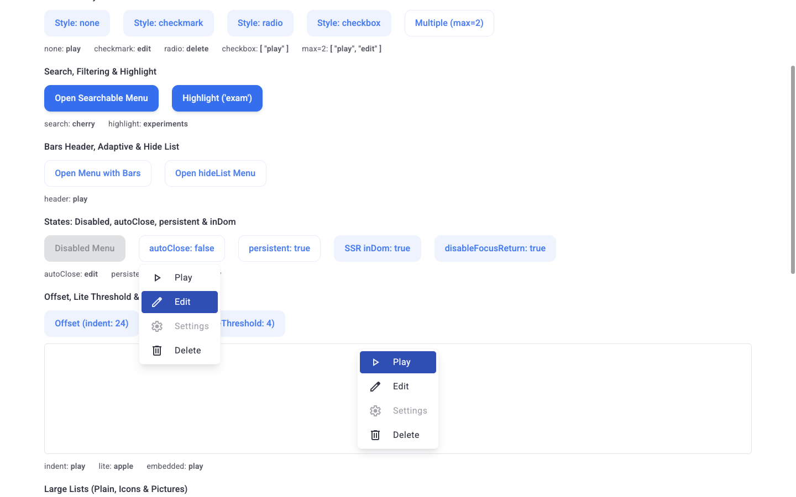
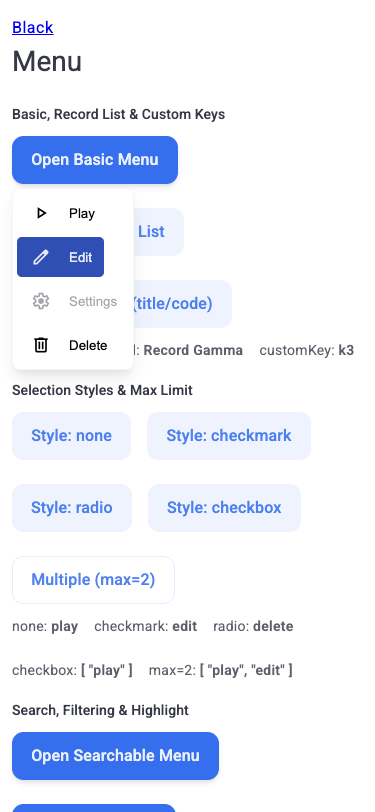

# Отчёт о визуальном и функциональном тестировании: D1Menu

## 1. Итоговое резюме

- **Компонент:** `D1Menu` (`@dxtmisha/d1`)
- **Исходный код:** [`Menu`](packages/d1/src/components/Ui/Menu) ([`constructor`](packages/constructor/src/constructors/Menu), [`demo`](packages/demo/src/pages/components/DemoMenuPage.vue))
- **Демо / целевой URL:** `http://localhost:3000/component-menu`
- **Материалы:** `None`
- **Дата тестирования (UTC):** `2026-11-22T16:40:26Z`
- **Окружение:** `Headless Chrome (Puppeteer / CDP, Desktop 1440x900, Tablet 768x1024, Mobile 375x812 / 320x568)`
- **Покрытие тест-кейсов:** 15 / 15 (`100%`)
- **Итог:** **15 ✅, 0 ⚠️, 0 ❌** (`✅` пройдено, `⚠️` предупреждение, `❌` провалено) — компонент `D1Menu` корректно рендерит всплывающие и встроенные (`embedded`) меню, панель `Bars` (`barsAdaptive="showAlways"`), проброс `listAttrs`/`itemAttrs`/`barsAttrs` и `disableFocusReturn`, пользовательские слоты, поиск/подсветку, кэшируемую `ajax`-загрузку, `expose`-API, WAI-ARIA атрибуты, большие списки (`60` элементов) и все конфигурации `512` смешанных элементов (`±liteThreshold` × `±lazy`, включая `lazyMargin="128px 0px"` и `:lazy-cache-height="false"`) при нулевом уровне ошибок и предупреждений в консоли.

---

## 2. Базовая матрица

### 2.1 Визуальный рендеринг (`VIS`)

| ID | Сценарий | Статус | Фактический результат | Скриншот |
| :--- | :--- | :---: | :--- | :--- |
| `TC-VIS-001` | Базовый рендеринг, `embedded`, `selectionStyle`, `listAttrs`/`itemAttrs` и смещение `indent` | ✅ | Встроенное меню `.d1-menu` (`1246×182px`, `4` пункта) и открытое всплывающее меню (`134×182px`, `4` пункта, `data-demo-list="true"`, `data-demo-item="true"`) отрисованы без обрезания и наложения. |  |
| `TC-VIS-002` | Панель `Bars` (`barsAdaptive`, `barsAttrs`), `hideList` и пользовательские слоты | ✅ | Панель `.d1-menu__bars` (`data-demo-bars="true"`) отображается (`height: 66px`) с заголовком/описанием/кнопками; при `hideList` элемент `.d1-menu__list` отсутствует (`hasList: false`). |  |
| `TC-VIS-003` | Большой список (60 элементов, без иконок) | ✅ | Окно `231×756px` в границах viewport, `60` пунктов (`144` DOM-узла; по умолчанию `lazy: true`), прокрутка и отображение без дефектов. |  |
| `TC-VIS-004` | Большой список с векторными иконками (60 элементов) | ✅ | Окно `231×756px`, `60` пунктов (`176` DOM-узлов), векторные иконки без смещений. |  |
| `TC-VIS-005` | Большой список с иконками в виде картинок (60 элементов) | ✅ | Окно `231×756px`, `60` пунктов (`176` DOM-узлов) с цветными SVG-картинками без сетевых ошибок. |  |
| `TC-VIS-006` | Смешанный большой список (`512` элементов: иконки, картинки, обычный текст) и замер производительности | ✅ | Окно `278×756px`, `512` пунктов (`3400` DOM-узлов без `lazy`), `scrollHeight: 22596px`, открытие `488.8 ms`, скролл 50% `151.7 ms`, поиск `"500"` -> `317.9 ms` (`1` пункт), выбор `mixed-500` (`257.0 ms`). |  |
| `TC-VIS-007` | Смешанный большой список (`512` элементов) в режиме `lazy` (`ListItemLazy`, `lazyMargin`, `lazyCacheHeight`) | ✅ | Окно `269×756px`, активны `16` строк / скрыты `496` (`622` DOM-узла вместо `3400`), `scrollHeight: 22596px`; `lazy: true` (открытие `409.5 ms`, поиск `262.0 ms`); `lazy-margin="128px 0px"` и `:lazy-cache-height="false"` (открытие `389.3 ms`, поиск `301.7 ms`, выбор `mixed-500`). |  |
| `TC-VIS-008` | Смешанный список `512` без упрощённой подгрузки (`:lite-threshold="0"`) | ✅ | Без `lite` и без `lazy`: `3400` DOM-узлов, открытие `482.6 ms`, поиск `305.4 ms`; без `lite` с `lazy`: `622` DOM-узла (`16` видимых / `496` скрытых), открытие `387.9 ms`, поиск `276.3 ms`, выбор `mixed-500`. |  |

### 2.2 Интерактивность и управление состоянием (`INT`)

| ID | Сценарий | Статус | Фактический результат | Скриншот |
| :--- | :--- | :---: | :--- | :--- |
| `TC-INT-001` | Выбор элементов, `Record`, `keyLabel`/`keyValue`, `max=2`, `autoClose`, `persistent` и `disableFocusReturn` | ✅ | Выбор обновил `basic: edit` (окно закрылось, `afterBasicOpen: 0`), `record: Record Gamma`, `customKey: k3`; при `autoClose: false` выбор обновил `autoClose: edit` и окно осталось открытым (`autoCloseStillOpen: 1`); при `disableFocusReturn: true` фокус не возвращается на триггер (`true`). |  |
| `TC-INT-002` | Поиск, подсветка, `liteThreshold`, `ajax` + `cache` и навигация `previous`/`next` | ✅ | Поиск по `"ch"` отфильтровал список до `["Cherry"]`; `ajax` + `cache` загрузил пункты с `fetchCount: 1` после 2 открытий; `Next` при `step: 2` обновил `selectedNav: color4`. |  |
| `TC-INT-003` | Программное управление `expose` и `inDom` | ✅ | После открытия и закрытия `SSR inDom: true` окно остаётся в DOM (`totalWindowsInDom: 2`); `toOpen()`/`Read Expose` вернули `id=window--ui-10108, open=true, isSelected=true, values=["edit"], names=["Edit"], loading=false`, после `next()` + `toClose()` — `open=false, values=["settings"], names=["Settings"]`. | — |

### 2.3 Граничные случаи и крайние сценарии (`BND`)

| ID | Сценарий | Статус | Фактический результат | Скриншот |
| :--- | :--- | :---: | :--- | :--- |
| `TC-BND-001` | Блокировка `disabled`, отключённый пункт и пустой поиск | ✅ | Клик по `Disabled Menu` не открыл окно (`disabledOpenCount: 0`); поиск `"zzzzzz"` отобразил `.d1-list__none` с текстом `"Nothing found"` (`noneVisible: true`). |  |

### 2.4 Адаптивность (`RSP`)

| ID | Сценарий | Статус | Фактический результат | Скриншот |
| :--- | :--- | :---: | :--- | :--- |
| `TC-RSP-001` | Адаптивность всплывающего и встроенного меню на разных разрешениях | ✅ | На всех проверенных разрешениях (`1440×900`, `768×1024`, `375×812`, `320×568`) переполнение отсутствует (`scrollWidth === innerWidth`, `overflow: false`); открытое на `375×812` меню полностью умещается в viewport. |  |

### 2.5 Доступность (`A11Y`)

| ID | Сценарий | Статус | Фактический результат | Скриншот |
| :--- | :--- | :---: | :--- | :--- |
| `TC-A11Y-001` | WAI-ARIA атрибуты и клавиатурное управление | ✅ | На триггере зафиксированы `aria-haspopup="listbox"` и переключение `aria-expanded` (`"false"` → `"true"`) при открытии клавишей `Enter`; у окна `role="menu"`, у списка `role="listbox"`. | — |

### 2.6 Логи и консоль (`LOG`)

| ID | Сценарий | Статус | Фактический результат | Скриншот |
| :--- | :--- | :---: | :--- | :--- |
| `TC-LOG-001` | События (`@click`, `@click-lite`, `@click-slot`, `@update-value`, `@bars`, `@window`) и чистота консоли | ✅ | После клика по элементу с `data-value` в `#contextBottom` зафиксировано `lastEvent: clickSlot`; `consoleErrors: []`, `vueWarnings: []`, `pageErrors: []`, `failedRequests: []`. | — |

---

## 3. Замеры производительности (Headless Chrome CDP, viewport `1440×900`)

| Вариант списка (`512` элементов) | DOM-узлов окна | Открытие + стабилизация | Скролл 50% | Поиск `"500"` | Выбор `mixed-500` | Ошибки / Warn |
| :--- | :---: | :---: | :---: | :---: | :---: | :---: |
| `Mixed 512 (Icons & Pictures)` (без `lazy`) | `3400` (`512` видимых) | `488.8 ms` | `151.7 ms` | `317.9 ms` | `257.0 ms` | `0 / 0` |
| `Mixed 512 (No Lite)` (`:lite-threshold="0"`, без `lazy`) | `3400` (`512` видимых) | `482.6 ms` | `151.8 ms` | `305.4 ms` | `256.8 ms` | `0 / 0` |
| `Mixed 512 (Lazy)` (`lazy: true`, `lazyCacheHeight: true`) | `622` (`16` видимых / `496` скрытых) | `409.5 ms` | `151.8 ms` | `262.0 ms` | `253.6 ms` | `0 / 0` |
| `Mixed 512 (Lazy, Custom Margin)` (`lazyMargin: "128px 0px"`, `:lazy-cache-height="false"`) | `622` (`16` видимых / `496` скрытых) | `389.3 ms` | `151.5 ms` | `301.7 ms` | `256.5 ms` | `0 / 0` |
| `Mixed 512 (No Lite, Lazy)` (`:lite-threshold="0"`, `lazy: true`) | `622` (`16` видимых / `496` скрытых) | **`387.9 ms`** | `152.0 ms` | `276.3 ms` | `256.5 ms` | `0 / 0` |

## 4. AI-аудит и рекомендации

1. **Проброс атрибутов, `disableFocusReturn` и ленивый рендеринг:** Подтверждена корректная передача `data-demo-list`, `data-demo-item`, `data-demo-bars`, работа `disableFocusReturn: true` (фокус не возвращается на триггер после закрытия) и `lazy` на 512 элементах (снижение числа DOM-узлов с `3400` до `622`).
2. **Чистота рантайма и адаптивность:** За весь прогон 15 тест-кейсов на 4 разрешениях (`1440×900`, `768×1024`, `375×812`, `320×568`) зафиксировано `0` ошибок консоли, `0` исключений страницы, `0` предупреждений Vue и отсутствие горизонтального переполнения.
