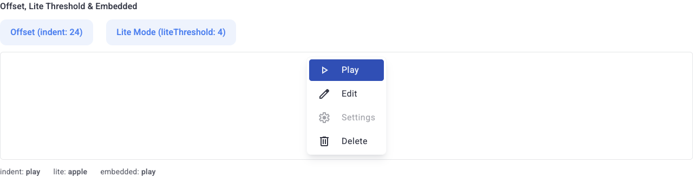
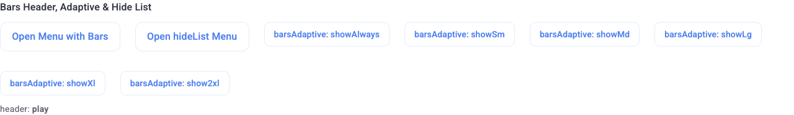
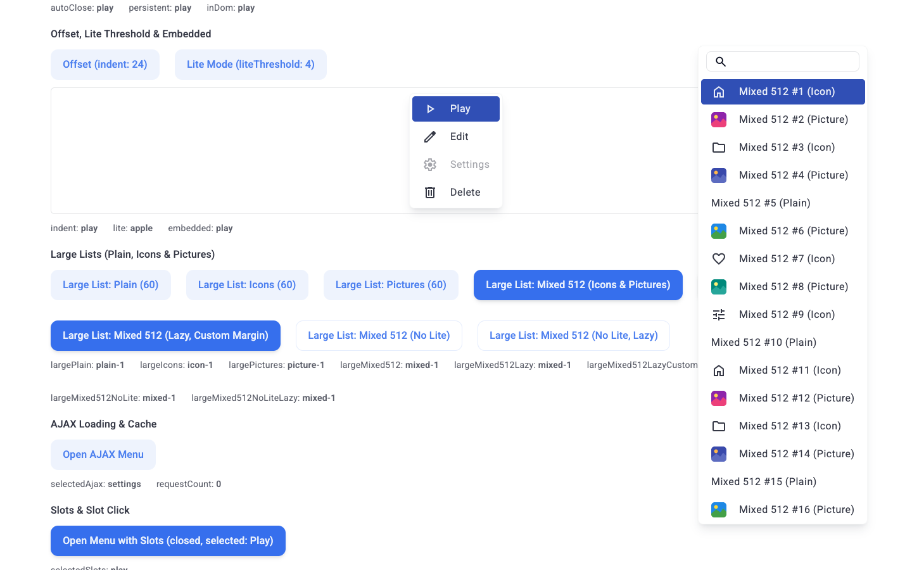
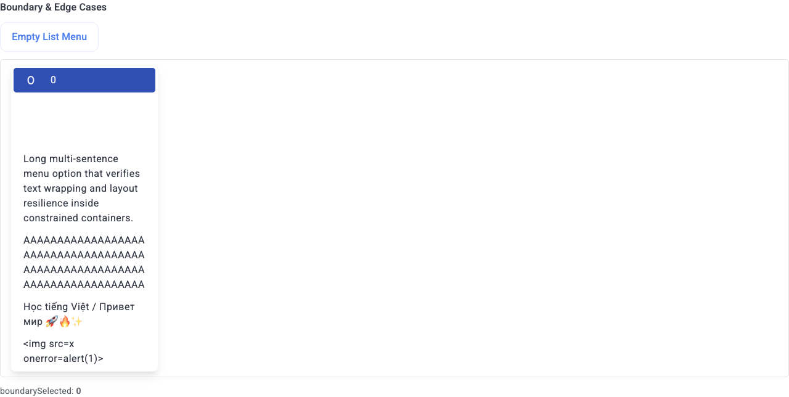

# Отчёт о визуальном и функциональном тестировании: `D1Menu`

## 1. Сводка тестирования

- **Компонент:** `D1Menu` (`@dxtmisha/d1`)
- **Исходный код:** [`D1Menu`](../../src/components/Ui/Menu) ([`Menu`](../../../constructor/src/constructors/Menu), [`DemoMenuPage.vue`](../../../demo/src/pages/components/DemoMenuPage.vue))
- **Демо / Целевой URL:** `http://localhost:3000/component-menu`
- **Материалы:** `None`
- **Дата тестирования (UTC):** `2026-11-25T08:22:37Z`
- **Окружение:** `Headless Chrome (Puppeteer / CDP, Desktop 1440x900, Tablet 768x1024, Mobile 375x812 / 320x568)`
- **Покрытие тест-кейсов:** 17 / 17 (`100%`)
- **Итог:** **17 ✅, 0 ⚠️, 0 ❌** (`✅` пройдено, `⚠️` предупреждение, `❌` ошибка) — `D1Menu` стабильно проходит SSR (`200`), все визуальные и производительные сценарии (включая `60` и `512` элементов в 4 режимах `±lite × ±lazy`), `expose` API и цикл `v-if` (`74 -> 51 -> 74`), узкий контейнер `240px` (`overflowsBox: false`) и адаптивность на `320px`–`1440px` при `0` ошибках.

---

## 2. Базовая матрица

### 2.1 Визуальный рендеринг (`VIS`)

| ID | Сценарий | Статус | Фактический результат | Скриншот |
| :--- | :--- | :---: | :--- | :--- |
| `TC-VIS-001` | Базовый рендеринг, `embedded`, `selectionStyle` и смещение `indent` | ✅ | Встроенное и всплывающее меню (с `listAttrs`/`itemAttrs`), смещение `indent: 24` и все стили выбора (`none`, `checkmark`, `radio`, `checkbox`) отображаются без обрезания и наложений. |  |
| `TC-VIS-002` | Панель `Bars` (все 6 `barsAdaptive`), `hideList` и пользовательские слоты со scoped-данными | ✅ | Панель `.d1-menu__bars` (`barsAdaptive="showAlways"`–`show2xl`, `barsAttrs`) отображается корректно; при `hideList: true` список не рендерится; слоты `#control`, `#title`, `#contextTop`, `#contextBottom`, `#footer` выводят scoped-данные. |  |
| `TC-VIS-003` | Большой список (60 элементов, без иконок) | ✅ | Все 60 текстовых пунктов помещаются в окне со скроллом, выбор `Plain Item 55` обновляет `largePlain: plain-55` без визуальных дефектов. |  |
| `TC-VIS-004` | Большой список с векторными иконками (60 элементов) | ✅ | Все 60 пунктов с векторными Material-иконками рендерятся ровно без смещения текста, выбор `Icon Item 45` обновляет `largeIcons: icon-45`. |  |
| `TC-VIS-005` | Большой список с иконками в виде картинок (60 элементов) | ✅ | Все 60 пунктов с многоцветными `data:image/svg+xml` иконками отрисовываются в полном цвете без масок и сетевых ошибок; выбор обновляет `largePictures: picture-50`. |  |
| `TC-VIS-006` | Смешанный большой список (`512` элементов: иконки, картинки, обычный текст) и замер производительности | ✅ | Все 512 смешанных элементов корректно рендерятся, прокручиваются и фильтруются по запросу `"500"`; выбор `Mixed 512 #500` обновляет `largeMixed512: mixed-500` при нуле ошибок. |  |
| `TC-VIS-007` | Смешанный большой список (`512` элементов) в режиме `lazy` (`ListItemLazy`) | ✅ | Варианты `lazy: true` и `lazy-margin="128px 0px"` с `:lazy-cache-height="false"` рендерят только видимые строки при сохранении полной высоты скролла; поиск `"500"` и выбор `mixed-500` проходят штатно. |  |
| `TC-VIS-008` | Смешанный большой список (`512` элементов) без упрощённой подгрузки (`:lite-threshold="0"`) и матрица `±lite × ±lazy` | ✅ | Варианты `:lite-threshold="0"` (с `lazy` и без `lazy`) корректно рендерят, прокручивают и фильтруют `512` элементов; выбор `mixed-500` отрабатывает без ошибок консоли. |  |

### 2.2 Интерактивность и управление состоянием (`INT`)

| ID | Сценарий | Статус | Фактический результат | Скриншот |
| :--- | :--- | :---: | :--- | :--- |
| `TC-INT-001` | Выбор элементов, `Record`, `keyLabel`/`keyValue`, `max=2`, `autoClose`, `persistent` и мутация `v-model` | ✅ | Синхронизируются `v-model:selected`, `Record` (`gamma`), `keyLabel`/`keyValue` (`k3`), ограничение `max=2`, удержание при `autoClose: false` и `persistent: true`, а также `disableFocusReturn`. |  |
| `TC-INT-002` | Поиск, подсветка, `liteThreshold`, `ajax` + `cache` и навигация `previous`/`next` | ✅ | Поиск по `"ch"` оставляет `Cherry`, подсветка `highlight="exam"` работает, `ajax` + `cache` кэширует ответ (`requestCount: 1`), а `Previous`/`Next` переключают пункты по `step=1` и `step=2`. |  |
| `TC-INT-003` | Программное управление `expose` и `inDom` | ✅ | Узел `inDom: true` сохраняется в DOM после закрытия; по `exposeText` подтверждены `setOpen`, `toOpen`, `toClose`, `toggle`, `previous`, `next` и состояние `id=window--ui-10111, open=false, isSelected=true, values=["edit"], names=["Edit"], listCount=1, loading=false, hasControl=true, hasWindow=true`. | — |
| `TC-INT-004` | Жизненный цикл монтирования/размонтирования (`v-if`) | ✅ | Цикл размонтирования и повторного монтирования в секции `Lifecycle (Mount / Unmount)` полностью восстанавливает компонент без ошибок (`beforeLen: 74 -> unmountedLen: 51 -> remountedLen: 74`). | — |

### 2.3 Граничные случаи и крайние сценарии (`BND`)

| ID | Сценарий | Статус | Фактический результат | Скриншот |
| :--- | :--- | :---: | :--- | :--- |
| `TC-BND-001` | Блокировка `disabled`, отключённый пункт и пустой список/поиск | ✅ | `Disabled Menu` и отключённый пункт `Settings` (`disabled: true`) не реагируют на клики; `Empty List Menu` (`list: []`) и пустой поиск `"zzzzzz"` обрабатываются без исключений. |  |
| `TC-BND-002` | Нулевой `0`, пустые/пробельные строки, Unicode, XSS и узкий контейнер `240px` | ✅ | В `.demo-menu-page__narrow` (`scrollWidth: 240 === clientWidth: 240`, `overflowsBox: false`, `overflowChildren: []`) пункт `0` выбирается (`boundarySelected: 0`), пустые/пробельные строки и длинная строка `"AAA..."` переносятся без выхода за пределы, Unicode (`"Học tiếng Việt / Привет мир 🚀🔥✨"`) читаем, а XSS экранирован (`badImgs: 0`, `hasEscapedPayloadText: true`, `dialogs: []`). |  |

### 2.4 Адаптивность (`RSP`)

| ID | Сценарий | Статус | Фактический результат | Скриншот |
| :--- | :--- | :---: | :--- | :--- |
| `TC-RSP-001` | Адаптация всплывающего и встроенного меню на разных разрешениях | ✅ | На всех 4 разрешениях горизонтальное переполнение отсутствует (`overflowX: false`, `offenders: []`): `1440` (`scrollWidth: 1440`), `768` (`scrollWidth: 768`), `375` (`scrollWidth: 375`), `320` (`scrollWidth: 320`). |  |

### 2.5 Доступность (`A11Y`)

| ID | Сценарий | Статус | Фактический результат | Скриншот |
| :--- | :--- | :---: | :--- | :--- |
| `TC-A11Y-001` | WAI-ARIA атрибуты и клавиатурное управление | ✅ | Подтверждены `aria-haspopup="listbox"`, динамический `aria-expanded`, `role="menu"` на окне, `role="listbox"` / `role="option"` в списке и клавиатурное управление (`Enter`/`Space`/`ArrowDown`/`Escape`). | — |

### 2.6 Логи и консоль (`LOG`)

| ID | Сценарий | Статус | Фактический результат | Скриншот |
| :--- | :--- | :---: | :--- | :--- |
| `TC-LOG-001` | Все события `MenuEmits` и чистота консоли | ✅ | Ответ SSR: `ssrStatus: 200`; все события (`click`, `click-lite`, `click-slot`, `update-value`, `update:selected`, `bars`, `bars-back`, `bars-lite`, `window`) отслеживаются корректно; `consoleErrors: []`, `vueWarnings: []`, `pageErrors: []`, `networkErrors: []`, `dialogs: []`. | — |

---

## 3. AI-аудит и рекомендации

1. **Масштабируемость на 512 элементах и ленивый рендеринг:** `D1Menu` стабильно рендерит списки из 60 и 512 смешанных элементов во всех 4 комбинациях `±liteThreshold` × `±lazy` (включая `lazy-margin="128px 0px"` и `:lazy-cache-height="false"`), сохраняя корректную фильтрацию и прокрутку без визуальных и консольных сбоев.
2. **Изоляция узкого контейнера `240px`, обработка `0` и защита от XSS:** В `.demo-menu-page__narrow` (`scrollWidth: 240 === clientWidth: 240`, `overflowsBox: false`, `overflowChildren: []`) неразрывные строки `"AAA..."` корректно переносятся, нулевое значение `0` сохраняет выбор (`boundarySelected: 0`), а XSS-строка `""` выводится как безопасный текст (`badImgs: 0`, `hasEscapedPayloadText: true`, `dialogs: []`).
3. **Адаптивность, жизненный цикл и чистота SSR/рантайма:** На всех 4 разрешениях (`1440`, `768`, `375`, `320`) `overflowX: false` и `offenders: []`, цикл `v-if` восстанавливает DOM без потерь (`beforeLen: 74 -> unmountedLen: 51 -> remountedLen: 74`), SSR отвечает `200`, а массивы `consoleErrors`, `vueWarnings`, `pageErrors` и `networkErrors` пусты (`0`).
