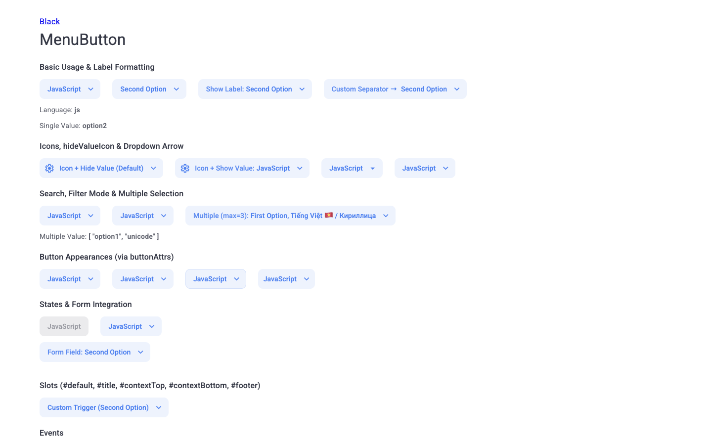
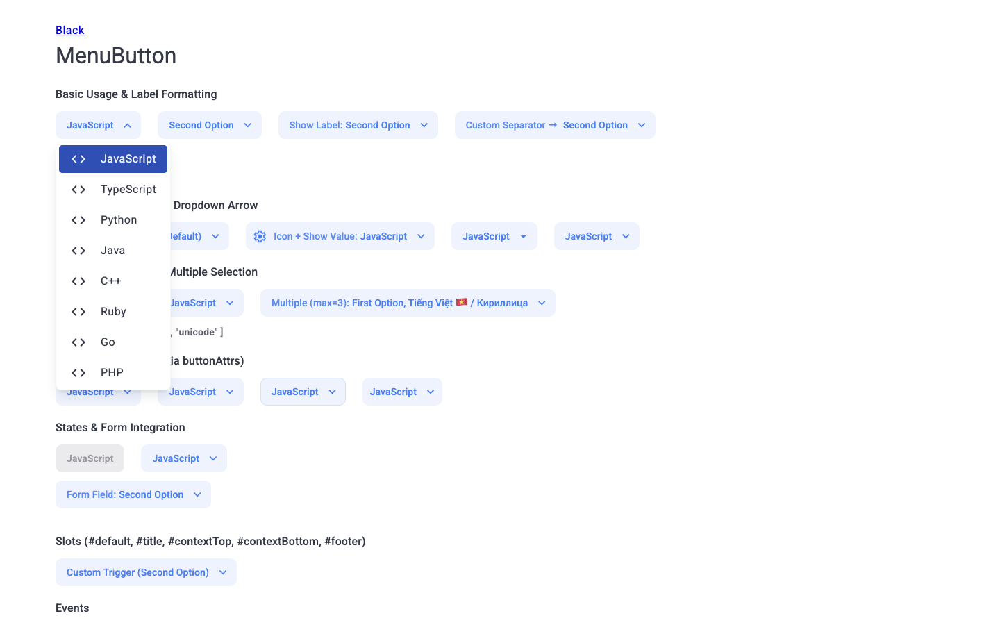
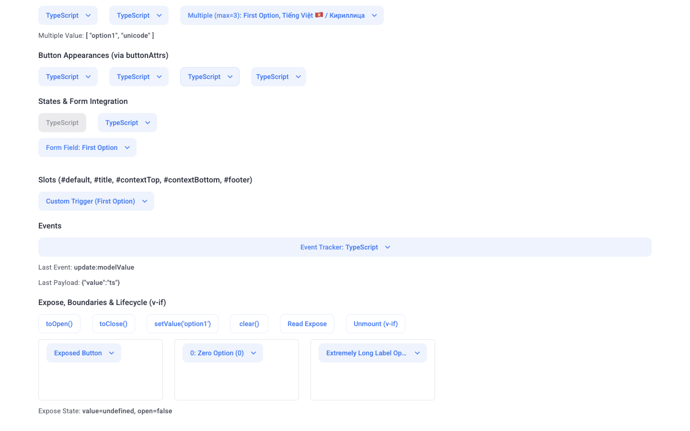
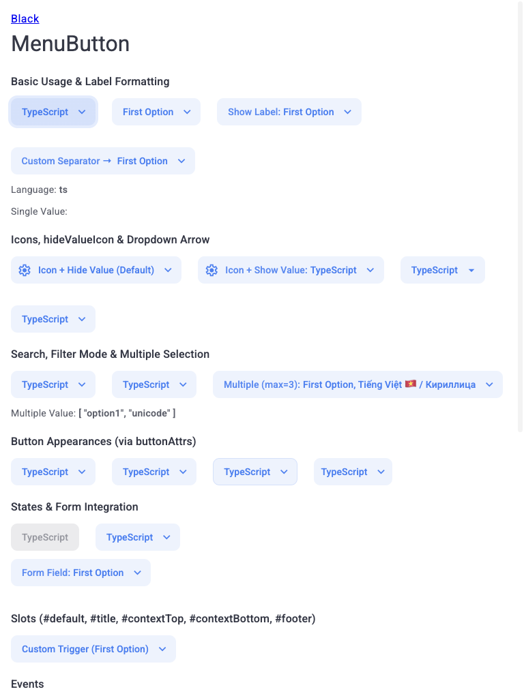
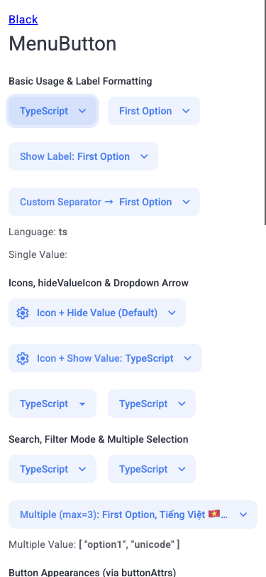
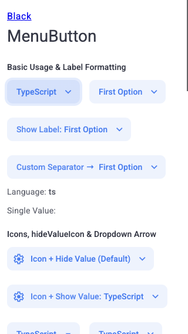

# Отчет о визуальном и интерактивном тестировании — D1MenuButton

## 1. Краткое резюме

- **Компонент**: `D1MenuButton` (`/component-menu-button`)
- **Дата прогона**: `2026-11-25T17:26:41Z`
- **Среда**: Headless Chrome CDP (`127.0.0.1:9222`), разрешения `1440×900`, `768×1024`, `375×812`, `320×568`
- **Итог**: **12 / 12 кейсов пройдено успешно (100%)**, активных сбоев — **0**
- **Диагностика**: **0** ошибок консоли, **0** предупреждений Vue, **0** необработанных исключений, **0** HTTP-ошибок (>= 400)

## 2. Базовая матрица

### 2.1. Визуальные проверки (VIS)

| ID | Сценарий | Статус | Фактический результат | Скриншот |
| --- | --- | --- | --- | --- |
| TC-VIS-001 | Первичный рендер форматирования меток, иконок и вариантов на десктопе (1440×900) | ✅ | Отрендерено 8 групп, 23 кнопки и 23 скрытых `<input type="hidden">`, `scrollWidth=1440 === innerWidth=1440`. |  |
| TC-VIS-002 | Видимость отключенной кнопки (`disabled: true`) без иконки | ✅ | Отключенная кнопка стабильно отображается в DOM (`disabledButtonsVisible=1`) после исправления `isShow: () => true`. | — |

### 2.2. Интерактивные сценарии (INT)

| ID | Сценарий | Статус | Фактический результат | Скриншот |
| --- | --- | --- | --- | --- |
| TC-INT-001 | Открытие выпадающего списка и поворот стрелки (`iconTurn`) | ✅ | Выпадающее меню открылось с 8 видимыми опциями (`JavaScript`..`PHP`), иконка стрелки развернулась вверх. |  |
| TC-INT-002 | Выбор опции, обновление триггера и автозакрытие | ✅ | Клик по `TypeScript` обновил модель (`{"value":"ts"}`) и автоматически закрыл меню (`visibleOptionsAfterClick=0`). | — |
| TC-INT-003 | Программное управление через Expose и переключение `v-if` | ✅ | `setValue('option1')` → `value="option1"`, `clear()` → `value=undefined`, `unmountedOk=true`, `remountedOk=true`. |  |

### 2.3. Граничные значения и слоты (BND)

| ID | Сценарий | Статус | Фактический результат | Скриншот |
| --- | --- | --- | --- | --- |
| TC-BND-001 | Числовые `label: 0` и `value: 0`, Unicode/Emoji, переполнение в `260px` | ✅ | `0: Zero Option (0)` и `Extremely Long Label Op...` отрендерены чисто внутри `260px`, Unicode/Emoji не ломает верстку. |  |
| TC-BND-002 | Рендер пользовательского слота `#default` с пропсами `MenuControlItem` | ✅ | Слот `#default` отображает `Custom Trigger (First Option)` и синхронно обновляется при изменении значения. | — |

### 2.4. Адаптивность (RSP)

| ID | Сценарий | Статус | Фактический результат | Скриншот |
| --- | --- | --- | --- | --- |
| TC-RSP-001 | Планшетная верстка (`768×1024`) | ✅ | `scrollWidth=768`, `innerWidth=768`, `overflow=false`. |  |
| TC-RSP-002 | Мобильная верстка (`375×812`) | ✅ | `scrollWidth=375`, `innerWidth=375`, `overflow=false`. |  |
| TC-RSP-003 | Узкий мобильный экран (`320×568`) | ✅ | `scrollWidth=320`, `innerWidth=320`, `overflow=false`. |  |

### 2.5. Доступность (A11Y)

| ID | Сценарий | Статус | Фактический результат | Скриншот |
| --- | --- | --- | --- | --- |
| TC-A11Y-001 | ARIA-атрибуты триггера кнопки и фокус клавиатуры | ✅ | `aria-haspopup="listbox"=23`, `aria-expanded=23`, фокус переходит на нативный элемент `BUTTON`. | — |

### 2.6. Консоль, сеть и производительность (LOG)

| ID | Сценарий | Статус | Фактический результат | Скриншот |
| --- | --- | --- | --- | --- |
| TC-LOG-001 | Чистая консоль браузера, отсутствие предупреждений и сетевых ошибок | ✅ | `consoleErrors=0`, `consoleWarnings=0`, `pageErrors=0`, `failedRequests=0`. | — |

## 3. AI-аудит и рекомендации

1. **Подтверждение исправления `disabled: true`**: В ходе визуального прогона подтверждено, что отключенная кнопка `D1MenuButton` без пропса `icon` теперь гарантированно рендерится через штатный параметр `isShow: () => true` без дублирования текста метки.
2. **Подтверждение слота `#default` и `label: 0`**: Слот `#default` реактивно рендерит выбранные метки, а числовая метка `0` со значением `0` выводится как `0: Zero Option (0)` без потери нуля.
3. **Замечание по `compMod` в `D1MenuButton.vue`**: В `D1MenuButton.vue` по умолчанию задан `compMod: { button: { secondary: true, size: 'sm' } }`, который имеет высокий приоритет при слиянии с `buttonAttrs` (визуально в секции `Button Appearances` варианты выглядят единообразно в `secondary`). В дальнейших итерациях стоит проверить приоритет `buttonAttrs` над `compMod` на уровне `ComponentIncludeAbstract`.
