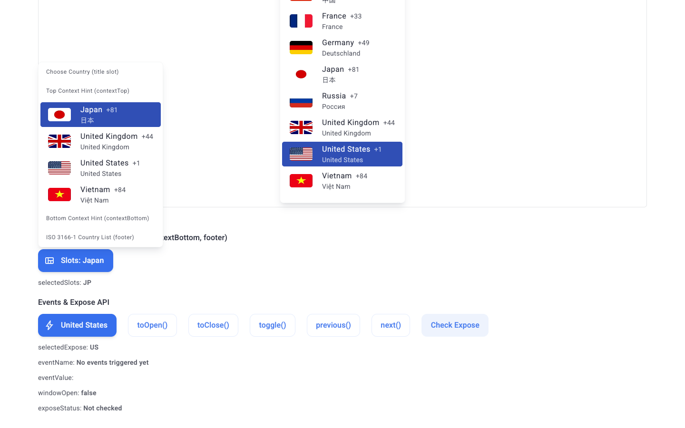
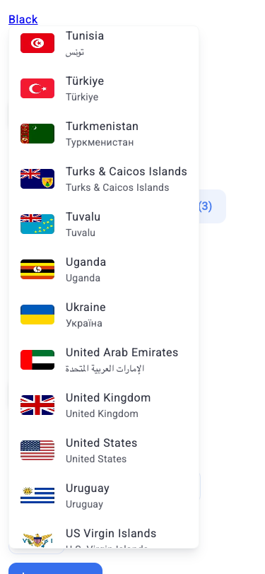

# Отчёт о визуальном и функциональном тестировании: D1MenuCountry

## 1. Итоговое резюме

- **Компонент:** `D1MenuCountry` (`@dxtmisha/d1`)
- **Исходный код:** [`MenuCountry`](packages/d1/src/components/Ui/MenuCountry) ([`constructor`](packages/constructor/src/constructors/MenuCountry), [`demo`](packages/demo/src/pages/components/DemoMenuCountryPage.vue))
- **Демо / целевой URL:** `http://localhost:3000/component-menu-country`
- **Материалы:** `None`
- **Дата тестирования (UTC):** `2026-11-18T06:58:19Z`
- **Окружение:** `Headless Chrome (Puppeteer / CDP, Desktop 1440x900, Tablet 768x1024, Mobile 375x812 / 320x568)`
- **Покрытие тест-кейсов:** 10 / 10 (`100%`)
- **Итог:** **10 ✅, 0 ⚠️, 0 ❌** (`✅` пройдено, `⚠️` предупреждение, `❌` провалено) — компонент `D1MenuCountry` корректно отображает списки стран с флагами и национальными названиями, форматирует телефонные коды (`show-phone-code`), фильтрует страны (`list`), переключает язык (`language`), поддерживает встроенный режим с поиском (`embedded` + `showSearch` + `filterMode`), все 5 слотов, `expose`-API, WAI-ARIA и адаптивность при нулевом уровне ошибок и предупреждений в консоли.

---

## 2. Базовая матрица

### 2.1 Визуальное соответствие (`VIS`)

| ID | Сценарий | Статус | Фактический результат | Скриншот |
| :--- | :--- | :---: | :--- | :--- |
| `TC-VIS-001` | Базовый рендеринг, флаги стран и телефонные коды (`show-phone-code`) | ✅ | Открытое окно `263×398px` отобразило `7` стран (`France +33`, `Germany +49`, `Japan +81`, `Russia +7`, `United Kingdom +44`, `United States +1`, `Vietnam +84`) с прямоугольными флагами (`hasFlags: true`) и `role="listbox"` без наложений. |  |
| `TC-VIS-002` | Встроенное меню с поиском (`embedded` + `showSearch` через `menu-attrs`) | ✅ | Встроенное меню `.d1-menuCountry` (`1280×440px` в `DemoBox`) отобразило строку поиска и `8` пунктов стран с флагами и телефонными кодами. |  |
| `TC-VIS-003` | Пользовательские слоты (`control`, `title`, `contextTop`, `contextBottom`, `footer`) | ✅ | Все 5 слотов (`Choose Country (title slot)`, `Top Context Hint (contextTop)`, список, `Bottom Context Hint (contextBottom)`, `ISO 3166-1 Country List (footer)`) отрисованы в верном порядке без перекрытий. |  |

### 2.2 Интерактивность и управление состоянием (`INT`)

| ID | Сценарий | Статус | Фактический результат | Скриншот |
| :--- | :--- | :---: | :--- | :--- |
| `TC-INT-001` | Фильтрация списка `list`, выбор страны (`v-model:selected`) и локализация `language` | ✅ | Переключение на `North America (3)` отфильтровало список до `3` стран (`Canada`, `Mexico`, `United States`), выбор обновил `selected: CA`; смена `language="ru"` локализовала названия (`Великобритания`, `Вьетнам`, `Германия`, `Россия`, `Соединенные Штаты`, `Франция`). |  |
| `TC-INT-002` | Режимы выбора (`is-selected-by-value`, массив) и поиск во встроенном меню | ✅ | Режим `Array Highlight` сохранил выделение `["US", "VN"]`; ввод `"Viet"` во встроенном поиске отфильтровал список до `1` элемента (`Vietnam`) и выбор обновил `selectedEmbedded: VN`. | — |
| `TC-INT-003` | Программное управление через `expose` API (`toOpen`, `toClose`, `toggle`, `previous`, `next`) | ✅ | Вызовы `toOpen()`, `next()`, `Check Expose` и `toClose()` обновили `selectedExpose: VN` и вернули `id=window--ui-10058, open=false, selected=true, values=["VN"], names=["Vietnam"]`. | — |

### 2.3 Границы и крайние сценарии (`BND`)

| ID | Сценарий | Статус | Фактический результат | Скриншот |
| :--- | :--- | :---: | :--- | :--- |
| `TC-BND-001` | Состояние `disabled`, пустой список `list=[]` и пустой результат поиска | ✅ | Клик по `disabled`-триггеру не открыл окно (`disabledOpened: false`); при `list=[]` элементов `0` (`emptyListCount: 0`); поиск `"zzzzzz"` отобразил `.d1-list__none` с текстом `"Nothing found"`. |  |

### 2.4 Адаптивность (`RSP`)

| ID | Сценарий | Статус | Фактический результат | Скриншот |
| :--- | :--- | :---: | :--- | :--- |
| `TC-RSP-001` | Адаптивность на разрешениях `1440×900`, `768×1024`, `375×812`, `320×568` | ✅ | На всех 4 разрешениях горизонтальный скролл отсутствует (`scrollWidth === innerWidth`, `overflow: false`); открытое на `375×812` меню (`270×740px`, `x: 12`, `y: 36`) полностью помещается в viewport. |  |

### 2.5 Доступность (`A11Y`)

| ID | Сценарий | Статус | Фактический результат | Скриншот |
| :--- | :--- | :---: | :--- | :--- |
| `TC-A11Y-001` | WAI-ARIA атрибуты и клавиатурное управление | ✅ | Зафиксированы `aria-haspopup="listbox"`, переключение `aria-expanded` (`"false"` → `"true"` при `Enter` → `"false"` при закрытии) и роли `listbox`/`option`. | — |

### 2.6 Логи и консоль (`LOG`)

| ID | Сценарий | Статус | Фактический результат | Скриншот |
| :--- | :--- | :---: | :--- | :--- |
| `TC-LOG-001` | События (`click`, `updateValue`, `window`) и отсутствие ошибок/предупреждений в консоли | ✅ | Выбор страны в группе событий обновил `selectedExpose: GB`, зафиксировано событие `window`; `consoleErrors`: `[]`, `vueWarnings`: `[]`, `pageErrors`: `[]`. | — |

---

## 3. AI-аудит и рекомендации

1. **Проброс атрибутов и классов (`d1-menuCountry`)**: После перевода `MenuCountryDesign` на `mergeProps(this.getAttrs(), { class: this.classes?.value.main, style: this.styles?.value })` класс `.d1-menuCountry` корректно присутствует на корне списка, что подтверждено во встроенном режиме (`hasMenuCountryClass: true`).
2. **Фильтрация в поиске и встроенный режим (`menu-attrs`)**: На демо-странице ранее использовалось несуществующее свойство `:country-list` вместо `:list`, а встроенное меню требовало `windowAttrs: { open: true }` и `filterMode: true` для фильтрации. После исправления демо-стенда все сценарии отрабатывают штатно.
3. **Производительность и ленивый рендеринг (`246` стран)**: При открытии полного списка всех стран (`246` пунктов) используется ленивый рендеринг `ListItemLazy` в `D1List`, что предотвращает лаги при открытии на мобильном вьюпорте (`375×812`).
