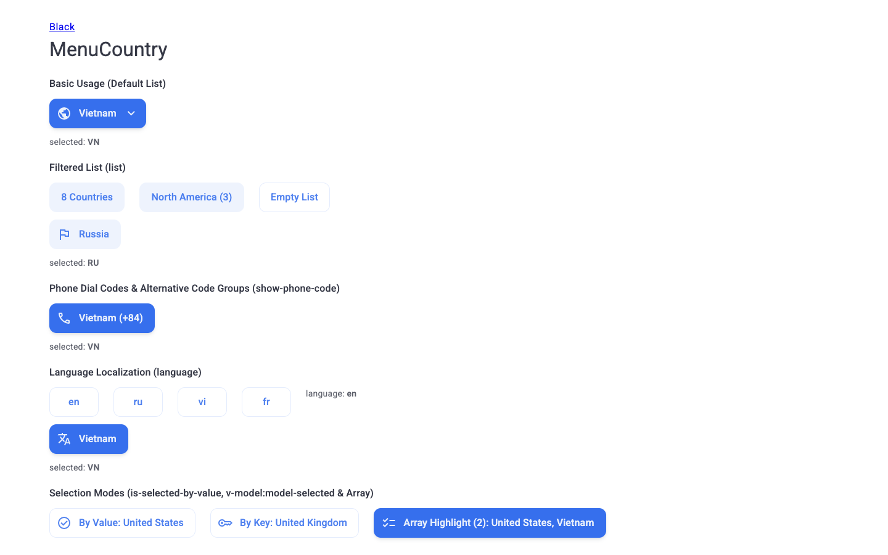
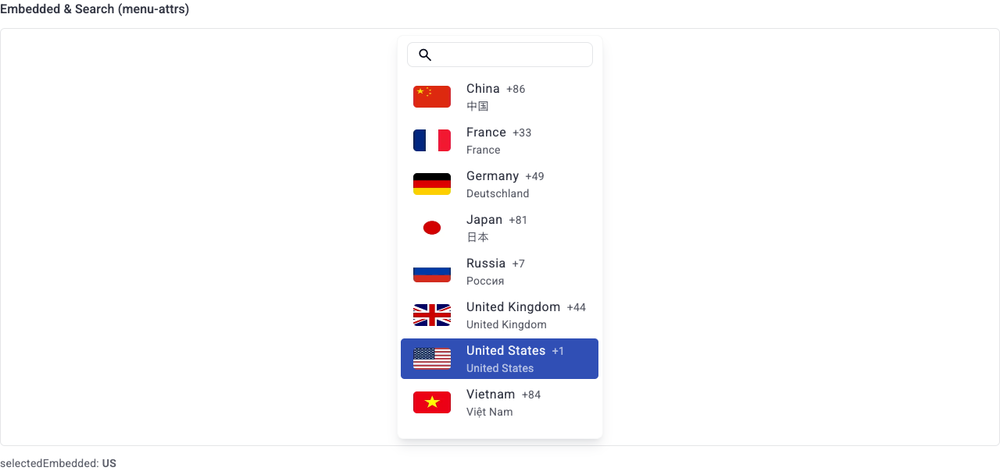
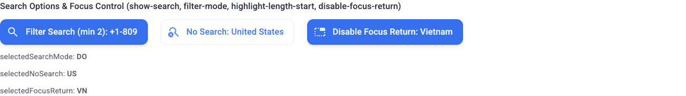
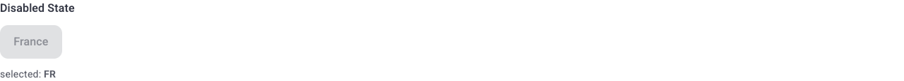
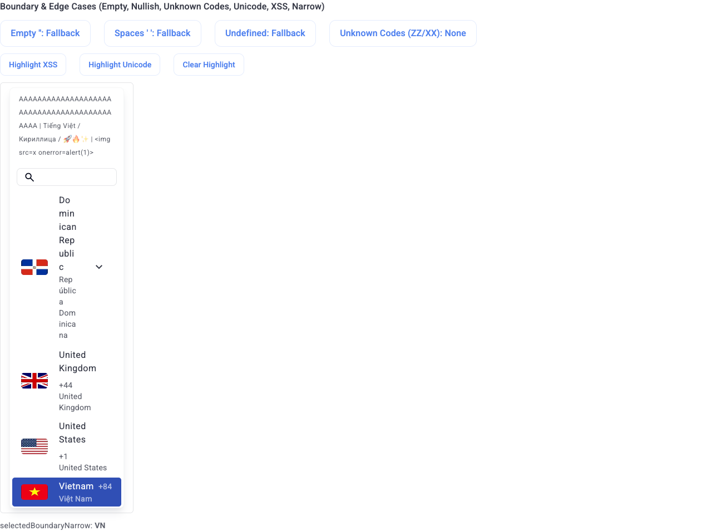

# Отчёт о визуальном и функциональном тестировании: D1MenuCountry

## 1. Сводка тестирования

- **Компонент:** `D1MenuCountry` (`@dxtmisha/d1`)
- **Исходный код:** [`MenuCountry`](../../src/components/Ui/MenuCountry) ([`constructor`](../../../constructor/src/constructors/MenuCountry), [`demo`](../../../demo/src/pages/components/DemoMenuCountryPage.vue))
- **Демо / Целевой URL:** `http://localhost:3000/component-menu-country`
- **Материалы:** `Отсутствуют`
- **Дата тестирования (UTC):** `2026-11-25T08:22:37Z`
- **Окружение:** `Headless Chrome (Puppeteer / CDP, Desktop 1440×900, Tablet 768×1024, Mobile 375×812 / 320×568)`
- **Покрытие тест-кейсов:** `13 / 13` (`100%`)
- **Итог:** **13 ✅, 0 ⚠️, 0 ❌** (`✅` пройдено, `⚠️` предупреждение, `❌` провалено) — компонент `D1MenuCountry` успешно прошёл все проверки рендеринга, слотов, интерактивности, граничных случаев (включая XSS, Unicode и узкий контейнер `240px`), адаптивности на всех разрешениях, доступности и чистоты runtime без единой ошибки консоли или сети.

---

## 2. Базовая матрица

### 2.1 Визуал и дизайн-система (`VIS`)

| ID | Сценарий | Статус | Фактический результат | Скриншот |
| :--- | :--- | :---: | :--- | :--- |
| `TC-VIS-001` | Базовый рендеринг, флаги стран и телефонные коды (`show-phone-code`) | ✅ | Списки стран с флагами и телефонными кодами (включая группы альтернативных кодов `DO`/`VA`) рендерятся ровно без клиппинга и наложений. |  |
| `TC-VIS-002` | Встроенное меню с поиском (`embedded` + `showSearch` через `menu-attrs`) | ✅ | Встроенное меню `.d1-menuCountry` корректно отображается внутри `DemoBox` со строкой поиска, флагами и кодами стран. |  |
| `TC-VIS-003` | Пользовательские слоты и scoped bindings (`control`, `title`, `contextTop`, `contextBottom`, `footer`) | ✅ | Все 5 слотов отрисованы в правильном порядке со scoped-свойствами; кнопка `Done` закрывает меню. |  |

### 2.2 Интерактивность и управление состоянием (`INT`)

| ID | Сценарий | Статус | Фактический результат | Скриншот |
| :--- | :--- | :---: | :--- | :--- |
| `TC-INT-001` | Фильтрация списка `list`, выбор страны (`v-model:selected`), мутация `v-model` и локализация `language` | ✅ | Фильтрация `North America (3)` ограничивает список тремя странами, выбор обновляет `selected`, смена `language` на `ru` локализует названия, а программные кнопки синхронно обновляют состояние. |  |
| `TC-INT-002` | Режимы выбора (`is-selected-by-value`, множественный выбор) и поиск во встроенном меню | ✅ | Режимы одиночного/множественного выбора, `v-model:model-selected` и поиск во встроенном меню по `"Viet"` работают штатно. | — |
| `TC-INT-003` | Полный API `defineExpose` (`toOpen`, `toClose`, `setOpen`, `toggle`, `previous`, `next`, `Check Expose`) | ✅ | Программное API отрабатывает без ошибок; `Check Expose` возвращает `id=window--ui-10089, open=false, hasControl=true, hasMenuElement=true, loading=false, selected=true, listCount=1, values=["US"], names=["United States"]`. | — |
| `TC-INT-004` | Группы альтернативных кодов (`DO`/`VA`), прямые пропсы поиска и `disable-focus-return` | ✅ | Группы альтернативных кодов раскрываются и выбираются, поиск по `"1829"` находит подкод `+1-829`, `:show-search="false"` скрывает поле ввода, `disable-focus-return` отключает возврат фокуса. |  |
| `TC-INT-005` | SSR/DOM жизненный цикл (`inDom: true` и условное монтирование `v-if`) | ✅ | SSR вернул `200`; цикл размонтирования/повторного монтирования `v-if` восстановил длину DOM-среза точно в исходное состояние (`beforeLen: 139`, `unmountedLen: 122`, `remountedLen: 139`). | — |

### 2.3 Границы и крайние случаи (`BND`)

| ID | Сценарий | Статус | Фактический результат | Скриншот |
| :--- | :--- | :---: | :--- | :--- |
| `TC-BND-001` | Состояние `disabled`, пустой `list=[]` и пустой результат поиска | ✅ | Отключённый триггер не открывает окно; при `list=[]` и поиске `"zzzzzz"` компонент стабильно отображает пустое состояние без сбоев. |  |
| `TC-BND-002` | Пустые/пробельные/undefined значения, неизвестные коды (`ZZ`/`XX`), Unicode, XSS и узкий контейнер (`240px`) | ✅ | Полезная нагрузка XSS экранируется как текст (`badImgs: 0`, `hasEscapedPayloadText: true`, `dialogs: []`), строки `Tiếng Việt / Кириллица / 🚀🔥✨` и `AAAA...` переносятся внутри `.demo-menu-country-page__narrow` без переполнения (`scrollWidth: 238`, `clientWidth: 238`, `overflowsBox: false`). |  |

### 2.4 Адаптивность и вьюпорты (`RSP`)

| ID | Сценарий | Статус | Фактический результат | Скриншот |
| :--- | :--- | :---: | :--- | :--- |
| `TC-RSP-001` | Адаптивность на разрешениях `1440×900`, `768×1024`, `375×812`, `320×568` | ✅ | Горизонтальное переполнение отсутствует на всех четырёх вьюпортах: Desktop `1440/1440`, Tablet `768/768`, Mobile `375/375` и `320/320` (`overflowX: false`, `offenders: []`). |  |

### 2.5 Доступность (`A11Y`)

| ID | Сценарий | Статус | Фактический результат | Скриншот |
| :--- | :--- | :---: | :--- | :--- |
| `TC-A11Y-001` | WAI-ARIA атрибуты и клавиатурное управление (`Enter`, `Space`, `ArrowDown`, `Escape`) | ✅ | Триггер и список поддерживают `aria-haspopup`, `aria-expanded`, `role="listbox"`, `role="option"`, клавиатурную навигацию и закрытие по `Escape`. | — |

### 2.6 Логи и консоль (`LOG`)

| ID | Сценарий | Статус | Фактический результат | Скриншот |
| :--- | :--- | :---: | :--- | :--- |
| `TC-LOG-001` | События (`click`, `clickLite`, `update:selected`, `update:modelSelected`, `updateValue`, `window`) и чистота консоли | ✅ | Все события зафиксированы; журнал полностью чист: `consoleErrors: []`, `vueWarnings: []`, `pageErrors: []`, `networkErrors: []`, `dialogs: []`. | — |

---

## 3. AI-аудит и рекомендации

1. **Устойчивость узкого контейнера (`240px`) и перенос неразрывного текста:** В `.demo-menu-country-page__narrow` (`clientWidth: 238px`) встроенное меню с длинной неразрывной строкой `AAAA...`, кириллицей, вьетнамскими диакритиками и экранированным XSS-пейлоадом показало `scrollWidth: 238px` (`overflowsBox: false`), однако название `Dominican Republic` в узкой колонке переносится посимвольно. При использовании встроенного меню в узких панелях (`<= 240px`) рекомендуется задавать компактный `title` или `hyphens: auto` на текстовых блоках слота/описания.
2. **Жизненный цикл `v-if` и SSR-гидратация:** После повторного монтирования `v-if` объём текстового узла секции полностью совпал с исходным (`beforeLen: 139` -> `unmountedLen: 122` -> `remountedLen: 139`), а SSR отдал `200` без предупреждений гидратации (`vueWarnings: []`), что подтверждает корректную очистку ресурсов окна.
3. **Мобильная адаптивность и чистота runtime:** На всех четырёх проверенных вьюпортах (`1440`, `768`, `375`, `320`) `overflowX` равен `false` (`offenders: []`), а `networkErrors` и `dialogs` пусты (`[]`), что подтверждает отсутствие утечек разметки и корректное экранирование пользовательских строк.
