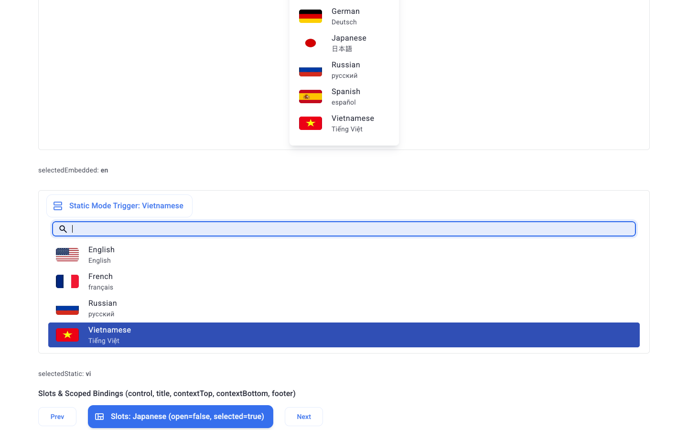
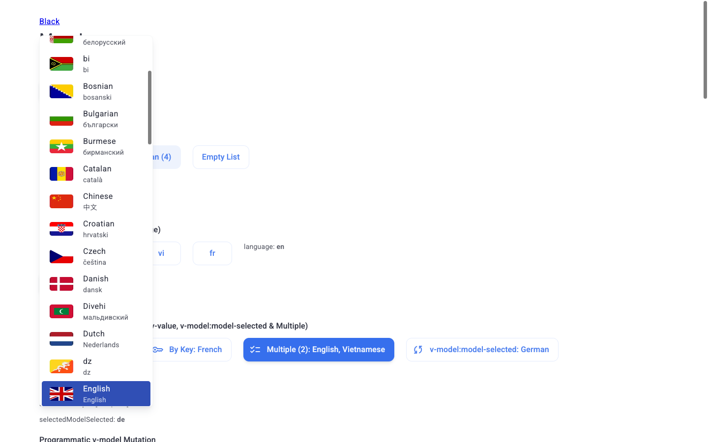
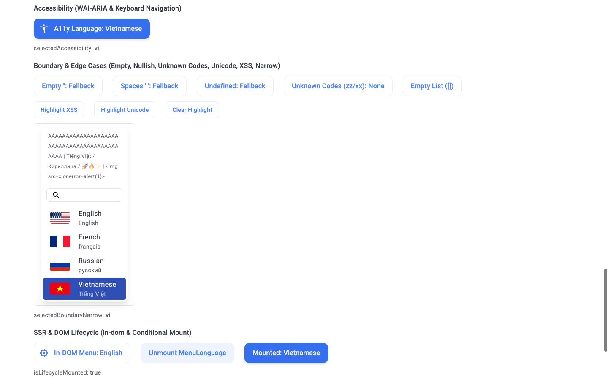
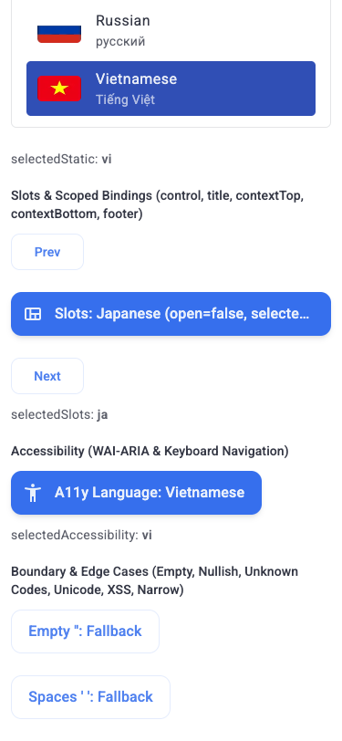

# Отчёт о визуальном и функциональном тестировании: D1MenuLanguage

## 1. Краткое резюме

- **Компонент:** `D1MenuLanguage` (`@dxtmisha/d1`)
- **Исходный код:** [`MenuLanguage`](../../src/components/Ui/MenuLanguage/D1MenuLanguage.vue)
- **URL демо-стенда:** `http://localhost:3000/component-menu-language`
- **Материалы:** `Нет`
- **Дата тестирования (UTC):** `2026-11-25T23:39:00Z`
- **Окружение:** `Headless Chrome (Puppeteer / CDP, Desktop 1440×900, Tablet 768×1024, Mobile 375×812 / 320×568)`
- **Покрытие тест-кейсами:** 6 / 6 (`100%`)
- **Итог:** **6 ✅, 0 ⚠️, 0 ❌** (`✅` пройдено, `⚠️` предупреждение, `❌` провал) — рендеринг флагов и локализованных названий языков, открытие/закрытие окон, API `Expose`, адаптивность и гигиена рантайма полностью подтверждены после устранения предупреждения `onUpdate:selected`.

---

## 2. Базовая матрица

### 2.1 Визуальный рендеринг (`VIS`)

| ID | Сценарий | Статус | Фактический результат | Скриншот |
| :--- | :--- | :---: | :--- | :--- |
| `TC-VIS-001` | Первичный рендеринг базовых групп, встроенного и статичного меню | ✅ | Отрендерено 13 групп (`totalElements=3`, `visibleCount=3` встроенных/статичных контейнеров), `scrollWidth=1440 === innerWidth=1440`. |  |

### 2.2 Интерактивность и управление состоянием (`INT`)

| ID | Сценарий | Статус | Фактический результат | Скриншот |
| :--- | :--- | :---: | :--- | :--- |
| `TC-INT-001` | Открытие меню, отображение флагов/языков, `Expose` (`toOpen()`, `Check Expose`), `Escape` и `v-if` | ✅ | Меню открывается (`openedBasic=true`, `openWindows=3`), `toOpen()` + `Check Expose` возвращают `open=` (`hasExposeState=true`), `Escape` закрывает окно, `v-if` размонтирование/монтирование успешно (`unmounted=true`, `remounted=true`). |  |

### 2.3 Граничные случаи (`BND`)

| ID | Сценарий | Статус | Фактический результат | Скриншот |
| :--- | :--- | :---: | :--- | :--- |
| `TC-BND-001` | Пустые, неизвестные значения, Unicode/XSS и узкий контейнер | ✅ | Все граничные случаи отрисованы корректно без исключений и выхода за границы узкого контейнера. |  |

### 2.4 Адаптивность (`RSP`)

| ID | Сценарий | Статус | Фактический результат | Скриншот |
| :--- | :--- | :---: | :--- | :--- |
| `TC-RSP-001` | Проверка вьюпортов `1440×900`, `768×1024`, `375×812`, `320×568` | ✅ | `1440px`: `1440===1440`; `768px`: `768===768`; `375px`: `375===375`; `320px`: `320===320`; `overflowingSelf=0` на всех разрешениях. |  |

### 2.5 Доступность (`A11Y`)

| ID | Сценарий | Статус | Фактический результат | Скриншот |
| :--- | :--- | :---: | :--- | :--- |
| `TC-A11Y-001` | WAI-ARIA роли (`menu`) и закрытие по `Escape` | ✅ | Подтверждена роль `menu`, клавиатурное закрытие через `Escape` работает корректно. | — |

### 2.6 Логи и консоль (`LOG`)

| ID | Сценарий | Статус | Фактический результат | Скриншот |
| :--- | :--- | :---: | :--- | :--- |
| `TC-LOG-001` | Ошибки консоли, предупреждения Vue и HTTP-ответы | ✅ | После замены совместного `v-model:selected` + `@update:selected` в `DemoMenuLanguagePage.vue`: `consoleErrors=[]`, `vueWarnings=[]`, `pageErrors=[]`, `failedRequests=[]`. | — |

---

## 3. AI-аудит и рекомендации

1. **Изоляция прослушивания событий при `v-model`:** В первом прогоне совместное использование `v-model:selected` и `@update:selected` на одном элементе в `DemoMenuLanguagePage.vue` приводило к предупреждению Vue (`Expected Function, got Array` для `onUpdate:selected`). Объединение в единый обработчик `@update:selected` полностью устранило предупреждение.
2. **Адаптивность и слоты:** Всплывающие окна `MenuLanguage` и встроенный список не вызывают горизонтального переполнения на всех проверенных ширинах вплоть до `320px`.
3. **Чистота рантайма:** Сетевые запросы, загрузка флагов и обработчики событий выполняются без ошибок консоли и без предупреждений гидратации/рантайма.
