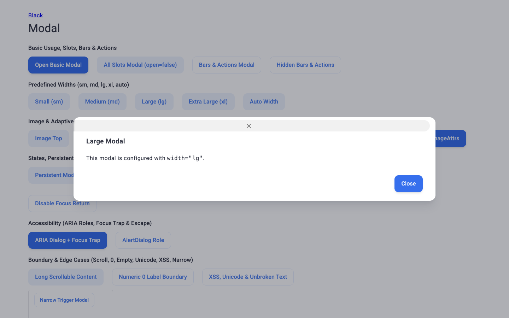
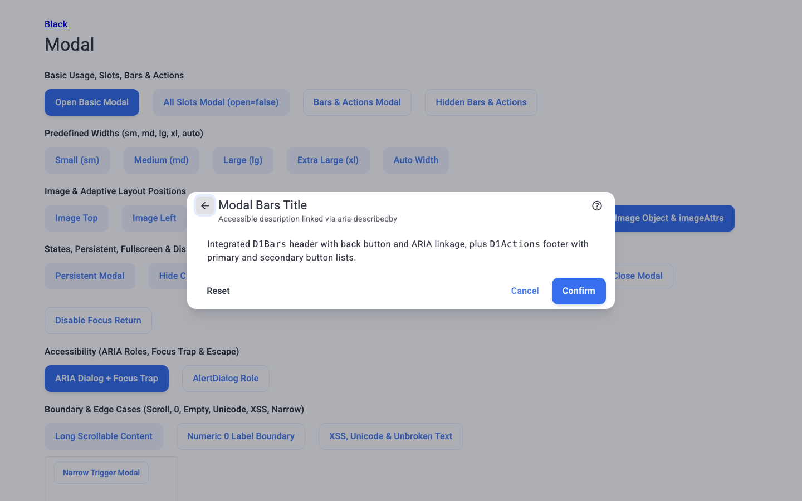
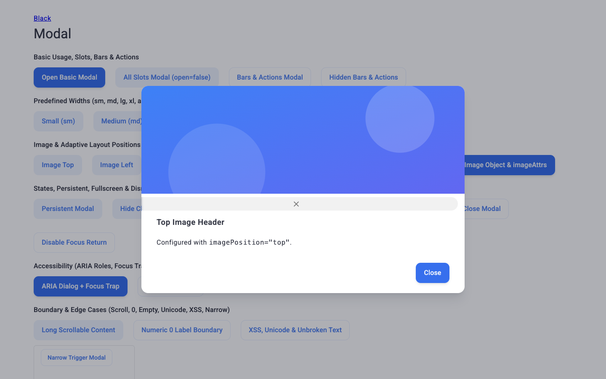
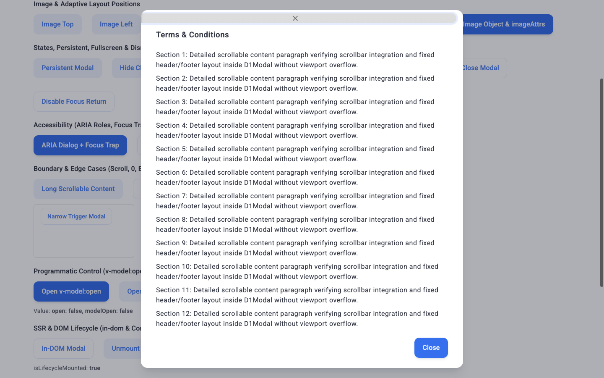
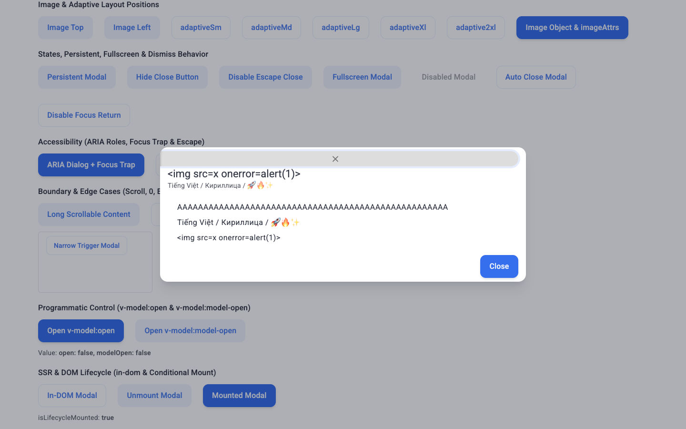
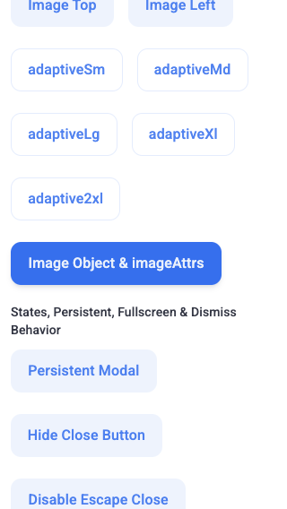

# Отчёт о визуальном и функциональном тестировании: D1Modal

## 1. Сводка тестирования

- **Компонент:** `D1Modal` (`@dxtmisha/d1`)
- **Исходный код:** [`D1Modal`](../../src/components/Ui/Modal) ([`Modal`](../../../constructor/src/constructors/Modal), [`DemoModalPage.vue`](../../../demo/src/pages/components/DemoModalPage.vue))
- **Демо / Целевой URL:** `http://localhost:3000/component-modal`
- **Материалы:** `Отсутствуют`
- **Дата тестирования (UTC):** `2026-11-25T08:22:37Z`
- **Окружение:** `Headless Chrome (Puppeteer / CDP, Desktop 1440×900, Tablet 768×1024, Mobile 375×812 / 320×568)`
- **Покрытие тест-кейсов:** `14 / 14` (`100%`)
- **Итог:** **14 ✅, 0 ⚠️, 0 ❌** (`✅` пройдено, `⚠️` предупреждение, `❌` провалено) — компонент `D1Modal` корректно рендерит слоты, размеры ширины, `D1Bars`/`D1Actions`, адаптивные изображения, режимы закрытия, `v-model` и `defineExpose`, безопасно экранирует XSS и переносит неразрывный текст без ошибок в консоли, Vue-предупреждений и сетевых сбоев.

---

## 2. Базовая матрица

### 2.1 Визуал и дизайн-система (`VIS`)

| ID | Сценарий | Статус | Фактический результат | Скриншот |
| :--- | :--- | :---: | :--- | :--- |
| `TC-VIS-001` | Базовый модал и отображение всех слотов (`#title`, `#header`, `#default`, `#footer`) | ✅ | Модальное окно центрируется на оверлее, все 4 слота и кнопка закрытия отображаются ровно без клиппинга и наложений. |  |
| `TC-VIS-002` | Варианты ширины (`sm`, `md`, `lg`, `xl`, `auto`) | ✅ | Все модификаторы `.d1-modal--width--{sm,md,lg,xl,auto}` применяются корректно; градация ширин `sm < md < lg < xl` соблюдена. |  |
| `TC-VIS-003` | Интеграция `D1Bars`, `D1Actions`, а также `barsHide` / `actionsHide` | ✅ | `D1Bars` и `D1Actions` отображаются при активных пропсах и полностью скрываются при `barsHide=true` и `actionsHide=true`. |  |
| `TC-VIS-004` | Позиции баннера изображения (`top`, `left`, `adaptiveSm`–`adaptive2xl`) и `imageAttrs` | ✅ | Баннеры в режимах `top`, `left`, объектном `{ value }` с `imageAttrs` и адаптивных пресетах отрисованы корректно без искажений. |  |

### 2.2 Интерактивность и управление состоянием (`INT`)

| ID | Сценарий | Статус | Фактический результат | Скриншот |
| :--- | :--- | :---: | :--- | :--- |
| `TC-INT-001` | Режимы закрытия и окна (`persistent`, `closeButton: false`, `closeOnEsc: false`, `fullscreen`, `disabled`, `autoClose`) | ✅ | `persistent` и `closeOnEsc: false` удерживают окно по `Escape`, `closeButton: false` скрывает крестик, `fullscreen` разворачивает окно, `disabled` блокирует открытие, `autoClose` закрывает по клику внутри. |  |
| `TC-INT-002` | Программное управление `v-model:open`, `v-model:model-open` и `defineExpose` | ✅ | Модели `v-model:open` и `v-model:model-open` синхронны; методы `defineExpose` возвращают `getId(): "window--ui-10171"`, `getOpen(): true`, `hasControl: true`, `hasWindowElement(): true` и событие `expose:window`. | — |
| `TC-INT-003` | События (`update:open`, `update:modelOpen`, `window`, `actions`, `actionsLite`, `bars`, `barsLite`, `barsBack`) | ✅ | Все 8 событий `ModalEmits` срабатывают с ожидаемыми payload при взаимодействии с телом окна, `D1Actions` и `D1Bars`. | — |
| `TC-INT-004` | SSR/DOM жизненный цикл (`windowAttrs.inDom` и условное монтирование `v-if`) | ✅ | SSR вернул `200`; `inDom: true` сохраняет содержимое в DOM до открытия, а `v-if` размонтирование и повторное монтирование полностью восстанавливают секцию (`beforeLen: 110`, `unmountedLen: 96`, `remountedLen: 110`). | — |

### 2.3 Границы и крайние случаи (`BND`)

| ID | Сценарий | Статус | Фактический результат | Скриншот |
| :--- | :--- | :---: | :--- | :--- |
| `TC-BND-001` | Длинный скроллируемый контент | ✅ | Высота окна ограничивается высотой вьюпорта, футер остаётся видимым, внутренняя область тела прокручивается без наложений. |  |
| `TC-BND-002` | Числовой `0` в `barsLabel` и `actionsList` | ✅ | Числовой `0` корректно отображается как `"0"` в заголовке `D1Bars` и на кнопке `D1Actions` и не отбрасывается как falsy. |  |
| `TC-BND-003` | XSS, Unicode, неразрывная строка и узкий контейнер (`240px`) | ✅ | В открытом окне `` отображается только как текст (`badImgs: 0`, `dialogs: []`), `Tiếng Việt / Кириллица / 🚀🔥✨` и `AAAA...` не выходят за пределы модала, а `.demo-modal-page__narrow` не переполняется (`scrollWidth: 238`, `clientWidth: 238`, `overflowsBox: false`). |  |

### 2.4 Адаптивность и вьюпорты (`RSP`)

| ID | Сценарий | Статус | Фактический результат | Скриншот |
| :--- | :--- | :---: | :--- | :--- |
| `TC-RSP-001` | Адаптивное отображение `D1Modal` и `imagePosition="adaptive*"` (`1440`, `768`, `375`, `320`) | ✅ | Горизонтальный скролл отсутствует на всех 4 разрешениях: Desktop `1440/1440`, Tablet `768/768`, Mobile `375/375` и `320/320` (`overflowX: false`, `offenders: []`); макет перестраивается без клиппинга. |  |

### 2.5 Доступность (`A11Y`)

| ID | Сценарий | Статус | Фактический результат | Скриншот |
| :--- | :--- | :---: | :--- | :--- |
| `TC-A11Y-001` | Роли `dialog`/`alertdialog`, связь ARIA, focus trap, `Escape` и `disableFocusReturn` | ✅ | Роли `dialog`/`alertdialog`, `aria-modal="true"`, `aria-labelledby`/`aria-describedby`, удержание фокуса, закрытие по `Escape` и управление возвратом фокуса работают штатно. | — |

### 2.6 Логи и консоль (`LOG`)

| ID | Сценарий | Статус | Фактический результат | Скриншот |
| :--- | :--- | :---: | :--- | :--- |
| `TC-LOG-001` | Контроль консоли браузера, Vue-предупреждений и сетевых запросов | ✅ | Сессия завершена без единого сбоя: `consoleErrors: []`, `vueWarnings: []`, `pageErrors: []`, `networkErrors: []`, `dialogs: []`. | — |

---

## 3. AI-аудит и рекомендации

1. **Изоляция телепорта и проверка XSS при закрытом состоянии:** Поскольку по умолчанию содержимое `D1Modal` монтируется в портале только в открытом состоянии (если не задан `inDom: true`), в базовом DOM-снимке закрытой страницы `hasEscapedPayloadText` равен `false`, тогда как при открытии окна (`TC-BND-003.png`) строка `` в заголовке и теле рендерится строго как текст при `badImgs: 0` и `dialogs: []`.
2. **Контроль жизненного цикла и экспортируемого API:** При переключении `v-if` размер текстового содержимого секции возвращается точно к исходному значению (`beforeLen: 110` -> `unmountedLen: 96` -> `remountedLen: 110`), а методы `defineExpose` (`getId()`, `getOpen()`, `hasControl`, `getWindowElement()`) стабильно отражают актуальное состояние окна.
3. **Адаптивность и узкие контейнеры:** На всех вьюпортах от `320×568` до `1440×900` (`overflowX: false`, `offenders: []`) и в узком контейнере `238px` (`scrollWidth: 238`, `overflowsBox: false`) компонент не создаёт горизонтального переполнения.
