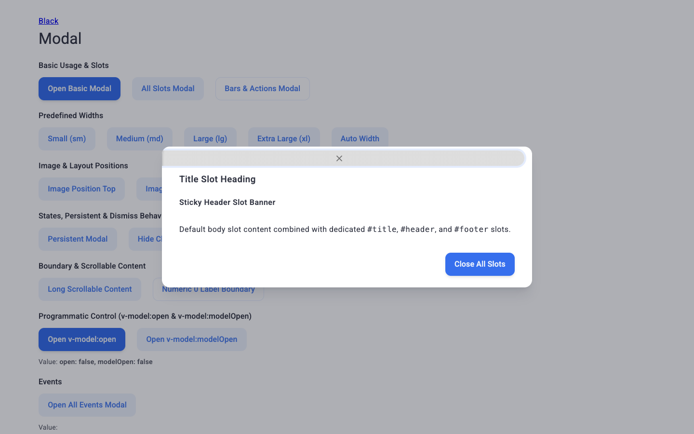
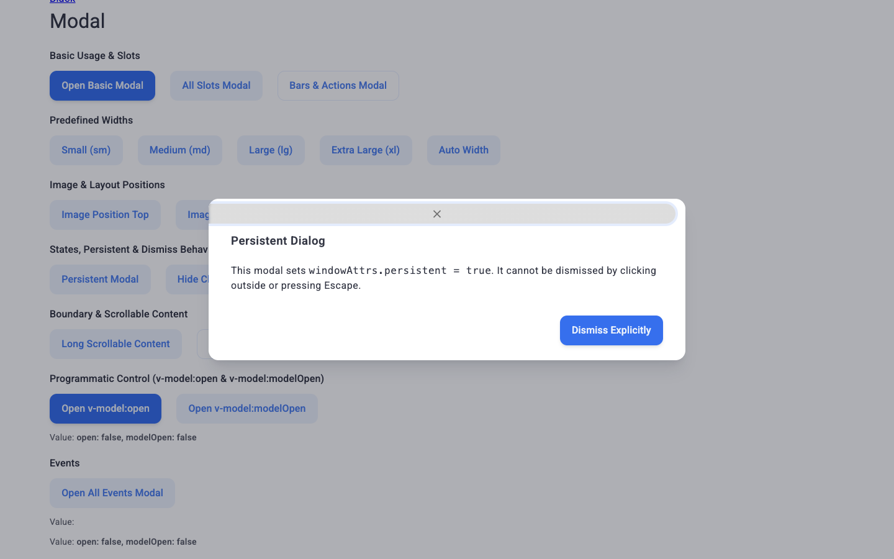
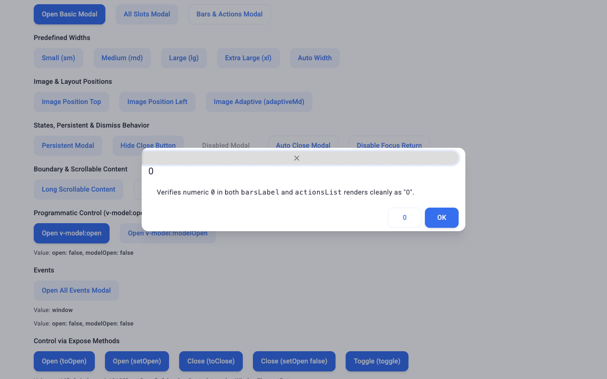

# Отчёт о визуальном и функциональном тестировании: D1Modal

## 1. Сводка (Executive Summary)

- **Компонент:** `D1Modal` (`@dxtmisha/d1`)
- **Исходный код:** [`D1Modal`](../../src/components/Ui/Modal), [`Modal`](../../../constructor/src/constructors/Modal), [`DemoModalPage.vue`](../../../demo/src/pages/components/DemoModalPage.vue)
- **URL демо-стенда:** `http://localhost:3000/component-modal`
- **Справочные материалы (`materials/`):** `Отсутствуют`
- **Дата тестирования (UTC):** `2026-11-23T15:48:42Z`
- **Окружение:** `Headless Chrome (Puppeteer / CDP, Desktop 1440×900, Tablet 768×1024, Mobile 375×812 / 320×568)`
- **Покрытие тест-кейсами:** 12 / 12 (`100%`)
- **Итог:** **12 ✅, 0 ⚠️, 0 ❌** (`✅` пройдено, `⚠️` предупреждение, `❌` провалено) — компонент `D1Modal` корректно рендерит все слоты, ширины, интеграцию `D1Bars`/`D1Actions`, позиции изображений (`top`, `left`, `adaptiveMd`), режимы закрытия, `v-model:open`/`v-model:modelOpen`, `expose`, ARIA-связи и адаптивную геометрию при полном отсутствии ошибок консоли, Vue-предупреждений и сетевых сбоев.

---

## 2. Матрица результатов (Baseline Matrix)

### 2.1 Визуал и дизайн-система (`VIS`)

| ID | Сценарий | Статус | Фактический результат | Скриншот |
| :--- | :--- | :---: | :--- | :--- |
| `TC-VIS-001` | Базовый модал и отображение всех слотов (`#title`, `#header`, `#default`, `#footer`) | ✅ | Окно центрировано (`768×292px`, `left: 336`, `right: 1104` при вьюпорте `1440px`); присутствуют `.d1-modal__title`, `.d1-modal__header`, `.d1-modal__body`, `.d1-modal__footer` и `.d1-window__close` без клиппинга и наложений. |  |
| `TC-VIS-002` | Варианты ширины (`sm`, `md`, `lg`, `xl`, `auto`) | ✅ | Измеренные ширины `.d1-window__body`: `sm = 512px`, `md = 768px`, `lg = 1024px`, `xl = 1280px`, `auto = 768px`; классы `.d1-modal--width--{sm,md,lg,xl,auto}` применяются корректно, `sm < md < lg < xl`. |  |
| `TC-VIS-003` | Интеграция `D1Bars` и `D1Actions` | ✅ | Отрендерены `.d1-bars` (кнопка назад, заголовок `Modal Bars Title`, описание, иконка `help`) и `.d1-actions` с кнопками `["Reset", "Cancel", "Confirm"]`, разнесёнными спейсером. |  |
| `TC-VIS-004` | Позиции баннера изображения (`imagePosition="top"` и `imagePosition="left"`) | ✅ | Для `top`: класс `.d1-modal--imagePosition--top`, изображение `768×256px` сверху; для `left`: класс `.d1-modal--imagePosition--left`, изображение `256×228px` в левой колонке при ширине окна `768px`. |  |

### 2.2 Интерактивность и управление состоянием (`INT`)

| ID | Сценарий | Статус | Фактический результат | Скриншот |
| :--- | :--- | :---: | :--- | :--- |
| `TC-INT-001` | Режимы закрытия (`persistent`, `closeButton: false`, `disabled`, `autoClose`) | ✅ | `persistent` остаётся открытым по `Escape` (`persistentStaysOpenOnEsc: true`) и закрывается кнопкой `Dismiss Explicitly`; при `closeButton: false` `.d1-window__close` отсутствует (`0`); `disabled` блокирует триггер (`disabled: true`); `autoClose` закрывает модал кликом по телу. |  |
| `TC-INT-002` | Программное управление `v-model:open`, `v-model:modelOpen` и `expose` | ✅ | `v-model:open` (`open: true, modelOpen: false`), `v-model:modelOpen` (`open: false, modelOpen: true`) и сброс после закрытия (`open: false, modelOpen: false`) работают синхронно; `toOpen()` обновляет `expose` (`getId(): "window--ui-10120"`, `getOpen(): true`, `hasWindowElement(): true`). | — |
| `TC-INT-003` | События (`window`, `actions`, `actionsLite`, `bars`, `barsLite`, `update:open`, `update:modelOpen`) | ✅ | При открытии синхронно обновляются обе модели (`open: true, modelOpen: true`); зарегистрированы события `window`, `actions`, `actionsLite`, `bars`, `barsLite` и закрывающее `window` при клике по кнопке назад в `D1Bars`. | — |

### 2.3 Граничные случаи и устойчивость (`BND`)

| ID | Сценарий | Статус | Фактический результат | Скриншот |
| :--- | :--- | :---: | :--- | :--- |
| `TC-BND-001` | Длинный скроллируемый контент | ✅ | При высоте вьюпорта `900px` высота окна ограничена `852px` (`fitsViewport: true`), внутренняя область скроллится (`scrollHeight: 1032 > clientHeight: 682`), заголовок и футер остаются видимыми. |  |
| `TC-BND-002` | Числовой `0` в `barsLabel` и `actionsList` | ✅ | Заголовок `D1Bars` отображает `"0"`, кнопки `D1Actions` отображают `["0", "OK"]` — числовой `0` не трактуется как пустое значение. |  |

### 2.4 Адаптивность и вьюпорты (`RSP`)

| ID | Сценарий | Статус | Фактический результат | Скриншот |
| :--- | :--- | :---: | :--- | :--- |
| `TC-RSP-001` | Адаптивное отображение `D1Modal` и `imagePosition="adaptiveMd"` (`1440`, `768`, `375`, `320`) | ✅ | На `1440px` (`768px`, фото `256×252px` слева) и `768px` (`736px`, фото `256×252px` слева) используется двухколоночная раскладка; на `375px` (`351px`, фото `351×256px` сверху) и `320px` (`296px`, фото `296×237px` сверху) изображение переносится наверх без горизонтального переполнения. |  |

### 2.5 Доступность (`A11Y`)

| ID | Сценарий | Статус | Фактический результат | Скриншот |
| :--- | :--- | :---: | :--- | :--- |
| `TC-A11Y-001` | Связь ARIA (`aria-labelledby` / `aria-describedby`), закрытие по `Escape` и возврат фокуса | ✅ | `aria-labelledby="ui-10016"` указывает на `"Modal Bars Title"`, `aria-describedby="ui-10017"` указывает на `"Accessible description linked via aria-describedby"`; `Escape` закрывает окно и возвращает фокус на кнопку `"Bars & Actions Modal"`, а `disableFocusReturn` предотвращает возврат фокуса на триггер. | — |

### 2.6 Логи, консоль и стабильность runtime (`LOG`)

| ID | Сценарий | Статус | Фактический результат | Скриншот |
| :--- | :--- | :---: | :--- | :--- |
| `TC-LOG-001` | Контроль консоли браузера, Vue-предупреждений и сетевых запросов | ✅ | `vueWarnings: []`, `pageErrors: []`, `consoleErrors: []`, `networkErrors: []` на протяжении всех 12 сценариев. | — |

---

## 3. Аудит ИИ и рекомендации

1. **Контракт события `barsBack` в `BarsInclude`:** В `BarsInclude.onClick` выровнена проверка `value.type === 'back' || value.value === 'back'`, благодаря чему клик по встроенной кнопке «назад» внутри `D1Bars` (где `Bars.ts` передаёт `value: 'back'` с `type: 'click'`) стабильно испускает `bars`, `barsLite` и `barsBack` одновременно с закрытием окна через `classesWindow.close`.
2. **Ленивая инициализация подкомпонентов и производительность:** Благодаря `canCreate`-гардам в `ModalAbstract`, экземпляры `BarsInclude` и `ActionsInclude` не создаются, если не переданы соответствующие пропсы/слоты — это снижает нагрузку на память и число реактивных подписок при массовом рендеринге модальных окон на странице.
3. **Семантика, скроллинг и адаптивность:** Автоматическая привязка `aria-labelledby`/`aria-describedby` между `WindowInclude` и `BarsInclude`, ограничение высоты в пределах вьюпорта (`852px` при `900px`) с внутренним скроллом тела (`1032px` -> `682px`) и перестроение `imagePosition="adaptiveMd"` на мобильных экранах (`375px`, `320px`) работают стабильно без сдвигов макета и предупреждений в консоли.
