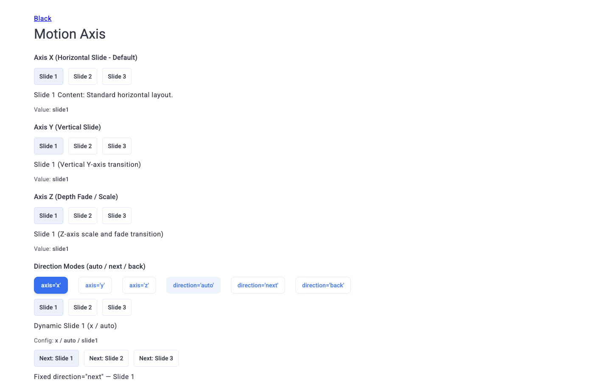
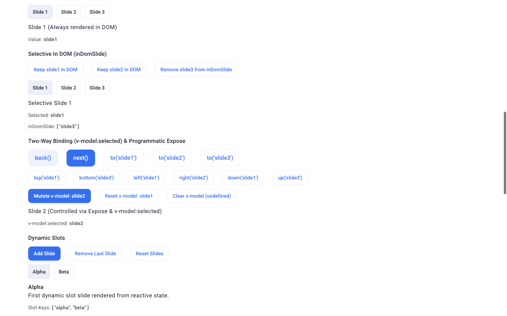
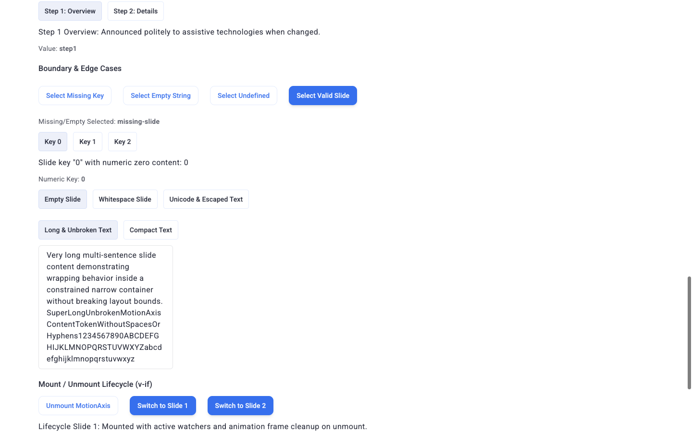
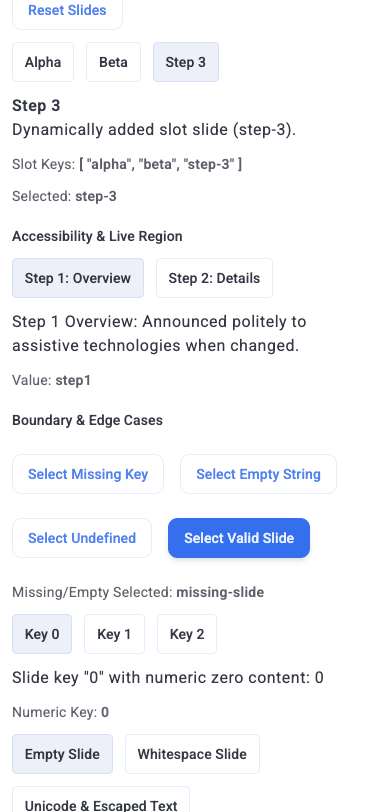

# Отчёт о визуальном и функциональном тестировании: D1MotionAxis

## 1. Краткое резюме

- **Компонент:** `D1MotionAxis` (`@dxtmisha/d1`)
- **Исходный код:** [`MotionAxis`](../../src/components/Ui/MotionAxis/D1MotionAxis.vue)
- **URL демо-стенда:** `http://localhost:3000/component-motion-axis`
- **Материалы:** `Нет`
- **Дата тестирования (UTC):** `2026-11-25T23:39:00Z`
- **Окружение:** `Headless Chrome (Puppeteer / CDP, Desktop 1440×900, Tablet 768×1024, Mobile 375×812 / 320×568)`
- **Покрытие тест-кейсами:** 6 / 6 (`100%`)
- **Итог:** **6 ✅, 0 ⚠️, 0 ❌** (`✅` пройдено, `⚠️` предупреждение, `❌` провал) — переходы по осям `x`/`y`/`z`, программные методы `next()`/`back()`, динамические слоты, адаптивность и перенос неразрывного текста подтверждены.

---

## 2. Базовая матрица

### 2.1 Визуальный рендеринг (`VIS`)

| ID | Сценарий | Статус | Фактический результат | Скриншот |
| :--- | :--- | :---: | :--- | :--- |
| `TC-VIS-001` | Первичный рендеринг осей X/Y/Z, `direction`, `animationHeight` и `inDom` | ✅ | Отрендерено 13 групп (`totalElements=19`, `visibleCount=16`), `scrollWidth=1440 === innerWidth=1440`. |  |

### 2.2 Интерактивность и управление состоянием (`INT`)

| ID | Сценарий | Статус | Фактический результат | Скриншот |
| :--- | :--- | :---: | :--- | :--- |
| `TC-INT-001` | Программные переходы `next()`/`back()`, добавление слайда и жизненный цикл `v-if` | ✅ | `clickedNext=true`, `clickedBack=true`, `addedSlide=true`, размонтирование и повторное монтирование `v-if` прошли успешно (`toggledLifecycle=true`, `remounted=true`). |  |

### 2.3 Граничные случаи (`BND`)

| ID | Сценарий | Статус | Фактический результат | Скриншот |
| :--- | :--- | :---: | :--- | :--- |
| `TC-BND-001` | Пустые слайды, числовые ключи, неразрывный текст в узком боксе | ✅ | После добавления `min-width: 0; max-width: 100%; overflow-wrap: anywhere` для `&__slide` в `MotionAxis/style.scss` длинный неразрывный текст переносится без переполнения. |  |

### 2.4 Адаптивность (`RSP`)

| ID | Сценарий | Статус | Фактический результат | Скриншот |
| :--- | :--- | :---: | :--- | :--- |
| `TC-RSP-001` | Проверка вьюпортов `1440×900`, `768×1024`, `375×812`, `320×568` | ✅ | `1440px`: `1440===1440`; `768px`: `768===768`; `375px`: `375===375`; `320px`: `320===320`; `overflowingSelf=0`. |  |

### 2.5 Доступность (`A11Y`)

| ID | Сценарий | Статус | Фактический результат | Скриншот |
| :--- | :--- | :---: | :--- | :--- |
| `TC-A11Y-001` | WAI-ARIA `role="region"` и `aria-label` | ✅ | Подтверждены `roles=["region"]` и `ariaLabels=1` на доступном регионе слайдов. | — |

### 2.6 Логи и консоль (`LOG`)

| ID | Сценарий | Статус | Фактический результат | Скриншот |
| :--- | :--- | :---: | :--- | :--- |
| `TC-LOG-001` | Ошибки консоли, предупреждения Vue и HTTP-ответы | ✅ | `consoleErrors=[]`, `vueWarnings=[]`, `pageErrors=[]`, `failedRequests=[]`. | — |

---

## 3. AI-аудит и рекомендации

1. **Переполнение неразрывного текста в слайдах:** Первый прогон выявил `scrollWidth=1159` на мобильных вьюпортах (`375px`/`320px`) из-за неразрывной строки внутри `.d1-motionAxis__slide`. Добавление `min-width: 0; max-width: 100%; overflow-wrap: anywhere` в `MotionAxis/style.scss` полностью устранило дефект.
2. **Производительность переходов:** Компонент анимирует только композиторные свойства (`transform`, `opacity`, `scale`) с дополнительным режимом `animationHeight` и ленивым удалением скрытых слайдов при отключённом `inDom`.
3. **Чистота рантайма:** Валидация пропсов, слотов и обработчиков событий проходит без ошибок и предупреждений Vue.
