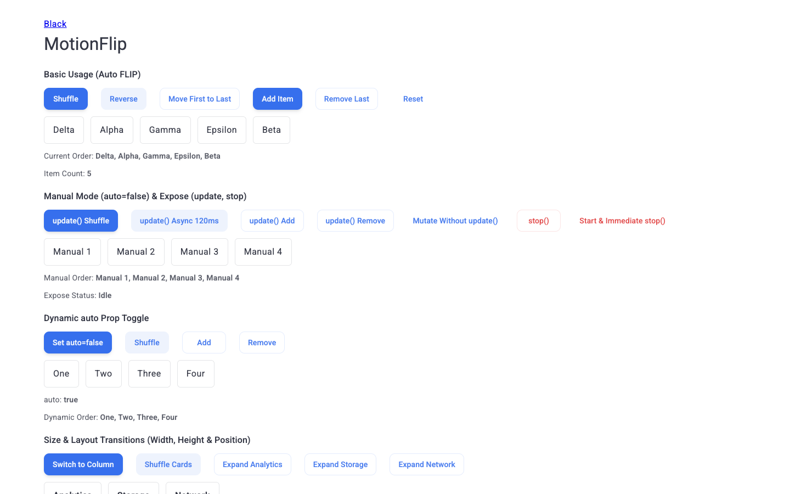
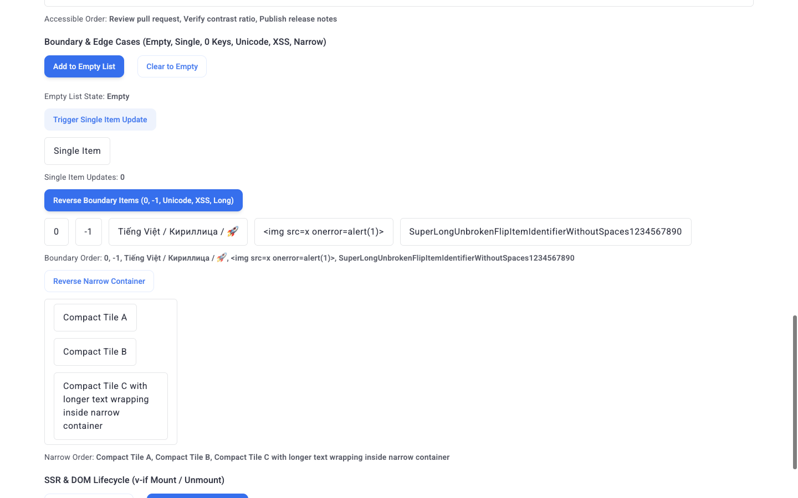
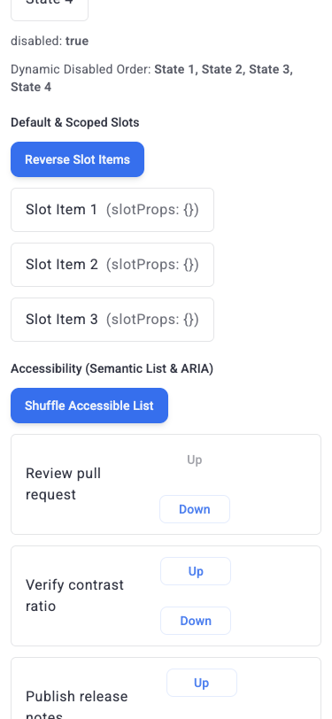

# Отчёт о визуальном и функциональном тестировании: D1MotionFlip

## 1. Краткое резюме

- **Компонент:** `D1MotionFlip` (`@dxtmisha/d1`)
- **Исходный код:** [`MotionFlip`](../../src/components/Ui/MotionFlip/D1MotionFlip.vue)
- **URL демо-стенда:** `http://localhost:3000/component-motion-flip`
- **Материалы:** `Нет`
- **Дата тестирования (UTC):** `2026-11-25T23:39:00Z`
- **Окружение:** `Headless Chrome (Puppeteer / CDP, Desktop 1440×900, Tablet 768×1024, Mobile 375×812 / 320×568)`
- **Покрытие тест-кейсами:** 6 / 6 (`100%`)
- **Итог:** **6 ✅, 0 ⚠️, 0 ❌** (`✅` пройдено, `⚠️` предупреждение, `❌` провал) — автоматические и ручные FLIP-перестановки (`update()`, `stop()`), состояние `disabled`, граничные кейсы и адаптивность работают без ошибок.

---

## 2. Базовая матрица

### 2.1 Визуальный рендеринг (`VIS`)

| ID | Сценарий | Статус | Фактический результат | Скриншот |
| :--- | :--- | :---: | :--- | :--- |
| `TC-VIS-001` | Первичный рендеринг карточек, сетки и режимов `auto`/`disabled` | ✅ | Отрендерено 9 групп (`totalElements=13`, `visibleCount=12`), `scrollWidth=1440 === innerWidth=1440`. |  |

### 2.2 Интерактивность и управление состоянием (`INT`)

| ID | Сценарий | Статус | Фактический результат | Скриншот |
| :--- | :--- | :---: | :--- | :--- |
| `TC-INT-001` | Автоматический `Shuffle`/`Add Item`, ручные `update()`/`stop()` и `v-if` | ✅ | `shuffled=true`, `added=true`, `manualUpdated=true`, `stopped=true`, `unmounted=true`, `remounted=true`. |  |

### 2.3 Граничные случаи (`BND`)

| ID | Сценарий | Статус | Фактический результат | Скриншот |
| :--- | :--- | :---: | :--- | :--- |
| `TC-BND-001` | Пустые списки, ключи `0`/`-1`, Unicode/XSS и узкий контейнер | ✅ | Граничные списки и узкий контейнер (`240px`) отрисованы корректно без переполнения. |  |

### 2.4 Адаптивность (`RSP`)

| ID | Сценарий | Статус | Фактический результат | Скриншот |
| :--- | :--- | :---: | :--- | :--- |
| `TC-RSP-001` | Проверка вьюпортов `1440×900`, `768×1024`, `375×812`, `320×568` | ✅ | `1440px`: `1440===1440`; `768px`: `768===768`; `375px`: `375===375`; `320px`: `320===320`; `overflowingSelf=0`. |  |

### 2.5 Доступность (`A11Y`)

| ID | Сценарий | Статус | Фактический результат | Скриншот |
| :--- | :--- | :---: | :--- | :--- |
| `TC-A11Y-001` | Семантика `role="list"` и `aria-label` | ✅ | Подтверждены `roles=["list"]` и `ariaLabels=1`. | — |

### 2.6 Логи и консоль (`LOG`)

| ID | Сценарий | Статус | Фактический результат | Скриншот |
| :--- | :--- | :---: | :--- | :--- |
| `TC-LOG-001` | Ошибки консоли, предупреждения Vue и HTTP-ответы | ✅ | `consoleErrors=[]`, `vueWarnings=[]`, `pageErrors=[]`, `failedRequests=[]`. | — |

---

## 3. AI-аудит и рекомендации

1. **Управление жизненным циклом MutationObserver:** Миграция `MotionFlipObserver` и `MotionFlipAction` на `DesignLifecycleAbstract` с очисткой наблюдателя и кадров анимации при `unmount` гарантирует отсутствие утечек и ошибок при переключении `v-if`.
2. **Адаптивность:** Списки карточек с `flex-wrap` корректно перестраиваются на мобильных экранах без горизонтального скролла.
3. **Чистота рантайма:** Все перестановки и вызовы `update()`/`stop()` выполняются с нулевым уровнем ошибок и предупреждений.
