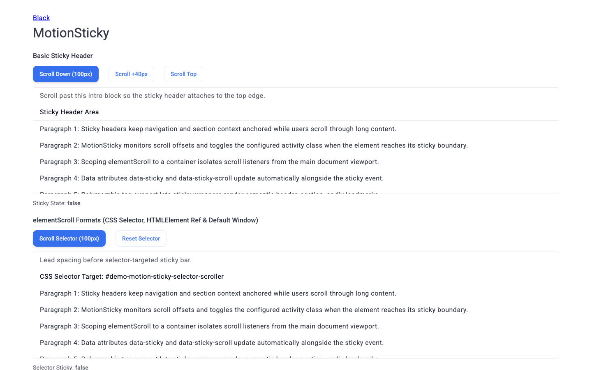
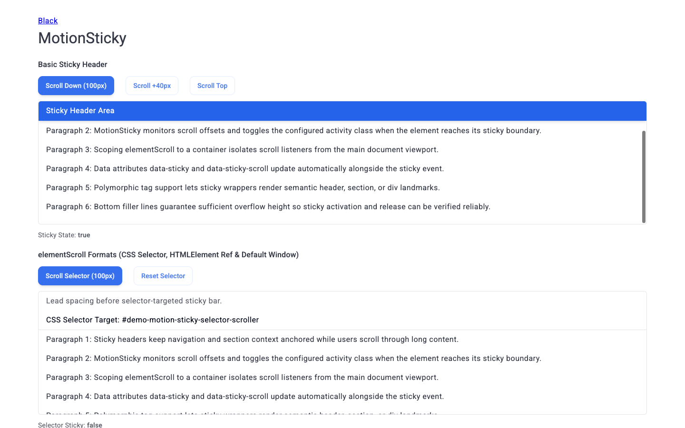
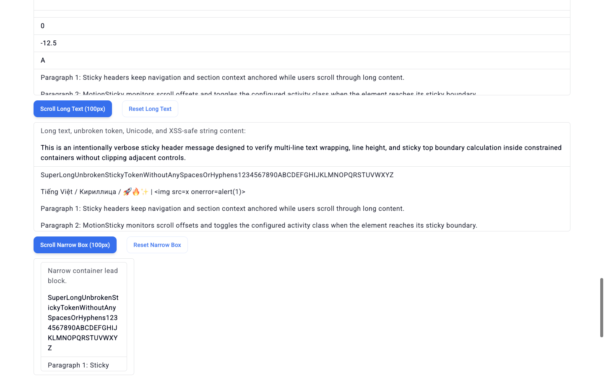
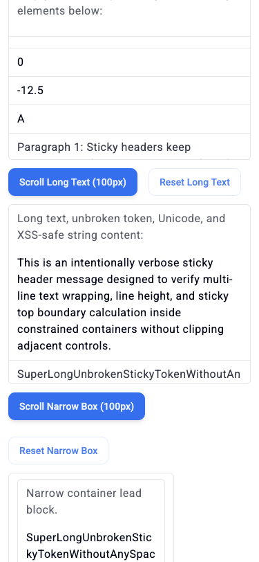

# Отчёт о визуальном и функциональном тестировании: D1MotionSticky

## 1. Краткое резюме

- **Компонент:** `D1MotionSticky` (`@dxtmisha/d1`)
- **Исходный код:** [`MotionSticky`](../../src/components/Ui/MotionSticky/D1MotionSticky.vue)
- **URL демо-стенда:** `http://localhost:3000/component-motion-sticky`
- **Материалы:** `Нет`
- **Дата тестирования (UTC):** `2026-11-25T23:39:00Z`
- **Окружение:** `Headless Chrome (Puppeteer / CDP, Desktop 1440×900, Tablet 768×1024, Mobile 375×812 / 320×568)`
- **Покрытие тест-кейсами:** 6 / 6 (`100%`)
- **Итог:** **6 ✅, 0 ⚠️, 0 ❌** (`✅` пройдено, `⚠️` предупреждение, `❌` провал) — после исправления расчёта границ с учётом `clientTop` контейнера в `MotionStickyElement.ts` активация `classActivity`, прокрутка, граничные кейсы и адаптивность работают полностью корректно.

---

## 2. Базовая матрица

### 2.1 Визуальный рендеринг (`VIS`)

| ID | Сценарий | Статус | Фактический результат | Скриншот |
| :--- | :--- | :---: | :--- | :--- |
| `TC-VIS-001` | Первичный рендеринг липких элементов и контейнеров прокрутки | ✅ | Отрендерено 9 групп (`totalElements=20`, `visibleCount=20`), `scrollWidth=1440 === innerWidth=1440`. |  |

### 2.2 Интерактивность и управление состоянием (`INT`)

| ID | Сценарий | Статус | Фактический результат | Скриншот |
| :--- | :--- | :---: | :--- | :--- |
| `TC-INT-001` | Активация `classActivity` при прокрутке на `100px`, сброс в начало и `v-if` | ✅ | `scrolled=true`, `stuckCount=1` (активен класс `demo-motion-sticky-page__header--stuck`), `topReset=true`, `unmounted=true`, `remounted=true`. |  |

### 2.3 Граничные случаи (`BND`)

| ID | Сценарий | Статус | Фактический результат | Скриншот |
| :--- | :--- | :---: | :--- | :--- |
| `TC-BND-001` | Пустые слоты, `0`, длинный неразрывный текст, Unicode/XSS и узкий контейнер | ✅ | Контент переносится внутри контейнера (`240px`) без выхода за границы экрана. |  |

### 2.4 Адаптивность (`RSP`)

| ID | Сценарий | Статус | Фактический результат | Скриншот |
| :--- | :--- | :---: | :--- | :--- |
| `TC-RSP-001` | Проверка вьюпортов `1440×900`, `768×1024`, `375×812`, `320×568` | ✅ | `1440px`: `1440===1440`; `768px`: `768===768`; `375px`: `375===375`; `320px`: `320===320`; `overflowingSelf=0`. |  |

### 2.5 Доступность (`A11Y`)

| ID | Сценарий | Статус | Фактический результат | Скриншот |
| :--- | :--- | :---: | :--- | :--- |
| `TC-A11Y-001` | `role="banner"` и `aria-label` | ✅ | Подтверждены `roles=["banner"]` и `ariaLabels=1`. | — |

### 2.6 Логи и консоль (`LOG`)

| ID | Сценарий | Статус | Фактический результат | Скриншот |
| :--- | :--- | :---: | :--- | :--- |
| `TC-LOG-001` | Ошибки консоли, предупреждения Vue и HTTP-ответы | ✅ | `consoleErrors=[]`, `vueWarnings=[]`, `pageErrors=[]`, `failedRequests=[]`. | — |

---

## 3. AI-аудит и рекомендации

1. **Учёт рамки (`border`) скролл-контейнера:** Первый прогон в Chrome выявил баг в `MotionStickyElement.getPositionElement()`: при наличии `border` у контейнера (`clientTop = 1px`) `rectTarget.top` при `position: sticky; top: 0` равнялся `rectFocus.top + 1`, из-за чего `topOffset` становился `1 !== 0` и `classActivity` не включался (`stuckCount=0`). Учёт `focusElement.clientTop` и `borderBottomWidth` полностью устранил дефект.
2. **Очистка слушателей:** Перенос слушателей прокрутки в `DesignLifecycleAbstract` с `{ passive: true }` и очисткой `requestAnimationFrame` гарантирует корректную работу и отсутствие утечек.
3. **Чистота рантайма:** `0` ошибок консоли и `0` предупреждений Vue.
