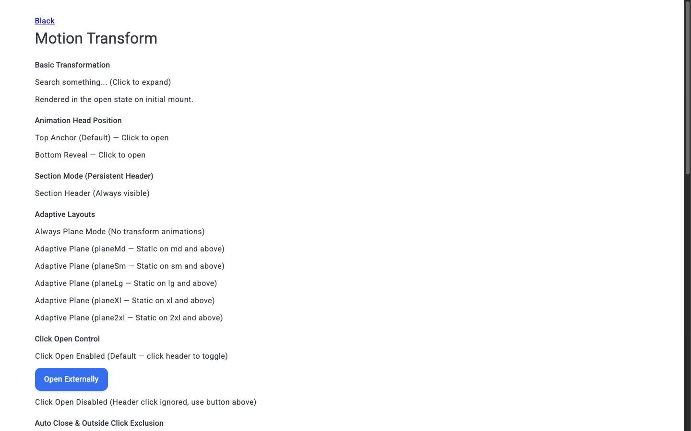
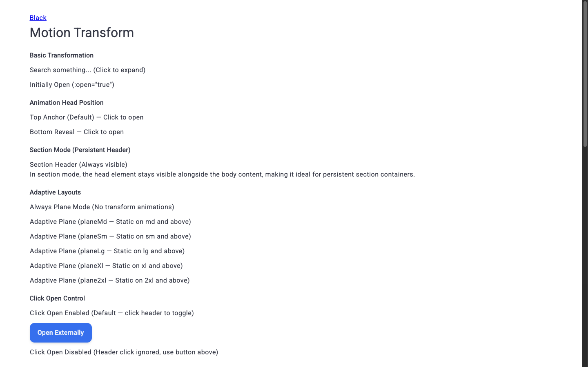
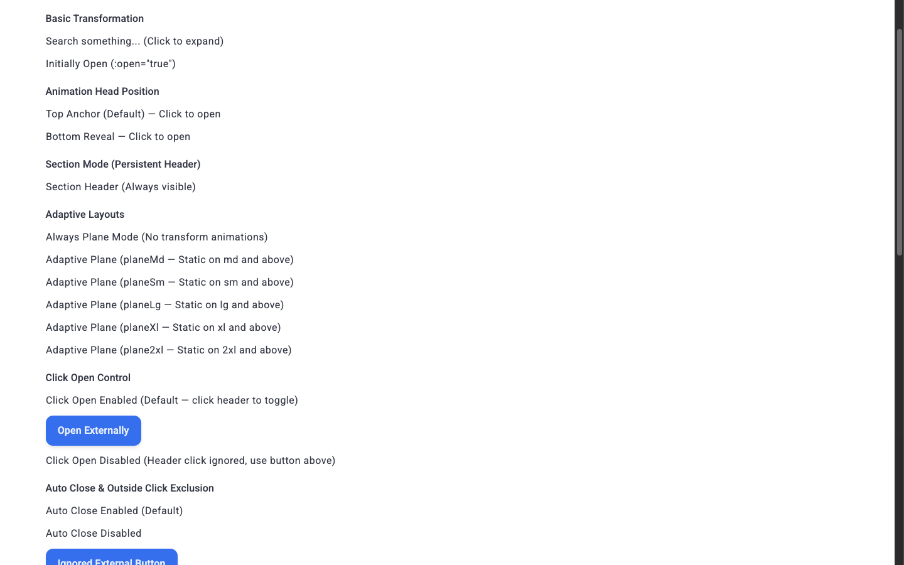
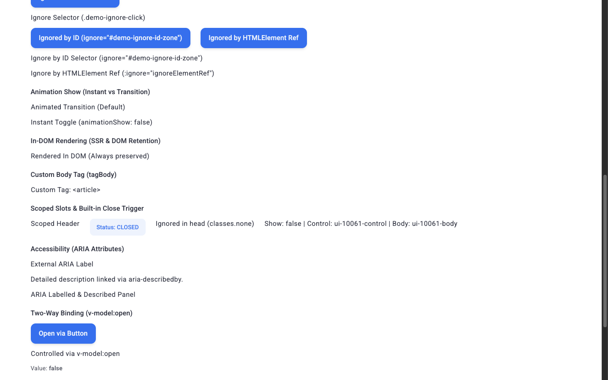
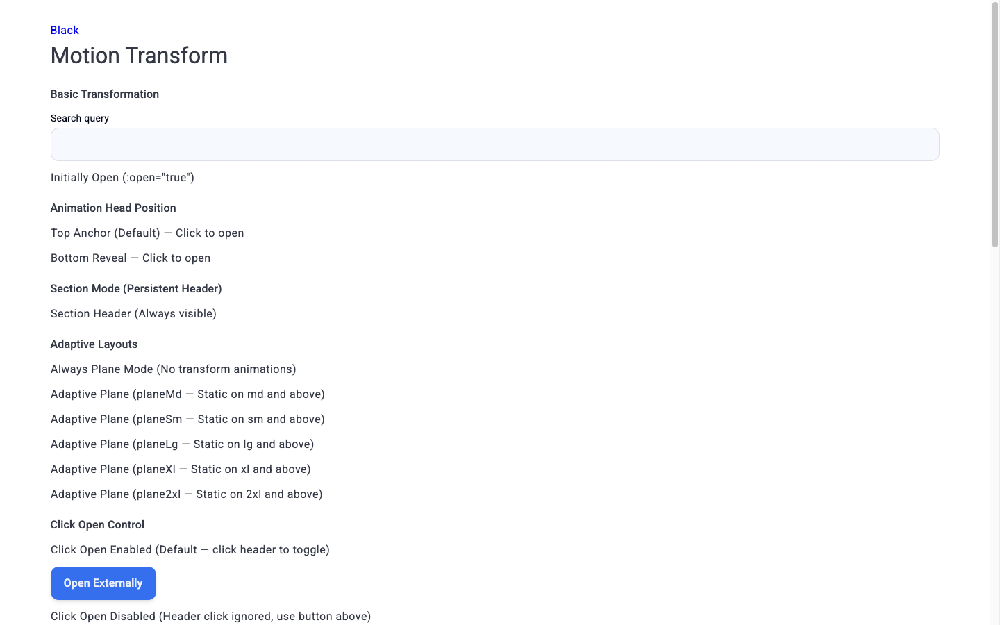
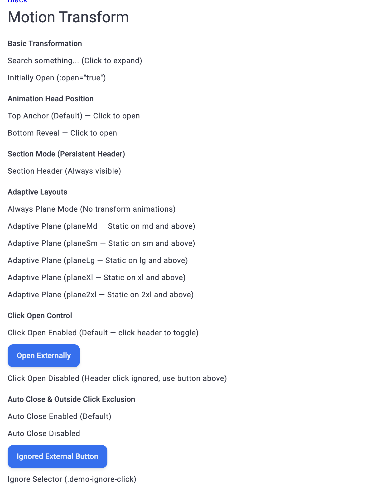
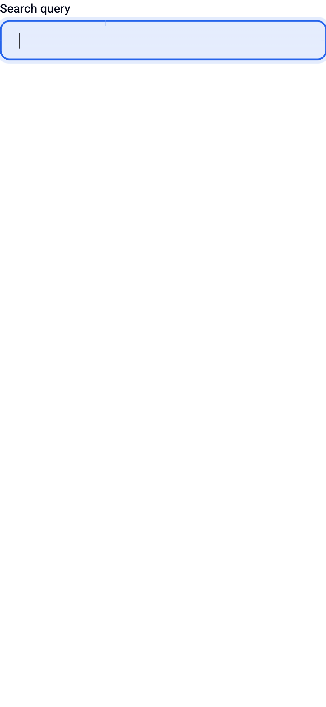

# Отчёт визуального и функционального тестирования: D1MotionTransform

## 1. Сводка выполнения

- **Компонент:** `D1MotionTransform` (`@dxtmisha/d1`)
- **Исходный код:** [`D1MotionTransform`](../../src/components/Ui/MotionTransform)
- **Целевой URL:** `http://localhost:3000/component-motion-transform`
- **Материалы (`materials/`):** `Отсутствуют`
- **Дата тестирования (UTC):** `2026-11-14T17:16:00Z`
- **Окружение:** `Headless Chrome (CDP, Desktop 1440×900, Tablet 768×1024, Mobile 375×812 / 320×568)`
- **Покрытие тест-кейсов:** `17 / 17` (`100%`)
- **Итог:** **17 ✅, 0 ⚠️, 0 ❌** (`✅` пройдено, `⚠️` предупреждение, `❌` ошибка) — компонент `D1MotionTransform` рендерится без визуальных дефектов и переполнений, корректно обрабатывает анимации, зоны исключения, доступность и адаптивные режимы, без единой ошибки консоли или сети.

---

## 2. Матрица результатов

### 2.1 Визуальный рендеринг (`VIS`)

| ID | Сценарий | Статус | Наблюдаемый результат | Скриншот |
| :--- | :--- | :---: | :--- | :--- |
| `TC-VIS-001` | Базовый рендеринг и `:open="true"` | ✅ | `scrollWidth: 1425 <= innerWidth: 1440`, 27 экземпляров; базовый закрыт (`data-open="none"`), `:open="true"` открыт (`data-open="open"`, body в DOM). |  |
| `TC-VIS-002` | `animationHeadPosition` и режим `section` | ✅ | Применены `--animationHeadPosition--top`, `--animationHeadPosition--toBottom` и `--section`; в режиме `section` при открытии заголовок остаётся видимым (`visibility: visible`, `opacity: 1`). |  |
| `TC-VIS-003` | Адаптивные макеты (`planeAlways`..`plane2xl`) | ✅ | Все 6 вариантов (`planeAlways`, `planeSm`, `planeMd`, `planeLg`, `planeXl`, `plane2xl`) имеют корректные классы-модификаторы без визуальных наложений. |  |
| `TC-VIS-004` | Кастомный тег `tagBody="article"` и `in-dom` | ✅ | `.d1-motionTransform__body` рендерится тегом `ARTICLE`; слотовые контролы и текст отображаются ровно и без наложений. |  |

### 2.2 Интерактивность и управление состоянием (`INT`)

| ID | Сценарий | Статус | Наблюдаемый результат | Скриншот |
| :--- | :--- | :---: | :--- | :--- |
| `TC-INT-001` | Переключение по клику на заголовок (`clickOpen: true`) | ✅ | Клик переводит `data-open` в `open`, `aria-expanded` в `true`, открывает `D1Input`; после transition `data-show="none"`, внешний клик закрывает панель. |  |
| `TC-INT-002` | Отключённый клик по заголовку (`clickOpen: false`) | ✅ | Клик по заголовку оставил `data-open="none"`; внешняя кнопка `Open Externally` открыла компонент (`data-open="open"`). |  |
| `TC-INT-003` | Автозакрытие при внешнем клике (`autoClose`) | ✅ | При `autoClose: true` внешний клик закрывает (`none`), при `autoClose: false` панель остаётся `open` и закрывается кнопкой `classes.close`. | — |
| `TC-INT-004` | Зоны игнорирования (`ignore`, `ignoreSelector`) и слоты | ✅ | Клики по `.demo-ignore-click`, `#demo-ignore-id-zone` и `#demo-ignore-ref-zone` сохранили `open`; `classes.none` не открыл панель; `classes.close` закрыл. | — |
| `TC-INT-005` | Двусторонняя `v-model:open` и методы `expose` | ✅ | `v-model:open` синхронно переключает `true`/`false`; `toOpen`, `toClose`, `setOpen(true/false)`, `toggle` корректно обновляют состояние (`isOpen: true, isShow: true`). | — |
| `TC-INT-006` | События (`@update:open`, `@transform`, `@transform-lite`) и `animationShow: false` | ✅ | При `animationShow: false` панель открылась без задержек (`open`); события зафиксированы (`update:open`). | — |

### 2.3 Граничные случаи и устойчивость (`BND`)

| ID | Сценарий | Статус | Наблюдаемый результат | Скриншот |
| :--- | :--- | :---: | :--- | :--- |
| `TC-BND-001` | Быстрые повторные переключения (5× `toggle()` по 30мс) | ✅ | После 5 быстрых кликов состояние стабильно и согласовано: `data-open="open"`, `data-show="none"`, `aria-expanded="true"`, `isOpen: true, isShow: true`. | — |
| `TC-BND-002` | Первичное `:open="true"` (SSR/гидратация) и `in-dom` | ✅ | В закрытом `in-dom` узел `.d1-motionTransform__body` сохранён в DOM (`data-show="none"`); `:open="true"` отрендерен открытым сразу после загрузки. | — |

### 2.4 Адаптивность (`RSP`)

| ID | Сценарий | Статус | Наблюдаемый результат | Скриншот |
| :--- | :--- | :---: | :--- | :--- |
| `TC-RSP-001` | Планшет (`768×1024`) | ✅ | На ширине 768px горизонтальное переполнение отсутствует (`scrollWidth: 768 <= innerWidth: 768`), макет читаемый. |  |
| `TC-RSP-002` | Мобильные экраны (`375×812` и `320×568`) | ✅ | Горизонтального скролла нет (`390 <= 391`, `390 <= 390`); ниже брейкпоинта `planeMd` открытая панель разворачивается в полноэкранном телепортированном окне. |  |

### 2.5 Доступность (`A11Y`)

| ID | Сценарий | Статус | Наблюдаемый результат | Скриншот |
| :--- | :--- | :---: | :--- | :--- |
| `TC-A11Y-001` | Клавиатурное управление (`Tab`, `Enter`, `Escape`) | ✅ | У заголовка `tabindex="0"`, `role="button"`, `aria-controls="ui-10008-body"`; `Enter` открыл панель (`aria-expanded="true"`), `Escape` закрыл (`aria-expanded="false"`). | — |
| `TC-A11Y-002` | Связанные атрибуты `aria-labelledby` и `aria-describedby` | ✅ | На открытом `.d1-motionTransform__body` присутствуют `role="region"`, `aria-labelledby="demo-mt-aria-label"`, `aria-describedby="demo-mt-aria-desc"`, целевые элементы в DOM. | — |

### 2.6 Консоль и runtime (`LOG`)

| ID | Сценарий | Статус | Наблюдаемый результат | Скриншот |
| :--- | :--- | :---: | :--- | :--- |
| `TC-LOG-001` | Чистота консоли, предупреждения Vue и сетевые запросы | ✅ | За весь цикл тестирования: `console`: `[]`, `exceptions`: `[]`, `networkErrors`: `[]`. | — |

---

## 3. Аудит и рекомендации

1. **Контракт `ignore` (строковый селектор vs «голый» `id`):** В `MotionTransformElement.isIgnore` строковое значение `props.ignore` передаётся в `getElementId(this.props.ignore, ' ')`, который ищет элемент через `document.querySelector`. Строки без префикса `#` (например `'demo-ignore-id-zone'`) не сопоставляются по `id`, поэтому в демо и документации важно явно требовать валидный CSS-селектор (`#id`) или `HTMLElement`.
2. **Закрытие при `autoClose: false` вне режима `section`:** В стандартном (не `section`) режиме при открытии `.d1-motionTransform__head` получает `visibility: hidden; position: absolute; opacity: 0`, поэтому при отключённом `autoClose` пользователь может закрыть компонент мышью только через элемент с `classes.close` внутри `#body` (либо клавишей `Escape`). Рекомендуется всегда предусматривать триггер `classes.close` при отключении `autoClose`.
3. **Стабильность анимаций и консоли:** Отмена кадров `requestAnimationFrame` выдержала серию быстрых переключений без рассинхронизации `data-open` / `data-show`, а прогон прошёл без единого `[Vue warn]` или ошибки в сети.
