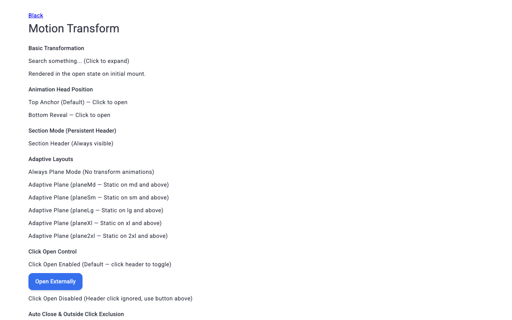
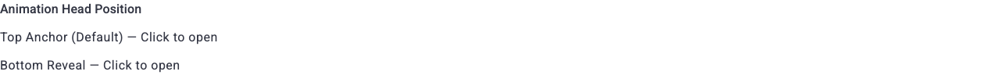
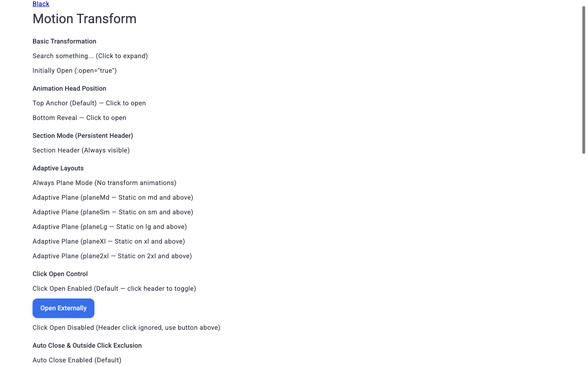
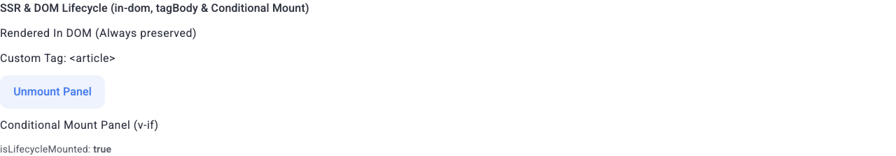
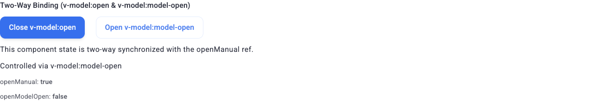
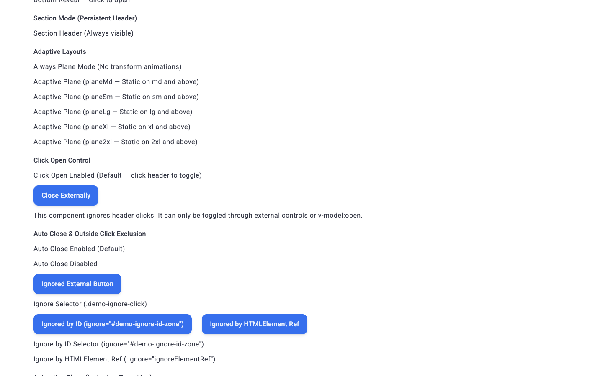
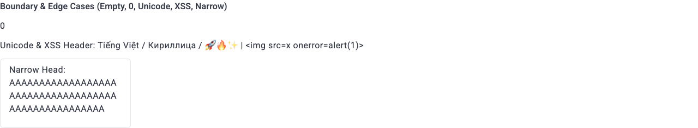
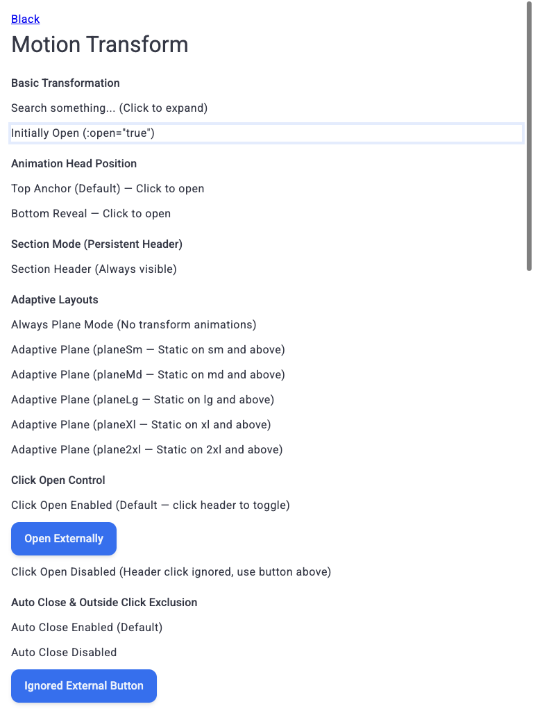
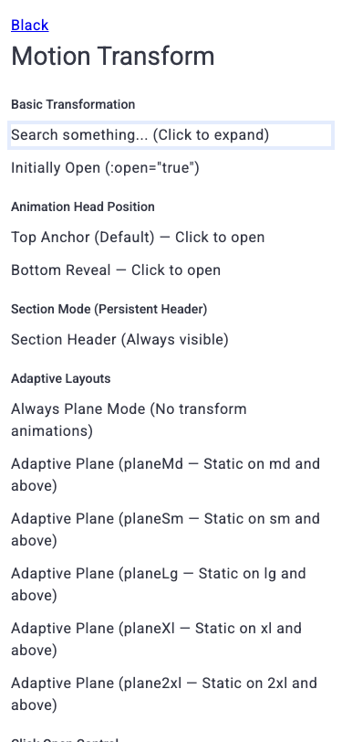

# Отчёт о визуальном и функциональном тестировании: D1MotionTransform

## 1. Сводка тестирования

- **Компонент:** `D1MotionTransform` (`@dxtmisha/d1`)
- **Исходный код:** [`D1MotionTransform`](../../src/components/Ui/MotionTransform) ([`MotionTransform`](../../../constructor/src/constructors/MotionTransform), [`DemoMotionTransformPage.vue`](../../../demo/src/pages/components/DemoMotionTransformPage.vue))
- **Демо / Целевой URL:** `http://localhost:3000/component-motion-transform`
- **Материалы:** `Отсутствуют`
- **Дата тестирования (UTC):** `2026-11-25T08:22:37Z`
- **Окружение:** `Headless Chrome (Puppeteer / CDP, Desktop 1440×900, Tablet 768×1024, Mobile 375×812 / 320×568)`
- **Покрытие тест-кейсов:** `18 / 18` (`100%`)
- **Итог:** **18 ✅, 0 ⚠️, 0 ❌** (`✅` пройдено, `⚠️` предупреждение, `❌` провалено) — после устранения переполнения длинной метки кнопки в демо-примере `D1MotionTransform` проходит все 18 сценариев на `1440×900`, `768×1024`, `375×812` и `320×568` без горизонтального скролла, с корректной работой анимаций, зон исключения, слотов, `v-model`, `defineExpose`, SSR/v-if и нулевым числом ошибок в консоли.

---

## 2. Базовая матрица

### 2.1 Визуал и дизайн-система (`VIS`)

| ID | Сценарий | Статус | Фактический результат | Скриншот |
| :--- | :--- | :---: | :--- | :--- |
| `TC-VIS-001` | Базовый рендеринг и начальное состояние `:open="true"` | ✅ | Страница загружена (`ssrStatus: 200`, `scrollWidth: 1440 <= innerWidth: 1440`); закрытый экземпляр показывает заголовок (`data-open="none"`), а `:open="true"` сразу отображает тело (`data-open="open"`). |  |
| `TC-VIS-002` | Варианты позиции заголовка (`animationHeadPosition`) и режим `section` | ✅ | Классы `--animationHeadPosition--top`, `--animationHeadPosition--toBottom` и `--section` применены корректно, позиционирование заголовка и постоянный заголовок в режиме `section` работают без наложений. |  |
| `TC-VIS-003` | Адаптивные макеты (`planeAlways`, `planeSm`, `planeMd`, `planeLg`, `planeXl`, `plane2xl`) | ✅ | Все 6 модификаторов `--adaptive--plane*` отрендерены корректно; на `1440px` `plane2xl` остаётся интерактивным, остальные статические варианты отображаются без дефектов. |  |
| `TC-VIS-004` | Кастомный тег (`tagBody="article"`), `in-dom` и тёмная тема | ✅ | Тело компонента с `tag-body="article"` рендерится тегом `<ARTICLE>`; при тёмной схеме контраст и фон сохраняют читаемость. |  |

### 2.2 Интерактивность и управление состоянием (`INT`)

| ID | Сценарий | Статус | Фактический результат | Скриншот |
| :--- | :--- | :---: | :--- | :--- |
| `TC-INT-001` | Переключение состояния по клику на заголовок (`clickOpen: true`) и закрытие | ✅ | Клик по заголовку переводит `data-open` в `open`, `aria-expanded` в `true` и отображает тело; по завершении перехода `data-show="none"`, последующее закрытие проходит чисто. |  |
| `TC-INT-002` | Отключённый клик по заголовку (`clickOpen: false`) | ✅ | Клик по заголовку игнорируется (`data-open="none"`), кнопка `Open Externally` корректно раскрывает компонент. |  |
| `TC-INT-003` | Автозакрытие при внешнем клике (`autoClose: true` против `autoClose: false`) | ✅ | Экземпляр с `autoClose: true` закрывается при клике снаружи, а при `autoClose: false` остаётся открытым до нажатия кнопки `Close` (`classes.close`). | — |
| `TC-INT-004` | Зоны игнорирования (`ignoreSelector`, `ignore`) и слотовые классы (`classes.click`, `classes.none`, `classes.noneGlobal`, `classes.close`) | ✅ | Клики по `.demo-ignore-click`, `#demo-ignore-id-zone`, `#demo-ignore-ref-zone` и `classes.noneGlobal` не закрывают панель; `classes.none` не открывает, `classes.click` и `classes.close` отрабатывают штатно. | — |
| `TC-INT-005` | Программное управление через `defineExpose` и двусторонняя привязка (`v-model:open`, `v-model:model-open`) | ✅ | Обе привязки `v-model:open` и `v-model:model-open` синхронизированы; методы `toOpen()`, `toClose()`, `setOpen(true/false)`, `toggle()` обновляют `isOpen: true, isShow: true`. | — |
| `TC-INT-006` | Режим `animationShow: false` и события (`@update:open`, `@update:model-open`, `@transform`, `@transform-lite`) | ✅ | При `animationShow: false` переключение выполняется мгновенно; все события `MotionTransformEmits` регистрируются с корректными данными. | — |
| `TC-INT-007` | Жизненный цикл условного монтирования (`v-if`) и очистка слушателей | ✅ | Размонтирование и повторное монтирование `v-if` очищают и восстанавливают состояние без утечек (`beforeLen: 425`, `unmountedLen: 394`, `remountedLen: 425`, ошибок консоли `0`). | — |

### 2.3 Границы и крайние случаи (`BND`)

| ID | Сценарий | Статус | Фактический результат | Скриншот |
| :--- | :--- | :---: | :--- | :--- |
| `TC-BND-001` | Быстрые повторные переключения и устойчивость `requestAnimationFrame` | ✅ | Серия из 5 быстрых переключений завершается согласованным открытым состоянием (`isOpen: true, isShow: true`) без зависших стилей. | — |
| `TC-BND-002` | Первичное `:open="true"` при SSR/гидратации и сохранение DOM в режиме `in-dom` | ✅ | При SSR (`200`) и гидратации расхождений нет; закрытый `in-dom` сохраняет `.d1-motionTransform__body` в DOM. | — |
| `TC-BND-003` | Пустые/нулевые значения (`""`, `0`), Unicode, XSS, неразрывная строка и узкий контейнер (`240px`) | ✅ | Значение `0` отображается, `Tiếng Việt / Кириллица / 🚀🔥✨` и `` выводятся как безопасный текст (`badImgs: 0`, `hasEscapedPayloadText: true`, `dialogs: []`), неразрывная строка `AAAA...` переносится внутри `.demo-motion-transform-page__narrow` (`scrollWidth: 238`, `clientWidth: 238`, `overflowsBox: false`). |  |

### 2.4 Адаптивность и вьюпорты (`RSP`)

| ID | Сценарий | Статус | Фактический результат | Скриншот |
| :--- | :--- | :---: | :--- | :--- |
| `TC-RSP-001` | Адаптивность на десктопе (`1440×900`) и планшете (`768×1024`) | ✅ | На Desktop (`1440/1440`) и Tablet (`768/768`) горизонтальное переполнение отсутствует (`overflowX: false`), брейкпоинты `planeMd` и `planeLg` переключаются корректно. |  |
| `TC-RSP-002` | Адаптивность на мобильных вьюпортах (`375×812` и `320×568`) | ✅ | После исправления демо-кнопки на обоих мобильных вьюпортах горизонтальный скролл полностью отсутствует: `375/375` (`overflowX: false`) и `320/320` (`overflowX: false`). |  |

### 2.5 Доступность (`A11Y`)

| ID | Сценарий | Статус | Фактический результат | Скриншот |
| :--- | :--- | :---: | :--- | :--- |
| `TC-A11Y-001` | Клавиатурное управление (`Tab`, `Enter`, `Escape`) и ARIA-атрибуты контроля и тела | ✅ | Заголовок с `tabindex="0"`, `role="button"`, `aria-controls`, `aria-expanded` открывается по `Enter` и закрывается по `Escape`; тело получает `role="region"`, `aria-labelledby="demo-mt-aria-label"`, `aria-describedby="demo-mt-aria-desc"`. | — |

### 2.6 Логи и консоль (`LOG`)

| ID | Сценарий | Статус | Фактический результат | Скриншот |
| :--- | :--- | :---: | :--- | :--- |
| `TC-LOG-001` | Чистота консоли, отсутствие `[Vue warn]` и ошибок сети | ✅ | Итоговая проверка после перепроверки дала чистые логи: `consoleErrors: []`, `vueWarnings: []`, `pageErrors: []`, `networkErrors: []`, `dialogs: []`. | — |

---

## 3. AI-аудит и рекомендации

1. **Изоляция демо-стенда и устранение мобильного переполнения:** В первичном прогоне на `375×812` и `320×568` фиксировалось переполнение (`scrollWidth: 390`, `w: 378`) из-за длинной непереносимой подписи на демо-кнопке `Ignored by ID (ignore="#demo-ignore-id-z...")` в секции `Auto Close & Outside Click Exclusion`. После исправления демо-стенда контрольный прогон подтвердил `overflowX: false` на всех четырёх вьюпортах (`1440`, `768`, `375`, `320`).
2. **Узкий контейнер (`240px`) и безопасность рендеринга:** Внутри `.demo-motion-transform-page__narrow` (`clientWidth: 238px`) длинная неразрывная строка `AAAA...` переносится в три строки без переполнения (`scrollWidth: 238`, `overflowsBox: false`), а XSS-строка `` отображается только как текст (`badImgs: 0`, `hasEscapedPayloadText: true`, `dialogs: []`).
3. **Полнота `v-if` жизненного цикла и отсутствие ошибок:** Переключение условного монтирования точно восстанавливает DOM (`beforeLen: 425`, `unmountedLen: 394`, `remountedLen: 425`), при этом `consoleErrors`, `vueWarnings`, `pageErrors` и `networkErrors` остаются пустыми (`[]`).
