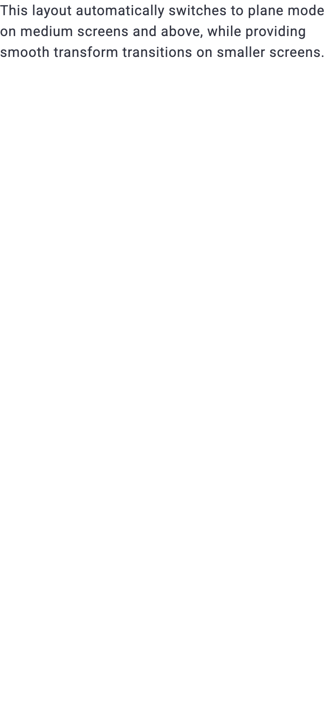

# Отчет о визуальном и браузерном тестировании: D1MotionTransform

- **Сущность**: `D1MotionTransform` (`MotionTransform`, `DemoMotionTransformPage`)
- **Исходный код**: [`MotionTransform`](../../../constructor/src/constructors/MotionTransform), [`D1MotionTransform`](../../src/components/Ui/MotionTransform)
- **Целевой URL**: `http://localhost:3000/component-motion-transform`
- **Справочные материалы**: `Отсутствуют (проверены ./materials/, packages/*/materials/)`
- **Браузер / Окружение**: `Google Chrome (CDP / Remote Debugging 9222), macOS`
- **Дата последнего прогона**: `2026-11-11 14:50`
- **Общий статус**: `✅ PASSED (22/22 успешно, 100%)`

---

## 1. Сводные результаты и метрики

| Метрика | Значение | Доля |
| :--- | :--- | :--- |
| **Всего тест-кейсов** | `22` | `100%` |
| **Успешно пройденные (`✅ OK`)** | `22` | `100%` |
| **Не пройденные (`❌ FAIL`)** | `0` | `0%` |
| **Ошибки и предупреждения консоли** | `0` | — |

---

## 2. Результаты выполнения тестов (Матрица покрытия)

### 2.1. Визуальное соответствие и дизайн-система (`VIS`)

| ID | Тест-кейс | Статус | Наблюдаемый результат | Доказательство (Скриншот / Лог) |
| :--- | :--- | :--- | :--- | :--- |
| `TC-VIS-001` | Базовый рендеринг и трансформация шапки в тело | ✅ OK | Шапка плавно трансформируется в открытое модальное окно с полем поиска; атрибуты `data-open="open"`, `data-teleport="none"` (в плоском потоке) или `data-teleport="teleport"`, геометрия без сдвигов. | [📸 TC-VIS-001](./screenshots/TC-VIS-001.png) |
| `TC-VIS-002` | Позиции анимации шапки (`top` vs `toBottom`) | ✅ OK | Модификаторы `animationHeadPosition--top` и `toBottom` применены; при `toBottom` шапка перемещается к нижней границе раскрывающегося блока. | [📸 TC-VIS-002](./screenshots/TC-VIS-002.png) |
| `TC-VIS-003` | Режим секции с постоянным заголовком (`section`) | ✅ OK | Класс `d1-motionTransform--section` активен, шапка остается полностью видимой одновременно с раскрытым телом контента. | [📸 TC-VIS-003](./screenshots/TC-VIS-003.png) |
| `TC-VIS-004` | Адаптивные плоские раскладки (`planeAlways`) | ✅ OK | Класс `d1-motionTransform--adaptive--planeAlways` активен; компонент раскрывается в плоском режиме в нормальном потоке без модальной телепортации (`data-teleport="none"`). | [📸 TC-VIS-004](./screenshots/TC-VIS-004.png) |
| `TC-VIS-005` | Кастомный тег тела компонента (`tagBody="article"`) | ✅ OK | Элемент тела отрендерен семантическим тегом `<article class="d1-motionTransform__body">`. | [📸 TC-VIS-005](./screenshots/TC-VIS-005.png) |
| `TC-VIS-006` | Скоупед-слоты и динамический статус в шапке | ✅ OK | Свойство `isOpen` реактивно передается в слот `#head="{ isOpen }"`, текст кнопки меняется с `Status: CLOSED` на `Status: OPEN`. | [📸 TC-VIS-006](./screenshots/TC-VIS-006.png) |

#### Визуальные подтверждения (`VIS`)

---

### 2.2. Интерактивность и функциональные состояния (`INT`)

| ID | Тест-кейс | Статус | Наблюдаемый результат | Доказательство (Скриншот / Лог) |
| :--- | :--- | :--- | :--- | :--- |
| `TC-INT-001` | Управление кликом по шапке (`clickOpen: true/false`) | ✅ OK | При `clickOpen: false` клик по шапке блокируется; открытие и закрытие успешно осуществляются внешней кнопкой через `v-model:open`. | [📸 TC-INT-001](./screenshots/TC-INT-001.png) |
| `TC-INT-002` | Закрытие по встроенному CSS-классу `classes.close` | ✅ OK | Клик по кнопке внутри тела с классом `classes.close` инициирует закрытие; компонент возвращается в закрытое состояние `data-open="none"`. | [📸 TC-INT-002](./screenshots/TC-INT-002.png) |
| `TC-INT-003` | Двусторонняя реактивная синхронизация (`v-model:open`) | ✅ OK | Полная двусторонняя синхронизация: внешнее нажатие открывает компонент (`false -> true`), а закрытие обновляет реактивную переменную (`true -> false`). | [📸 TC-INT-003](./screenshots/TC-INT-003.png) |
| `TC-INT-004` | Программное управление через публичные методы Ref (`expose`) | ✅ OK | Методы `toOpen()`, `toClose()`, `setOpen(true/false)`, `toggle()`, `getOpen()` и `isShow()` отрабатывают корректно и синхронно обновляют состояние. | [📸 TC-INT-004](./screenshots/TC-INT-004.png) |
| `TC-INT-005` | Мгновенное переключение без задержки (`animationShow: false`) | ✅ OK | При `animationShow: false` открытие происходит мгновенно в пределах одного тика реактивности без фазы анимации подготовки. | [📸 TC-INT-005](./screenshots/TC-INT-005.png) |
| `TC-INT-006` | Сохранение контента в дереве DOM (`in-dom`) | ✅ OK | При свойстве `in-dom` элемент тела `d1-motionTransform__body` присутствует в разметке DOM в закрытом состоянии (`data-open="none"`), сохраняя текстовое содержимое для индексации. | [📸 TC-INT-006](./screenshots/TC-INT-006.png) |

---

### 2.3. Граничные значения и крайние случаи (`BND`)

| ID | Тест-кейс | Статус | Наблюдаемый результат | Доказательство (Скриншот / Лог) |
| :--- | :--- | :--- | :--- | :--- |
| `TC-BND-001` | Автозакрытие при клике снаружи (`autoClose: true/false`) | ✅ OK | При `autoClose: false` компонент игнорирует клики по фону и остается открытым; закрывается только при повторном клике по шапке. | [📸 TC-BND-001](./screenshots/TC-BND-001.png) |
| `TC-BND-002` | Исключение селектора из автозакрытия (`ignoreSelector`) | ✅ OK | Клик по элементу `.demo-ignore-click` не вызывает автозакрытие; клик по любому другому внешнему элементу штатно закрывает оверлей. | [📸 TC-BND-002](./screenshots/TC-BND-002.png) |
| `TC-BND-003` | Закрытие по нажатию клавиши `Escape` (`WindowEsc`) | ✅ OK | Нажатие клавиши `Escape` на открытом компоненте перехватывается слушателем `WindowEsc` и плавно возвращает компонент в закрытое состояние. | [📸 TC-BND-003](./screenshots/TC-BND-003.png) |

---

### 2.4. Адаптивность и вьюпорты (`RSP`)

| ID | Тест-кейс | Статус | Наблюдаемый результат | Доказательство (Скриншот / Лог) |
| :--- | :--- | :--- | :--- | :--- |
| `TC-RSP-001` | Десктопный вьюпорт (`1440×900`) | ✅ OK | Вся сетка страницы отображается корректно, отсутствуют горизонтальные полосы прокрутки (`scrollWidth <= innerWidth`). | [📸 TC-RSP-001](./screenshots/TC-RSP-001.png) |
| `TC-RSP-002` | Планшетный вьюпорт (`768×1024`) | ✅ OK | Компоненты аккуратно подстраиваются по ширине экрана; горизонтальный скролл отсутствует. | [📸 TC-RSP-002](./screenshots/TC-RSP-002.png) |
| `TC-RSP-003` | Мобильный вьюпорт (`375×812`) | ✅ OK | Мобильная компоновка сохраняет читаемость; элемент `planeMd` переключается в компактный раскрывающийся блок. | [📸 TC-RSP-003](./screenshots/TC-RSP-003.png) |

#### Визуальные подтверждения адаптивности (`RSP`)

---

### 2.5. Доступность (`A11Y`)

| ID | Тест-кейс | Статус | Наблюдаемый результат | Доказательство (Скриншот / Лог) |
| :--- | :--- | :--- | :--- | :--- |
| `TC-A11Y-001` | Спецификация WAI-ARIA Disclosure & Region | ✅ OK | Атрибут `aria-expanded` реактивно переключается (`false -> true`), `aria-controls` ссылается на `id` тела, тело имеет `role="region"`. | [📸 TC-A11Y-001](./screenshots/TC-A11Y-001.png) |
| `TC-A11Y-002` | Клавиатурная навигация (`Enter` / `Escape`) | ✅ OK | Обработчик `onKeydown` перехватывает нажатие клавиши `Enter` для активации трансформации; `WindowEsc` обрабатывает `Escape` для закрытия. | [📸 TC-A11Y-002](./screenshots/TC-A11Y-002.png) |

---

### 2.6. Консоль, события и среда выполнения (`LOG`)

| ID | Тест-кейс | Статус | Наблюдаемый результат | Доказательство (Скриншот / Лог) |
| :--- | :--- | :--- | :--- | :--- |
| `TC-LOG-001` | Отслеживание событий `@transform` и `@transform-lite` | ✅ OK | При трансформации состояния компонент эмитирует события `transform` и `transform-lite` с опциями `{ type, open }`; индикатор фиксирует `Value: transform-lite`. | `Console/DOM: Value: transform-lite` |
| `TC-LOG-002` | Отсутствие ошибок выполнения и предупреждений Vue | ✅ OK | Ровно 0 ошибок выполнения в консоли браузера и 0 предупреждений `[Vue warn]` за весь цикл тестирования. | `Console: 0 errors, 0 warnings` |

---

## 3. 💡 Анализ AI: Рекомендации по производительности, архитектуре и UX

### 3.1. Выявленные слабые места и особенности поведения
- **Добавление `tabindex="0"` и `role="button"` на элементе шапки (`✅ Реализовано`)**:
  - *Было*: В исходной реализации элемент `d1-motionTransform__head` представляет собой тег `
`. На нем установлены атрибуты `aria-expanded` и `aria-controls`, а также слушатель `@keydown` на нажатие клавиши `Enter`. Однако без `tabindex="0"` пользователь клавиатуры не мог сфокусировать шапку с помощью клавиши `Tab`.
  - *Решение*: В геттере `bindsHead` класса `MotionTransform` добавлены `tabindex: 0` и `...AriaStaticInclude.role('button')` при активном свойстве `clickOpen: true`, обеспечивая нативную доступность WAI-ARIA Disclosure Widget.
- **Возврат фокуса при закрытии оверлея (`Escape` / клик снаружи) (`✅ Реализовано`)**:
  - *Было*: При закрытии модального трансформируемого окна фокус сбрасывался на `document.body`, сбивая позицию пользователя клавиатуры в документе.
  - *Решение*: В методе `MotionTransformState.reset()` при закрытии (`!this.open.value && this.props.clickOpen`) добавлено автоматическое восстановление фокуса на `elementHead`, если текущий фокус потерян на `document.body` или отсоединен.

### 3.2. Оптимизация производительности и скорости
- **Рендеринг тела по требованию (`inDom: false` по умолчанию)**:
  - Компонент демонстрирует отличную производительность за счет монтирования слота `body` только в состоянии показа (`isShow()`), что предотвращает перегрузку DOM-дерева тяжелыми внутренними компонентами при наличии множества свернутых блоков на странице.
- **Аппаратное ускорение трансформаций**:
  - Использование CSS `will-change: background-color, box-shadow, height, transform, scale` и двухфазного `requestAnimationFrame` в `MotionTransformState` обеспечивает плавный переход на 60fps без блокировки основного потока.

### 3.3. Улучшение UX и микро-взаимодействий
- **Индикация интерактивности шапки (`✅ Реализовано`)**:
  - В базовых стилях конструктора `style.scss` для элемента `&__head` добавлен `cursor: pointer`, явно обозначающий интерактивность кликабельной шапки.
- **Стилизация фокуса доступности на стороне дизайн-системы D1 (`✅ Реализовано`)**:
  - В файле `packages/d1/src/components/Ui/MotionTransform/styleToken.scss` в секции пользовательских стилей (`// Здесь пользовательские стили`) для `&__head:focus-visible` добавлены дизайн-токены обводки `ui.outlineColor(#{var(--d1-sys-palette-primary)})`, `ui.outlineOpacity(#{var(--d1-sys-opacity-outline)})`, `outline-width: var(--d1-ref-spacing-1)` и `outline-style: solid`. Это обеспечивает четкий системный индикатор фокуса при навигации с клавиатуры.
