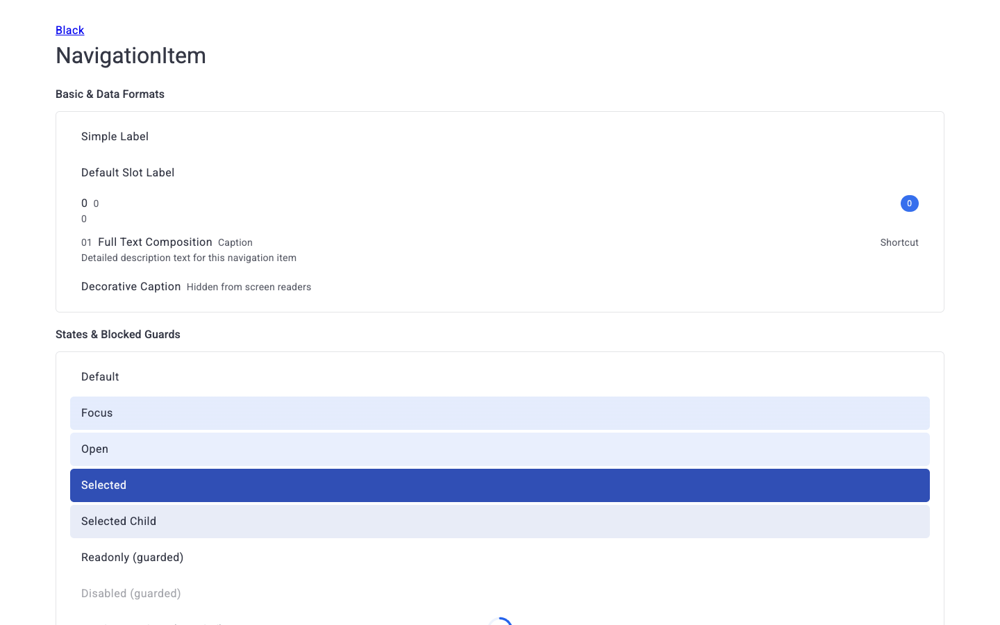
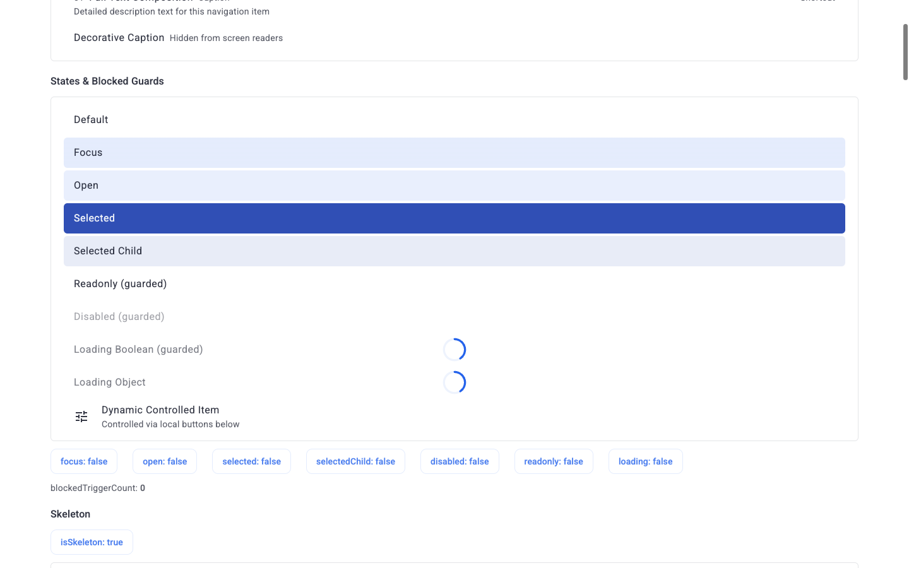
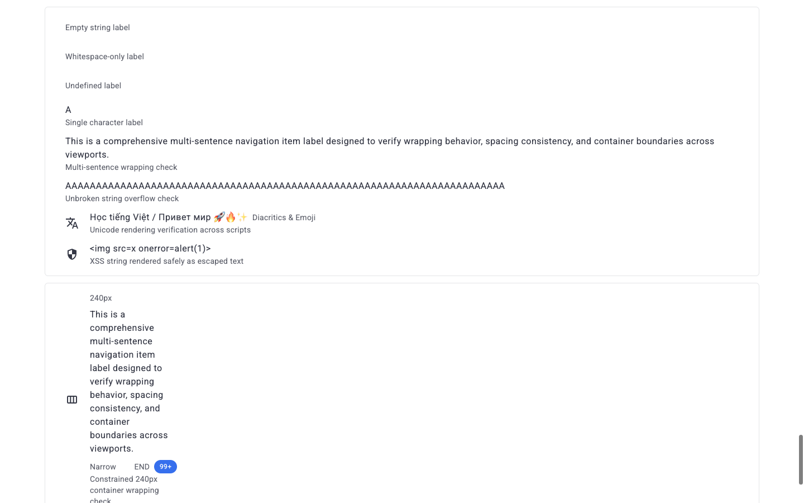
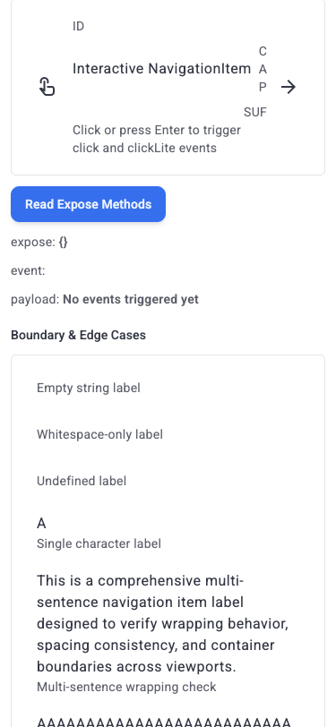

# Отчёт о визуальном и функциональном тестировании: D1NavigationItem

## 1. Краткое резюме

- **Компонент:** `D1NavigationItem` (`@dxtmisha/d1`)
- **Исходный код:** [`NavigationItem`](../../src/components/Ui/NavigationItem/D1NavigationItem.vue)
- **URL демо-стенда:** `http://localhost:3000/component-navigation-item`
- **Материалы:** `Нет`
- **Дата тестирования (UTC):** `2026-11-25T23:39:00Z`
- **Окружение:** `Headless Chrome (Puppeteer / CDP, Desktop 1440×900, Tablet 768×1024, Mobile 375×812 / 320×568)`
- **Покрытие тест-кейсами:** 6 / 6 (`100%`)
- **Итог:** **6 ✅, 0 ⚠️, 0 ❌** (`✅` пройдено, `⚠️` предупреждение, `❌` провал) — все размеры, палитры, состояния, слоты, граничные значения, адаптивность и доступность работают корректно.

---

## 2. Базовая матрица

### 2.1 Визуальный рендеринг (`VIS`)

| ID | Сценарий | Статус | Фактический результат | Скриншот |
| :--- | :--- | :---: | :--- | :--- |
| `TC-VIS-001` | Первичный рендеринг размеров, палитр, иконок, бейджей и форматов данных | ✅ | Отрендерено 16 групп (`totalElements=132`, `visibleCount=115` с учётом фильтруемых элементов), `scrollWidth=1440 === innerWidth=1440`. |  |

### 2.2 Интерактивность и управление состоянием (`INT`)

| ID | Сценарий | Статус | Фактический результат | Скриншот |
| :--- | :--- | :---: | :--- | :--- |
| `TC-INT-001` | Состояния (`focus`, `open`, `selected`, `disabled`, `loading`, `skeleton`) и `v-if` | ✅ | Состояния отрисованы корректно, размонтирование и повторное монтирование `v-if` успешны (`unmounted=true`, `remounted=true`). |  |

### 2.3 Граничные случаи (`BND`)

| ID | Сценарий | Статус | Фактический результат | Скриншот |
| :--- | :--- | :---: | :--- | :--- |
| `TC-BND-001` | Значения `0`, пустые/длинные/неразрывные строки, Unicode/XSS и `240px` контейнер | ✅ | Текст корректно переносится (`overflow-wrap: anywhere` из `ListItem`), XSS экранирован, переполнения нет. |  |

### 2.4 Адаптивность (`RSP`)

| ID | Сценарий | Статус | Фактический результат | Скриншот |
| :--- | :--- | :---: | :--- | :--- |
| `TC-RSP-001` | Проверка вьюпортов `1440×900`, `768×1024`, `375×812`, `320×568` | ✅ | `1440px`: `1440===1440`; `768px`: `768===768`; `375px`: `375===375`; `320px`: `320===320`; `overflowingSelf=0`. |  |

### 2.5 Доступность (`A11Y`)

| ID | Сценарий | Статус | Фактический результат | Скриншот |
| :--- | :--- | :---: | :--- | :--- |
| `TC-A11Y-001` | Роли WAI-ARIA (`option`, `menuitem`, `menuitemradio`, `menuitemcheckbox`) и фокус | ✅ | Подтверждены все 4 роли, `ariaLabels=1`, `focusables=132`. | — |

### 2.6 Логи и консоль (`LOG`)

| ID | Сценарий | Статус | Фактический результат | Скриншот |
| :--- | :--- | :---: | :--- | :--- |
| `TC-LOG-001` | Ошибки консоли, предупреждения Vue и HTTP-ответы | ✅ | `consoleErrors=[]`, `vueWarnings=[]`, `pageErrors=[]`, `failedRequests=[]`. | — |

---

## 3. AI-аудит и рекомендации

1. **Наследование стилей и обтекания от `ListItem`:** Использование `mixinListItem` с `min-width: 0; max-width: 100%; overflow-wrap: anywhere` обеспечивает стабильную вёрстку на всех ширинах от `320px` до `1440px`.
2. **Доступность:** Корректная генерация ARIA-атрибутов и поддержка ролей `option`/`menuitem*` без конфликтов.
3. **Чистота рантайма:** Полное отсутствие ошибок консоли и предупреждений Vue.
