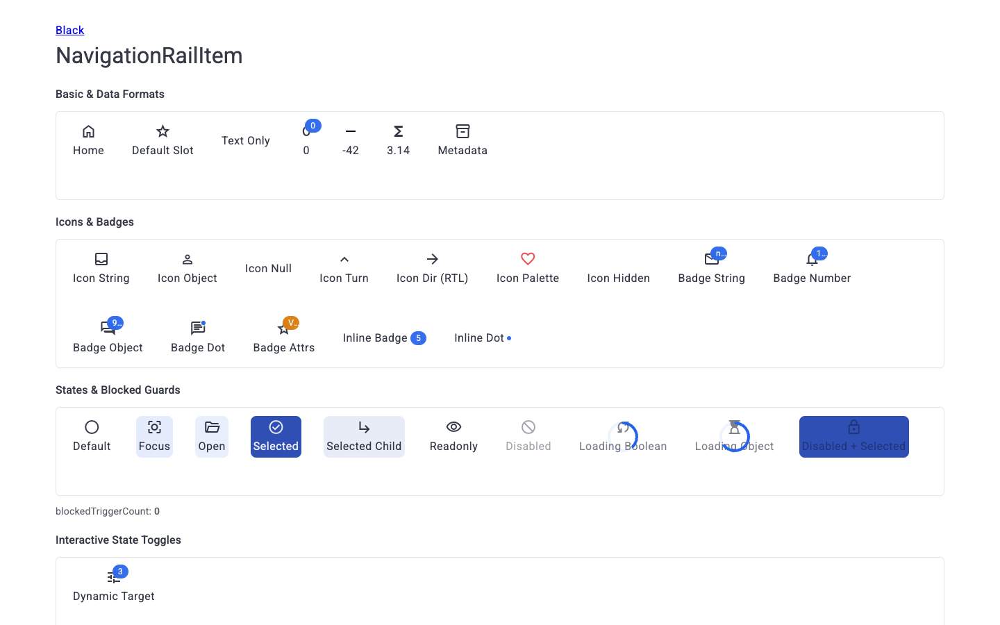
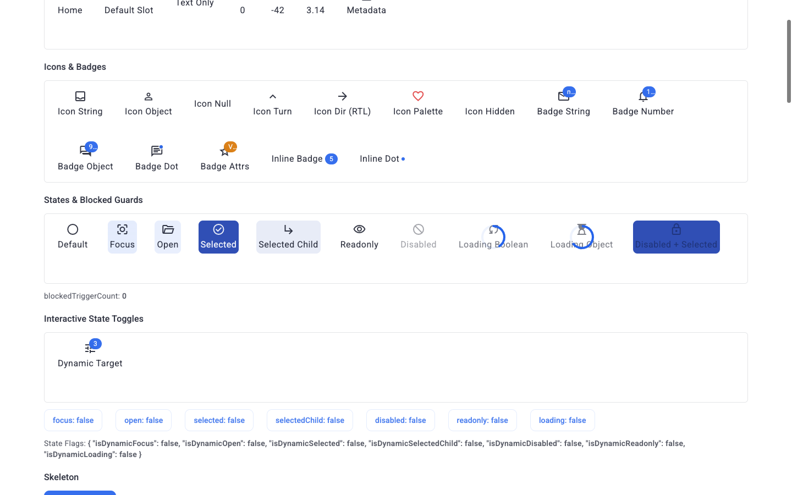
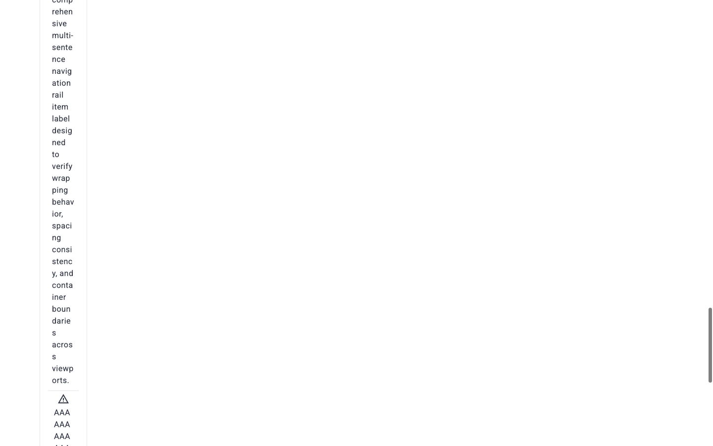
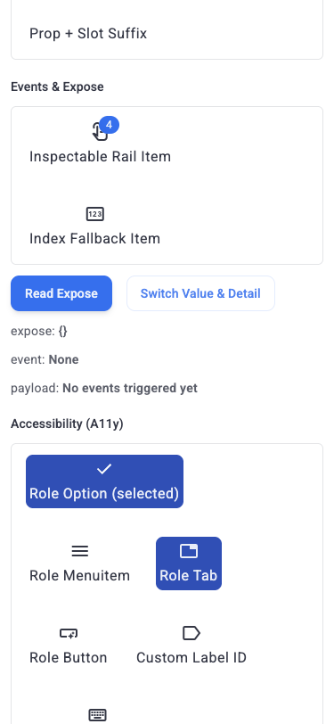

# Отчёт о визуальном и функциональном тестировании: D1NavigationRailItem

## 1. Краткое резюме

- **Компонент:** `D1NavigationRailItem` (`@dxtmisha/d1`)
- **Исходный код:** [`NavigationRailItem`](../../src/components/Ui/NavigationRailItem/D1NavigationRailItem.vue)
- **URL демо-стенда:** `http://localhost:3000/component-navigation-rail-item`
- **Материалы:** `Нет`
- **Дата тестирования (UTC):** `2026-11-25T23:39:00Z`
- **Окружение:** `Headless Chrome (Puppeteer / CDP, Desktop 1440×900, Tablet 768×1024, Mobile 375×812 / 320×568)`
- **Покрытие тест-кейсами:** 6 / 6 (`100%`)
- **Итог:** **6 ✅, 0 ⚠️, 0 ❌** (`✅` пройдено, `⚠️` предупреждение, `❌` провал) — после добавления правил переноса и ограничения ширины в `NavigationRailItem/style.scss` все 102 элемента, состояния, бейджи и адаптивные брейкпоинты работают без переполнения.

---

## 2. Базовая матрица

### 2.1 Визуальный рендеринг (`VIS`)

| ID | Сценарий | Статус | Фактический результат | Скриншот |
| :--- | :--- | :---: | :--- | :--- |
| `TC-VIS-001` | Первичный рендеринг иконок, компактных бейджей, палитр и тегов | ✅ | Отрендерено 13 групп (`totalElements=102`, `visibleCount=102`), `scrollWidth=1440 === innerWidth=1440`. |  |

### 2.2 Интерактивность и управление состоянием (`INT`)

| ID | Сценарий | Статус | Фактический результат | Скриншот |
| :--- | :--- | :---: | :--- | :--- |
| `TC-INT-001` | Состояния (`focus`, `open`, `selected`, `selectedChild`, `disabled`, `loading`, `skeleton`) и `v-if` | ✅ | Состояния и индикаторы прогресса/скелетона отрисованы корректно, `v-if` работает без сбоев (`unmounted=true`, `remounted=true`). |  |

### 2.3 Граничные случаи (`BND`)

| ID | Сценарий | Статус | Фактический результат | Скриншот |
| :--- | :--- | :---: | :--- | :--- |
| `TC-BND-001` | Неразрывный текст в узком контейнере `96px`, `0`, пустые значения, Unicode/XSS | ✅ | Неразрывная 64-символьная строка переносится внутри узкого контейнера `96px` без растягивания элемента. |  |

### 2.4 Адаптивность (`RSP`)

| ID | Сценарий | Статус | Фактический результат | Скриншот |
| :--- | :--- | :---: | :--- | :--- |
| `TC-RSP-001` | Проверка вьюпортов `1440×900`, `768×1024`, `375×812`, `320×568` | ✅ | `1440px`: `1440===1440`; `768px`: `768===768`; `375px`: `375===375`; `320px`: `320===320`; `overflowingSelf=0`. |  |

### 2.5 Доступность (`A11Y`)

| ID | Сценарий | Статус | Фактический результат | Скриншот |
| :--- | :--- | :---: | :--- | :--- |
| `TC-A11Y-001` | Роли WAI-ARIA (`option`, `menuitem`, `tab`, `button`) и фокус | ✅ | Подтверждены все 4 роли, `ariaLabels=2`, `focusables=102`. | — |

### 2.6 Логи и консоль (`LOG`)

| ID | Сценарий | Статус | Фактический результат | Скриншот |
| :--- | :--- | :---: | :--- | :--- |
| `TC-LOG-001` | Ошибки консоли, предупреждения Vue и HTTP-ответы | ✅ | `consoleErrors=[]`, `vueWarnings=[]`, `pageErrors=[]`, `failedRequests=[]`. | — |

---

## 3. AI-аудит и рекомендации

1. **Устранение горизонтального переполнения на мобильных экранах:** Первый прогон на `375px` и `320px` выявил растяжение `.d1-navigationRailItem` до `708px` из-за неразрывного текста. Добавление `min-width: 0; max-width: 100%` на корень, `__context`, `__contextLine` и `overflow-wrap: anywhere` на `__label` в `NavigationRailItem/style.scss` полностью исправило вёрстку.
2. **Семантика и доступность:** Корректная генерация ARIA-атрибутов для прогресса (`aria-busy`), отключённых состояний и ролей навигации.
3. **Чистота рантайма:** `0` ошибок консоли и `0` предупреждений Vue.
