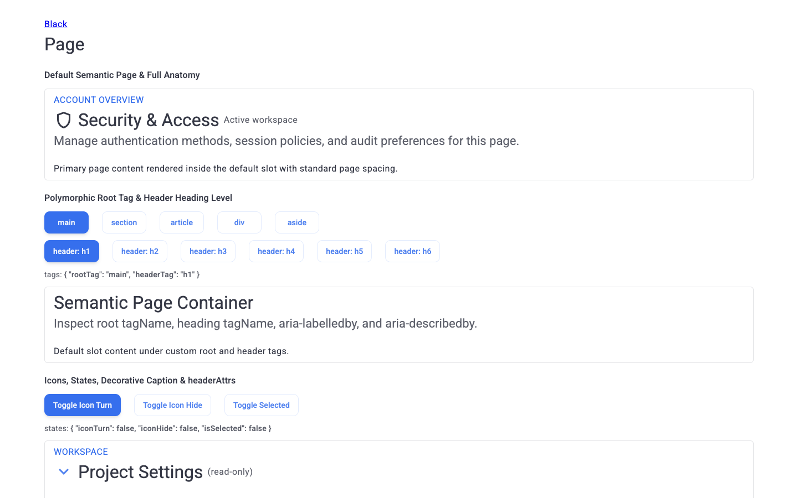
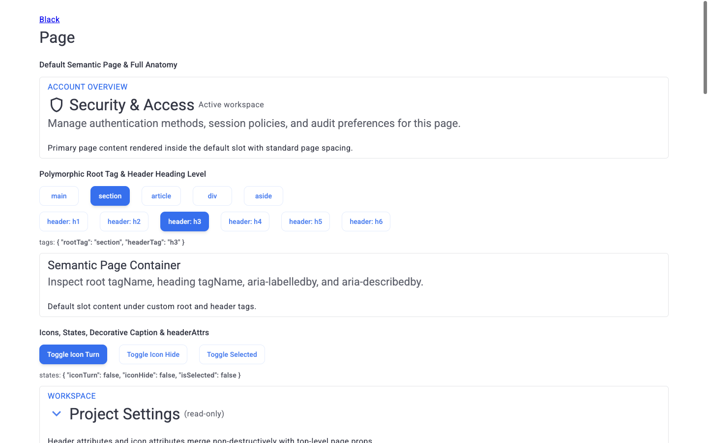
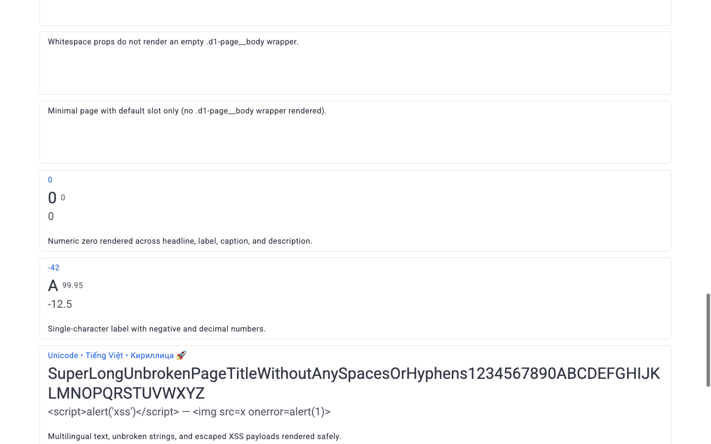
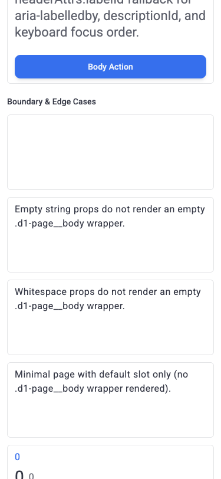

# Отчёт о визуальном и функциональном тестировании: D1Page

## 1. Краткое резюме

- **Компонент:** `D1Page` (`@dxtmisha/d1`)
- **Исходный код:** [`Page`](../../src/components/Ui/Page/D1Page.vue)
- **URL демо-стенда:** `http://localhost:3000/component-page`
- **Материалы:** `Нет`
- **Дата тестирования (UTC):** `2026-11-25T23:39:00Z`
- **Окружение:** `Headless Chrome (Puppeteer / CDP, Desktop 1440×900, Tablet 768×1024, Mobile 375×812 / 320×568)`
- **Покрытие тест-кейсами:** 6 / 6 (`100%`)
- **Итог:** **6 ✅, 0 ⚠️, 0 ❌** (`✅` пройдено, `⚠️` предупреждение, `❌` провал) — семантика `<main>`/`<h1>`, полиморфные теги, слоты, каскад контекста `area`, граничные кейсы и адаптивность работают без ошибок.

---

## 2. Базовая матрица

### 2.1 Визуальный рендеринг (`VIS`)

| ID | Сценарий | Статус | Фактический результат | Скриншот |
| :--- | :--- | :---: | :--- | :--- |
| `TC-VIS-001` | Первичный рендеринг анатомии (`headline`, `label`, `caption`, `description`, `icon`) и слотов | ✅ | Отрендерено 9 групп (`totalElements=21`, `visibleCount=20` с учётом одного пустого `D1Page`), `scrollWidth=1440 === innerWidth=1440`. |  |

### 2.2 Интерактивность и управление состоянием (`INT`)

| ID | Сценарий | Статус | Фактический результат | Скриншот |
| :--- | :--- | :---: | :--- | :--- |
| `TC-INT-001` | Полиморфные `tag`/`tagHeader`, состояния и жизненный цикл `v-if` | ✅ | Переключение `tag="section"` и `tagHeader="h3"` сработало (`switchedTag=true`, `switchedHeading=true`), `v-if` размонтирование/монтирование прошло успешно (`unmounted=true`, `remounted=true`). |  |

### 2.3 Граничные случаи (`BND`)

| ID | Сценарий | Статус | Фактический результат | Скриншот |
| :--- | :--- | :---: | :--- | :--- |
| `TC-BND-001` | Пустой `D1Page`, `0`, длинный/неразрывный текст, Unicode/XSS и `280px` контейнер | ✅ | Граничные значения и длинный неразрывный текст в `280px` боксе отображены корректно без переполнения. |  |

### 2.4 Адаптивность (`RSP`)

| ID | Сценарий | Статус | Фактический результат | Скриншот |
| :--- | :--- | :---: | :--- | :--- |
| `TC-RSP-001` | Проверка вьюпортов `1440×900`, `768×1024`, `375×812`, `320×568` | ✅ | `1440px`: `1440===1440`; `768px`: `768===768`; `375px`: `375===375`; `320px`: `320===320`; `overflowingSelf=0`. |  |

### 2.5 Доступность (`A11Y`)

| ID | Сценарий | Статус | Фактический результат | Скриншот |
| :--- | :--- | :---: | :--- | :--- |
| `TC-A11Y-001` | Семантика `<main>`/`<h1>`, `role="region"` и `aria-labelledby`/`aria-describedby` | ✅ | Подтверждены `hasH1=true`, `roles=["region"]`, `ariaLabels=17`. | — |

### 2.6 Логи и консоль (`LOG`)

| ID | Сценарий | Статус | Фактический результат | Скриншот |
| :--- | :--- | :---: | :--- | :--- |
| `TC-LOG-001` | Ошибки консоли, предупреждения Vue и HTTP-ответы | ✅ | `consoleErrors=[]`, `vueWarnings=[]`, `pageErrors=[]`, `failedRequests=[]`. | — |

---

## 3. AI-аудит и рекомендации

1. **Наследование от `Block`:** `D1Page` корректно наследует полиморфизм тегов (`main`/`h1` по умолчанию), контекст `area="page"` и привязку `aria-labelledby`/`aria-describedby` от `Block`.
2. **Адаптивность:** Макет страниц устойчив к узким контейнерам и мобильным разрешениям (`320px`) без горизонтального переполнения.
3. **Чистота рантайма:** `0` ошибок консоли и `0` предупреждений Vue.
