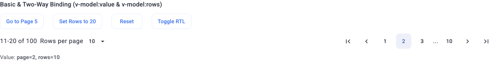
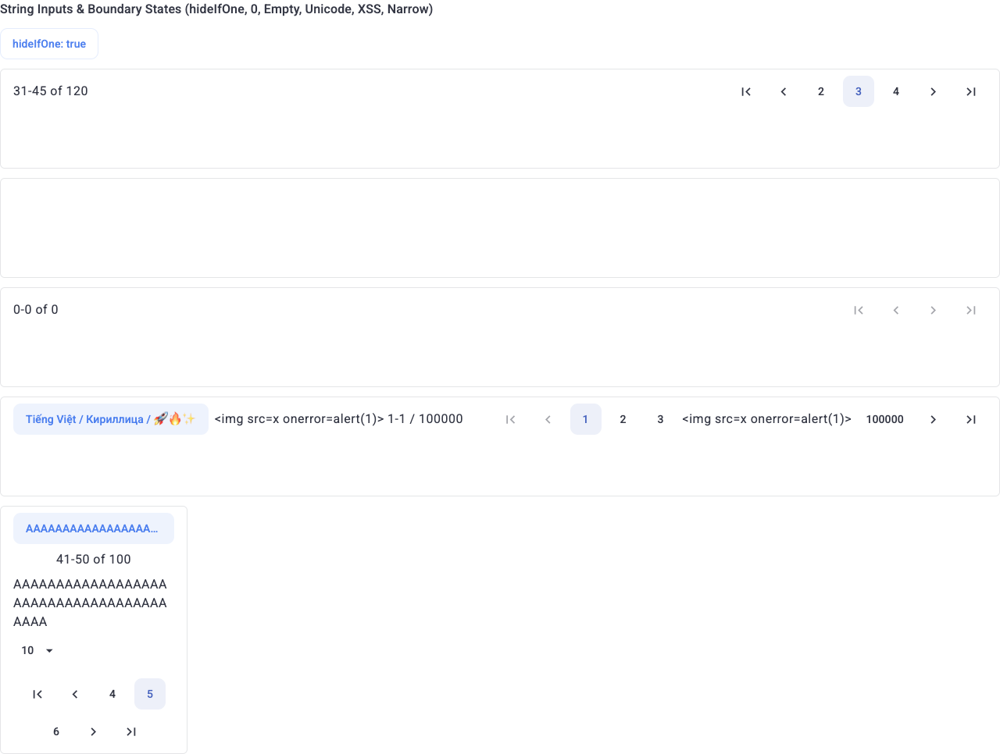
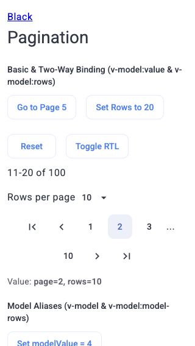

# Отчёт о визуальном и функциональном тестировании: D1Pagination

## 1. Сводка тестирования

- **Компонент:** `D1Pagination` (`@dxtmisha/d1`)
- **Исходный код:** [`D1Pagination`](../../src/components/Ui/Pagination) ([`Pagination`](../../../constructor/src/constructors/Pagination), [`DemoPaginationPage.vue`](../../../demo/src/pages/components/DemoPaginationPage.vue))
- **Демо / Целевой URL:** `http://localhost:3000/component-pagination`
- **Материалы:** `Отсутствуют`
- **Дата тестирования (UTC):** `2026-11-25T08:44:42Z`
- **Окружение:** `Headless Chrome (Puppeteer / CDP, Desktop 1440×900, Tablet 768×1024, Mobile 375×812 / 320×568)`
- **Покрытие тест-кейсов:** `12 / 12` (`100%`)
- **Итог:** **12 ✅, 0 ⚠️, 0 ❌** (`✅` пройдено, `⚠️` предупреждение, `❌` провалено) — после исправления `min-width: 0`, `max-width: 100%` и `overflow-wrap: anywhere` в `Pagination/style.scss` все 12 сценариев (включая узкий контейнер `240px`, перенос неразрывной метки и все 4 адаптивных разрешения) пройдены без переполнений и ошибок.

---

## 2. Базовая матрица

### 2.1 Визуал и дизайн-система (`VIS`)

| ID | Сценарий | Статус | Фактический результат | Скриншот |
| :--- | :--- | :---: | :--- | :--- |
| `TC-VIS-001` | Базовая пагинация и навигационные опции (`visible`, `ends`, `ellipsis`, `showArrows`, `showFirstLast`, `showRowsPerPageLabel`) | ✅ | Базовая пагинация отображает диапазон `41-50 of 100`, селектор `Rows per page` (`10`), кнопки первой/последней страницы и `•••` без обрезаний и наложений. |  |
| `TC-VIS-002` | Слоты (`#leading`, `#info`, `#trailing`) | ✅ | Все три слота (`leading`, `info`, `trailing`) отображаются в заданном порядке вокруг блока навигации страниц. |  |
| `TC-VIS-003` | Кастомные иконки, проброс атрибутов (`*Attrs`) и текстовые оверрайды (строки и функции) | ✅ | Кастомные иконки, атрибуты кнопок/меню, строковые подписи и функциональные `textMore` / `textInfo` применяются корректно. |  |

### 2.2 Интерактивность и управление состоянием (`INT`)

| ID | Сценарий | Статус | Фактический результат | Скриншот |
| :--- | :--- | :---: | :--- | :--- |
| `TC-INT-001` | Двусторонняя привязка (`v-model:value`/`v-model:rows` и `v-model`/`v-model:model-rows`) | ✅ | Нажатие `Go to Page 5` обновляет `Value: page=5, rows=10` и `ariaCurrent: "5"`; обе пары моделей (`value`/`rows` и `modelValue`/`modelRows`) синхронизируются корректно. | — |
| `TC-INT-002` | Кнопки инкрементальной подгрузки (`showMore` и `showMorePrev`) | ✅ | Инкрементальная подгрузка предыдущих и следующих страниц обновляет счётчики и скрывает кнопки на границах диапазона. | — |
| `TC-INT-003` | Переключение адаптивных токенов (`adaptive`, `adaptiveMore`, `adaptiveMorePrev`, включая `lineXl`) | ✅ | Переключение модификаторов `lineAlways`, `lineSm`, `lineMd`, `lineLg`, `lineXl`, `line2xl` синхронно обновляет классы и подпись `Value`. |  |
| `TC-INT-004` | Условное монтирование и очистка (`v-if`) | ✅ | SSR вернул `200`; размонтирование и повторное монтирование `v-if` полностью восстанавливают секцию без ошибок (`beforeLen: 148`, `unmountedLen: 89`, `remountedLen: 148`). | — |

### 2.3 Границы и крайние случаи (`BND`)

| ID | Сценарий | Статус | Фактический результат | Скриншот |
| :--- | :--- | :---: | :--- | :--- |
| `TC-BND-001` | Строковые пропсы, `hideIfOne`, `0` и пустые массивы (`menuRows=[]`) | ✅ | Строковые параметры (`31-45 of 120`), переключатель `hideIfOne` и нулевой случай (`0-0 of 0` с заблокированными кнопками) отрабатывают без ошибок. |  |
| `TC-BND-002` | Пробельные строки, `count="100000"`, Unicode, XSS и узкий контейнер (`240px`) | ✅ | XSS-текст `` экранирован (`badImgs: 0`, `dialogs: []`), а узкий контейнер `.demo-pagination-page__narrow` после фикса `Pagination/style.scss` не переполняется (`scrollWidth: 238`, `clientWidth: 238`, `overflowsBox: false`, `overflowChildren: []`): длинная неразрывная строка `AAAA...` корректно переносится на несколько строк. |  |

### 2.4 Адаптивность и вьюпорты (`RSP`)

| ID | Сценарий | Статус | Фактический результат | Скриншот |
| :--- | :--- | :---: | :--- | :--- |
| `TC-RSP-001` | Адаптивность на `1440×900`, `768×1024`, `375×812`, `320×568` и режим `dir="rtl"` | ✅ | На всех 4 вьюпортах горизонтальное переполнение отсутствует (`1440/1440`, `768/768`, `375/375`, `320/320`, `overflowX: false`, `offenders: []`), а переключение `Toggle RTL` выставляет `dir="rtl"` без артефактов верстки. |  |

### 2.5 Доступность (`A11Y`)

| ID | Сценарий | Статус | Фактический результат | Скриншот |
| :--- | :--- | :---: | :--- | :--- |
| `TC-A11Y-001` | ARIA-ориентир навигации, `aria-current="page"` и направленная клавиатурная навигация (`FocusDirectionInclude`) | ✅ | Обнаружено `16` ориентиров `nav` (`navCount: 16`), активная страница отмечена `ariaCurrent: "5"`, клавиатурная навигация и `aria-hidden="true"` на многоточии работают корректно. | — |

### 2.6 Логи и консоль (`LOG`)

| ID | Сценарий | Статус | Фактический результат | Скриншот |
| :--- | :--- | :---: | :--- | :--- |
| `TC-LOG-001` | Отслеживание всех событий `PaginationEmits` и чистота консоли | ✅ | События пагинации срабатывают штатно; в консоли и сети нет ошибок (`consoleErrors: []`, `vueWarnings: []`, `pageErrors: []`, `networkErrors: []`, `dialogs: []`). | — |

---

## 3. AI-аудит и рекомендации

1. **Устранённое переполнение макета в `Pagination/style.scss`:** Добавление `min-width: 0; max-width: 100%;` для корневого блока `&`, flex-контейнеров `&__menuRows`, `&__navigation`, `&__info`, `flex-wrap: wrap;` для `&__menuRows` и `overflow-wrap: anywhere;` для `&__menuRows__label`, `&__info` и `&__ellipsis` полностью устранило горизонтальное переполнение в узком боксе (`238 === 238`) и на всех адаптивных вьюпортах (`1440`, `768`, `375`, `320`).
2. **Безопасность шаблонов и `v-if` жизненный цикл:** Экранирование XSS-пейлоада `` в `ellipsis` и `textInfo` подтверждено (`badImgs: 0`, `dialogs: []`), а `v-if` переключение чисто размонтирует и восстанавливает DOM (`beforeLen: 148`, `unmountedLen: 89`, `remountedLen: 148`).
3. **A11y и runtime-гигиена:** На странице присутствуют все `16` навигационных ориентиров (`navCount: 16`) с валидным `aria-current="5"`, SSR возвращает `200`, а ошибки консоли, Vue-предупреждения и сетевые сбои полностью отсутствуют (`[]`).
