# Отчёт о визуальном и браузерном тестировании: D1Progress

- **Сущность**: `D1Progress` (`Progress`, `ProgressDesign`)
- **Исходный код**: [`D1Progress`](../../src/components/Ui/Progress), [`Progress`](../../../constructor/src/constructors/Progress), [`DemoProgressPage.vue`](../../../demo/src/pages/components/DemoProgressPage.vue)
- **Целевой URL**: `http://localhost:3000/component-progress`
- **Проверенные материалы (`materials/`)**: `None`
- **Браузер / Среда**: `Chrome (CDP / DevTools Protocol, port 9222), macOS`
- **Дата последнего прогона**: `2026-11-10 23:21`
- **Общий статус**: `✅ PASSED`

---

## 1. Итоговая сводка и метрики

| Метрика | Количество | Доля |
| :--- | :--- | :--- |
| **Всего тест-кейсов** | `20` | `100%` |
| **Успешно (`✅ OK`)** | `20` | `100%` |
| **Провалено (`❌ FAIL`)** | `0` | `0%` |
| **Ошибки / Предупреждения консоли Vue** | `0` | — |

---

## 2. Результаты выполнения тестов (Базовая матрица)

### 2.1. Визуальное отображение и дизайн-система (`VIS`)

| ID | Тест-кейс | Статус | Наблюдаемый результат | Доказательство (Скриншот / Консоль) |
| :--- | :--- | :--- | :--- | :--- |
| `TC-VIS-001` | Отрисовка линейного прогресс-бара (`linear`) в детерминированном и неопределённом режимах | ✅ OK | Все 6 индикаторов рендерятся как `div.d1-progress.d1-progress--linear` (`193×4px`); для `value` `25`/`50`/`75` `--d1-progress-sys-value` равен `75%`/`50%`/`25%` (`::before right`: `144.99px`/`96.66px`/`48.33px`); для `type1`–`type3` активны анимации `d1-progress-linear-type1..4`. | [📸 TC-VIS-001](./screenshots/TC-VIS-001.png) |
| `TC-VIS-002` | Отрисовка кругового индикатора (`circular`) в детерминированном и неопределённом режимах | ✅ OK | Корневой элемент `<svg viewBox="0 0 48 48">` (`48×48px`) содержит 2 элемента `<circle>` (`stroke-width: 4px`); для `value` `30`/`60`/`90` `stroke-dasharray` равен `37.70px`/`75.40px`/`113.10px` из `125.66px`; в `type1`–`type3` работают круговые анимации. | [📸 TC-VIS-002](./screenshots/TC-VIS-002.png) |
| `TC-VIS-003` | Отрисовка точечного индикатора (`point` + `linear`) и условия рендера `.d1-progress__point` | ✅ OK | Класс `d1-progress--point` и дочерний `` (`4×4px`) рендерятся на всех 4 элементах секции `Mode: Point` (`value="25"`, `value="75"`, `indeterminate="type1"` и `inverse` + `indeterminate="type1"`). | [📸 TC-VIS-003](./screenshots/TC-VIS-003.png) |
| `TC-VIS-004` | Позиционирование прогресс-бара (`position`: `top`, `bottom`, `static`) | ✅ OK | `top` и `bottom` рендерятся с `position: absolute` (`top: 0px` и `bottom: 0px` относительно контейнера), `static` — с `position: relative` в потоке документа без перекрытия подписей (`overlapsLabel: false`). | [📸 TC-VIS-004](./screenshots/TC-VIS-004.png) |
| `TC-VIS-005` | Проверка размерной сетки (`size`: `sm`, `md`, `lg`) для линейного и кругового режимов | ✅ OK | Токен `--d1-progress-height` корректно управляет высотой линейной полосы и `stroke-width` кругового SVG: `sm` = `2px`, `md` = `4px` (`.25rem`), `lg` = `8px` (`.5rem`). | [📸 TC-VIS-005](./screenshots/TC-VIS-005.png) |
| `TC-VIS-006` | Проверка цветовых палитр (`palette`) | ✅ OK | Классы `d1-palette d1-palette--<color>` корректно задают цвета заполнения и подложки (`rgba(..., 0.08)`): `red` (`rgb(220, 38, 38)`), `green` (`rgb(22, 163, 74)`), `blue` (`rgb(37, 99, 235)`), `orange` (`rgb(234, 88, 12)`), `purple` (`rgb(147, 51, 234)`), `amber` (`rgb(217, 119, 6)`). | [📸 TC-VIS-006](./screenshots/TC-VIS-006.png) |
| `TC-VIS-007` | Проверка модификаторов `inverse` и `dense` в секции `States & Options` | ✅ OK | Модификатор `inverse` переключает палитру на `--sys-color`, модификатор `dense` на круговом индикаторе устанавливает `--d1-progress-inset: 0px` (против `.25rem` по умолчанию). | [📸 TC-VIS-007](./screenshots/TC-VIS-007.png) |

#### Визуальные превью (`VIS`)
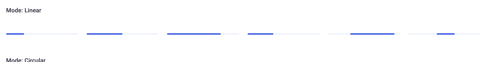
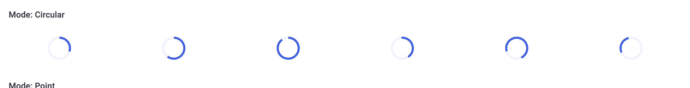
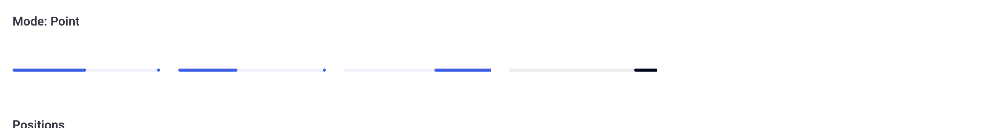
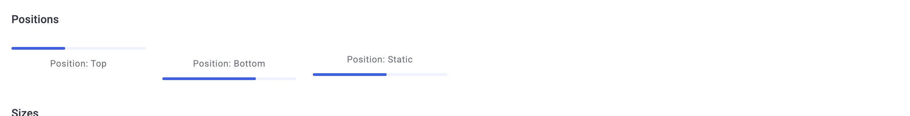
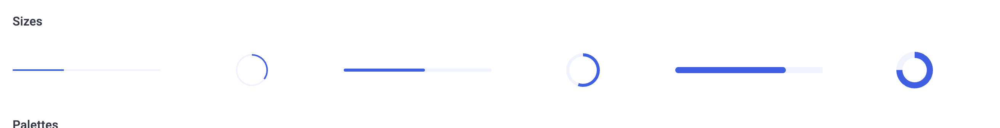
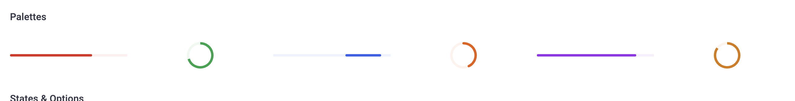
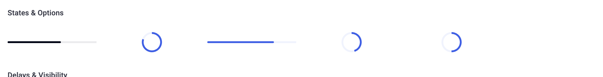

---

### 2.2. Интерактивные состояния и функциональный контракт (`INT`)

| ID | Тест-кейс | Статус | Наблюдаемый результат | Доказательство (Скриншот / Консоль) |
| :--- | :--- | :--- | :--- | :--- |
| `TC-INT-001` | Динамическое управление значением прогресса (`Increment +25`, `Decrement -25`, `Reset 0`) | ✅ OK | При кликах `+25` и `-25` реактивно обновляются `--d1-progress-sys-value` (линейный: `75%` -> `25%` -> `50%`, круговой: `25` -> `75` -> `50`) и `aria-valuenow` (`25` -> `75` -> `50`). | [📸 TC-INT-001](./screenshots/TC-INT-001.png) |
| `TC-INT-002` | Реактивное переключение режимов `Dense: ON/OFF` и `Point: ON/OFF` | ✅ OK | Включение `Dense: ON` добавляет класс `d1-progress--dense` круговому индикатору; включение `Point: ON` добавляет `d1-progress--point` и дочерний `` линейному индикатору. | [📸 TC-INT-002](./screenshots/TC-INT-002.png) |
| `TC-INT-003` | Проверка задержек появления и скрытия (`delay` / `delayHide`) в секции `Delays & Visibility` | ✅ OK | На `30ms` после клика `Show Progress` виден только `Immediate (0ms)`, на `150ms` — `Immediate` и `Fast (100ms)`, на `450ms` — все 3 включая `Standard (360ms)`; при `Hide Progress` все 3 плавно скрываются (`display: none`). | [📸 TC-INT-003](./screenshots/TC-INT-003.png) |

#### Визуальные превью (`INT`)
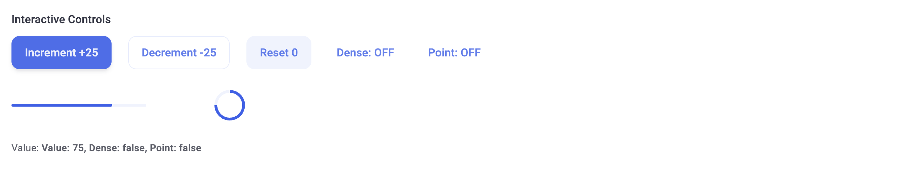

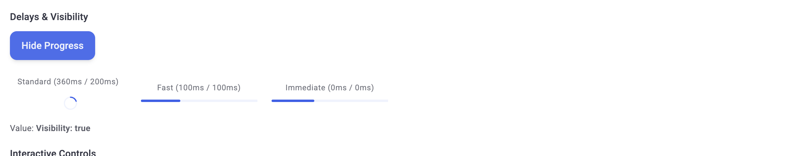

---

### 2.3. Граничные значения и крайние случаи (`BND`)

| ID | Тест-кейс | Статус | Наблюдаемый результат | Доказательство (Скриншот / Консоль) |
| :--- | :--- | :--- | :--- | :--- |
| `TC-BND-001` | Граничные значения `value = 0` и `value = 100` | ✅ OK | Значения корректно удерживаются в границах `[0, 100]`; при `value = 0` метод `isValue()` (`isNumber(this.props.value) && this.value >= 0`) сохраняет детерминированный режим `0%` (`role="progressbar"`, `aria-valuenow="0"`, `--d1-progress-sys-value: 100%`), при `value = 100` линейный прогресс заполнен на 100% (`--d1-progress-sys-value: 0%`), круговой — `100` (`aria-valuenow="100"`). | [📸 TC-BND-001](./screenshots/TC-BND-001.png) |
| `TC-BND-002` | Нестандартный максимум (`value="150"`, `max="200"`) | ✅ OK | Расчёт процента точен (`75%` заполнения -> `--d1-progress-sys-value: 25%`), атрибуты `aria-valuenow="150"` и `aria-valuemax="200"` установлены верно. | `DOM: sysValue="25%", aria-valuenow="150", aria-valuemax="200"` |
| `TC-BND-003` | Стресс-тест быстрого многократного переключения `Show Progress` / `Hide Progress` | ✅ OK | После 6 быстрых кликов с интервалом `40ms` промежуточные таймеры корректно сброшены через `clearTimeout`; все 3 индикатора синхронно вернулись в `display: none` без зависшего класса `d1-progress--hide`. | `DOM: Visibility: false, all 3 items display="none"` |
| `TC-BND-004` | Проверка `clientOnly="false"` и отображения в режиме `dir="rtl"` | ✅ OK | Элемент с `:clientOnly="false"` рендерится сразу без `d1-progress--clientOnly`; при `dir="rtl"` горизонтальный скролл отсутствует (`scrollWidth: 1425 <= innerWidth: 1440`). | [📸 TC-BND-004](./screenshots/TC-BND-004.png) |

#### Визуальные превью (`BND`)

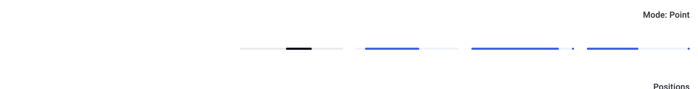

---

### 2.4. Адаптивность и вьюпорты (`RSP`)

| ID | Тест-кейс | Статус | Наблюдаемый результат | Доказательство (Скриншот / Консоль) |
| :--- | :--- | :--- | :--- | :--- |
| `TC-RSP-001` | Адаптивность на широком и стандартном десктопе (`1920×1080` и `1440×900`) | ✅ OK | На `1920×1080` и `1440×900` все 38 видимых индикаторов прогресса отображаются без переполнения (`overflowingCount: 0`, `hasHorizontalScroll: false`). | [📸 TC-RSP-001](./screenshots/TC-RSP-001.png) |
| `TC-RSP-002` | Адаптивность на ноутбуке и планшете (`1024×768` и `768×1024`) | ✅ OK | На `1024×768` и `768×1024` сетка и прогресс-бары корректно масштабируются (`overflowingCount: 0`, `hasHorizontalScroll: false`). | [📸 TC-RSP-002](./screenshots/TC-RSP-002.png) |
| `TC-RSP-003` | Адаптивность на мобильных устройствах (`375×812` и компактный `320×568`) | ✅ OK | На `375×812` и `320×568` горизонтальный скролл отсутствует (`scrollWidth === innerWidth`), все 38 видимых индикаторов адаптируются к узким колонкам без выхода за границы экрана. | [📸 TC-RSP-003](./screenshots/TC-RSP-003.png) |

#### Визуальные превью (`RSP`)
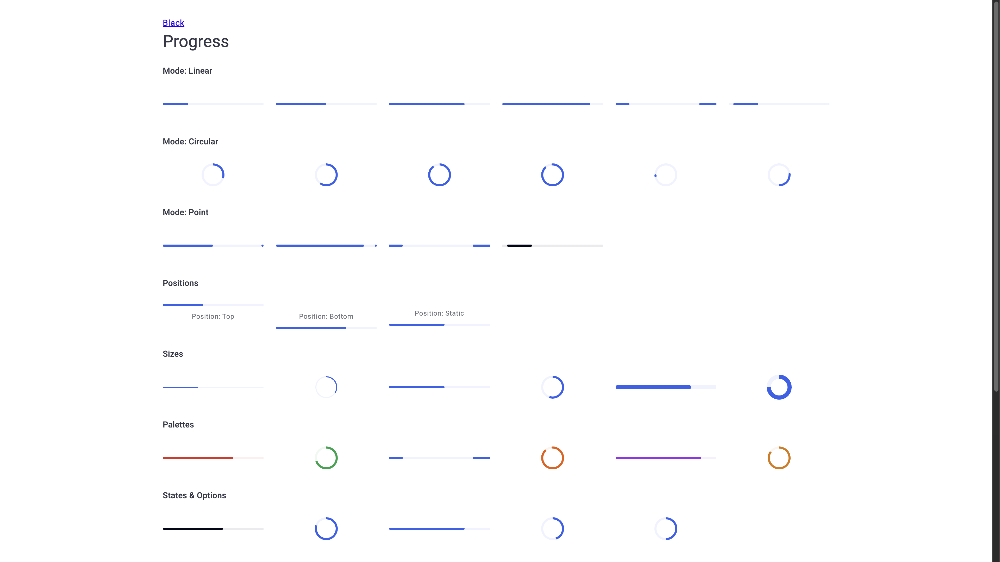
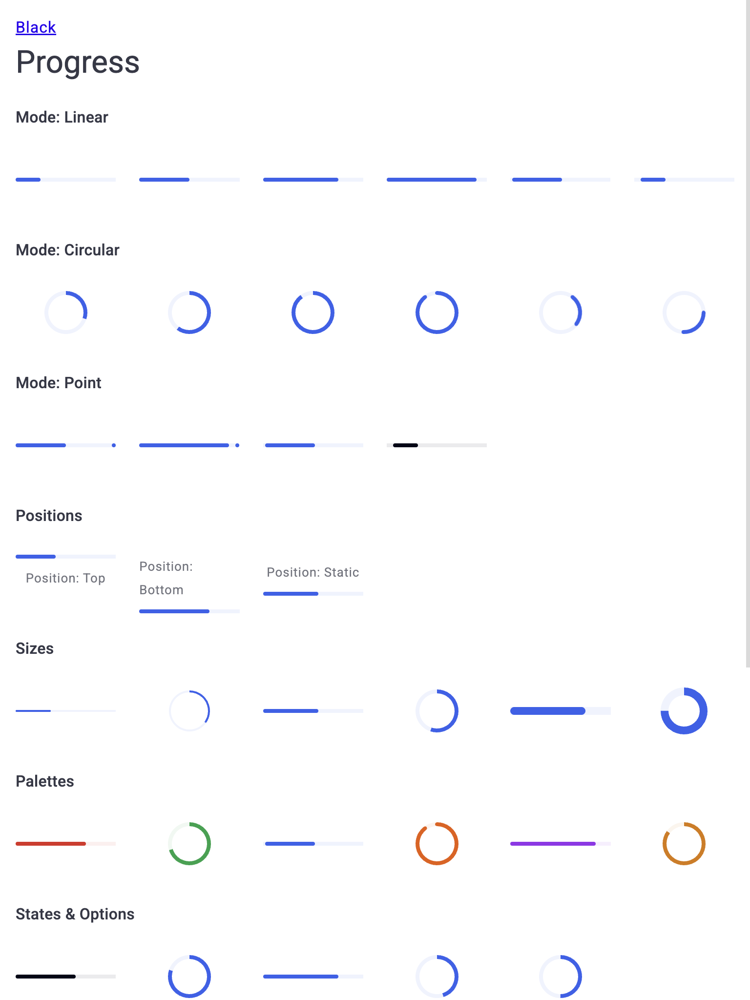
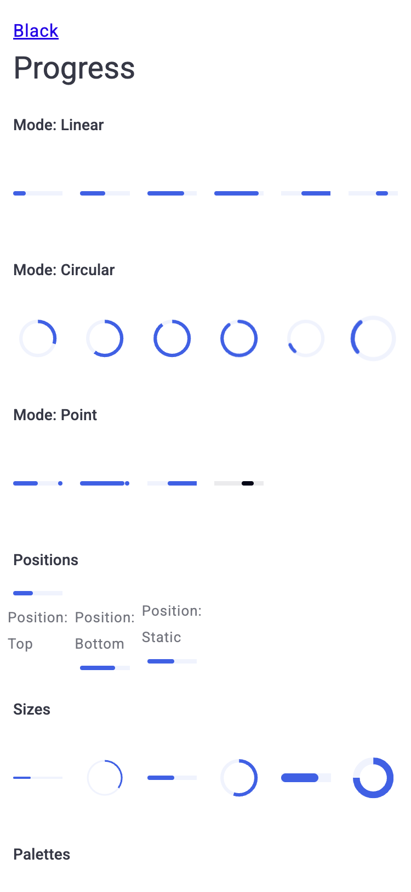

---

### 2.5. Доступность и клавиатурная навигация (`A11Y`)

| ID | Тест-кейс | Статус | Наблюдаемый результат | Доказательство (Скриншот / Консоль) |
| :--- | :--- | :--- | :--- | :--- |
| `TC-A11Y-001` | Семантика WAI-ARIA для детерминированного прогресса (`role="progressbar"`, `aria-valuenow`, `ariaLabel`) | ✅ OK | Все 27 детерминированных индикаторов имеют `role="progressbar"`, `aria-valuemin="0"`, `aria-valuenow` и `aria-valuemax`; кастомная метка `aria-label="Asset downloading"` корректно применена. | `DOM: count=27, allHaveRoleProgressbar=true, customLabel="Asset downloading"` |
| `TC-A11Y-002` | Семантика WAI-ARIA для неопределённого прогресса (`role="status"`, `TextInclude.loading`) и клавиатурный фокус | ✅ OK | Все 11 видимых неопределённых индикаторов имеют `role="status"` и `aria-label="Loading"` без лишних `aria-valuenow`; все 34 SVG-элемента `<circle>` скрыты через `aria-hidden="true"`; фокусное кольцо `:focus-visible` чётко отображается при навигации через `Tab`. | [📸 TC-A11Y-002](./screenshots/TC-A11Y-002.png) |

#### Визуальные превью (`A11Y`)
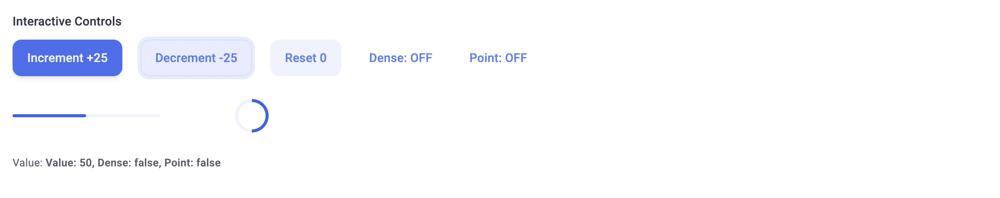

---

### 2.6. Консоль, события и здоровье среды выполнения (`LOG`)

| ID | Тест-кейс | Статус | Наблюдаемый результат | Доказательство (Скриншот / Консоль) |
| :--- | :--- | :--- | :--- | :--- |
| `TC-LOG-001` | Контроль чистоты консоли браузера и отсутствия предупреждений Vue | ✅ OK | За время выполнения всех 20 тест-кейсов зафиксировано `0` ошибок JavaScript/Vue, `0` предупреждений `[Vue warn]` и `0` необработанных исключений. | `Console: 0 runtime errors, 0 Vue warnings, 0 uncaught exceptions` |

---

## 3. 💡 AI-аудит: Рекомендации по производительности, скорости и UX

### 3.1. Что работает неоптимально / Выявленные слабые места

- *Все ранее выявленные замечания в секции 3.1 устранены в коде и демо-стенде.*

### 3.2. Оптимизация производительности и скорости

- *Все рекомендации по производительности (перевод линейных анимаций на GPU-композитный `transform` и условная привязка `onAnimationend` при `this.hide.value === true`) внедрены в коде.*

### 3.3. Улучшения UX, UI и доступности (A11y)

- *Все рекомендации по UX и доступности (фолбэк `aria-label` для детерминированного `role="progressbar"`, ограничение диапазона `[0, 100]` и защита от деления на ноль в `valueInPercent`, а также замедление анимаций при `@media (prefers-reduced-motion: reduce)`) внедрены в коде.*
